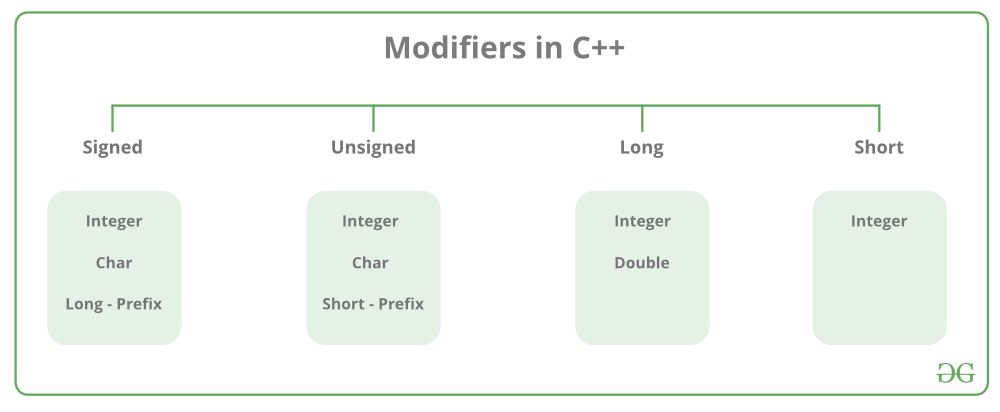
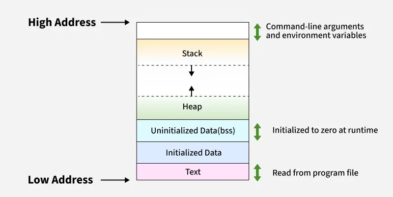

# Intro

Data Type Conversion

```cpp
// Convert char data type into integer
cout << (int)c << endl;
```

Type Modifiers



Basic Input / Output

```cpp
cin >> age;
cout << "GeeksforGeeks";
```


## Functions

Function Definition

```cpp
int add(int a, int b) {
    return a + b;
}
```

Inline Functions

- optimize the performance of the program by reducing the overhead related to a function call.
- When a function is specified as inline the whole code of the inline function is inserted or substituted at the point of its call during the compilation instead of using the normal function call mechanism

```cpp
inline int square(int x) {
        return x * x;
}
```


## Pointers

- variable that stores the address of another variable
- addressof operator (&) determines the address of any variable
- NULL is a macro which is 0 or ((void\*)0) depending on compiler
- nullptr is type safe and only represents null pointer

```cpp
int val = 22;
int* ptr = &val;
```

Dereferencing- process of accessing the value present at the memory address pointed by the pointer

```cpp
// Store the address of var variable
int* ptr = &var;
    
// Access value using (*) operator
cout << *ptr;
```

Wild Pointer- When a pointer is created, it just contains a random address that may or may not be valid

```cpp
// Wild pointer
int *ptr;
```

NULL Pointer- pointer that does not point to any valid memory location but NULL

```cpp
int *ptr = NULL;
```

Void Pointer- point to a value that has no particular type. It also means that they can point to any data type

```cpp
void* ptr_name;
```

- Dangling Pointer- pointer that points to a memory location that has been deallocated earlier in the program
- Smart Pointers- manage dynamically allocated memory automatically and prevent memory leaks

Pointer Arithmetic

- arithmetic is done relative to the data type they point to
- Incrementing/ Decrementing or adding/ subtracting- Moves pointer to next/prev element by that amount


## References

- alias for an existing variable, providing an alternative name for it and allowing you to work with the original data directly
- shares the same memory address as the variable it is referencing
- Cannot be NULL
- Cannot reassign

```cpp
int main() {
    int x = 10;

    // ref is a reference to x.
    int& ref = x;

    // printing value using ref
    cout << ref << endl;
    
    // Changing the value and printing again
    ref = 22;
    cout << ref;

    return 0;
}
```


## Create a Dynamic 2D Array Inside a Class

```cpp
class Matrix {
private:
    int** arr;
    int rows, cols;

public:
    Matrix(int r, int c) : rows(r), cols(c) {
        // Allocate rows
        arr = new int*[rows];
        // Allocate columns for each row
        for (int i = 0; i < rows; i++) {
            arr[i] = new int[cols];
        }
    }
};
```


## Dynamic Memory Allocation

- allocate memory at runtime
- Dynamic resources are stored in the heap memory instead of the stack

### C language

malloc()

- allocate a single block of contiguous memory on the heap at runtime
- The memory allocated is uninitialized, meaning it contains garbage values

```c
int *ptr = (int *)malloc(20);
```

calloc()

- contiguous allocation
- similar to malloc(), but it initializes the allocated memory to zero

```c
int *ptr = (int *)calloc(5, sizeof(int));
```

free()

- release dynamically allocated memory back to the operating system

```c
free(ptr);
```

### C++ language

new()

```cpp
int *ptr = new int;
int *ptr = new int(10);

// Allocate and initialize array of integer with 5 elements
int *ptr = new int[5]{1, 2, 3, 4, 5};
```

delete

- release dynamically allocated memory

```cpp
delete ptr;
delete[] arr;
```

Memory Leaks- program allocates memory dynamic memory but forgets to deallocate it

Memory layout




## File Handling

Read Data

```cpp
int main() {

    // Open a file in read mode
    ifstream file("GFG.txt");
    string s;
    
    // Read string from the file
    file >> s;
    
    cout << "Read String: " << s;

    return 0;
}
```

Write Data to File

```cpp
int main() {

    // Open a file
    ofstream file("GFG.txt");
    
    // Write the string to the file
    file << "Welcome to GeeksforGeeks.";

    return 0;
}
```

Close file

```cpp
int main() {

    // Open a file in read mode
    ifstream file("GFG.txt");
    string s;
    
    // Read string from the file
    getline(file, s);
    
    cout << "Read String: " << s;
    
    // Close the file
    file.close();

    return 0;
}
```

getline()

- used to read a string or a line from an input stream

```cpp
int main() {
    string name;
    
    // Taking input from cin stream(standard
    // input stream) and storing it in name
    getline(cin, name);
    cout << name;
    return 0;
}
```

- iterator- object like a pointer that points to an element inside the container
- Preprocessors- programs that process the source code before the actual compilation begins
- Macro- preprocessor directive used to define constants or snippets of code that get substituted before compilation. They are written using #define
- Namespace- a container for identifiers (variables, functions, classes, etc.) used to avoid name conflicts when using multiple libraries


## Enum

```cpp
#include <iostream>
using namespace std;

// Define enum class with explicit values
enum class StatusCode : int {
    Ok = 200,
    Created = 201,
    BadRequest = 400,
    Unauthorized = 401,
    NotFound = 404
};

void printStatus(StatusCode code) {
    switch (code) {
        case StatusCode::Ok:
            cout << "200 OK" << endl;
            break;
        case StatusCode::Created:
            cout << "201 Created" << endl;
            break;
        case StatusCode::BadRequest:
            cout << "400 Bad Request" << endl;
            break;
        case StatusCode::Unauthorized:
            cout << "401 Unauthorized" << endl;
            break;
        case StatusCode::NotFound:
            cout << "404 Not Found" << endl;
            break;
    }
}

int main() {
    StatusCode status = StatusCode::BadRequest;
    printStatus(status);

    // Convert enum to int
    cout << "Numeric value: " << static_cast<int>(status) << endl;

    return 0;
}
```
