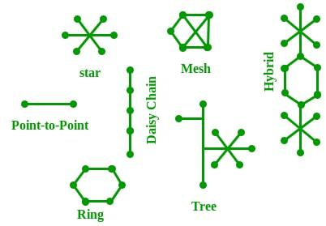
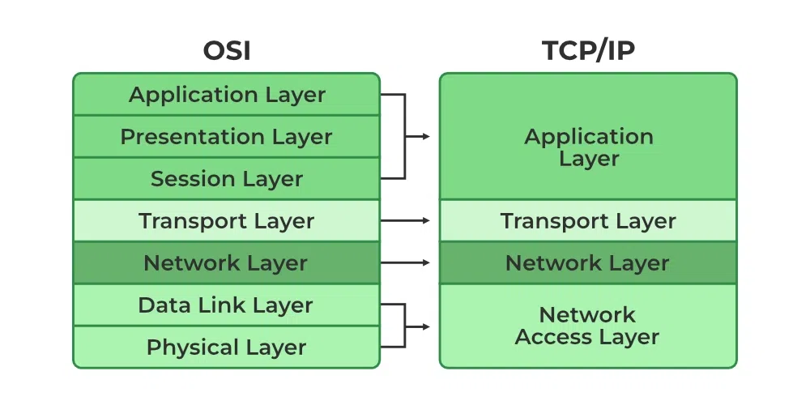
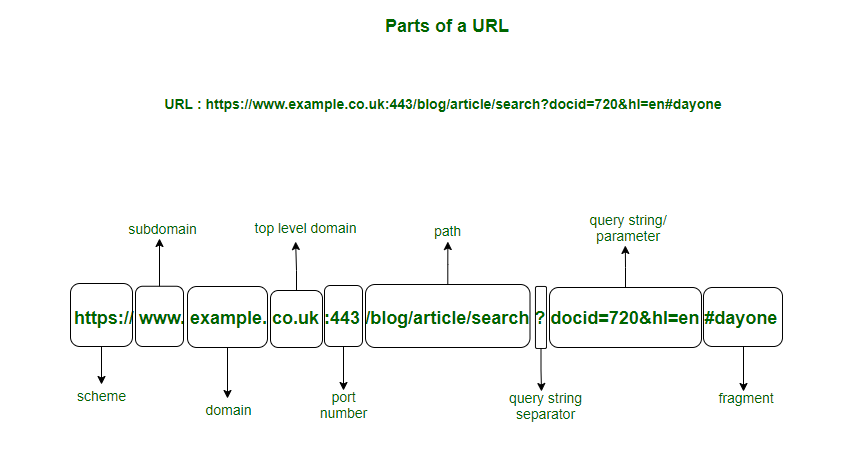

# Intro

A computer network is a collection of interconnected devices that share resources and information

Internet- global network comprised of smaller networks that are interconnected using standardized communication protocols (TCP/IP)

World Wide Web (WWW)- service on the Internet that allows users to access and share information using websites and web pages through browsers

URI (Uniform Resource Identifier)- string of characters used to identify a resource on the internet, such as a web page, file, image, or email address.

URL (Uniform Resource Locator)- address of a resource on the internet. It tells the browser where a resource is located and how to retrieve it

Working of internet

- You type https://www.google.com into a browser
- The browser asks a DNS (Domain Name System) to resolve the domain name (google.com) into an IP address (e.g., 142.250.193.78).
- The DNS server sends back the IP address of the web server that hosts the website.
- The browser uses HTTP or HTTPS (secure) to send a request to the web server via the resolved IP address.
- The server (e.g., Google’s server) receives the request and prepares the response (webpage data: HTML, CSS, JavaScript, images, etc.).
- Web Server Sends the Response Back
- The browser processes the HTML, CSS, and JavaScript. It displays the website to you visually on your screen.

## Network Devices

Modems- convert digital to analog signal and vice-versa

Repeater- extend the range of a network by amplifying and retransmitting signals

Hub- multiport repeater. multi-plug adapter for networks. It takes one network signal and forwards it to all connected devices, without knowing who actually needs it.

Bridge- Connects and filters traffic between two LAN segments

Switch- multiport bridge. Connects multiple devices within a single LAN and manages data traffic intelligently.

Router- routes data packets based on their IP addresses

Gateway- Connects two different systems or networks that use different protocols.

Network topology

## VPN (Virtual Private Network)

- secure tunnel between your device and the internet
- creates a private and encrypted connection over a public network (like the Internet)
- It masks your IP address, encrypts your data, and routes traffic through a remote VPN server
- Internet traffic is routed through the VPN server

## TCP/IP Model

Transmission Control Protocol/Internet Protocol is a four-layer networking framework

# OSI Model (Open Systems Interconnection)

conceptual framework that standardizes how data is transmitted over a network, from one device to another

1\. Physical Layer

- Deals with actual hardware and raw bits
- Responsible for transmitting data over cables/wireless

2\. Data Link Layer

- responsible for node-to-node data transfer — making sure data gets from one device to another over a physical link
- Uses MAC addresses to identify devices on a local network

3\. Network Layer

- Routes data from source to destination
- Deals with IP addressing and routing

4\. Transport Layer

- Ensures reliable data transfer between devices
- Responsible for error checking and data flow control
- how much data is sent, how fast, checks for errors, and retransmits if needed

5\. Session Layer

- Manages sessions (connections) between devices
- Opens, maintains, and closes communication

6\. Presentation Layer

- Translates data between application and network
- Handles data format, encryption, and compression

7\. Application Layer

- Handles user interface and application-level protocols
- Example: Web browsers, email clients

# Data Link Layer

Ethernet- wired networking technology used to connect computers and other devices in a Local Area Network (LAN)

## Internetworking

connecting multiple networks so that they can communicate with each other.

### Types

1\. Internet- Public network accessible by everyone

2\. Intranet- Private network within an organization

3\. Extranet- Restricted network that allows limited access to outsiders (partners, vendors)

## MAC Address

- Media Access Control address
- unique 48-bit hardware numbers of a computer that are embedded into a network card (known as a Network Interface Card) during manufacturing
- Physical Address of a network device

Network Interface Card (NIC)- hardware component that allows a computer or device to connect to a network and communicate with other devices

Wi-Fi (Wireless Fidelity)

- wireless networking technology that allows devices like smartphones, laptops, tablets, and smart TVs to connect to the internet or communicate with each other without cables
- wireless communication standard that uses radio waves to transmit data between a wireless router and nearby devices

HotSpot- device that provides wireless internet access (Wi-Fi) to nearby devices like phones, laptops, or tablets using Wi-Fi technology

Virtual LAN (VLAN)- logical grouping of devices within a network, regardless of their physical location, as if they are on the same local network

# Network Layer

IP Address (Internet Protocol Address)

- unique identifier assigned to each device on a network that uses the Internet Protocol (IP) to communicate.
- Types are IPv4 and IPv6
- Eg: 128.11.3.31

Subnet- smaller part of a larger IP network, created by dividing the network into logical sections

Subnetting- process of dividing a large network (IP range) into smaller, manageable sub-networks (subnets)

Supernetting- process of combining multiple networks (with the same subnet mask) into a single network

Network Address Translation (NAT)

- It allows multiple devices on a local (private) network to access the internet using a single public IP address
- translate private IP addresses to a public IP address, and vice versa

Port number- logical identifier assigned to a network service, enabling multiple services to use the same IP address while maintaining separate communication channels

Address Resolution Protocol (ARP)- map an IP address to a MAC address

# Transport Layer

## TCP (Transmission Control Protocol)

- communication between computers over a network.
- It ensures that data is delivered accurately and in the same order in which it was sent
- Uses checksums to detect errors and requests retransmission if needed
- Have Congestion Control
- TCP establishes a connection between sender and receiver before data transmission using a process called the three-way handshake
- Eg: Web browsing (HTTP, HTTPS), Email (SMTP), File transfers (FTP), remove access (SSH)

3-Way Handshake Process (connection establishment)

1. SYN: Client sends a synchronization packet to the server.
2. SYN-ACK: Server acknowledges and responds with its own synchronization request.
3. ACK: Client acknowledges and connection is established.

Structure

- Source Port
- Destination Port
- Sequence Number
- Acknowledgment Number
- Flags (SYN, ACK)
- Window Size
- Checksum

## User Datagram Protocol (UDP)

- time-sensitive transmissions such as video playback or DNS lookups
- UDP is connectionless and does not guarantee delivery, order, or error checking
- faster
- Eg: Live video or audio streaming, VoIP (Voice over IP), DNS (Domain Name System), Online multiplayer games, DHCP (Dynamic Host Configuration Protocol)

Structure

- Source Port
- Destination Port
- Checksum

Working

- A process sends a UDP packet (datagram) to a destination.
- The packet is delivered as-is, without any handshake or guarantee.
- If the packet is lost, the application is responsible for handling it.

## SSL and TLS

- SSL (Secure Sockets Layer) and TLS (Transport Layer Security) are cryptographic protocols that provide security for data transmission over the internet for HTTPS
- TLS is latest and is used today

Working

- Uses TLS Handshake and asymmetric encryption (for key exchange) and symmetric encryption (for data exchange)
- Your browser connects to a website and asks to start a secure connection
- The website sends its security certificate and public key
- Your browser checks if the certificate is real and trusted
- Your browser creates a secret key for encryption
- The browser encrypts this secret key using the website’s public key and sends it to the server
- The server decrypts the secret key using its private key
- Now both the browser and server have the same secret key
- From this point onward, all data is encrypted using this shared secret key

SSL/TLS Certificate- A digital certificate issued by a trusted Certificate Authority (CA). Proves that the website is authentic and secure

Working

- Client connects to server via https://
- Server sends its TLS certificate (includes public key)
- Client verifies the certificate (using Certificate Authority – CA)
- They exchange a secret key using asymmetric encryption
- All further data is encrypted using symmetric encryption
- This process is called the TLS Handshake

## P2P (Peer To Peer) File Sharing

method of distributing or sharing digital files (like music, videos, documents, software) directly between users, without relying on a central server.

Working

- A file is broken into small chunks.
- Peers who have the file (or parts of it) share it.
- A new user (downloader) connects to the P2P network and downloads chunks from multiple peers simultaneously.
- Once a user has the full file, they become a seeder and can share it with others.

## Congestion Control

mechanism to prevent network congestion — a situation where too many packets are present in the network, leading to degraded performance like packet loss, high delays, and low throughput

### Congestion Control Algorithm

1\. Token Bucket Algorithm

- Tokens are added to a bucket at a fixed rate (e.g., 1 token every millisecond).
- To send a packet, the sender must consume tokens equal to the packet size.
- If there aren’t enough tokens, the packet waits (or is dropped depending on configuration).

2\. Leaky Bucket Algorithm

- A bucket leaks at a fixed rate.
- Incoming packets are poured into the bucket.
- If the bucket overflows (i.e. packets come too fast), excess packets are discarded.

## Server

program or a device that provides functionality for called clients which are other programs or devices.

Types

- Web Server- Hosts websites and delivers web pages (HTML, CSS, JS) via HTTP/HTTPS (e.g., Apache, Nginx)
- Application Server- Runs backend application logic and APIs, typically supports business operations (e.g., Node.js, Tomcat, JBoss)
- Database Server- Stores and manages data, responds to SQL/NoSQL queries (e.g., MySQL, PostgreSQL, MongoDB)
- File Server- Stores and serves files to clients over the network (e.g., Samba, FTP server)
- Mail Server- Manages and transfers emails using SMTP, IMAP, POP3 (e.g., Microsoft Exchange, Postfix)
- Proxy Server-         Acts as an intermediary between clients and other servers to improve security, caching, or content filtering
- DNS Server- Translates domain names (like google.com) to IP addresses (e.g., BIND)
- Authentication Server- Verifies user identity, used in login systems (e.g., LDAP, Active Directory)

# Application Layer

## Protocols

TELNET

- TELetype NETwork
- It allows Telnet clients to access the resources of the Telnet server

FTP

- File Transfer Protocol
- Transfers files between client and server

NFS

- Network File System
- It allows remote hosts to mount file systems over a network and interact with those file systems as though they are mounted locally

SMTP

- Simple Mail Transfer Protocol
- Sends emails from client to server or server to server

IMAP

- Internet Message Access Protocol
- Retrieves emails from the server while keeping them synced across devices.

POP3

- Post Office Protocol v3
- Retrieves and downloads emails from the server (removes from server).

DHCP

- Dynamic Host Configuration Protocol
- gives IP addresses to hosts

HTTP/HTTPS

- Hypertext Transfer Protocol/ Hypertext Transfer Protocol Secure
- used to access data from the World Wide Web
- uses TCP
- base on client-server model
- In HTTPS, data is encrypted using SSL/TLS

IRC

- Internet Relay Chat
- real-time messaging for group communication in channels (chat rooms) and private messaging between users

MIME

- Multipurpose Internet Mail Extensions
- standard that extends the format of email messages to support text in character sets other than ASCII, attachments like images, audio, video, PDFs

SNMP

- Simple Network Management Protocol
- Monitors and manages network devices

SSH

- Secure Shell
- Secure remote login and command execution.

## Domain Name System (DNS)

Working

- When you type www.example.com in your browser
- If not found, it asks the Operating System’s DNS resolver.
- If not found, the resolver queries a series of DNS servers:
  - Root DNS Server → returns Top-Level Domain (TLD) server (like .com)
  - TLD Server → returns Authoritative Name Server for example.com
  - Authoritative Server → returns IP of www.example.com

Types

- Root DNS Servers- These are the highest-level DNS servers and know where to find the TLD servers
- TLD Servers- These servers manage domain extensions like .com, .org, .net, .edu, .gov, and others. They help route queries to the authoritative DNS servers for specific domains.
- Authoritative DNS Servers- These are the servers that store the actual DNS records for domain names. They are responsible for providing the correct IP addresses that allow users to reach websites.

DNS Lookup/ DNS Resolution- is the process of translating a human-readable domain name (like www.example.com) into its corresponding IP address (like 192.0.2.1), which computers use to locate and communicate with each other on the internet

Reverse DNS Lookup- process of mapping an IP address back to its corresponding domain name

DNS Resolver/ DNS Client- functionality for initiating the process of DNS Lookup

DNS Caching- mechanism that stores DNS records locally to avoid querying external DNS servers repeatedly for the same information

Record Types

- A Record- This record maps a domain name to an IPv4 address (e.g., geeksforgeeks.org to 185.199.109.153)
- CNAME Record (Canonical Name)- allows you to alias one domain name to another. For example, www.geeksforgeeks.org can be an alias for geeksforgeeks.org
- MX Record- The Mail Exchange (MX) record defines which mail servers are responsible for receiving emails for a domain
- TXT Record- The Text (TXT) record stores text-based information. It is commonly used to verify domain ownership and to implement email security protocols like SPF (Sender Policy Framework) and DKIM (DomainKeys Identified Mail)

DNS attacks

- DNS Spoofing/ DNS Cache Poisoning- hacker corrupts the DNS cache of a resolver, causing it to return false IP addresses for domain names.
- DoS (Denial of service)- single system sends a flood of traffic or malicious requests to a target system, crashing or slowing it down
- DDoS (Distributed Denial of Service)- multiple compromised systems (bots) launch the attack simultaneously

Components of URL

Bluetooth- wireless communication technology used to exchange data over short distances (\~10 metre) between devices like smartphones, laptops, speakers, headphones, and IoT devices using radio waves

Firewall- network security system that monitors and controls incoming and outgoing network traffic based on predefined security rules
