# Intro

DBMS- software to store, manage, organise and retrieve data in a structured manner

3 Tier Architecture

1. Presentation Tier (User Interface Layer)
2. Application Tier (Business Logic Layer)
3. Data Management Tier (Database Layer)

Architecture

1. 1-Tier Architecture- The user interacts directly with the database. Both the DBMS and the database reside on the same system.
2. 2-Tier Architecture (Client-Server)- The application is split into two layers. The Client sends requests (UI, application logic) and server DBMS processes requests and sends back data.
3. 3-Tier Architecture (Presentation, Logic, Data)- Presentation Layer (Client UI - e.g. React frontend), Application Layer (Business Logic - e.g. NestJS/Express backend), Data Layer (Database - e.g. MySQL, MongoDB)

Level of Abstraction

1. Physical or Internal Level- how the data is actually stored in memory (File structures, indexing, compression, storage blocks, pages)
2. Logical or Conceptual Level- comprises the information that is actually stored in the database in the form of tables. Stores the relationship among the data entities
3. View or External Level- Only a part of the actual database is viewed by the users. Users view data in the form of rows and columns. Users can just view the data and interact with the database, storage and implementation details are hidden from them


## Data Independence

property of DBMS that helps you to change the database schema at one level of a system without requiring to change the schema at the next level.

Types

1. Physical level data independence- modify the physical schema without any alterations to the conceptual or logical schema
2. Logical Level Data Independence- modify the logical schema without affecting the external schema or application program

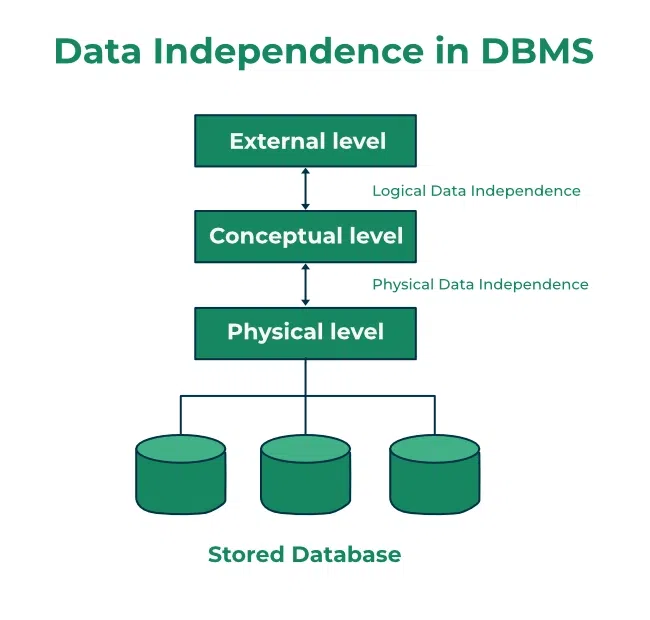


# Entity-Relationship Model (ER Model)

- Entity: An object that is stored as data such as Student, Course or Company.
- Attribute: Properties that describe an entity such as StudentID, CourseName, or EmployeeEmail.
- Relationship: A connection between entities such as "a Student enrolls in a Course".

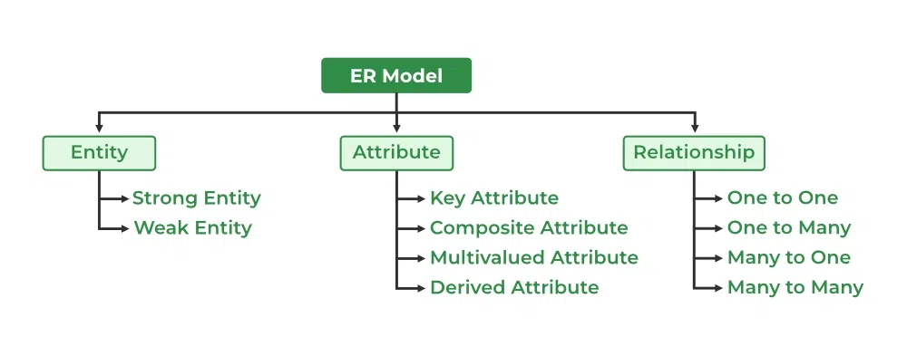

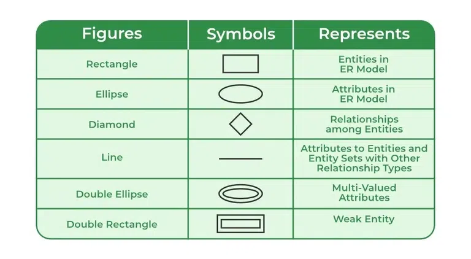


## Entity

1\. Strong Entity

- has a key Attribute that can uniquely identify each instance of the entity.
- A Strong Entity does not depend on any other Entity in the Schema for its identification.
- It has a primary key

2\. Weak Entity

- A Weak Entity cannot be uniquely identified by its own attributes alone.
- It depends on a strong entity to be identified.
- A weak entity is associated with an identifying entity (strong entity), which helps in its identification.


## Attributes

1\. Key Attribute

The attribute which uniquely identifies each entity in the entity set

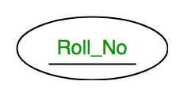

2\. Composite Attribute

An attribute composed of many other attributes

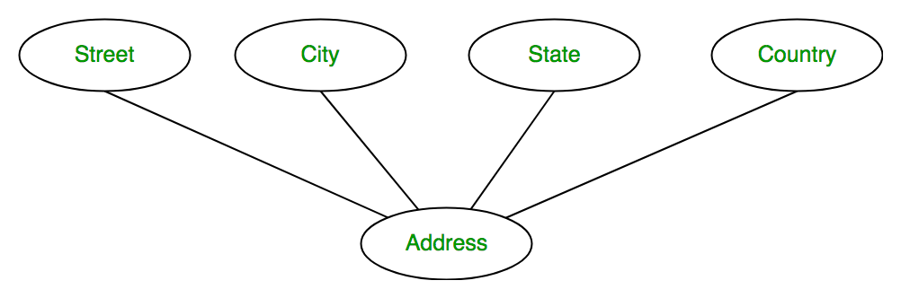

3\. Multivalued Attribute

attribute consisting of more than one value for a given entity.

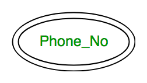

4\. Derived Attribute

An attribute that can be derived from other attributes of the entity type

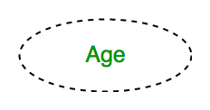


## Cardinality

1\. One-to-One

When each entity in each entity set can take part only once in the relationship

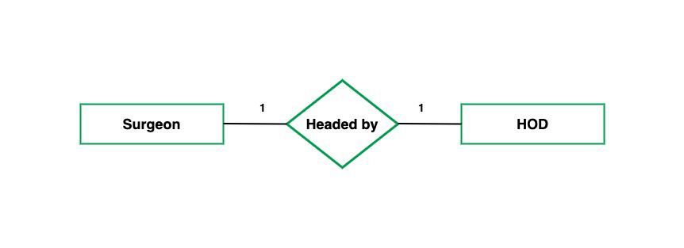

2\. One-to-Many

each entity can be related to more than one entity

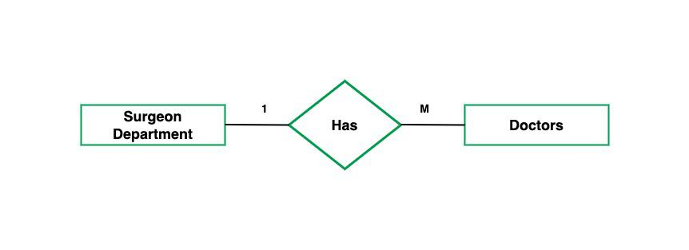

3\. Many-to-One

When entities in one entity set can take part only once in the relationship set and entities in other entity sets can take part more than once in the relationship set

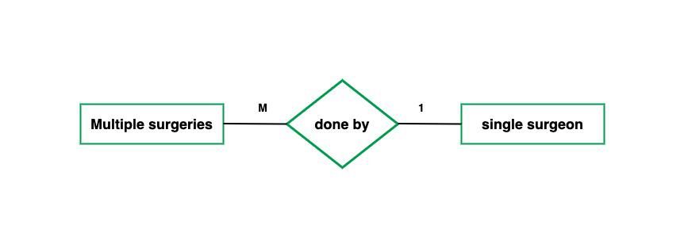

4\. Many-to-Many

When entities in all entity sets can take part more than once in the relationship

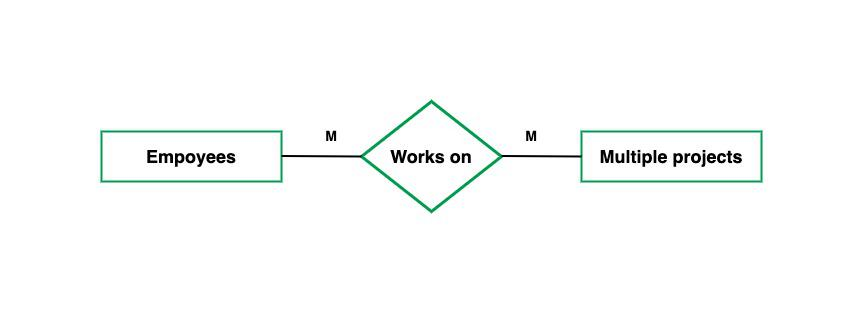

Many to many requires 3 tables, while other relationships requires 2 tables


## Participation Constraint

1\. Total Participation- Each entity in the entity set must participate in the relationship

2\. Partial Participation- The entity in the entity set may or may not participate in the relationship

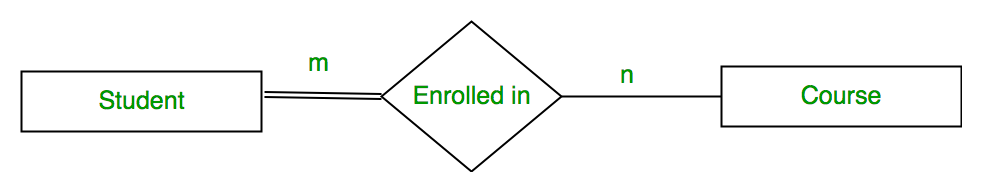


# Relational Model


## Key Terms

Tuple- represents a row in a relation. Eg: (1, RAM, DELHI, 9455123451, 18) is a tuple in the STUDENT table.

Degree- The number of attributes (columns) in the relation

Cardinality- number of tuples in a relation (rows)


## Keys

1\. Super Key- The set of one or more attributes (columns) that can uniquely identify a tuple (record)

2\. Candidate Key- minimal set of attributes that can uniquely identify a tuple. Minimal super key. Unique and cannot be NULL

3\. Primary Key- There can be more than one candidate key in relation out of which one can be chosen as the primary key. Unique and cannot be NULL

4\. Alternate Key- any candidate key in a table that is not chosen as the primary key

5\. Foreign Key- A column that references the primary key or unique key of another table. Can contain duplicates and NULLs

6\. Composite Key- A primary or candidate key made up of two or more columns.

7\. Unique Key- Ensures all values in a column (or group) are unique. Can contain NULL


## Constraints

1\. Domain Constraints- value of each attribute A in a tuple must be an atomic value derived from its specified domain, dom(A)

2\. Key Integrity- Every relation in the database should have at least one set of attributes that defines a tuple uniquely. Should be unique and not NULL

3\. Entity Integrity Constraints- no primary key can take a NULL value

4\. Referential Integrity Constraints- Ensures that foreign key values in one table match primary key values in another table


## Subset

### 1. Proper Subsets (⊂)

A is a proper subset of B if:

- All elements of A are in B
- A ≠ B

```text
{1, 2} ⊂ {1, 2, 3}
```

### 2. Improper Subset

A subset that is equal to the original set.

```text
{1, 2, 3} ⊆ {1, 2, 3}
```


# Normalization

Functional Dependency

- A functional dependency A->B in a relation holds if two tuples having the same value of attribute A must have the same value for attribute B
- If you know the value of column A, you can uniquely determine the value of column B.
- A → B (A determines B or B depends on A)

Normalization- process of organizing the attributes of the database to reduce or eliminate data redundancy (having the same data but at different places)

Anomalies

1. Insertion Anomalies: Insertion anomalies occur when it is not possible to insert data into a database because the required fields are missing or because the data is incomplete. For example, if a database requires that every record has a primary key, but no value is provided for a particular record, it cannot be inserted into the database.
2. Deletion anomalies: Deletion anomalies occur when deleting a record from a database and can result in the unintentional loss of data. For example, if a database contains information about customers and orders, deleting a customer record may also delete all the orders associated with that customer.
3. Updation anomalies: Updation anomalies occur when modifying data in a database and can result in inconsistencies or errors. For example, if a database contains information about employees and their salaries, updating an employee’s salary in one record but not in all related records could lead to incorrect calculations and reporting.


## Normal Forms

### 1. First Normal Form (1NF)

- All columns contain atomic values (i.e., indivisible values).
- Each row is unique (i.e., no duplicate rows).
- Eg: If a table has a column "Phone Numbers" that stores multiple phone numbers in a single cell, it violates 1NF

### 2. Second Normal Form (2NF)

- should be in 1NF
- No partial dependency exists, meaning every non-key attribute must depend on the whole primary key
- Eg: For a composite key (StudentID, CourseID), if the StudentName depends only on StudentID and not on the entire key, it violates 2NF. To normalize, move StudentName into a separate table where it depends only on StudentID.

### 3. Third Normal Form (3NF)

- should be in 2NF
- no transitive dependencies, no non-key column should depend on another non-key column
- Eg: Consider a table with (StudentID, CourseID, Instructor). If Instructor depends on CourseID, and CourseID depends on StudentID, then Instructor indirectly depends on StudentID, which violates 3NF. To resolve this, place Instructor in a separate table linked by CourseID.

### 4. Boyce-Codd Normal Form (BCNF)

- should be in 3NF
- stricter version of 3NF
- If one column can determine another, then that first column should uniquely identify rows.
- Eg: If a table has a dependency (StudentID, CourseID) → Instructor, but neither StudentID nor CourseID is a superkey, then it violates BCNF. To bring it into BCNF, decompose the table so that each determinant is a candidate key.


## Decomposition

1\. Lossless (Non-loss) Decomposition

- You can reconstruct the original table by joining the decomposed tables.
- No data loss after split and join

2\. Lossy (Lossy-Join) Decomposition

- You lose information or get incorrect rows when joining decomposed tables.


## Denormalization

- Denormalization is a database optimization technique in which we add redundant data to one or more tables
- This can help us avoid costly joins in a relational database


# Data Replication

- process of storing data in more than one site or node
- improving the availability of data
- It is simply copying data from a database from one server to another server so that all the users can share the same data without any inconsistency


## Types

1\. Transactional Replication

- users receive full initial copies of the database and then receive updates as data changes
- Data is copied in real-time from the publisher to the receiving database(subscriber) in the same order as they occur with the publisher
- transactional consistency is guaranteed

2\. Snapshot Replication

- distributes data exactly as it appears at a specific moment in time and the does not monitor for updates to the data
- The entire snapshot is generated and sent to Users

3\. Merge Replication

- Data from two or more databases is combined into a single database
- it allows both publisher and subscriber to independently make changes to the database
- It allows changes to be sent from one publisher to multiple subscribers.


## Replication Schemes

1\. Full Replication

- replication of the whole database at every site in the distributed system

2\. No replication

- Each fragment is stored exactly at one site.

3\. Partial replication

- Some fragments are replicated whereas others are not.
- Only a subset of the database is replicated at each site


## Replication types

1\. Master-slave replication

- one database server is designated as the master, and one or more other servers are designated as slaves.
- The master server receives all the write operations, and the slaves receive a copy of the data from the master.

2\. Multi-master replication

- all the servers involved in replication can receive write operations, and all the updates made to any server will be replicated to all the other servers.

3\. Peer-to-peer replication

- Each server can act as both a master and a slave, and the data is replicated between all the servers in a peer-to-peer fashion.

4\. Single-source replication

- a single source database is replicated to multiple target databases.


# Transaction

series of operations that are executed together as a single unit to perform a task

Data is temporary stored in memory (buffer)

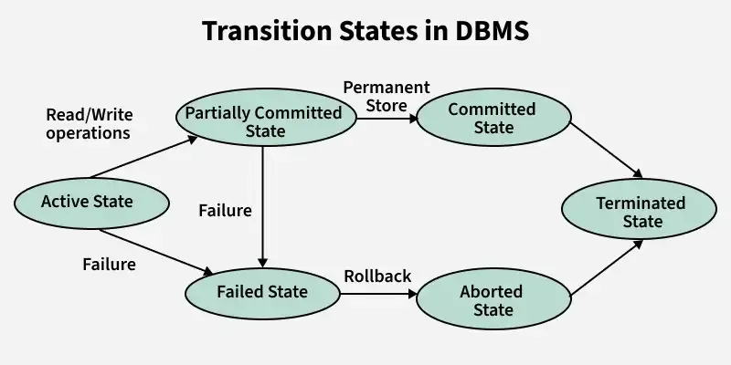


## ACID Properties

1\. Atomicity

- a transaction is atomic, it means that either the entire transaction completes fully or doesn't execute at all
- There is no in-between state i.e. transactions do not occur partially

2\. Consistency

- database remains in a valid state before and after a transaction
- guarantees that any transaction will take the database from one consistent state to another, maintaining the rules and constraints defined for the data
- If a transaction violates any database rules or constraints, it should be rejected, ensuring that only consistent data exists after the transaction

3\. Isolation

- multiple transactions can occur concurrently without leading to the inconsistency of the database state
- Changes occurring in a particular transaction will not be visible to any other transaction until that particular change in that transaction is written to memory or has been committed.

4\. Durability

- once the transaction has completed execution, the updates and modifications to the database are stored in and written to disk and they persist even if a system failure occurs
- These updates now become permanent and are stored in non-volatile memory.
- In the event of a failure, the DBMS can recover the database to the state it was in after the last committed transaction, ensuring that no data is lost


## Concurrency problems

1\. Temporary Update Problem/ Dirty read problem

- One transaction updates an item and fails. But the updated item is used by another transaction before the item is changed or reverted back to its last value.

2\. Incorrect Summary Problem

- where one transaction is applying the aggregate function on some records while another transaction is updating these records.
- The aggregate function may calculate some values before the values have been updated and others after they are updated.

3\. Lost Update Problem

- an update done to a data item by a transaction is lost as it is overwritten by the update done by another transaction

4\. Unrepeatable Read Problem

- occurs when two or more read operations of the same transaction read different values of the same variable

5\. Phantom Read Problem

- occurs when a transaction reads a variable once but when it tries to read that same variable again, an error occurs saying that the variable does not exist (was deleted by another transaction)

Prevention

1. locking
2. timestamp ordering


## Timestamp Ordering Protocol

- ordering transactions based on their timestamps
- Ensuring Serializability


## Locking

Lock manager- mechanism to manage the locking requests made by transactions

Lock table- data structure required for the implementation of locking. It is a hash table

Lock- It is a variable associated with a data item that indicates whether it is in use

### Types

1\. Shared Lock (S)

- If a Transaction has a Read lock on a data item, it can read the item but not update it.
- If a transaction has a Read lock on the data item, other transaction can obtain Read Lock on the data item but no Write Locks.

2\. Exclusive Lock (X)

- If a transaction has a write Lock on a data item, it can both read and update the data item.
- If a transaction has a write Lock on the data item, then other transactions cannot obtain either a Read lock or write lock on the data item.

### Lock-Based Protocols

1\. Simplistic Lock Protocol

- enable all transactions to obtain a lock on the data before inserting, deleting, or updating it.
- It will unlock the data item once the transaction is completed.

2\. Pre-Claiming Lock Protocol

- requires a transaction to request all needed locks in advance, before execution begins.
- If all locks are granted, the transaction proceeds; otherwise, it rolls back and waits.
- This approach prevents deadlocks by ensuring a transaction only runs when it can lock all required data items upfront.

3\. Two-phase locking Protocol (2PL)

- Growing Phase: New locks on data items may be acquired but none can be released.
- Shrinking Phase: Existing locks may be released but no new locks can be acquired.

4\. Strict Two-Phase Locking Protocol

- in addition to the 2-PL all Exclusive(X) locks held by the transaction be released until after the Transaction Commits.

5\. Graph Based Concurrency Control Protocol

- transactions are represented as nodes in a graph, and conflicts between them are shown as edges
- Before granting a lock on a data item, the system checks for cycles in the graph. If a cycle is detected, one of the transactions is rolled back to prevent deadlock and ensure smooth execution.
- It is deadlock free, but no guarantee of recoverability.


## Schedules

process of lining the transactions and executing them one by one.

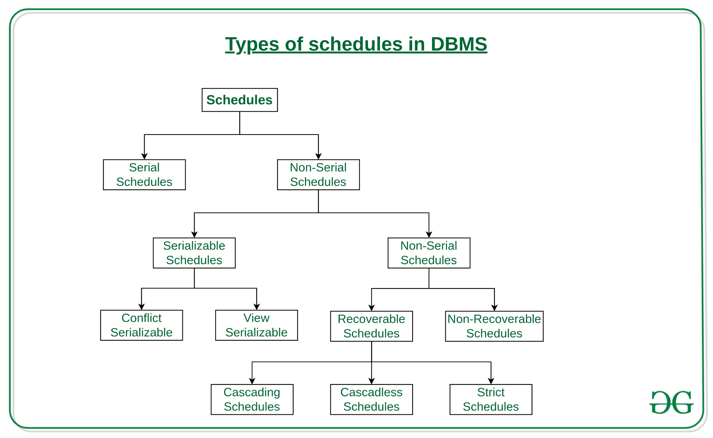

Conflict Serializability guarantees that even though transactions run concurrently, their outcome will be identical to the result achieved if the transactions were executed one by one in a specific order.

Recoverability- database can return to a consistent and reliable state after a failure or error

Starvation- happens when some processes are unable to get the resources they need because other processes keep getting priority. Happens in locking or scheduling


## Indexing

- improves query performance by minimizing disk I/O operations, thus reducing the time it takes to locate and access data
- When an index is created for a database table, it maintains a sorted order of key values along with pointers to the actual data rows.

Types

- Single-Column Index
- Composite (Multi-Column) Index


## B-Tree

- A B-Tree is a specialized m-way tree designed to optimize data access, especially on disk-based storage systems.
- In a B-Tree of order m, each node can have up to m children and m-1 keys, allowing it to efficiently manage large datasets.
- All leaf nodes of a B tree are at the same level, i.e. they have the same depth (height of the tree).
- The keys of each node of a B tree (in case of multiple keys), should be stored in the ascending order.

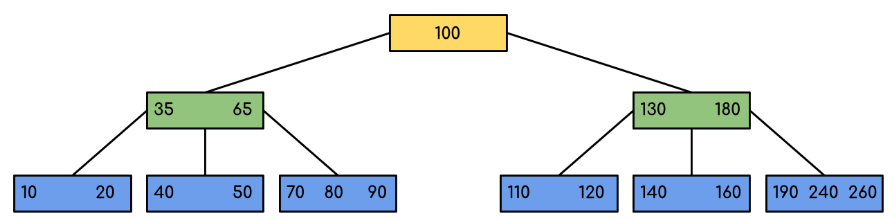


## B+ Tree

- data pointers are stored only at the leaf nodes of the tree
- self-balancing
- used by modern relational database

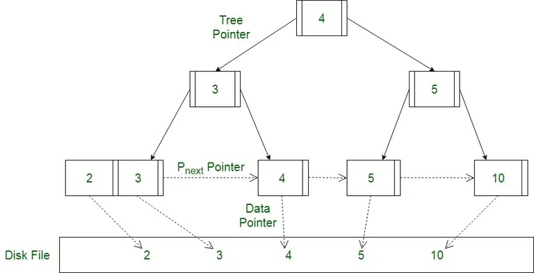


# Structured Query Language (SQL)

Data Types

- Numeric
  - BIGINT
  - INT
  - SMALLINT
  - TINYINT
  - DECIMAL(p, s)
  - NUMERIC(p, s)
  - DOUBLE
  - FLOAT
  - REAL
- String
  - CHAR(n)
  - VARCHAR(n)
  - TEXT
- Date & Time
  - DATE
  - TIME
  - DATETIME
  - TIMESTAMP
- Boolean
  - BOOLEAN
- Binary
  - BINARY(n)
  - VARBINARY(n)
  - BLOB
- Other
  - UUID
  - JSON
  - XML
  - GEOMETRY

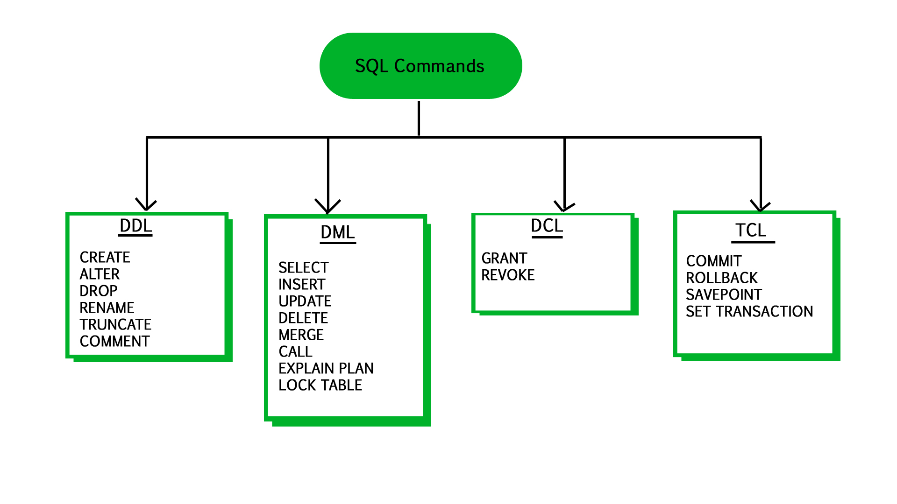


## Transaction

The BEGIN TRANSACTION command marks the beginning of a new transaction.

The COMMIT command is used to save all changes made during the current transaction to the database.

```sql
BEGIN TRANSACTION;

-- Deduct $150 from Account A
UPDATE Accounts
SET Balance = Balance - 150
WHERE AccountID = 'A';

-- Add $150 to Account B
UPDATE Accounts
SET Balance = Balance + 150
WHERE AccountID = 'B';

-- Commit the transaction if both operations succeed
COMMIT;
```

The ROLLBACK command is used to undo all changes made in the current transaction

```sql
DELETE FROM Student WHERE AGE = 20;
ROLLBACK;
```

A SAVEPOINT is used to create a checkpoint within a transaction. We can roll back to a specific SAVEPOINT instead of rolling back the entire transaction

```sql
SAVEPOINT SP1;
-- Savepoint created.
DELETE FROM Student WHERE AGE = 20;
-- deleted
SAVEPOINT SP2;
-- Savepoint created.
```

The ROLLBACK TO SAVEPOINT command allows us to roll back the transaction to a specific savepoint

```sql
ROLLBACK TO SP1;
-- Rollback completed
```


## Views

- A view in SQL is a saved SQL query that acts as a virtual table.
- Unlike regular tables, views do not store data themselves. Instead, they dynamically generate data by executing the SQL query defined in the view each time it is accessed

Create view

```sql
CREATE VIEW StudentNames AS
SELECT S_ID, NAME
FROM StudentDetails
ORDER BY NAME;
```

List all views

```sql
SHOW FULL TABLES WHERE table_type LIKE "%VIEW";
```

Deleting a view

```sql
DROP VIEW MarksView;
```

Updating a View

```sql
UPDATE view_name
SET column1 = value1, column2 = value2...., columnN = valueN
WHERE [condition];
```

```sql
CREATE OR REPLACE VIEW view_name AS
SELECT column1, column2, ...
FROM table_name
WHERE condition;
```


## Constraints

NOT NULL- ensures that a column cannot contain NULL values

UNIQUE- ensures that all values in a column are distinct across all rows in a table

PRIMARY KEY- It uniquely identifies each row in a table (unique and not null)

FOREIGN KEY- links a column in one table to the primary/ unique key in another table

CHECK- allows us to specify a condition that data must satisfy before it is inserted into the table

DEFAULT- provides a default value for a column when no value is specified during insertion

```sql
CREATE TABLE employees (
    id INT PRIMARY KEY AUTO_INCREMENT,                         -- PRIMARY KEY
    name VARCHAR(100) NOT NULL,                                -- NOT NULL
    email VARCHAR(100) UNIQUE,                                 -- UNIQUE
    salary DECIMAL(10,2) CHECK (salary >= 10000),              -- CHECK constraint
    department_id INT,                                         -- FOREIGN KEY
    is_active BOOLEAN DEFAULT TRUE,                            -- DEFAULT
    FOREIGN KEY (department_id) REFERENCES departments(id)     -- FOREIGN KEY constraint
);
```


## Roles

Creating a Role

```sql
CREATE ROLE manager;
```

Grant Privileges To a Role

```sql
GRANT create table, create view
TO manager;
```

Revoke Privilege from a Role

```sql
REVOKE create table FROM manager;
```

Drop a Role

```sql
DROP ROLE manager;
```


## Indexes

Creating an Index

```sql
CREATE INDEX idx_product_id
ON Sales (product_id);
```

Multi - Column Indexes

```sql
CREATE INDEX idx_product_quantity
ON Sales (product_id, quantity);
```

Unique Indexes

```sql
CREATE UNIQUE INDEX idx_unique_employee_id
ON Employees (employee_id);
```

Removing an Index

```sql
DROP INDEX index;
```


## Arithmetic Operators

```text
+           [Addition]
-           [Subtraction]
/           [Division]
*           [Multiplication]
%           [Modulus]
```


## CREATE TABLE

```sql
CREATE TABLE Customer(
    CustomerID INT PRIMARY KEY,
    CustomerName VARCHAR(50),
    LastName VARCHAR(50),
    Country VARCHAR(50),
    Age INT CHECK (Age >= 0 AND Age <= 99),
    Phone int(10)
);
```

```sql
CREATE TABLE SubTable AS
SELECT CustomerID, CustomerName
FROM customer;
```


## INSERT INTO Statement

```sql
INSERT INTO Student (ROLL_NO, NAME, ADDRESS, PHONE, AGE) VALUES
(1, 'Ram', 'Delhi', 'XXXXXXXXXX', 18),
(2, 'Ramesh', 'Gurgaon', 'XXXXXXXXXX', 18),
(3, 'Sujit', 'Rohtak', 'XXXXXXXXXX', 20),
(4, 'Suresh', 'Rohtak', 'XXXXXXXXXX', 18);
```

```sql
INSERT INTO Student 
VALUES ('5','HARSH','WEST BENGAL', 'XXXXXXXXXX','19');
```

```sql
INSERT INTO Students (Name, Age)
SELECT Name, Age
FROM OldStudents;
```


## UPDATE Statement

```sql
UPDATE Customer 
SET CustomerName = 'Satyam', Country = 'USA' 
WHERE CustomerID = 1;
```


## DELETE Statement

```sql
DELETE 
FROM GFG_Employees 
WHERE department = 'Development';
```


## DROP and TRUNCATE

DROP command is used to permanently remove an object from a database, such as a table, database, index, or view

```sql
DROP TABLE table_name;
DROP DATABASE database_name;
```

TRUNCATE command removes all rows from a table but preserves the structure of the table

```sql
TRUNCATE TABLE  table_name;
```


## AND and OR Operators

```sql
SELECT * FROM table_name WHERE condition1 AND condition2 AND ...conditionN;
```

```sql
SELECT * FROM table_name WHERE condition1 OR condition2 OR... conditionN;
```


## WHERE Clause

allows to filtering of records in queries


## WITH Clause

Common Table Expressions (CTEs)

WITH clause is used to define temporary tables or result sets within a query. These temporary relations, act like virtual tables that exist only during the execution of the query

```sql
WITH temporaryTable (averageValue) AS (
    SELECT AVG(Salary)
    FROM Employee
)

SELECT EmployeeID,Name, Salary 
FROM Employee, temporaryTable 
WHERE Employee.Salary > temporaryTable.averageValue;
```


## SELECT Query

```sql
SELECT column1,column2.... FROM table_name ;
```


## Join

Cross join- returns the Cartesian product of two tables, meaning each row from the first table is combined with every row from the second table

```sql
SELECT Student.NAME, Student.AGE, StudentCourse.COURSE_ID
FROM Student
CROSS JOIN StudentCourse;
```

Self join- Where a table is joined with itself

```sql
SELECT a.ROLL_NO , b.NAME
FROM Student a, Student b
WHERE a.ROLL_NO < b.ROLL_NO;
```

Inner join- The result contains only the rows that have matching values in both tables based on a specific condition

```sql
SELECT StudentCourse.COURSE_ID, Student.NAME, Student.AGE FROM Student
INNER JOIN StudentCourse
ON Student.ROLL_NO = StudentCourse.ROLL_NO;
```

Left join- returns all rows from the left table, along with matching rows from the right table

```sql
SELECT Student.NAME,StudentCourse.COURSE_ID 
FROM Student
LEFT JOIN StudentCourse 
ON StudentCourse.ROLL_NO = Student.ROLL_NO;
```

Right join- returns all rows from the right table, along with matching rows from the left table

```sql
SELECT Student.NAME,StudentCourse.COURSE_ID 
FROM Student
RIGHT JOIN StudentCourse 
ON StudentCourse.ROLL_NO = Student.ROLL_NO;
```

Full join- combines the results of both LEFT JOIN and RIGHT JOIN

```sql
SELECT Student.NAME,StudentCourse.COURSE_ID 
FROM Student
FULL JOIN StudentCourse 
ON StudentCourse.ROLL_NO = Student.ROLL_NO;
```


## Wildcard Characters

%: Represents zero or more characters.

\_: Represents exactly one character.


## LIKE Operator

```sql
SELECT * FROM products WHERE name LIKE BINARY 'apple%'
```


## ALTER Command

Renaming a Table

```sql
ALTER TABLE table_name
RENAME TO new_table_name;
```

Renaming a Column

```sql
ALTER TABLE table_name
RENAME COLUMN old_column_name TO new_column_name;
```

Adding a New Column

```sql
ALTER TABLE table_name
ADD column_name datatype;
```

Modifying a Column Data Type

```sql
ALTER TABLE table_name
MODIFY COLUMN column_name new_datatype;
```


## GROUP BY

used to arrange identical data into groups based on specified columns

```sql
SELECT SUBJECT, YEAR, Count(*)
FROM Student
GROUP BY SUBJECT, YEAR;
```

HAVING clause is used to filter groups created by GROUP BY

```sql
SELECT column1, function_name(column2)
FROM table_name
WHERE condition
GROUP BY column1, column2
HAVING condition
ORDER BY column1, column2;
```

```sql
SELECT customer, SUM(amount) AS total_paid
FROM orders
WHERE status = 'paid'                   -- filters only paid orders (row level)
GROUP BY customer
HAVING SUM(amount) > 2000;              -- filters groups based on aggregated sum
```


## ORDER BY

sort query results in either ascending or descending order based on one or more columns

```sql
SELECT * FROM students ORDER BY age DESC , name ASC;
```


## LIMIT Clause

control the number of rows returned in a query result

```sql
SELECT * FROM student 
LIMIT 3;
```


## OFFSET Clause

skips the specified number of rows before returning the remaining rows

Skip 3 rows, and get next 2 rows

```sql
SELECT * FROM students
LIMIT 2 OFFSET 3;
```

```sql
SELECT * FROM students
LIMIT 3, 2;  -- LIMIT offset, count
```


## Union Clause

combine the results of two or more SELECT statements into a single result set

```sql
SELECT column_name(s) FROM table1  
UNION -- no duplicates
SELECT column_name(s) FROM table2;
```

```sql
SELECT column_name(s) FROM table1 
UNION ALL -- has duplicates
SELECT column_name(s) FROM table2;
```


## Intersect & Except clause

provide the result of the intersection of two select statements

```sql
SELECT column-1, column-2 ...... 
FROM table 1
WHERE.....

INTERSECT

SELECT column-1, column-2 ...... 
FROM table 2
WHERE.....
```

EXCEPT clause contains all the rows that are returned by the first SELECT operation, and not returned by the second SELECT operation

```sql
SELECT column-1, column-2 ...... 
FROM table 1
WHERE.....

EXCEPT

SELECT column-1, column-2 ...... 
FROM table 2
WHERE.....
```


## MINUS Operator

return only those rows which are unique in only first SELECT query and not those rows which are common to both first and second SELECT queries

```sql
SELECT column1 , column2 , ... columnN
FROM table_name
WHERE condition
MINUS
SELECT column1 , column2 , ... columnN
FROM table_name
WHERE condition;
```


## Distinct Clause

- retrieve unique values
- If a distinct keyword is used with multiple columns, the distinct combination is displayed in the result set
- DISTINCT keyword treats NULL as a unique value

```sql
SELECT DISTINCT column1, column2 
FROM table_name
```


## NOT Operator

negate or reverse the result of a condition

```sql
SELECT column1, column2, ... 
FROM table_name WHERE NOT condition;
```


## BETWEEN & IN Operator

BETWEEN operator is used to test whether a value falls within a given range of values (inclusive)

```sql
SELECT column_name(s)
FROM table_name
WHERE column_name BETWEEN value1 AND value2;
```

IN operator- filter data by matching values against a specific list,

```sql
SELECT column_name(s)
FROM table_name
WHERE column_name IN (list_of_values);
```


## EXISTS

whether a correlated subquery returns any results

```sql
SELECT column_name(s)
FROM table_name
WHERE EXISTS (
    SELECT column_name(s)
    FROM subquery_table
    WHERE condition
);
```


## CASE Statement

to perform conditional logic

```sql
CASE case_value
WHEN condition THEN result1
WHEN condition THEN result2
...
Else result
END CASE;
```

```sql
SELECT CustomerName, Age,
CASE
    WHEN Age> 22 THEN 'The Age is greater than 22'
    WHEN Age = 21 THEN 'The Age is 21'
    ELSE 'The Age is over 30'
END AS QuantityText
FROM Customer;
```


## Aggregate functions

- perform calculations on a set of rows and return a single value
- often used with the GROUP BY

### Count()

- COUNT(\*): Counts all rows.
- COUNT(column_name): Counts non-NULL values in the specified column.
- COUNT(DISTINCT column_name): Counts unique non-NULL values in the column.

```sql
-- Total number of records in the table
SELECT COUNT(*) AS TotalRecords FROM Employee;

-- Count of non-NULL salaries
SELECT COUNT(Salary) AS NonNullSalaries FROM Employee;

-- Count of unique non-NULL salaries
SELECT COUNT(DISTINCT Salary) AS UniqueSalaries FROM Employee;
```

### SUM()

SUM(column_name): Returns the total sum of all non-NULL values in a column.

```sql
-- Calculate the total salary
SELECT SUM(Salary) AS TotalSalary FROM Employee;

-- Calculate the sum of unique salaries
SELECT SUM(DISTINCT Salary) AS DistinctSalarySum FROM Employee;
```

### AVG()

AVG(column_name): Returns the average of the non-NULL values in the column.

```sql
-- Calculate the average salary
SELECT AVG(Salary) AS AverageSalary FROM Employee;

-- Average of distinct salaries
SELECT AVG(DISTINCT Salary) AS DistinctAvgSalary FROM Employee;
```

### MIN() and MAX()

MIN(column_name): Returns the minimum value.

MAX(column_name): Returns the maximum value.

```sql
-- Find the highest salary
SELECT MAX(Salary) AS HighestSalary FROM Employee;

-- Find the lowest salary
SELECT MIN(Salary) AS LowestSalary FROM Employee;
```

```sql
SELECT
  customer,
  COUNT(*) AS total_orders,
  SUM(amount) AS total_amount,
  AVG(amount) AS avg_amount,
  MAX(amount) AS max_amount,
  MIN(amount) AS min_amount
FROM orders
WHERE status = 'paid'
GROUP BY customer
HAVING SUM(amount) > 1500
ORDER BY total_amount DESC;
```


## Scalar functions

operate on a single value and return a single value

| Name | Description | Syntax |
| --- | --- | --- |
| UCASE() | Converts a string to uppercase | `SELECT UCASE(column_name) `<br>`FROM table_name;` |
| LCASE() | Converts a string to lowercase | `SELECT LCASE(column_name) `<br>`FROM table_name;` |
| MID() | Extracts a substring from a string | `SELECT MID(column_name, start, length) `<br>`FROM table_name;` |
| LEN() | Returns the length of a string | `SELECT LEN(column_name) `<br>`FROM table_name;` |
| ROUND() | Rounds a number to a specified number of decimals | `SELECT ROUND(column_name, decimals) `<br>`FROM table_name;` |
| NOW() | Returns the current date and time | `SELECT NOW();` |
| FORMAT() | Formats a value with the specified format | `SELECT FORMAT(column_name, format) `<br>`FROM table_name;` |


## Date and Time Functions

Get Current Date and Time

```sql
SELECT NOW();
```

Get Current Date Only

```sql
SELECT CURDATE();
```

Get Current Time Only

```sql
SELECT CURTIME();
```

Extract the Date Part from a DATETIME Value

```sql
SELECT Name, DATE(BirthTime) 
AS BirthDate FROM Test;
```

Extract Specific Date Parts (MICROSECOND, SECOND, MINUTE, HOUR, DAY, WEEK, MONTH, QUARTER, YEAR)

```sql
SELECT Name, Extract(DAY FROM BirthTime) AS BirthDay FROM Test;
```

Add Intervals to a Date

```sql
DATE_ADD(date, INTERVAL expr type);
```

```sql
SELECT Name, DATE_ADD(BirthTime, INTERVAL 1 YEAR) AS BirthTimeModified FROM Test;
```

Find the Difference Between Two Dates

```sql
DATEDIFF(interval, date1, date2);

interval - minute/hour/month/year,etc
date1 & date2- date/time expression
```

```sql
SELECT DATEDIFF(day, '2017-01-13', '2017-01-03') AS DateDiff;
```

Format Date and Time

```sql
DATE_FORMAT(date, format);
```


## String functions

Concatenate Strings

```sql
SELECT CONCAT('John', ' ', 'Doe') AS FullName;
```

String Length

```sql
SELECT CHAR_LENGTH('Hello') AS StringLength;
```

Convert Text Case

```sql
SELECT UPPER('hello') AS UpperCase;
SELECT LOWER('HELLO') AS LowerCase;
```

Length of String in Bytes

```sql
SELECT LENGTH('Hello') AS LengthInBytes;
```

Replace Substring in String

```sql
SELECT REPLACE('Hello World', 'World', 'SQL') AS UpdatedString;
```

Extract Part of a String

```sql
SELECT SUBSTRING('Hello World', 1, 5) AS SubStringExample;
```


## Numeric Functions

Absolute Value

```sql
SELECT ABS(-25);
```

Round Number Up

```sql
SELECT CEIL(12.34);
```

Round Number Down

```sql
SELECT FLOOR(12.98);
```

Round a Number to a Specified Decimal Place

```sql
SELECT ROUND(15.6789, 2);
```

Remove Decimal Places

```sql
SELECT TRUNCATE(12.98765, 2);
```


## Conversion Function

TO_CHAR: Convert DATE or NUMBER to STRING

```sql
-- Convert date to string
SELECT TO_CHAR(SYSDATE, 'YYYY-MM-DD') FROM dual;

-- Convert number to formatted string
SELECT TO_CHAR(12345.678, '99999.99') FROM dual;
```

TO_NUMBER: Convert STRING → NUMBER

```sql
SELECT TO_NUMBER('12345.67', '99999.99') FROM dual;
```

TO_DATE: Convert STRING → DATE

```sql
SELECT TO_DATE('2025-06-16', 'YYYY-MM-DD') FROM dual;
```


## Subquery

```sql
SELECT column_name
FROM table_name
WHERE column_name expression operator 
    (SELECT column_name FROM table_name WHERE ...);
```

Correlated subquery- subquery that references columns from the outer query. It is re-executed for each row processed by the outer query


## COALESCE()

list of expressions in a specified order and returns the first non-null value encountered

```sql
SELECT COALESCE (NULL, 'X', 'Y') 
AS RESULT ;
```


## LEAST() and GREATEST()

Least- returns the smallest (minimum) value from a list of expressions

```sql
SELECT LEAST(10, 20, 30, 40) AS Least_Value;
```

Greatest- returns the largest (maximum) value from a list of expressions.

```sql
SELECT GREATEST(10, 20, 30, 40, 50) AS Greatest_Value;
```


## Window functions

### RANK()

- assign a position or rank to each row in a result set based on specific criteria.
- If two or more rows share the same values according to the specified criteria, they will receive the same rank.
- In this scenario, the rank of the next row is incremented by the number of tied rows.

```sql
RANK() OVER (PARTITION BY column1, column2, ... ORDER BY sort_column1, sort_column2, ...)
```

```sql
SELECT *,
  RANK() OVER (PARTITION BY month ORDER BY amount DESC) AS rank
FROM sales;
FROM Students;
```

### DENSE_RANK()

- no gaps between ranks in cases where multiple rows share the same values

```sql
DENSE_RANK() OVER (PARTITION BY column1, column2, ... ORDER BY sort_column1, sort_column2, ...)
```

### ROW_NUMBER()

Assigns a unique number to each row within the partition (no ties).

```sql
SELECT *,
  ROW_NUMBER() OVER (PARTITION BY employee ORDER BY month) AS row_num
FROM sales;
```

### LEAD() and LAG()

Lag- Returns the previous row's value in the partition.

Lead-         Returns the next row's value in the partition.

```sql
SELECT *,
  LAG(amount) OVER (PARTITION BY employee ORDER BY month) AS previous_amount,
  LEAD(amount) OVER (PARTITION BY employee ORDER BY month) AS next_amount
FROM sales;
```


## Trigger

set of SQL statements that automatically execute in response to certain events on a table, such as INSERT, UPDATE, or DELETE


## Stored procedure

precompiled set of SQL statements stored in the database. It can take input parameters, perform logic and queries, and return output values or result sets


## SQL injection

- attacker inserts malicious SQL code into your database query
- happens when user input is inserted directly into queries
- use parameterized queries and validate inputs
