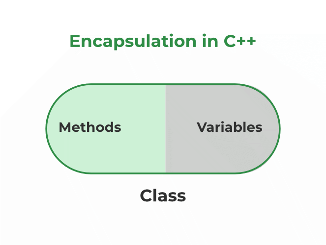
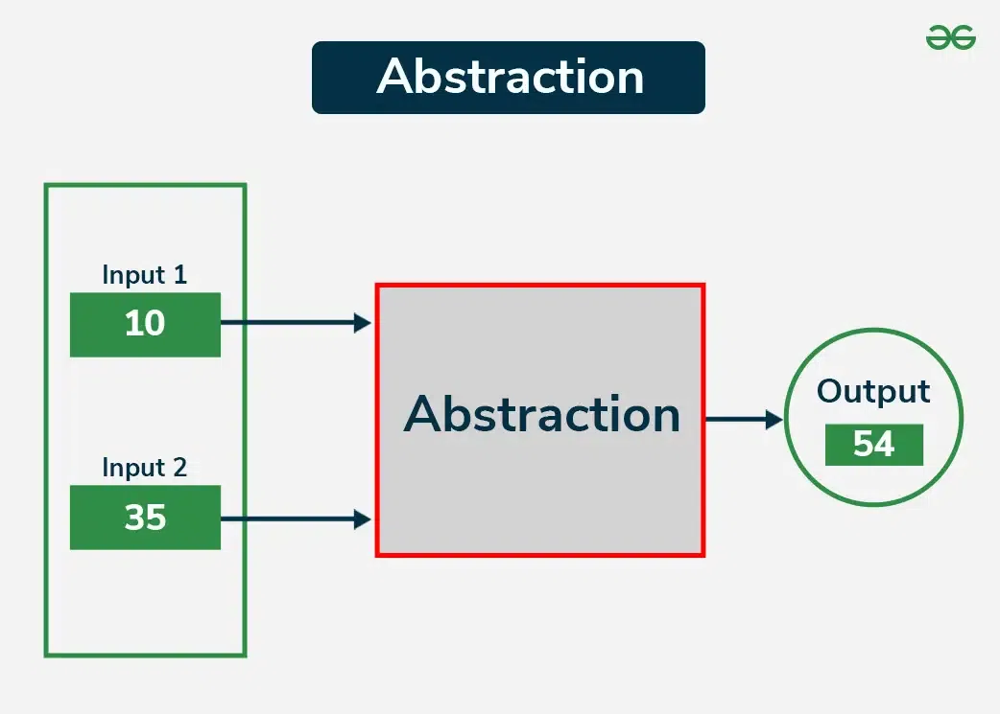
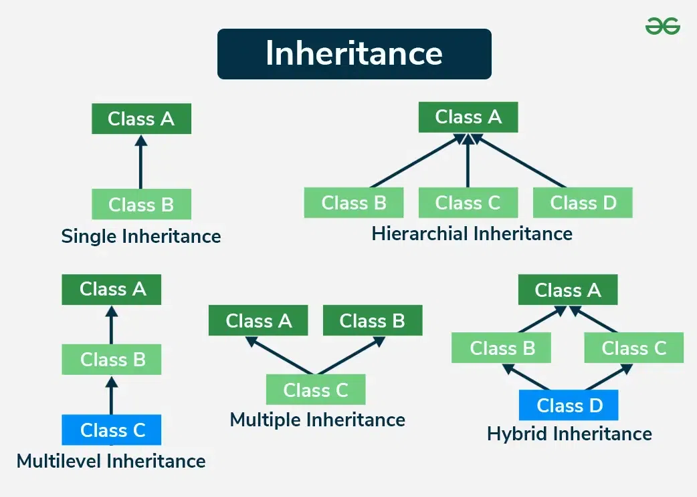
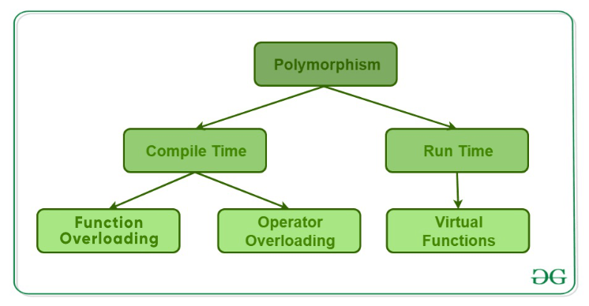

# Intro


## Class

user-defined data type

which holds its own data members and member functions that can be accessed and used by creating an instance of that class

Classes do not use memory. They merely serve as a template from which items are made

```cpp
class className {
access_specifier:

    // data member

    // member method
};
```

Size of a class:

- sum of sizes of non-static data members, plus any padding
- Static members and member functions do not affect object size


## Objects

instance of a class

Memory is allocated when an object is created.

```cpp
className objectName;
```

```cpp
Car my_car;
```

Member access

```cpp
obj.member1 // For data members
obj.member2(..) // For functions
```


## Access Modifiers

Default is private

- Public: Members of the class can be accessed from outside the class.
- Private: Private members can only be accessed within the class itself.
- Protected: Protected members can be accessed within the class and by derived classes.


## Constructor

called by the compiler every time an object of that class is instantiated

Constructors have the same name as the class.

### Types

### 1. Default Constructor

automatically generated by the compiler if the programmer does not define one

C++ compiler doesn't create a default constructor when we define any type of constructor manually in the class

### 2. Parameterized Constructor

pass arguments to constructors

\#include \<iostream>

using namespace std;

```cpp
class A {
public:
    int val;
  
          // Parameterized Constructor
    A(int x) {
        val = x;
    }
};

int main() {
  
          // Creating object with a parameter
    A a(10);
    cout << a.val;
    return 0;
}
```

Using initialization list

```cpp
class Demo {
    int a;
    int b;

public:
    // constructor using initialization list
    Demo(int x, int y) : a(x), b(y) {
        cout << "a = " << a << ", b = " << b << endl;
    }
};
```

### 3. Copy Constructor

initializes an object using another object of the same class

takes a reference to an object of the same class as an argument

Shallow copy- Copies only the pointer

```cpp
#include <iostream>
#include <cstring>
using namespace std;

class Shallow {
public:
    char* data;

    Shallow(const char* str) {
        data = new char[strlen(str) + 1];
        strcpy(data, str);
    }

    // Shallow copy constructor
    Shallow(const Shallow& other) {
        data = other.data; // just copy pointer!
    }

    ~Shallow() {
        delete[] data;
    }

    void print() {
        cout << "Data: " << data << endl;
    }
};

int main() {
    Shallow obj1("Hello");
    Shallow obj2 = obj1;  // shallow copy

    obj2.data[0] = 'J';   // modifies same memory

    obj1.print(); // Output: Jello
    obj2.print(); // Output: Jello (unexpected!)

    // destructor will crash: both will delete same memory
    return 0;
}
```

Deep copy- Copies actual data (creates new copy)

```cpp
#include <iostream>
#include <cstring>
using namespace std;

class Deep {
public:
    char* data;

    Deep(const char* str) {
        data = new char[strlen(str) + 1];
        strcpy(data, str);
    }

    // Deep copy constructor
    Deep(const Deep& other) {
        data = new char[strlen(other.data) + 1];
        strcpy(data, other.data);
    }

    ~Deep() {
        delete[] data;
    }

    void print() {
        cout << "Data: " << data << endl;
    }
};

int main() {
    Deep obj1("Hello");
    Deep obj2 = obj1;      // deep copy

    obj2.data[0] = 'J';    // modifies separate memory

    obj1.print(); // Output: Hello
    obj2.print(); // Output: Jello

    return 0;
}
```

Copy constructor is called

- When an object of the class is returned by value.
- When an object of the class is passed (to a function) by value as an argument.
- When an object is constructed based on another object of the same class.
- When an object is constructed using initialization lists with braces
- When the compiler generates a temporary object.

### 4. Move Constructor

instead of copying the object in the new memory, it makes use of move semantics to transfer the ownership of the already created object to the new object without creating extra copies

```cpp
#include <iostream>
#include <vector>
using namespace std; 

class MyClass {
private:
    int b;

public:
    // Constructor
    MyClass(int &&a) : b(move(a)) {
        cout << "Move constructor called!" << endl;
    }

    void display() {
            cout << b <<endl;
    }
};

int main() {
    int a = 4;
    MyClass obj1(move(a));  // Move constructor is called

    obj1.display();
    return 0;
}
```


## Destructors

called by the compiler when the scope of the object ends.

It deallocates all the memory previously used by the object of the class so that there will be no memory leaks.

The destructor also has the same name as the class but with tilde (\~) as prefix

Whenever we want to prevent the destruction of an object, we can make the destructor private

Cannot be overloaded

```cpp
#include <iostream>
using namespace std;

class MyClass {
private:

    // Pointer to dynamically 
    // allocated memory
    int* data;

public:
    MyClass(int value) {
        data = new int;
        *data = value;
        cout << *data << endl;
    }

    // User-defined destructor: Free 
    // the dynamically allocated memory
    ~MyClass() {
        
        // Deallocate the dynamically 
        // allocated memory
        delete data;  
        cout << "Destructor: Memory deallocated";
    }
};

int main() {
    MyClass obj1(10);
    return 0;
}
```


## Static Members

These static members of a class are not associated with the objects of the class but with the class itself

Can be called directly through the class without creating any objects

Can be accessed using Scope Resolution Operator or through objects

```cpp
Class_Name :: var_name
A::x;
```

```cpp
object_name . var_name
obj.x;
```


## this Pointer

pointer that points to the current instance of a class

used within the member functions of a class to refer to the object of that class

```cpp
class A {
    int n;
    A(int n) {
        this->n = n;
    }
};
```


## Friend Class and Function

A friend class can access private and protected members of other classes in which it is declared as a friend

```cpp
#include <iostream>
using namespace std;

class Geeks {
private:
    int private_variable;

protected:
    int protected_variable;

public:
    Geeks() {
        private_variable = 10;
        protected_variable = 99;
    }

    // friend class declaration
    friend class GFG;
};

// class GFG is declared as a friend
// inside class Geeks, therefore
// Class GFG can access private members
// of class Geeks.
class GFG {
public:
    void display(Geeks& t) {
        cout << "The value of Private Variable = "
             << t.private_variable << endl;
        cout << "The value of Protected Variable = "
             << t.protected_variable;
    }
};

int main() {
    Geeks g;
    GFG fri;
    fri.display(g);
    return 0;
}
```

A friend function can be granted special access to private and protected members of a class

```cpp
#include <iostream>
using namespace std;

// Forward Declaration needed
class base;

// Another class in which function is declared
class GFG {
public:
    void GFG_Function(base& obj);
};

// Base class declare a frined
// function of another class
class base {
private:
    int private_variable;

protected:
    int protected_variable;

public:
    base() {
        private_variable = 10;
        protected_variable = 99;
    }

    // Friend function declaration
    friend void GFG::GFG_Function(base&);
};

// Friend function definition
void GFG::GFG_Function(base& obj) {
    cout << "Private Variable: " << 
             obj.private_variable
         << endl;
    cout << "Protected Variable: " << 
             obj.protected_variable;
}

int main() {
    base object1;
    GFG object2;
    object2.GFG_Function(object1);

    return 0;
}
```


# Object-Oriented Design

Acronym = A PIE


## Encapsulation

Bundling of data (attributes) and methods (functions) that operate on the data into a single unit called a class

restricts direct access to some of the object's components, which is a means of preventing accidental interference and misuse of the data, using access modifiers like private, protected, and public



```cpp
#include <iostream>

using namespace std;

class Car {
private:
    int speed;
    double fuelLevel;

public:
    Car() : speed(0), fuelLevel(100.0) {}

    void accelerate(int amount) {
        speed += amount;
        fuelLevel -= amount * 0.1;
    }

    void brake() {
        speed = 0;
    }

    void refuel(double amount) {
        fuelLevel += amount;
    }

    void display() {
        cout << "Speed: " << speed << ", Fuel Level: " << fuelLevel << endl;
    }
};

int main() {
    Car myCar;
    myCar.accelerate(10);
    myCar.brake();
    myCar.refuel(20);
    myCar.display();
    return 0;
}
```


## Abstraction

hiding the complex implementation details and showing only the essential features of the object

Achieved using abstract classes (with pure virtual functions)



```cpp
#include <iostream>
#include <string>

using namespace std;

class Animal {
public:
    virtual string makeSound() const = 0; // Pure virtual function
};

class Dog : public Animal {
public:
    string makeSound() const override {
        return "Bark";
    }
};

class Cat : public Animal {
public:
    string makeSound() const override {
        return "Meow";
    }
};

int main() {
    Animal* dog = new Dog();
    Animal* cat = new Cat();

    cout << dog->makeSound() << endl;
    cout << cat->makeSound() << endl;

    delete dog;
    delete cat;
    return 0;
}
```


## Inheritance

new class inherits properties and behaviors (methods) from an existing class

```cpp
class DerivedClass : mode_of_inheritance BaseClass {
    // Body of the Derived Class
}
```

Mode of inheritance

- Public- Public members of the base class will become public in the derived class and protected members of the base class will become protected in the derived class.
- Protected- Both public and protected members of the base class will become protected in the derived class
- Private- Both public members and protected members of the base class will become private in the derived class

```cpp
#include <iostream>
using namespace std;

class Animal {
public:
    void eat() {
        cout << "This animal eats food." << endl;
    }
};

class Dog : public Animal {
public:
    void bark() {
        cout << "Dog barks!" << endl;
    }
};

int main() {
    Dog d;
    d.eat();  // inherited
    d.bark(); // own method
    return 0;
}
```

Types



static variables and methods are shared across all instances of the class

In inheritance, friend function and classes are not inherited by the base class. Classes and functions declared as friends for the base class does not automatically become a friend for derived class

Constructors and Destructors in Inheritance

- constructors and destructors are not inherited by the derived class, but we can call the constructor of the base class in derived class
- The constructors will be called by the complier in the order in which they are inherited. It means that base class constructors will be called first, then derived class constructors will be called.
- The destructors will be called in reverse order in which the compiler is declared.
- We can also call the constructors and destructors manually in the derived class.


## Polymorphism

one function can behave differently for different classes

Polymorphism allows objects of different classes to be treated as objects of a common super class

### Types:



### 1. Compile-Time Polymorphism

compiler determines how the function or operator will work depending on the context

### A. Function Overloading

two or more functions can have the same name but behave differently for different parameters

```cpp
class Geeks {
public:
    
    // Function to add two integers
    void add(int a, int b) {
        cout << "Integer Sum = " << a + b
        << endl;
    }
    
    // Function to add two floating point values
    void add(double a, double b) {
        cout << "Float Sum = " << a + b
        << endl ;
    }
};
```

### B. Operator Overloading

giving special meaning to an existing operator in C++ without changing its original meaning

```cpp
class Number {
public:
    int value;

    Number(int v) {
        value = v;
    }

    // Overload + operator
    string operator+(const Number& other) {
        return to_string(value) + to_string(other.value);
    }
};

int main() {
    Number a(5);
    Number b(10);
    string c = a + b;  // uses overloaded +

    return 0;
}
```

### 2. Runtime Polymorphism

the function call in runtime polymorphism is resolved at runtime

### Function Overriding

Function Overriding occurs when a derived class defines one or more member functions of the base class. That base function is said to be overridden. The base class function must be declared as virtual function for runtime polymorphism to happen

```cpp
#include <bits/stdc++.h>
using namespace std;

class Base {
public:

    // Virtual function
    virtual void display() {
        cout << "Base class function";
    }
};

class Derived : public Base {
public:

    // Overriding the base class function
    void display() override {
        cout << "Derived class function";
    }
};

int main() {
    
    // Creating a pointer of type Base
    Base* basePtr;
    
    // Creating an object of Derived class
    Derived derivedObj;

    // Pointing base class pointer to 
    // derived class object
    basePtr = &derivedObj;
    
    // Calling the display function 
    // using base class pointer
    basePtr->display();
    return 0;
}
```


## Virtual Function

A virtual function (also known as virtual methods) is a member function that is declared within a base class and is re-defined (overridden) by a derived class

When you refer to a derived class object using a pointer or a reference to the base class, you can call a virtual function for that object and execute the derived class's version of the method.

Virtual functions ensure that the correct function is called for an object, regardless of the type of reference (or pointer) used for the function call.

They are mainly used to achieve Runtime polymorphism.

Rules

- Virtual functions cannot be static.
- A virtual function can be a friend function of another class.
- Virtual functions should be accessed using a pointer or reference of base class type to achieve runtime polymorphism.
- They are always defined in the base class and overridden in a derived class. It is not mandatory for the derived class to override (or re-define the virtual function), in that case, the base class version of the function is used.
- A class may have a virtual destructor, but it cannot have a virtual constructor.

Working of virtual function

- For every class with virtual functions, the compiler creates a vtable (virtual table) — a table of pointers to virtual functions. Each class has its own vtable.
- Each object of a class with virtual functions contains a hidden pointer, called vptr (virtual pointer), which points to that class’s vtable

```cpp
#include <iostream>
using namespace std;

class Base {
public:

    // Virtual function
    virtual void display() {
        cout << "Base class display" << endl;
    }
};

class Derived : public Base {
public:

    // Overriding the virtual 
    // function in the derived class
    void display() {
        cout << "Derived class display" << endl;
    }
};

int main() {
    Base* basePtr;
    Derived derivedObj;
    
    // Base class pointer pointing 
    // to derived class object
    basePtr = &derivedObj;
    
    // Calling the virtual function
    basePtr->display(); 
    return 0;
}
```

Virtual Destructor- Deleting a derived class object using a pointer of base class type that has a non-virtual destructor results in undefined behavior. To correct this situation, the base class should be defined with a virtual destructor.

Virtual Constructor- C++ constructors cannot be declared virtual. Use factory pattern

```cpp
class Shape {
public:
    virtual Shape* create() const = 0;  // acts like a "virtual constructor"
    virtual void draw() = 0;
    virtual ~Shape() {}
};

class Circle : public Shape {
public:
    Circle* create() const override {
        return new Circle(*this);  // calls copy constructor
    }

    void draw() override {
        cout << "Drawing Circle" << endl;
    }
};

Shape* s = new Circle();       // create one object
Shape* copy = s->create();     // virtual constructor!
copy->draw();                  // Output: Drawing Circle
```


## Pure Virtual Function

A virtual function is called a pure virtual function if it does not have any implementation and is assigned = 0

A class that contains a pure virtual function is called an abstract class.

An interface does not have an implementation of any of its methods, it can be considered as a collection of method declarations. In C++, an interface can be simulated by making all methods pure virtual. In Java, there is a separate keyword for the interface.

| Abstract Class | Interface |
| --- | --- |
| A class that is abstract can have both abstract and non-abstract methods. | An interface can only have abstract methods. |
| An abstract class can have final, non-final, static and non-static variables. | The interface has only static and final variables. |
| Abstract class doesn't support multiple inheritance | An interface supports multiple inheritance. |

```cpp
#include <iostream>
using namespace std;

class Base {
public:

    // Pure virtual function
    virtual void display() = 0;
};

class Derived : public Base {
public:

    void display() override {
        cout << "Derived class display" << endl;
    }
};

int main() {
    Base* basePtr;
    Derived derivedObj;
    basePtr = &derivedObj;
    basePtr->display(); 
    return 0;
}
```

Pure Virtual Destructor

```cpp
// C++ program to demonstrate if the value of
// of pure virtual destructor are provided
// then the program compiles & runs fine.

#include <iostream>

// Initialization of base class
class Base {
public:
    virtual ~Base() = 0; // Pure virtual destructor
};
Base::~Base() // Explicit destructor call
{
    std::cout << "Pure virtual destructor is called";
}

// Initialization of derived class
class Derived : public Base {
public:
    ~Derived() { std::cout << "~Derived() is executed\n"; }
};

int main()
{
    // Calling of derived member function
    Base* b = new Derived();
    delete b;
    return 0;
}
```
