# Index

- [Intro](#intro)
  - [Pseudocode](#pseudocode)
  - [Time complexity](#time-complexity)
  - [Modular Arithmetic](#modular-arithmetic)
  - [GCD (Greatest Common Divisor)](#gcd-greatest-common-divisor)
  - [Prime Numbers](#prime-numbers)
  - [Sieve of Eratosthenes](#sieve-of-eratosthenes)
- [Array](#array)
  - [Subarray](#subarray)
  - [Subsequence](#subsequence)
  - [Two Pointer Technique](#two-pointer-technique)
  - [Sliding Window Technique](#sliding-window-technique)
  - [Kadane’s Algorithm](#kadanes-algorithm)
  - [Difference Array](#difference-array)
- [String](#string)
  - [Palindrome string](#palindrome-string)
  - [KMP Algorithm](#kmp-algorithm)
- [Matrix](#matrix)
- [Searching & Sorting](#searching--sorting)
  - [Binary Search](#binary-search)
  - [Sorting](#sorting)
  - [Selection Sort](#selection-sort)
  - [Bubble Sort](#bubble-sort)
  - [Insertion Sort](#insertion-sort)
  - [Merge Sort](#merge-sort)
  - [Quick Sort](#quick-sort)
  - [Time and Space Complexity Comparison Table](#time-and-space-complexity-comparison-table)
- [Recursion](#recursion)
- [Linked List](#linked-list)
  - [Structure](#structure)
  - [Operations](#operations)
  - [Length of Linked List](#length-of-linked-list)
  - [Reverse a Linked List](#reverse-a-linked-list)
  - [Floyd's slow and fast pointers/ Tortoise and Hare algorithm](#floyds-slow-and-fast-pointers-tortoise-and-hare-algorithm)
  - [Merge sort in LL](#merge-sort-in-ll)
- [Stack & Queue](#stack--queue)
  - [Expression Notations](#expression-notations)
  - [Stack](#stack)
  - [Monotonic Stack](#monotonic-stack)
  - [Stack Implementations](#stack-implementations)
    - [Stack Implementation](#stack-implementation)
    - [Implement Two Stacks in an Array](#implement-two-stacks-in-an-array)
    - [Implement Stack using Queues](#implement-stack-using-queues)
    - [Implement k Stacks in an Array](#implement-k-stacks-in-an-array)
    - [Implement Stack using Priority Queue or Heap](#implement-stack-using-priority-queue-or-heap)
    - [Design a Stack that supports getMin() in O(1) time](#design-a-stack-that-supports-getmin-in-o1-time)
  - [Queue](#queue)
  - [Monotonic Queues](#monotonic-queues)
  - [Queue Implementations](#queue-implementations)
    - [Array Implementation of Queue - Simple](#array-implementation-of-queue---simple)
    - [Circular Array Implementation of Queue](#circular-array-implementation-of-queue)
    - [Queue - Linked List Implementation](#queue---linked-list-implementation)
    - [Implement Stack and Queue using Deque](#implement-stack-and-queue-using-deque)
    - [Queue using Stacks](#queue-using-stacks)
    - [Implement k Queues in a Single Array](#implement-k-queues-in-a-single-array)
  - [LRU Cache](#lru-cache)
- [Greedy](#greedy)
- [Binary Tree](#binary-tree)
  - [Types](#types)
  - [Traversals](#traversals)
  - [Maximum Depth/ height of Binary Tree](#maximum-depth-height-of-binary-tree)
  - [Size of a tree](#size-of-a-tree)
  - [Level of a Node in Binary Tree](#level-of-a-node-in-binary-tree)
  - [Print path from root to a given node in a binary tree](#print-path-from-root-to-a-given-node-in-a-binary-tree)
  - [AVL Tree](#avl-tree)
- [Binary Search Tree](#binary-search-tree)
  - [Insertion](#insertion)
  - [Searching](#searching)
  - [Deletion](#deletion)
  - [Inorder predecessor and successor in BST](#inorder-predecessor-and-successor-in-bst)
  - [Sorted Array to Balanced BST](#sorted-array-to-balanced-bst)
- [Heap & Hashing](#heap--hashing)
  - [Heap](#heap)
  - [Heap Sort](#heap-sort)
  - [Priority Queue](#priority-queue)
    - [Custom Comparator](#custom-comparator)
  - [Hashing](#hashing)
    - [Types of Hash Functions](#types-of-hash-functions)
- [Graph](#graph)
  - [Types](#types-1)
  - [Representation](#representation)
  - [Properties](#properties)
  - [Breadth First Search or BFS](#breadth-first-search-or-bfs)
  - [Depth First Search or DFS](#depth-first-search-or-dfs)
  - [Detect Cycle in a Directed Graph](#detect-cycle-in-a-directed-graph)
  - [Detect cycle in an undirected graph](#detect-cycle-in-an-undirected-graph)
  - [Dijkstra's Algorithm](#dijkstras-algorithm)
  - [Bellman–Ford Algorithm](#bellmanford-algorithm)
  - [Detect a negative cycle in a Graph](#detect-a-negative-cycle-in-a-graph)
  - [Floyd Warshall Algorithm](#floyd-warshall-algorithm)
  - [Minimum Spanning Tree (MST)](#minimum-spanning-tree-mst)
  - [Prim’s Algorithm](#prims-algorithm)
  - [Topological Sorting](#topological-sorting)
  - [Connected Components in an Undirected Graph](#connected-components-in-an-undirected-graph)
  - [Eulerian path and circuit for undirected graph](#eulerian-path-and-circuit-for-undirected-graph)
- [Dynamic Programming](#dynamic-programming)
  - [Properties](#properties-1)
  - [Approaches](#approaches)
- [Bit Manipulation](#bit-manipulation)
  - [Operators](#operators)
  - [XOR properties](#xor-properties)
  - [Important functions](#important-functions)
  - [Bitset](#bitset)
- [Trie](#trie)
  - [Declaration](#declaration)
  - [Insertion](#insertion-1)
  - [Search](#search)
  - [Deletion](#deletion-1)


# Intro


## Pseudocode


```pascal
// This is a single-line comment

ALGORITHM Example(arr, n, target)
    INPUT:  arr -> array of n integers, target -> integer to search for
    OUTPUT: index of target in arr, or -1 if not found

    // variables and assignment
    count <- 0
    sum <- 0
    isFound <- false
    name <- "Alice"
    SET max <- arr[0]

    // input and output
    READ n
    PRINT "Value of n is", n
    DISPLAY sum

    // arithmetic, comparison and logical operators
    result <- (a + b) * c - d / e
    remainder <- a MOD b
    quotient <- a DIV b
    power <- a ^ 2
    IF (a > b AND b >= c) OR NOT isFound THEN
        PRINT "condition met"
    END IF

    // if / else if / else
    IF n < 0 THEN
        PRINT "negative"
    ELSE IF n = 0 THEN
        PRINT "zero"
    ELSE
        PRINT "positive"
    END IF

    // for loop (counting)
    FOR i <- 0 TO n - 1 DO
        sum <- sum + arr[i]
    END FOR

    // for loop with step (counting down)
    FOR i <- n - 1 DOWNTO 0 STEP 1 DO
        PRINT arr[i]
    END FOR

    // for-each loop
    FOR EACH element IN arr DO
        PRINT element
    END FOR

    // while loop
    i <- 0
    WHILE i < n DO
        IF arr[i] = target THEN
            RETURN i
        END IF
        i <- i + 1
    END WHILE

    // do-while / repeat-until loop (runs at least once)
    REPEAT
        i <- i - 1
    UNTIL i <= 0

    // break and continue
    FOR i <- 0 TO n - 1 DO
        IF arr[i] < 0 THEN
            CONTINUE
        END IF
        IF arr[i] > 100 THEN
            BREAK
        END IF
    END FOR

    // switch / case
    CASE day OF
        1: PRINT "Monday"
        2: PRINT "Tuesday"
        DEFAULT: PRINT "Other day"
    END CASE

    // arrays, 2D arrays and swapping
    DECLARE temp[n]
    DECLARE matrix[rows][cols]
    matrix[0][1] <- 5
    SWAP arr[i], arr[j]
    length <- LENGTH(arr)

    // calling a function and using its result
    maxValue <- FindMax(arr, n)
    CALL PrintArray(arr, n)

    RETURN -1
END ALGORITHM


// function that returns a value
FUNCTION FindMax(arr, n)
    max <- arr[0]
    FOR i <- 1 TO n - 1 DO
        IF arr[i] > max THEN
            max <- arr[i]
        END IF
    END FOR
    RETURN max
END FUNCTION


// procedure that returns nothing
PROCEDURE PrintArray(arr, n)
    FOR i <- 0 TO n - 1 DO
        PRINT arr[i]
    END FOR
END PROCEDURE


// recursion
FUNCTION Factorial(n)
    IF n <= 1 THEN
        RETURN 1
    END IF
    RETURN n * Factorial(n - 1)
END FUNCTION
```


## Time complexity

Operations in 1 sec = 10<sup>8</sup>

| Order of n | Time complexity |
| --- | --- |
| n \<= 12 | n! |
| n ≤ 25 | 2<sup>n</sup> |
| n ≤ 100 | n<sup>4</sup> |
| n ≤ 500 | n<sup>3</sup> |
| n ≤ 10<sup>4</sup> | n<sup>2</sup> |
| n ≤ 10<sup>6</sup> | n log n |
| n ≤ 10<sup>8</sup> | n |
| n > 10<sup>8</sup> | log n or 1 |


## Modular Arithmetic

Quotient Remainder Theorem

```text
a = b x q + r
where 0 <= r < b
```

Modular Addition

```text
(a + b) mod m = ((a mod m) + (b mod m)) mod m
```

Modular Multiplication

```text
(a x b) mod m = ((a mod m) x (b mod m)) mod m
```

Modular Division

```text
(a / b) mod m = (a x (inverse of b if exists)) mod m
```

Modular Exponentiation

- x<sup>n</sup> = 1, if n = 0
- x<sup>n</sup> = x<sup>n/2</sup> · x<sup>n/2</sup>, if n is even
- x<sup>n</sup> = x<sup>n-1</sup> · x, if n is odd


## GCD (Greatest Common Divisor)

```java
BigInteger.valueOf(m).gcd(BigInteger.valueOf(n)).intValue()
```

returns 0, if both m and n are zero, else gcd of m and n


## Prime Numbers

Natural numbers (>= 1) which are divisible by 1 and the number itself

A number n > 1 is prime if it is not divisible by any integer from 2 to √n

To check prime number:

- Brute force O(n)- Check for each number from 1 to n and check if some number divides it
- Optimised O(√n)- Check from 1 to √n

```java
static boolean isPrime(int n) {
    if (n <= 1) return false;
    for (int i = 2; i * i <= n; i++) {
        if (n % i == 0)
            return false;
    }
    return true;
}
```


## Sieve of Eratosthenes

Marking the multiples of each prime starting from 2, marking them as non-prime, and continuing this process up to sqrt(n), leaving only the prime numbers unmarked

```java
static void sieveOfEratosthenes(int n) {
    boolean[] isPrime = new boolean[n + 1];
    Arrays.fill(isPrime, true);
    isPrime[0] = isPrime[1] = false;

    for (int i = 2; i * i <= n; i++) {
        if (isPrime[i]) {
            for (int j = i * i; j <= n; j += i)
                isPrime[j] = false;
        }
    }

    System.out.println("Primes up to " + n + ":");
    for (int i = 2; i <= n; i++) {
        if (isPrime[i])
            System.out.print(i + " ");
    }
    System.out.println();
}
```

T.C

```text
O(N * log (log(N)))
```


# Array


## Subarray

Total = n × (n + 1) / 2

T.C = O(n<sup>2</sup>)

```java
static List<List<Integer>> generateSubarrays(int[] arr) {
    int n = arr.length;
    List<List<Integer>> result = new ArrayList<>();

    for (int start = 0; start < n; ++start) {
        List<Integer> temp = new ArrayList<>();
        for (int end = start; end < n; ++end) {
            temp.add(arr[end]);
            result.add(new ArrayList<>(temp));
        }
    }

    return result;
}
```


## Subsequence

Total = 2<sup>n</sup>

```java
static List<List<Integer>> generateSubsequences(int[] arr) {
    int n = arr.length;
    int total = 1 << n;  // 2^n subsequences
    List<List<Integer>> result = new ArrayList<>();

    for (int mask = 0; mask < total; ++mask) {
        List<Integer> subseq = new ArrayList<>();

        for (int i = 0; i < n; ++i) {
            if ((mask & (1 << i)) != 0) {
                subseq.add(arr[i]);
            }
        }

        result.add(subseq);
    }

    return result;
}
```

TC = O(n \* 2<sup>n</sup>)

```java
static void buildSubsequences(int index, int[] arr, List<Integer> current, List<List<Integer>> result) {
    if (index == arr.length) {
        result.add(new ArrayList<>(current));
        return;
    }

    // Include arr[index] in the current subsequence
    current.add(arr[index]);
    buildSubsequences(index + 1, arr, current, result);

    // Exclude arr[index] from the current subsequence
    current.remove(current.size() - 1);
    buildSubsequences(index + 1, arr, current, result);
}

static List<List<Integer>> generateSubsequences(int[] arr) {
    List<List<Integer>> result = new ArrayList<>();
    List<Integer> current = new ArrayList<>();
    buildSubsequences(0, arr, current, result);
    return result;
}
```

TC = O(2<sup>n</sup>)


## Two Pointer Technique

- The Two Pointer technique involves using two indices (or pointers) to iterate through a data structure, typically an array or string.
- It's commonly used in sorted arrays to solve problems involving pairs or subarrays efficiently.
- Start with two pointers at either end (or both at the start) and move them based on a condition.


## Sliding Window Technique

- The Sliding Window technique is used to optimize problems involving contiguous subarrays or substrings.
- Instead of recomputing sums or counts repeatedly, it adjusts the window by adding the next element and removing the first element from the previous window.
- Use two pointers to represent the current window’s start and end. Expand or shrink the window based on conditions.


## Kadane’s Algorithm

Maximum sum of a contiguous subarray

```java
static int maxSubarraySum(int[] arr) {
    int res = arr[0];
    int maxEnding = arr[0];

    for (int i = 1; i < arr.length; i++) {
        // Find the maximum sum ending at index i by either extending
        // the maximum sum subarray ending at index i - 1 or by
        // starting a new subarray from index i
        maxEnding = Math.max(maxEnding + arr[i], arr[i]);

        // Update res if maximum subarray sum ending at index i > res
        res = Math.max(res, maxEnding);
    }
    return res;
}
```


## Difference Array

The difference array `diff` stores changes between adjacent elements, not the values themselves.

For a range update "add `v` to `[l, r]`":

- Something increases by `v` at position `l`
- Something decreases by `v` right after position `r`, i.e. at `r+1`

```java
diff[l]   += v
diff[r+1] -= v
```

After all queries, a single prefix sum over `diff` gives you the actual value at each position.

```java
public class Main {
    public static void main(String[] args) {
        int n = 8;
        // Original array (can also start as all zeros)
        int[] arr = {1, 2, 3, 4, 5, 6, 7, 8};

        // Difference array, size n+1 to safely handle diff[r+1] at r=n-1
        int[] diff = new int[n + 1];

        // Range update queries: {l, r, v} → add v to arr[l..r]
        int[][] queries = {
            {1, 4, 3},   // add 3 to indices [1,4]
            {2, 6, -2},  // add -2 to indices [2,6]
            {0, 7, 1},   // add 1 to all
        };

        // Step 1: Mark boundaries -- O(q)
        for (int[] query : queries) {
            int l = query[0], r = query[1], v = query[2];
            diff[l]     += v;
            diff[r + 1] -= v;
        }

        // Step 2: Prefix sum over diff to get total change at each index -- O(n)
        for (int i = 1; i <= n; i++) {
            diff[i] += diff[i - 1];
        }

        // Step 3: Apply changes to original array -- O(n)
        for (int i = 0; i < n; i++) {
            arr[i] += diff[i];
        }

        for (int x : arr) System.out.print(x + " ");
        // Output: 2 6 7 8 9 7 6 9
    }
}
```


# String

| String | Char Array |
| --- | --- |
| A string is a class that defines objects that are represented as a stream of characters. | A character array is simply an array of characters that can be terminated by a null character. |
| memory is allocated dynamically | memory is allocated statically |


## Palindrome string

```java
static boolean isPalindrome(String s) {
    int left = 0, right = s.length() - 1;

    while (left < right) {
        if (s.charAt(left) != s.charAt(right))
            return false;
        left++;
        right--;
    }
    return true;
}
```


## KMP Algorithm

For Pattern Searching

Whenever we detect a mismatch (after some matches), we already know some of the characters in the text of the next window

```text
lps[i] = the longest proper prefix of pat[0..i] which is also a suffix of pat[0..i]
```

```java
static void constructLps(String pat, int[] lps) {
    // len stores the length of longest prefix which
    // is also a suffix for the previous index
    int len = 0;

    // lps[0] is always 0
    lps[0] = 0;

    int i = 1;
    while (i < pat.length()) {

        // If characters match, increment the size of lps
        if (pat.charAt(i) == pat.charAt(len)) {
            len++;
            lps[i] = len;
            i++;
        }

        // If there is a mismatch
        else {
            if (len != 0) {

                // Update len to the previous lps value
                // to avoid redundant comparisons
                len = lps[len - 1];
            }
            else {

                // If no matching prefix found, set lps[i] to 0
                lps[i] = 0;
                i++;
            }
        }
    }
}

static List<Integer> search(String pat, String txt) {
    int n = txt.length();
    int m = pat.length();

    int[] lps = new int[m];
    List<Integer> res = new ArrayList<>();

    constructLps(pat, lps);

    // Pointers i and j, for traversing
    // the text and pattern
    int i = 0;
    int j = 0;

    while (i < n) {

        // If characters match, move both pointers forward
        if (txt.charAt(i) == pat.charAt(j)) {
            i++;
            j++;

            // If the entire pattern is matched
            // store the start index in result
            if (j == m) {
                res.add(i - j);

                // Use LPS of previous index to
                // skip unnecessary comparisons
                j = lps[j - 1];
            }
        }

        // If there is a mismatch
        else {

            // Use lps value of previous index
            // to avoid redundant comparisons
            if (j != 0)
                j = lps[j - 1];
            else
                i++;
        }
    }
    return res;
}
```


# Matrix

Sort row wise

```java
for (int[] row : mat) {
    Arrays.sort(row);
}
```

Transpose of matrix

```java
void transpose(int[][] mat) {
    int n = mat.length;
    for (int i = 0; i < n; i++) {
        for (int j = i + 1; j < n; j++) {
            int temp = mat[i][j];
            mat[i][j] = mat[j][i];
            mat[j][i] = temp;
        }
    }
}
```


# Searching & Sorting


## Binary Search

Sorted array

TC = O(log n)

```java
int binarySearch(int[] arr, int low, int high, int x)
{
    while (low <= high) {
        int mid = low + (high - low) / 2;

        // Check if x is present at mid
        if (arr[mid] == x)
            return mid;

        // If x greater, ignore left half
        if (arr[mid] < x)
            low = mid + 1;

        // If x is smaller, ignore right half
        else
            high = mid - 1;
    }

    // If we reach here, then element was not present
    return -1;
}
```

| Operation | Syntax |
| --- | --- |
| Return true, if value exists (list must be sorted) | `Collections.binarySearch(list, value) >= 0` |


## Sorting

Stable sorting- If two objects with equal keys appear in the same order in sorted output as they appear in the input data set


## Selection Sort

Sorts an array by repeatedly selecting the smallest (or largest) element from the unsorted portion and swapping it with the first unsorted element

```java
void selectionSort(int[] arr) {
    int n = arr.length;

    for (int i = 0; i < n - 1; ++i) {
        // Assume the current position holds
        // the minimum element
        int minIdx = i;

        // Iterate through the unsorted portion
        // to find the actual minimum
        for (int j = i + 1; j < n; ++j) {
            if (arr[j] < arr[minIdx]) {

                // Update minIdx if a smaller
                // element is found
                minIdx = j;
            }
        }

        // Move minimum element to its
        // correct position
        int temp = arr[i];
        arr[i] = arr[minIdx];
        arr[minIdx] = temp;
    }
}
```


## Bubble Sort

Repeatedly swapping the adjacent elements if they are in the wrong order

```java
void bubbleSort(int[] arr) {
    int n = arr.length;
    boolean swapped;

    for (int i = 0; i < n - 1; i++) {
        swapped = false;
        for (int j = 0; j < n - i - 1; j++) {
            if (arr[j] > arr[j + 1]) {
                int temp = arr[j];
                arr[j] = arr[j + 1];
                arr[j + 1] = temp;
                swapped = true;
            }
        }

        // If no two elements were swapped, then break
        if (!swapped)
            break;
    }
}
```


## Insertion Sort

inserting each element of an unsorted list into its correct position in a sorted portion of the list

```java
void insertionSort(int[] arr, int n)
{
    for (int i = 1; i < n; ++i) {
        int key = arr[i];
        int j = i - 1;

        /* Move elements of arr[0..i-1], that are
           greater than key, to one position ahead
           of their current position */
        while (j >= 0 && arr[j] > key) {
            arr[j + 1] = arr[j];
            j = j - 1;
        }
        arr[j + 1] = key;
    }
}
```


## Merge Sort

dividing the input array into two halves, recursively sorting the two halves and finally merging them back together to obtain the sorted array

TC = O(n log n)

```java
// Merges two subarrays of arr[].
// First subarray is arr[left..mid]
// Second subarray is arr[mid+1..right]
void merge(int[] arr, int left,
                     int mid, int right)
{
    int n1 = mid - left + 1;
    int n2 = right - mid;

    // Create temp arrays
    int[] L = new int[n1], R = new int[n2];

    // Copy data to temp arrays L[] and R[]
    for (int i = 0; i < n1; i++)
        L[i] = arr[left + i];
    for (int j = 0; j < n2; j++)
        R[j] = arr[mid + 1 + j];

    int i = 0, j = 0;
    int k = left;

    // Merge the temp arrays back
    // into arr[left..right]
    while (i < n1 && j < n2) {
        if (L[i] <= R[j]) {
            arr[k] = L[i];
            i++;
        }
        else {
            arr[k] = R[j];
            j++;
        }
        k++;
    }

    // Copy the remaining elements of L[],
    // if there are any
    while (i < n1) {
        arr[k] = L[i];
        i++;
        k++;
    }

    // Copy the remaining elements of R[],
    // if there are any
    while (j < n2) {
        arr[k] = R[j];
        j++;
        k++;
    }
}

// begin is for left index and end is right index
// of the sub-array of arr to be sorted
void mergeSort(int[] arr, int left, int right)
{
    if (left >= right)
        return;

    int mid = left + (right - left) / 2;
    mergeSort(arr, left, mid);
    mergeSort(arr, mid + 1, right);
    merge(arr, left, mid, right);
}
```


## Quick Sort

picks an element as a pivot and partitions the given array around the picked pivot by placing the pivot in its correct position in the sorted array

TC = O(n^2)

```java
int partition(int[] arr, int low, int high) {

    // Choose the pivot
    int pivot = arr[high];

    // Index of smaller element and indicates
    // the right position of pivot found so far
    int i = low - 1;

    // Traverse arr[low..high] and move all smaller
    // elements on the left side. Elements from low to
    // i are smaller after every iteration
    for (int j = low; j <= high - 1; j++) {
        if (arr[j] < pivot) {
            i++;
            int temp = arr[i];
            arr[i] = arr[j];
            arr[j] = temp;
        }
    }

    // Move pivot after smaller elements and
    // return its position
    int temp = arr[i + 1];
    arr[i + 1] = arr[high];
    arr[high] = temp;
    return i + 1;
}

// The QuickSort function implementation
void quickSort(int[] arr, int low, int high) {

    if (low < high) {

        // pi is the partition return index of pivot
        int pi = partition(arr, low, high);

        // Recursion calls for smaller elements
        // and greater or equals elements
        quickSort(arr, low, pi - 1);
        quickSort(arr, pi + 1, high);
    }
}
```


## Time and Space Complexity Comparison Table

| Sorting Algorithm | Best Case (Ω) | Average Case (Θ) | Worst Case (O) | Space Complexity |
| --- | --- | --- | --- | --- |
| Bubble Sort | Ω(N) | Θ(N<sup>2</sup>) | O(N<sup>2</sup>) | O(1) |
| Selection Sort | Ω(N<sup>2</sup>) | Θ(N<sup>2</sup>) | O(N<sup>2</sup>) | O(1) |
| Insertion Sort | Ω(N) | Θ(N<sup>2</sup>) | O(N<sup>2</sup>) | O(1) |
| Merge Sort | Ω(N log N) | Θ(N log N) | O(N log N) | O(N) |
| Heap Sort | Ω(N log N) | Θ(N log N) | O(N log N) | O(1) |
| Quick Sort | Ω(N log N) | Θ(N log N) | O(N<sup>2</sup>) | O(log N) |
| Radix Sort | Ω(N k) | Θ(N k) | O(N k) | O(N + k) |
| Count Sort | Ω(N + k) | Θ(N + k) | O(N + k) | O(k) |
| Bucket Sort | Ω(N + k) | Θ(N + k) | O(N<sup>2</sup>) | O(N) |


# Recursion

Base Case – stops the recursion.

Recursive Case – function calls itself with a smaller input.

Steps:

1. Define- What does my function return?
2. Base- What is the smallest input with an obvious answer?
3. Trust- Assume it works for smaller inputs (leap of faith)
4. Combine- How do I use smaller results to build my answer?
5. Verify- Does every return statement match my definition?

Backtracking- trying out all possible options and reverting (backtracking) when a choice leads to a dead end


# Linked List

| Array | Linked List |
| --- | --- |
| Arrays are stored in contiguous location | Linked Lists are not stored in contiguous locations. |
| Fixed size (Dynamic Sized Arrays also internally use fixed sized arrays) | Dynamic Size |
| Only store elements, no extra reference / pointer. | It stores both data and the address of the next node. |

Types

1. Singly Linked List: Each node points to the next node only
2. Doubly Linked List: Each node points to both next and previous nodes.
3. Circular Linked List: The last node points back to the first node.


## Structure

```java
class Node {
    int data;
    Node next;

    Node(int value) {
        data = value;
        next = null;
    }
}

Node newNode = new Node(value);

int val = newNode.data;
Node nextNode = newNode.next;
```


## Operations

Insertion

```java
Node insertAfterNode(Node head, Node prevNode, int val) {
    if (prevNode == null) {
        System.out.println("Previous node cannot be null");
        return head;
    }

    Node newNode = new Node(val);
    newNode.next = prevNode.next;
    prevNode.next = newNode;

    return head;
}
```

Deletion

```java
Node deleteAfterNode(Node head, Node prevNode) {
    if (prevNode == null || prevNode.next == null) {
        System.out.println("No node to delete after the given node");
        return head;
    }

    Node temp = prevNode.next;
    prevNode.next = temp.next;
    temp.next = null;

    return head;
}
```


## Length of Linked List

```java
// Counts number of nodes in linked list
int countNodes(Node head) {

    // Initialize count with 0
    int count = 0;

    // Initialize curr with head of Linked List
    Node curr = head;

    // Traverse till we reach null
    while (curr != null) {

              // Increment count by 1
        count++;

              // Move pointer to next node
        curr = curr.next;
    }

          // Return the count of nodes
    return count;
}
```


## Reverse a Linked List

```java
Node reverseList(Node head) {
    // Initialize three pointers: curr, prev and next
    Node curr = head, prev = null, next;

    // Traverse all the nodes of Linked List
    while (curr != null) {
        // Store next
        next = curr.next;

        // Reverse current node's next pointer
        curr.next = prev;

        // Move pointers one position ahead
        prev = curr;
        curr = next;
    }

    // Return the head of reversed linked list
    return prev;
}
```


## Floyd's slow and fast pointers/ Tortoise and Hare algorithm

- Use two pointers:
  - slow moves one step at a time.
  - fast moves two steps at a time.
- Used for cycle detection (loop) and finding middle of the LL

```java
boolean hasCycle(Node head) {
    Node slow = head;
    Node fast = head;

    while (fast != null && fast.next != null) {
        slow = slow.next;
        fast = fast.next.next;

        if (slow == fast)
            return true;  // Cycle exists
    }
    return false;
}
```

```java
Node findMiddle(Node head) {
    Node slow = head;
    Node fast = head;

    while (fast != null && fast.next != null) {
        slow = slow.next;
        fast = fast.next.next;
    }

    return slow; // Middle node
}
```


## Merge sort in LL

TC = O(n \* log(n))

```java
// Function to split the singly linked list into two halves
Node split(Node head) {
    Node fast = head;
    Node slow = head;

    // Move fast pointer two steps and slow pointer
    // one step until fast reaches the end
    while (fast != null && fast.next != null) {
        fast = fast.next.next;
        if (fast != null) {
            slow = slow.next;
        }
    }

    // Split the list into two halves
    Node temp = slow.next;
    slow.next = null;
    return temp;
}

// Function to merge two sorted singly linked lists
Node merge(Node first, Node second) {

    // If either list is empty, return the other list
    if (first == null) return second;
    if (second == null) return first;

    // Pick the smaller value between first and second nodes
    if (first.data < second.data) {

        // Recursively merge the rest of the lists and
        // link the result to the current node
        first.next = merge(first.next, second);
        return first;
    }
    else {
        // Recursively merge the rest of the lists
        // and link the result to the current node
        second.next = merge(first, second.next);
        return second;
    }
}

// Function to perform merge sort on a singly linked list
Node mergeSort(Node head) {

    // Base case: if the list is empty or has only one node,
    // it's already sorted
    if (head == null || head.next == null)
        return head;

    // Split the list into two halves
    Node second = split(head);

    // Recursively sort each half
    head = mergeSort(head);
    second = mergeSort(second);

    // Merge the two sorted halves
    return merge(head, second);
}
```


# Stack & Queue


## Expression Notations

The same expression can be written in 3 ways, e.g. `(A + B) * C`

- Infix: operator is placed between the operands, needs brackets and precedence rules
  - Example: `(A + B) * C`
- Postfix (Reverse Polish Notation): operator is placed after its operands, no brackets needed
  - Example: `A B + C *`
- Prefix (Polish Notation): operator is placed before its operands, no brackets needed
  - Example: `* + A B C`


## Stack

- LIFO (Last In First Out) Principle
- All operations are O(1) in TC and SC


## Monotonic Stack

- maintaining elements in either increasing or decreasing order
- useful for Next Greater Element (NGE) and Next Smaller Element (NSE)

```java
List<Integer> monotonicIncreasing(int[] nums)
{
    int n = nums.length;
    Deque<Integer> st = new ArrayDeque<>();
    List<Integer> result = new ArrayList<>();

    // Traverse the array
    for (int i = 0; i < n; ++i) {
        // While stack is not empty AND top of stack is more
        // than the current element
        // For Monotonic Decreasing Stack, change sign to “<”
        while (!st.isEmpty() && st.peek() > nums[i]) {

            // Pop the top element from the
            // stack
            st.pop();
        }

        // Push the current element into the stack
        st.push(nums[i]);
    }

    // Construct the result array from the stack
    while (!st.isEmpty()) {
        result.add(0, st.peek());
        st.pop();
    }

    return result;
}
```


## Stack Implementations

### Stack Implementation

```java
class ArrayStack {
    private final int[] arr;
    private int top = -1;

    ArrayStack(int capacity) {
        arr = new int[capacity];
    }

    void push(int x) {
        if (top == arr.length - 1) throw new RuntimeException("Stack overflow");
        arr[++top] = x;
    }

    int pop() {
        if (isEmpty()) throw new RuntimeException("Stack is empty");
        return arr[top--];
    }

    int peek() {
        if (isEmpty()) throw new RuntimeException("Stack is empty");
        return arr[top];
    }

    boolean isEmpty() {
        return top == -1;
    }
}
```

### Implement Two Stacks in an Array

```java
class TwoStacks {
    private final int[] arr;
    private final int size;
    private int top1, top2;

    TwoStacks(int n) {
        size = n;
        arr = new int[n];
        top1 = -1;
        top2 = size;
    }

    void push1(int x) {
        if (top1 + 1 == top2) throw new RuntimeException("Stack overflow");
        arr[++top1] = x;
    }

    void push2(int x) {
        if (top1 + 1 == top2) throw new RuntimeException("Stack overflow");
        arr[--top2] = x;
    }

    int pop1() {
        if (top1 == -1) throw new RuntimeException("Stack is empty");
        return arr[top1--];
    }

    int pop2() {
        if (top2 == size) throw new RuntimeException("Stack is empty");
        return arr[top2++];
    }
}
```

### Implement Stack using Queues

```java
class StackUsingQueue {
    private final Queue<Integer> q = new ArrayDeque<>();

    void push(int x) {
        q.offer(x);
        for (int i = 0; i < q.size() - 1; i++) {
            q.offer(q.poll());
        }
    }

    int pop() {
        return q.remove();
    }

    int top() {
        if (q.isEmpty()) throw new RuntimeException("Stack is empty");
        return q.peek();
    }
}
```

### Implement k Stacks in an Array

```java
class KStacks {
    private final int[] arr, top, next;
    private int freeTop = 0;

    KStacks(int k, int n) {
        arr = new int[n];
        top = new int[k];
        next = new int[n];
        Arrays.fill(top, -1);
        for (int i = 0; i < n - 1; i++) next[i] = i + 1;
        next[n - 1] = -1;
    }

    void push(int x, int stack) {
        if (freeTop == -1) throw new RuntimeException("Stack overflow");
        int idx = freeTop;
        freeTop = next[idx];
        next[idx] = top[stack];
        top[stack] = idx;
        arr[idx] = x;
    }

    int pop(int stack) {
        if (top[stack] == -1) throw new RuntimeException("Stack is empty");
        int idx = top[stack];
        top[stack] = next[idx];
        next[idx] = freeTop;
        freeTop = idx;
        return arr[idx];
    }
}
```

### Implement Stack using Priority Queue or Heap

```java
class StackUsingPQ {
    private int cnt = 0;
    private final PriorityQueue<int[]> pq =
        new PriorityQueue<>((a, b) -> Integer.compare(b[0], a[0]));

    void push(int x) {
        pq.offer(new int[]{cnt++, x});
    }

    int pop() {
        return pq.remove()[1];
    }

    int top() {
        if (pq.isEmpty()) throw new RuntimeException("Stack is empty");
        return pq.peek()[1];
    }
}
```

### Design a Stack that supports getMin() in O(1) time

```java
class MinStack {
    private final Deque<Integer> st = new ArrayDeque<>();
    private final Deque<Integer> minSt = new ArrayDeque<>();

    void push(int x) {
        st.push(x);
        minSt.push(minSt.isEmpty() ? x : Math.min(x, minSt.peek()));
    }

    int pop() {
        minSt.pop();
        return st.pop();
    }

    int peek() {
        return st.peek();
    }

    int getMin() {
        return minSt.peek();
    }
}
```

```java
class MinStackO1Space {
    private final Deque<Long> st = new ArrayDeque<>();
    private long minEle;

    void push(int x) {
        if (st.isEmpty()) {
            st.push((long) x);
            minEle = x;
        } else if (x < minEle) {
            st.push(2L * x - minEle);
            minEle = x;
        } else {
            st.push((long) x);
        }
    }

    int pop() {
        long top = st.pop();
        if (top < minEle) {
            int res = (int) minEle;
            minEle = 2 * minEle - top;
            return res;
        }
        return (int) top;
    }

    int peek() {
        long top = st.peek();
        return (int) (top < minEle ? minEle : top);
    }

    int getMin() {
        return (int) minEle;
    }
}
```


## Queue

- FIFO (First In First Out) Principle
- All operations are O(1) in TC and SC
- Dequeue- Double ended queue. Can insert and delete from both sides


## Monotonic Queues

maintaining elements in either increasing or decreasing order

```java
Deque<Integer> increasingMonotonicQueue(int[] arr, int n)
{
    Deque<Integer> q = new ArrayDeque<>();
    for (int i = 0; i < n; i++) {
        // If recently added element is
        // greater current element
        while (!q.isEmpty() && q.peekLast() > arr[i]) {

            q.pollLast();
        }

        q.addLast(arr[i]);
    }

    return q;
}
```


## Queue Implementations

### Array Implementation of Queue - Simple

```java
class ArrayQueue {
    private final int[] arr;
    private final int capacity;
    private int size = 0;

    ArrayQueue(int capacity) {
        this.capacity = capacity;
        arr = new int[capacity];
    }

    boolean isEmpty() {
        return size == 0;
    }

    boolean isFull() {
        return size == capacity;
    }

    void enqueue(int x) {
        if (isFull()) throw new RuntimeException("Queue is full");
        arr[size++] = x;
    }

    void dequeue() {
        if (isEmpty()) throw new RuntimeException("Queue is empty");
        for (int i = 1; i < size; i++) {
            arr[i - 1] = arr[i];
        }
        size--;
    }

    int getFront() {
        if (isEmpty()) throw new RuntimeException("Queue is empty");
        return arr[0];
    }

    int getRear() {
        if (isEmpty()) throw new RuntimeException("Queue is empty");
        return arr[size - 1];
    }
}
```

### Circular Array Implementation of Queue

```java
class CircularQueue {
    private final int[] arr;
    private final int capacity;
    private int front = 0;
    private int size = 0;

    CircularQueue(int capacity) {
        this.capacity = capacity;
        arr = new int[capacity];
    }

    void enqueue(int x) {
        if (size == capacity) throw new RuntimeException("Queue is full");
        int rear = (front + size) % capacity;
        arr[rear] = x;
        size++;
    }

    int dequeue() {
        if (size == 0) throw new RuntimeException("Queue is empty");
        int res = arr[front];
        front = (front + 1) % capacity;
        size--;
        return res;
    }

    int getFront() {
        if (size == 0) throw new RuntimeException("Queue is empty");
        return arr[front];
    }

    int getRear() {
        if (size == 0) throw new RuntimeException("Queue is empty");
        return arr[(front + size - 1) % capacity];
    }
}
```

### Queue - Linked List Implementation

```java
class Node {
    int data;
    Node next;

    Node(int data) {
        this.data = data;
        next = null;
    }
}
```

```java
class LinkedQueue {
    private Node front, rear;
    private int currSize = 0;

    boolean isEmpty() {
        return front == null;
    }

    void enqueue(int x) {
        Node node = new Node(x);
        if (isEmpty()) {
            front = rear = node;
        } else {
            rear.next = node;
            rear = node;
        }
        currSize++;
    }

    int dequeue() {
        if (isEmpty()) throw new RuntimeException("Queue is empty");
        int res = front.data;
        front = front.next;
        if (front == null) rear = null;
        currSize--;
        return res;
    }

    int getFront() {
        if (isEmpty()) throw new RuntimeException("Queue is empty");
        return front.data;
    }

    int size() {
        return currSize;
    }
}
```

### Implement Stack and Queue using Deque

```java
class StackUsingDeque {
    private final Deque<Integer> dq = new ArrayDeque<>();

    void push(int x) {
        dq.addLast(x);
    }

    int pop() {
        return dq.removeLast();
    }

    int peek() {
        return dq.getLast();
    }
}
```

```java
class QueueUsingDeque {
    private final Deque<Integer> dq = new ArrayDeque<>();

    void enqueue(int x) {
        dq.addLast(x);
    }

    int dequeue() {
        return dq.removeFirst();
    }

    int front() {
        return dq.getFirst();
    }
}
```

### Queue using Stacks

```java
class QueueUsingStacks {
    private final Deque<Integer> s1 = new ArrayDeque<>();
    private final Deque<Integer> s2 = new ArrayDeque<>();

    void enqueue(int x) {
        s1.push(x);
    }

    int dequeue() {
        moveToS2();
        return s2.pop();
    }

    int front() {
        moveToS2();
        return s2.peek();
    }

    int size() {
        return s1.size() + s2.size();
    }

    private void moveToS2() {
        if (s2.isEmpty()) {
            while (!s1.isEmpty()) {
                s2.push(s1.pop());
            }
        }
        if (s2.isEmpty()) throw new RuntimeException("Queue is empty");
    }
}
```

### Implement k Queues in a Single Array

```java
class KQueues {
    private final int[] arr, front, rear, next;
    private int freeIndex = 0;

    KQueues(int n, int k) {
        arr = new int[n];
        front = new int[k];
        rear = new int[k];
        next = new int[n];
        Arrays.fill(front, -1);
        Arrays.fill(rear, -1);
        for (int i = 0; i < n - 1; i++) next[i] = i + 1;
        next[n - 1] = -1;
    }

    boolean isEmpty(int qn) {
        return front[qn] == -1;
    }

    boolean isFull() {
        return freeIndex == -1;
    }

    void enqueue(int x, int qn) {
        if (isFull()) throw new RuntimeException("Queue overflow");
        int i = freeIndex;
        freeIndex = next[i];
        if (isEmpty(qn)) {
            front[qn] = i;
        } else {
            next[rear[qn]] = i;
        }
        next[i] = -1;
        rear[qn] = i;
        arr[i] = x;
    }

    int dequeue(int qn) {
        if (isEmpty(qn)) throw new RuntimeException("Queue is empty");
        int i = front[qn];
        front[qn] = next[i];
        if (front[qn] == -1) rear[qn] = -1;
        next[i] = freeIndex;
        freeIndex = i;
        return arr[i];
    }
}
```


## LRU Cache

- Removes the least recently used item when the cache reaches its capacity
- Implemented using doubly linked list (DLL) and unordered_map

```java
class Node {
    int key;
    int value;
    Node next;
    Node prev;

    Node(int k, int v) {
        key = k;
        value = v;
        next = null;
        prev = null;
    }
}

// LRU Cache class
class LRUCache
{
    // Constructor to initialize the cache with a given capacity
    int capacity;
    Map<Integer, Node> cacheMap = new HashMap<>();
    Node head;
    Node tail;
    LRUCache(int capacity) {
        this.capacity = capacity;
        head = new Node(-1, -1);
        tail = new Node(-1, -1);
        head.next = tail;
        tail.prev = head;
    }

    // Function to get the value for a given key
    int get(int key) {
        if (!cacheMap.containsKey(key))
            return -1;


        Node node = cacheMap.get(key);
        remove(node);
        add(node);
        return node.value;
    }

    // Function to put a key-value pair into the cache
    void put(int key, int value) {
        if (cacheMap.containsKey(key)) {
            Node oldNode = cacheMap.get(key);
            remove(oldNode);

        }

        Node node = new Node(key, value);
        cacheMap.put(key, node);
        add(node);


        if (cacheMap.size() > capacity) {
            Node nodeToDelete = tail.prev;
            remove(nodeToDelete);
            cacheMap.remove(nodeToDelete.key);
        }
    }

    // Add a node right after the head
    // (most recently used position)
    void add(Node node) {
        Node nextNode = head.next;
        head.next = node;
        node.prev = head;
        node.next = nextNode;
        nextNode.prev = node;
    }

    // Remove a node from the list
    void remove(Node node) {
        Node prevNode = node.prev;
        Node nextNode = node.next;
        prevNode.next = nextNode;
        nextNode.prev = prevNode;
    }
}

public class Main {
    public static void main(String[] args) {
        LRUCache cache = new LRUCache(2);

        cache.put(1, 1);
        cache.put(2, 2);
        System.out.println(cache.get(1));
        cache.put(3, 3);
        System.out.println(cache.get(2));
        cache.put(4, 4);
        System.out.println(cache.get(1));
        System.out.println(cache.get(3));
        System.out.println(cache.get(4));
    }
}
```


# Greedy

- Greedy Choice Property: The optimal solution can be constructed by making the best local choice at each step.
- Optimal Substructure: The optimal solution to the problem contains the optimal solutions to its subproblems.


# Binary Tree

```java
class Node {
    int data;
    Node left, right;

    Node(int key) {
        data = key;
        left = null;
        right = null;
    }
}
```

Properties

- The maximum number of nodes at level L of a binary tree is 2<sup>L</sup>
- The maximum number of nodes in a binary tree of height H is 2<sup>H</sup> – 1
- Total number of leaf nodes in a binary tree = total number of nodes with 2 children + 1
- In a Binary Tree with N nodes, the minimum possible height or the minimum number of levels is Log<sub>2</sub>(N+1)
- A Binary Tree with L leaves has at least \| Log<sub>2</sub>L \| + 1 levels


## Types

Complete Binary Tree- all the levels are completely filled except possibly the last level and the last level has all keys as left as possible

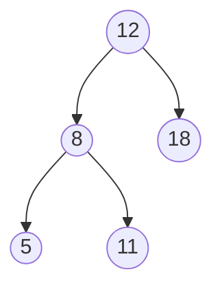

Perfect Binary Tree- all the internal nodes have two children and all leaf nodes are at the same level.

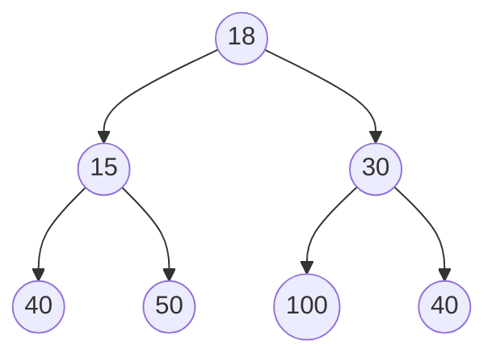

Balanced Binary Tree- difference between the height of the left and the right subtree for each node is either 0 or 1. Height will be O(log n)

Depth of a node (d) = \|height of left child - height of right child\|

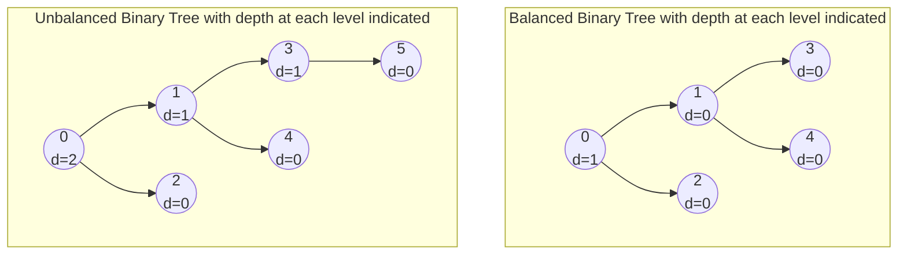

Full Binary Tree- binary tree with either zero or two child nodes for each node


Degenerate Binary Tree/ Skewed Binary Tree- Every non-leaf node has just one child. They are either left or right skewed

```text
Left Skewed        Right Skewed

    1             1
   /               \
  2                 2
 /                   \
3                     3
```

N-ary Tree- each node can have at most N children

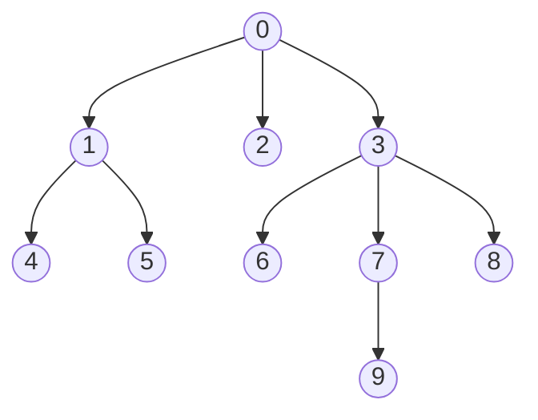


## Traversals

Inorder Traversal- Left -> Root -> Right

```java
void inorderTraversal(Node root, List<Integer> result) {
    if (root == null) return;
    inorderTraversal(root.left, result);
    result.add(root.data);
    inorderTraversal(root.right, result);
}
```

Preorder Traversal- Root -> Left -> Right

```java
void preorderTraversal(Node root, List<Integer> result) {
    if (root == null) return;
    result.add(root.data);
    preorderTraversal(root.left, result);
    preorderTraversal(root.right, result);
}
```

Postorder Traversal- Left -> Right -> Root

```java
void postorderTraversal(Node root, List<Integer> result) {
    if (root == null) return;
    postorderTraversal(root.left, result);
    postorderTraversal(root.right, result);
    result.add(root.data);
}
```

Level Order Traversal (BFS)

```java
List<Integer> levelOrderTraversal(Node root) {
    List<Integer> result = new ArrayList<>();
    if (root == null) return result;

    Queue<Node> q = new ArrayDeque<>();
    q.add(root);

    while (!q.isEmpty()) {
        Node curr = q.poll();
        result.add(curr.data);
        if (curr.left != null) q.add(curr.left);
        if (curr.right != null) q.add(curr.right);
    }

    return result;
}
```

Reverse Level Order Traversal

```java
List<Integer> reverseLevelOrderTraversal(Node root) {
    List<Integer> result = new ArrayList<>();
    if (root == null) return result;

    Queue<Node> q = new ArrayDeque<>();
    Deque<Integer> s = new ArrayDeque<>();
    q.add(root);

    while (!q.isEmpty()) {
        Node curr = q.poll();
        s.push(curr.data);

        // Push right first so left is processed first when reversed
        if (curr.right != null) q.add(curr.right);
        if (curr.left != null) q.add(curr.left);
    }

    while (!s.isEmpty()) {
        result.add(s.pop());
    }

    return result;
}
```

Diagonal Traversal

```java
List<Integer> diagonalTraversal(Node root) {
    List<Integer> result = new ArrayList<>();
    if (root == null) return result;

    Queue<Node> q = new ArrayDeque<>();
    q.add(root);

    while (!q.isEmpty()) {
        Node curr = q.poll();

        // Walk along the right chain, which is one diagonal
        while (curr != null) {
            result.add(curr.data);
            if (curr.left != null) q.add(curr.left);
            curr = curr.right;
        }
    }

    return result;
}
```

Boundary Traversal

```java
boolean isLeaf(Node node) {
    return node.left == null && node.right == null;
}

void collectLeft(Node node, List<Integer> res) {
    if (node == null || isLeaf(node)) return;
    res.add(node.data);
    if (node.left != null) collectLeft(node.left, res);
    else collectLeft(node.right, res);
}

void collectLeaves(Node node, List<Integer> res) {
    if (node == null) return;
    if (isLeaf(node)) {
        res.add(node.data);
        return;
    }
    collectLeaves(node.left, res);
    collectLeaves(node.right, res);
}

void collectRight(Node node, List<Integer> res) {
    if (node == null || isLeaf(node)) return;
    if (node.right != null) collectRight(node.right, res);
    else collectRight(node.left, res);
    res.add(node.data);
}

List<Integer> boundaryTraversal(Node root) {
    List<Integer> res = new ArrayList<>();
    if (root == null) return res;
    if (!isLeaf(root)) res.add(root.data);

    collectLeft(root.left, res);
    collectLeaves(root, res);
    collectRight(root.right, res);
    return res;
}
```


## Maximum Depth/ height of Binary Tree

Can use level order traversal also

```java
int height(Node root) {
    if (root == null)
        return -1;

    // compute the height of left and right subtrees
    int lHeight = height(root.left);
    int rHeight = height(root.right);

    return Math.max(lHeight, rHeight) + 1;
}
```


## Size of a tree

Total number of nodes

```java
int getSize(Node root) {
    if (root == null)
        return 0;

    // Find the size of left and right
    // subtree.
    int left = getSize(root.left);
    int right = getSize(root.right);

    // return the size of curr subtree.
    return left + right + 1;
}
```


## Level of a Node in Binary Tree

Can use level order traversal also

```java
int getLevel(Node root, int target, int level) {
    if (root == null) {
        return -1;
    }

    // If the target key matches the current node's
          // data, return the level
    if (root.data == target) {
        return level;
    }

    // Recursively call for left and right subtrees
    int leftLevel = getLevel(root.left, target, level + 1);
    if (leftLevel != -1) {
        return leftLevel;
    }

    return getLevel(root.right, target, level + 1);
}
```


## Print path from root to a given node in a binary tree

```java
// Returns true if there is a path from root
// to the given node. It also populates
// 'arr' with the given path
boolean hasPath(Node root, List<Integer> arr, int x)
{
    // if root is null
    // there is no path
    if (root == null)
        return false;

    // push the node's value in 'arr'
    arr.add(root.data);

    // if it is the required node
    // return true
    if (root.data == x)
        return true;

    // else check whether the required node lies
    // in the left subtree or right subtree of
    // the current node
    if (hasPath(root.left, arr, x) ||
        hasPath(root.right, arr, x))
        return true;

    // required node does not lie either in the
    // left or right subtree of the current node
    // Thus, remove current node's value from
    // 'arr'and then return false
    arr.remove(arr.size() - 1);
    return false;
}
```


## AVL Tree

- self-balancing Binary Search Tree (BST), where the difference between heights of left and right subtrees for any node cannot be more than one
- All TC is O(log n)
- 4 types of rotations for balancing
  - Left Rotation
  - Right Rotation
  - Left-Right Rotation
  - Right-Left Rotation

Insertion

```java
class Node {
    int key, height;
    Node left, right;

    Node(int key) {
        this.key = key;
        height = 1;
    }
}

int height(Node node) {
    return node == null ? 0 : node.height;
}

int getBalance(Node node) {
    return node == null ? 0 : height(node.left) - height(node.right);
}

Node rightRotate(Node y) {
    Node x = y.left;
    Node temp = x.right;

    x.right = y;
    y.left = temp;

    y.height = 1 + Math.max(height(y.left), height(y.right));
    x.height = 1 + Math.max(height(x.left), height(x.right));
    return x;
}

Node leftRotate(Node x) {
    Node y = x.right;
    Node temp = y.left;

    y.left = x;
    x.right = temp;

    x.height = 1 + Math.max(height(x.left), height(x.right));
    y.height = 1 + Math.max(height(y.left), height(y.right));
    return y;
}

Node insert(Node node, int key) {
    if (node == null) return new Node(key);

    if (key < node.key) node.left = insert(node.left, key);
    else if (key > node.key) node.right = insert(node.right, key);
    else return node;   // duplicates not allowed

    node.height = 1 + Math.max(height(node.left), height(node.right));
    int balance = getBalance(node);

    // Left Left
    if (balance > 1 && key < node.left.key) {
        return rightRotate(node);
    }
    // Right Right
    if (balance < -1 && key > node.right.key) {
        return leftRotate(node);
    }
    // Left Right
    if (balance > 1 && key > node.left.key) {
        node.left = leftRotate(node.left);
        return rightRotate(node);
    }
    // Right Left
    if (balance < -1 && key < node.right.key) {
        node.right = rightRotate(node.right);
        return leftRotate(node);
    }
    return node;
}
```

Deletion

```java
Node minValueNode(Node node) {
    while (node.left != null) node = node.left;
    return node;
}

Node delete(Node root, int key) {
    if (root == null) return null;

    if (key < root.key) {
        root.left = delete(root.left, key);
    } else if (key > root.key) {
        root.right = delete(root.right, key);
    } else {
        // 0 or 1 child
        if (root.left == null || root.right == null) {
            return root.left != null ? root.left : root.right;
        }
        // 2 children: replace with inorder successor, then delete it
        Node temp = minValueNode(root.right);
        root.key = temp.key;
        root.right = delete(root.right, temp.key);
    }

    root.height = 1 + Math.max(height(root.left), height(root.right));
    int balance = getBalance(root);

    // Left Left
    if (balance > 1 && getBalance(root.left) >= 0) {
        return rightRotate(root);
    }
    // Left Right
    if (balance > 1 && getBalance(root.left) < 0) {
        root.left = leftRotate(root.left);
        return rightRotate(root);
    }
    // Right Right
    if (balance < -1 && getBalance(root.right) <= 0) {
        return leftRotate(root);
    }
    // Right Left
    if (balance < -1 && getBalance(root.right) > 0) {
        root.right = rightRotate(root.right);
        return leftRotate(root);
    }
    return root;
}
```


# Binary Search Tree

- The left subtree of a node contains only nodes with keys less than the node's key.
- The right subtree of a node contains only nodes with keys greater than the node's key.
- The left and right subtree each must also be a binary search tree.


## Insertion

```java
Node insert(Node root, int x)
{

    Node temp = new Node(x);

    // If tree is empty
    if (root == null)
        return temp;

    // Find the node who is going
    // to have the new node temp as
    // it child. The parent node is
    // mainly going to be a leaf node
    Node parent = null, curr = root;
    while (curr != null) {
        parent = curr;
        if (curr.data > x)
            curr = curr.left;
        else if (curr.data < x)
            curr = curr.right;
        else
            return root;
    }

    // If x is smaller, make it
    // left child, else right child
    if (parent.data > x)
        parent.left = temp;
    else
        parent.right = temp;
    return root;
}
```


## Searching

```java
// Function to search in a bst.
boolean search(Node root, int x) {

    Node curr = root;

    while (curr != null) {

        // If curr node is x
        if (curr.data == x)
            return true;

        // Search in right subtree
        else if (curr.data < x)
            curr = curr.right;

        // Search in right subtree
        else
            curr = curr.left;
    }

    // If x is not found.
    return false;
}
```


## Deletion

3 cases

1. Delete a Leaf Node in BST
2. Delete a Node with Single Child in BST
3. Delete a Node with Both Children in BST

```java
// Note that it is not a generic inorder
// successor function. It mainly works
// when right child is not empty which is
// the case we need in BST delete
Node getSuccessor(Node curr){
    curr = curr.right;
    while (curr != null && curr.left != null)
        curr = curr.left;
    return curr;
}

// This function deletes a given key x from
// the give BST and returns modified root of
// the BST (if it is modified)
Node delNode(Node root, int x){

    // Base case
    if (root == null)
        return root;

    // If key to be searched is in a subtree
    if (root.data > x)
        root.left = delNode(root.left, x);
    else if (root.data < x)
        root.right = delNode(root.right, x);

    // If root matches with the given key
    else {

        // Cases when root has 0 children
        // or only right child
        if (root.left == null) {
            Node temp = root.right;
            return temp;
        }

        // When root has only left child
        if (root.right == null) {
            Node temp = root.left;
            return temp;
        }

        // When both children are present
        Node succ = getSuccessor(root);
        root.data = succ.data;
        root.right = delNode(root.right, succ.data);
    }
    return root;
}
```


## Inorder predecessor and successor in BST

```java
Node rightMost(Node node) {
    while (node.right != null) {
        node = node.right;
    }
    return node;
}

Node leftMost(Node node) {
    while (node.left != null) {
        node = node.left;
    }
    return node;
}

// Return predecessor and successor as a List<Node>
List<Node> findPreSuc(Node root, int key) {
    Node pre = null;
    Node suc = null;
    Node curr = root;

    while (curr != null) {
        if (curr.data < key) {
            pre = curr;
            curr = curr.right;
        } else if (curr.data > key) {
            suc = curr;
            curr = curr.left;
        } else {
            if (curr.left != null)
                pre = rightMost(curr.left);
            if (curr.right != null)
                suc = leftMost(curr.right);
            break;
        }
    }

    return Arrays.asList(pre, suc);
}
```


## Sorted Array to Balanced BST

```java
// Recursive function to construct BST
Node sortedArrayToBSTRecur(int[] arr, int start, int end) {
    if (start > end) return null;

    // Find the middle element
    int mid = start + (end - start) / 2;

    // Create root node
    Node root = new Node(arr[mid]);

    // Create left subtree
    root.left = sortedArrayToBSTRecur(arr, start,
                                      mid - 1);

    // Create right subtree
    root.right = sortedArrayToBSTRecur(arr, mid + 1,
                                       end);
    return root;
}

Node sortedArrayToBST(int[] arr) {
    int n = arr.length;
    return sortedArrayToBSTRecur(arr, 0, n - 1);
}
```


# Heap & Hashing


## Heap

- complete binary tree
- Max Heap- every parent node is greater than or equal to its children
- Min Heap- every parent node is less than or equal to its children
- Heapify- process to rearrange the elements to maintain the property of heap data structure
- Positions:
  - Parent = arr\[(i-1)/2\]
  - Left child = arr\[(2\*i)+1\]
  - Right child = arr\[(2\*i)+2\]

```java
class MaxHeap {
    // A reference pointing to the elements
    // in the array in the heap.
    private int[] arr;

    // Maximum possible size of
    // the Max Heap.
    private int maxSize;

    // Number of elements in the
    // Max heap currently.
    private int heapSize;

    // Constructor function.
    // Constructor function builds a heap
    // from a given array a[]
    // of the specified size.
    public MaxHeap(int totSize)
    {
        heapSize = 0;
        maxSize = totSize;
        arr = new int[totSize];
    }

    // Heapifies a subtree taking the
    // given index as the root.
    // To heapify the subtree this method
    // is called recursively
    public void MaxHeapify(int i)
    {
        int l = lChild(i);
        int r = rChild(i);
        int largest = i;
        if (l < heapSize && arr[l] > arr[i])
            largest = l;
        if (r < heapSize && arr[r] > arr[largest])
            largest = r;
        if (largest != i) {
            int temp = arr[i];
            arr[i] = arr[largest];
            arr[largest] = temp;
            MaxHeapify(largest);
        }
    }

    // Returns the index of the parent
    // of the element at ith index.
    public int parent(int i)
    {
        return (i - 1) / 2;
    }

    // Returns the index of the left child.
    public int lChild(int i)
    {
        return (2 * i + 1);
    }

    // Returns the index of the
    // right child.
    public int rChild(int i)
    {
        return (2 * i + 2);
    }

    // Removes the root which in this
    // case contains the maximum element.
    // To remove the root node which contains
    // the maximum element of the Max Heap.
    public int removeMax()
    {
        // Checking whether the heap array
        // is empty or not.
        if (heapSize <= 0)
            return Integer.MIN_VALUE;
        if (heapSize == 1) {
            heapSize--;
            return arr[0];
        }

        // Storing the maximum element
        // to remove it.
        int root = arr[0];
        arr[0] = arr[heapSize - 1];
        heapSize--;

        // To restore the property
        // of the Max heap.
        MaxHeapify(0);

        return root;
    }

    // Increases the value of the key
    // given by index i to some new value.
    // Increases value of key at
    // index 'i' to new_val.
    public void increaseKey(int i, int newVal)
    {
        arr[i] = newVal;
        while (i != 0 && arr[parent(i)] < arr[i]) {
            int temp = arr[i];
            arr[i] = arr[parent(i)];
            arr[parent(i)] = temp;
            i = parent(i);
        }
    }

    // Returns the maximum key
    // (key at root) from max heap.
    public int getMax()
    {
        return arr[0];
    }

    public int curSize()
    {
        return heapSize;
    }

    // Deletes a key at given index i.
    // In order to delete a key
    // at a given index i.
    public void deleteKey(int i)
    {
        // It increases the value of the key
        // to infinity and then removes
        // the maximum value.
        increaseKey(i, Integer.MAX_VALUE);
        removeMax();
    }

    // Inserts a new key 'x' in the Max Heap.
    // Inserting a new key 'x'.
    public void insertKey(int x)
    {
        // To check whether the key
        // can be inserted or not.
        if (heapSize == maxSize) {
            System.out.println("\nOverflow: Could not insertKey");
            return;
        }

        // The new key is initially
        // inserted at the end.
        heapSize++;
        int i = heapSize - 1;
        arr[i] = x;

        // The max heap property is checked
        // and if violation occurs,
        // it is restored.
        while (i != 0 && arr[parent(i)] < arr[i]) {
            int temp = arr[i];
            arr[i] = arr[parent(i)];
            arr[parent(i)] = temp;
            i = parent(i);
        }
    }
}
```


## Heap Sort

- Rearrange array elements so that they form a Max Heap.
- Repeat the following steps until the heap contains only one element:
  - Swap the root element of the heap (which is the largest element in the current heap) with the last element of the heap.
  - Remove the last element of the heap (which is now in the correct position). We mainly reduce heap size and do not remove elements from the actual array.
  - Heapify the remaining elements of the heap.
- Finally we get a sorted array.

TC of heap sort = O (n log n)

TC of building a heap = O (n)

```java
// To heapify a subtree rooted with node i
// which is an index in arr[].
void heapify(int[] arr, int n, int i){

    // Initialize largest as root
    int largest = i;

    // left index = 2*i + 1
    int l = 2 * i + 1;

    // right index = 2*i + 2
    int r = 2 * i + 2;

    // If left child is larger than root
    if (l < n && arr[l] > arr[largest])
        largest = l;

    // If right child is larger than largest so far
    if (r < n && arr[r] > arr[largest])
        largest = r;

    // If largest is not root
    if (largest != i) {
        int temp = arr[i];
        arr[i] = arr[largest];
        arr[largest] = temp;

        // Recursively heapify the affected sub-tree
        heapify(arr, n, largest);
    }
}

// Main function to do heap sort
void heapSort(int[] arr){
    int n = arr.length;

    // Build heap (rearrange array)
    for (int i = n / 2 - 1; i >= 0; i--)
        heapify(arr, n, i);

    // One by one extract an element from heap
    for (int i = n - 1; i > 0; i--) {

        // Move current root to end
        int temp = arr[0];
        arr[0] = arr[i];
        arr[i] = temp;

        // Call max heapify on the reduced heap
        heapify(arr, i, 0);
    }
}
```


## Priority Queue

### Custom Comparator

```java
// compare(a, b): negative -> a comes first, positive -> b comes first
class Compare implements Comparator<int[]> {
    public int compare(int[] a, int[] b) {
        return Integer.compare(a[1], b[1]);
    }
}

PriorityQueue<int[]> pq = new PriorityQueue<>(new Compare());
```

- Behaviour is same as sorting
- If negative, `a` comes first, order is correct and no swapping of elements takes place
- If positive, `b` comes first, order is NOT correct and swapping of elements takes place
- If zero, both are equal


## Hashing

- process of generating a small sized output (that can be used as index in a table) from an input of typically large and variable size
- Hash function- function that converts input data into a fixed-size number (called a hash value)
- Collision- When two or more keys have the same hash value, a collision happens
- Load Factor = Total elements in hash table/ Size of hash table
- Rehashing- increasing the size of a hashmap and redistributing the elements to new buckets based on their new hash values

### Types of Hash Functions

1\. Division Method

```text
h(k) = k % m
```

Where k is the key and m is a prime number.

2\. Multiplication Method

```text
h(k) = ⌊m * (k * A % 1)⌋
```

Where ⌊ ⌋ denotes the floor function.

3\. Mid-Square Method

- the key is squared, and the middle digits of the result are taken as the hash value.

4\. Folding Method

- dividing the key into equal parts, summing the parts, and then taking the modulo with respect to m

5\. Cryptographic Hash Functions

- MD5, SHA-1, and SHA-256

6\. Universal Hashing

```text
h(k) = ((a⋅k+b)%p)%m
```

Where a and b are randomly chosen constants, p is a prime number greater than m, and k is the key.

7\. Perfect Hashing

- create a collision-free hash function for a static set of keys. It guarantees that no two keys will hash to the same value


# Graph

- Vertices (nodes)- The points where edges meet in a graph
- Edges- The connections between vertices are known as edges. They can be undirected (bidirectional) or directed (unidirectional).
- Weight- A weight can be assigned to an edge, representing the cost or distance between two vertices
- Degree- The degree of a vertex is the number of edges that connect to it. In a directed graph, the in-degree of a vertex is the number of edges that point to it, and the out-degree is the number of edges that start from it.


## Types

Null Graph- no edges in the graph

Trivial Graph- only a single vertex, it is also the smallest graph possible

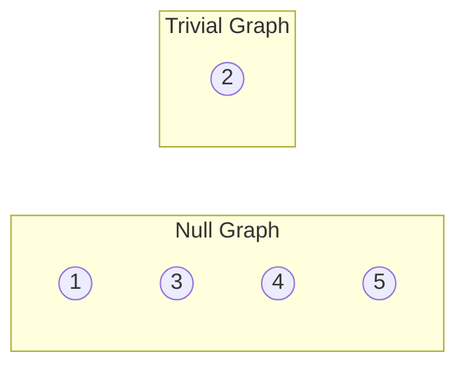

Undirected Graph- edges do not have any direction

Directed Graph- edge has direction

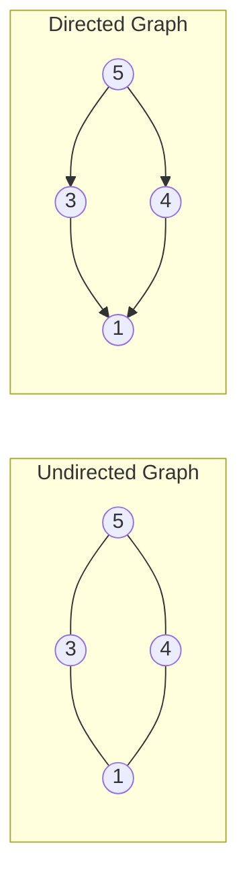

Connected Graph- in which from one node we can visit any other node in the graph

Disconnected Graph- at least one node is not reachable from a node

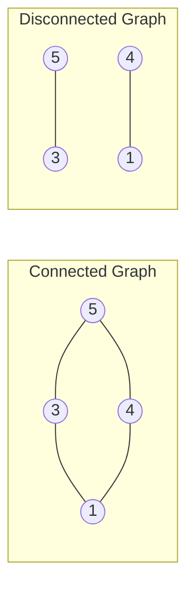

Regular Graph- degree of every vertex is equal to K is called K regular graph

Complete Graph- The graph in which from each node there is an edge to each other node

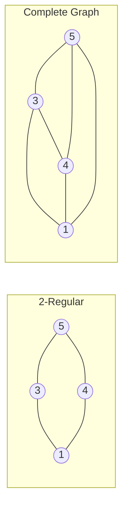

Cycle Graph- The graph in which the graph is a cycle in itself, the minimum value of degree of each vertex is 2

Cyclic Graph- graph containing at least one cycle

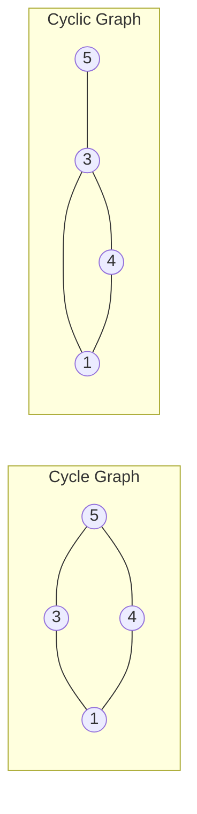

Directed Acyclic Graph- A Directed Graph that does not contain any cycle

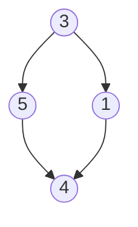

Bipartite Graph- A graph in which vertex can be divided into two sets such that vertex in each set does not contain any edge between them

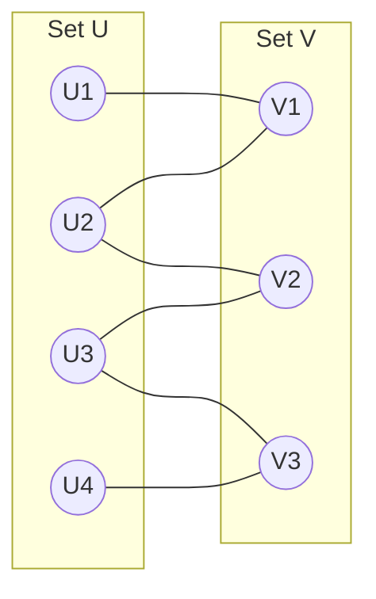


## Representation

Adjacency Matrix

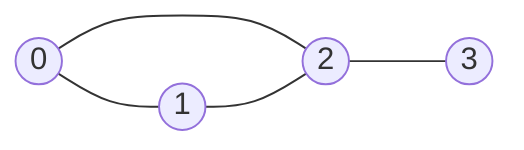

| | 0 | 1 | 2 | 3 |
| --- | --- | --- | --- | --- |
| **0** | 0 | 1 | 1 | 0 |
| **1** | 1 | 0 | 1 | 0 |
| **2** | 1 | 1 | 0 | 1 |
| **3** | 0 | 0 | 1 | 0 |

```java
void addEdge(int[][] mat, int i, int j)
{
    mat[i][j] = 1;
    mat[j][i] = 1; // Since the graph is undirected
}

void displayMatrix(int[][] mat)
{
    int V = mat.length;
    for (int i = 0; i < V; i++)
    {
        for (int j = 0; j < V; j++)
            System.out.print(mat[i][j] + " ");
        System.out.println();
    }
}
```

Adjacency List


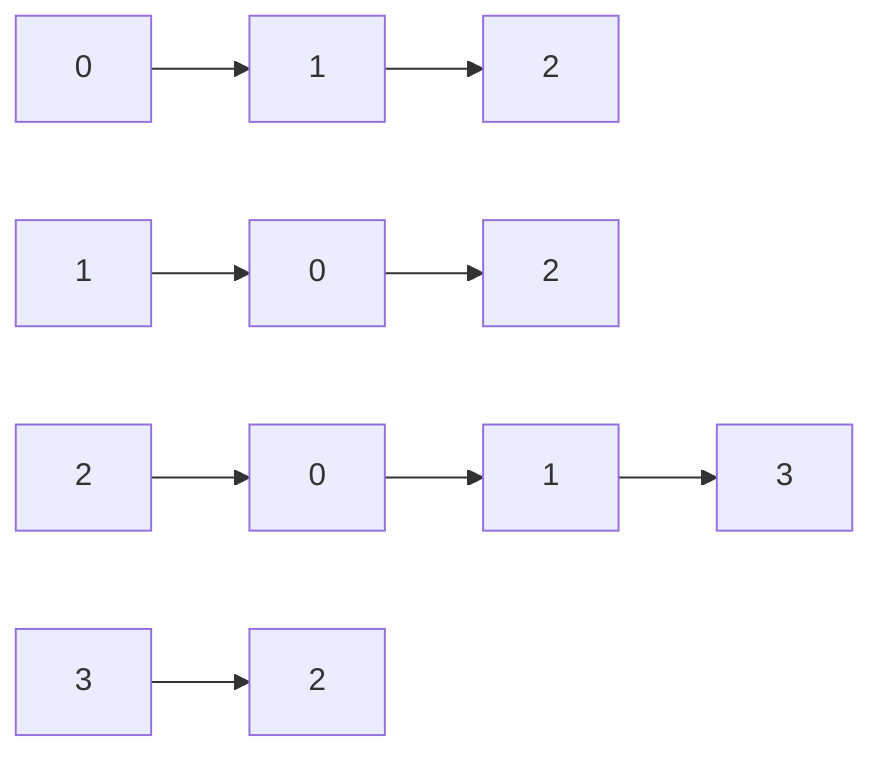

```java
// Function to add an edge between two vertices
void addEdge(List<List<Integer>> adj, int i, int j) {
    adj.get(i).add(j);
    adj.get(j).add(i); // Undirected
}

// Function to display the adjacency list
void displayAdjList(List<List<Integer>> adj) {
    for (int i = 0; i < adj.size(); i++) {
        System.out.print(i + ": "); // Print the vertex
        for (int j : adj.get(i)) {
            System.out.print(j + " "); // Print its adjacent
        }
        System.out.println();
    }
}
```

Convert Adjacency Matrix to Adjacency List

```java
List<List<Integer>> convert(int[][] a)
{
    List<List<Integer>> adjList = new ArrayList<>();
    for (int i = 0; i < a.length; i++)
        adjList.add(new ArrayList<>());

    for (int i = 0; i < a.length; i++)
    {

        for (int j = 0; j < a[i].length; j++)
        {
            if (a[i][j] != 0)
            {
                adjList.get(i).add(j);
            }
        }
    }
    return adjList;
}
```

Convert Adjacency List to Adjacency Matrix

```java
int[][] convert(List<List<Integer>> adj, int V)
{
    // Initialize a matrix
    int[][] matrix = new int[V][V];

    for (int i = 0; i < V; i++) {
        for (int j : adj.get(i))
            matrix[i][j] = 1;
    }
    return matrix;
}
```

In and out degree

```java
void findInOutDegrees(List<List<Integer>> adj, int V) {
    int[] inDegree = new int[V];
    int[] outDegree = new int[V];

    for (int u = 0; u < V; ++u) {
        outDegree[u] = adj.get(u).size(); // out-degree = number of edges from u
        for (int v : adj.get(u)) {
            inDegree[v]++;            // in-degree of v increases for each edge (u -> v)
        }
    }

    System.out.println("Vertex\tIn-Degree\tOut-Degree");
    for (int i = 0; i < V; ++i) {
        System.out.println(i + "\t" + inDegree[i] + "\t\t" + outDegree[i]);
    }
}
```


## Properties

- Distance between two Vertices- number of edges that are available in the shortest path between vertex A and vertex B
- Eccentricity of a Vertex- Maximum distance from a vertex to all other vertices
- Radius of a Connected Graph- The minimum value of eccentricity from all vertices
- Diameter of A Connected Graph- The maximum value of eccentricity from all vertices
- Central Point and Centre- The vertex having minimum eccentricity is considered as the central point of the graph. And the sets of all central points are considered as the centre of Graph.


## Breadth First Search or BFS

TC = O(V + E)

SC = O(V)

```java
// BFS from given source s
void bfs(List<List<Integer>> adj, int s, boolean[] visited, List<Integer> res) {
    // Create a queue for BFS
    Queue<Integer> q = new ArrayDeque<>();

    // Mark source node as visited and enqueue it
    visited[s] = true;
    q.add(s);

    // Iterate over the queue
    while (!q.isEmpty()) {
        // Dequeue a vertex and store it
        int curr = q.poll();
        res.add(curr);

        // Get all adjacent vertices of the dequeued
        // vertex curr If an adjacent has not been
        // visited, mark it visited and enqueue it
        for (int x : adj.get(curr)) {
            if (!visited[x]) {
                visited[x] = true;
                q.add(x);
            }
        }
    }
}

// Perform BFS for the entire graph which maybe
// disconnected
List<Integer> bfsDisconnected(List<List<Integer>> adj) {
    int V = adj.size();

    // create an array to store the traversal
    List<Integer> res = new ArrayList<>();

    // Initially mark all the vertices as not visited
    boolean[] visited = new boolean[V];

    // perform BFS for each node
    for (int i = 0; i < adj.size(); ++i) {
        if (!visited[i]) {
            bfs(adj, i, visited, res);
        }
    }

    return res;
}
```


## Depth First Search or DFS

TC = O(V + E)

SC = O(V)

```java
// Recursive function for DFS traversal
void dfsRec(List<List<Integer>> adj, boolean[] visited, int s, List<Integer> res)
{
    // Mark the current vertex as visited
    visited[s] = true;

    res.add(s);

    // Recursively visit all adjacent vertices that are not visited yet
    for (int i : adj.get(s))
        if (visited[i] == false)
            dfsRec(adj, visited, i, res);
}

// Main DFS function to perform DFS for the entire graph
List<Integer> DFS(List<List<Integer>> adj)
{
    boolean[] visited = new boolean[adj.size()];
    List<Integer> res = new ArrayList<>();
    // Loop through all vertices to handle disconnected graph
    for (int i = 0; i < adj.size(); i++)
    {
        if (visited[i] == false)
        {
            // If vertex i has not been visited,
            // perform DFS from it
            dfsRec(adj, visited, i, res);
        }
    }

    return res;
}
```


## Detect Cycle in a Directed Graph

Use DFS and find a back edge (a node points to one of its ancestors in a DFS tree)

```java
// Utility function for DFS to detect a cycle in a directed graph
boolean isCyclicUtil(List<List<Integer>> adj, int u, boolean[] visited, boolean[] recStack)
{
    // If the node is already in the recursion stack, a cycle is detected
    if (recStack[u])
        return true;

    // If the node is already visited and not in recursion stack, no need to check again
    if (visited[u])
        return false;

    // Mark the current node as visited and add it to the recursion stack
    visited[u] = true;
    recStack[u] = true;

    // Recur for all neighbors
    for (int x : adj.get(u))
    {
        if (isCyclicUtil(adj, x, visited, recStack))
            return true;
    }

    // Remove the node from the recursion stack
    recStack[u] = false;
    return false;
}

// Function to detect cycle in a directed graph
boolean isCyclic(int V, int[][] edges)
{
    // Construct the adjacency list
    List<List<Integer>> adj = constructadj(V, edges);

    // visited[] keeps track of visited nodes
    // recStack[] keeps track of nodes in the current recursion stack
    boolean[] visited = new boolean[V];
    boolean[] recStack = new boolean[V];

    // Check for cycles starting from every unvisited node
    for (int i = 0; i < V; i++)
    {
        if (!visited[i] && isCyclicUtil(adj, i, visited, recStack))
            return true; // Cycle found
    }

    return false; // No cycles detected
}
```


## Detect cycle in an undirected graph

- do BFS and check if a node has been visited earlier, ensuring that we do not consider the parent node of the current node while making this check.
- If we encounter a visited node that is not the parent, a cycle exists in the graph

```java
// Function to perform BFS from node start
boolean bfs(int start, List<List<Integer>> adj, boolean[] visited) {
    Queue<int[]> q = new ArrayDeque<>();
    q.add(new int[]{start, -1});
    visited[start] = true;

    while (!q.isEmpty()) {
        int[] curr = q.poll();
        int node = curr[0];
        int parent = curr[1];

        for (int neighbor : adj.get(node)) {

            if (!visited[neighbor]) {
                visited[neighbor] = true;
                q.add(new int[]{neighbor, node});
            }
            else if (neighbor != parent) {
                return true;
            }
        }
    }
    return false;
}

boolean isCycle(int V, int[][] edges) {
    List<List<Integer>> adj = constructadj(V, edges);
    boolean[] visited = new boolean[V];

    for (int i = 0; i < V; i++) {

        if (!visited[i]) {
            if (bfs(i, adj, visited)) {
                return true;
            }
        }
    }

    // If no cycle is found
    return false;
}
```


## Dijkstra's Algorithm

- To find Shortest Paths from a Source to all other vertices
- Non-negative weights

Steps

- Initialize distances from source to all nodes as infinity (∞), except source = 0.
- Use a priority queue (min-heap) to pick the node with the smallest distance.
- For the current node:
  - Check all its neighbors.
  - Relax the edge: If current_dist + edge_weight \< neighbor_dist, then update the neighbor’s distance.
- Repeat until all nodes are visited

TC = O(E \* logV)

SC = O(V)

```java
// Returns shortest distances from src to all other vertices
int[] dijkstra(int V, int[][] edges, int src) {
    // Create adjacency list
    List<List<int[]>> adj = constructAdj(edges, V);

    // Create a priority queue to store vertices that
    // are being preprocessed.
    PriorityQueue<int[]> pq = new PriorityQueue<>(Comparator.comparingInt(a -> a[0]));

    // Create an array for distances and initialize all
    // distances as infinite
    int[] dist = new int[V];
    Arrays.fill(dist, Integer.MAX_VALUE);

    // Insert source itself in priority queue and initialize
    // its distance as 0.
    pq.add(new int[]{0, src});
    dist[src] = 0;

    // Looping till priority queue becomes empty (or all
    // distances are not finalized)
    while (!pq.isEmpty()) {
        // The first vertex in pair is the minimum distance
        // vertex, extract it from priority queue.
        int u = pq.poll()[1];

        // Get all adjacent of u.
        for (int[] x : adj.get(u)) {
            // Get vertex label and weight of current
            // adjacent of u.
            int v = x[0];
            int weight = x[1];

            // If there is a shorter path to v through u.
            // Relaxing the edge
            if (dist[v] > dist[u] + weight)
            {
                // Updating distance of v
                dist[v] = dist[u] + weight;
                pq.add(new int[]{dist[v], v});
            }
        }
    }

    return dist;
}
```


## Bellman–Ford Algorithm

- To find Shortest Paths from a Source to all other vertices
- Can work in negative weights or negative weight cycle also

TC = O(V \* E)

SC = O(V)

```java
int[] bellmanFord(int V, int[][] edges, int src) {
    // Initially distance from source to all
    // other vertices are not known(Infinite).
    int[] dist = new int[V];
    Arrays.fill(dist, (int) 1e8);
    dist[src] = 0;

    // Relaxation of all the edges V times, not (V - 1) as we
    // need one additional relaxation to detect negative cycle
    for (int i = 0; i < V; i++) {

        for (int[] edge : edges) {
            int u = edge[0];
            int v = edge[1];
            int wt = edge[2];
            if (dist[u] != (int) 1e8 && dist[u] + wt < dist[v]) {
                // If this is the Vth relaxation, then there is
                // a negative cycle
                if (i == V - 1)
                    return new int[]{-1};

                // Update shortest distance to node v
                dist[v] = dist[u] + wt;
            }
        }
    }

    return dist;
}
```


## Detect a negative cycle in a Graph

use Bellman Ford algorithm

```java
// The main function that finds shortest distances
// from src to all other vertices using Bellman-
// Ford algorithm. The function also detects
// negative weight cycle
boolean isNegCycleBellmanFord(Graph graph, int src, int[] dist)
{
    int V = graph.V;
    int E = graph.E;

    // Step 1: Initialize distances from src
    // to all other vertices as INFINITE
    for (int i = 0; i < V; i++)
        dist[i] = Integer.MAX_VALUE;
    dist[src] = 0;

    // Step 2: Relax all edges |V| - 1 times.
    // A simple shortest path from src to any
    // other vertex can have at-most |V| - 1
    // edges
    for (int i = 1; i <= V - 1; i++) {
        for (int j = 0; j < E; j++) {
            int u = graph.edge[j].src;
            int v = graph.edge[j].dest;
            int weight = graph.edge[j].weight;
            if (dist[u] != Integer.MAX_VALUE
                && dist[u] + weight < dist[v])
                dist[v] = dist[u] + weight;
        }
    }

    // Step 3: check for negative-weight cycles.
    // The above step guarantees shortest distances
    // if the graph doesn't contain a negative weight cycle.
    // If we get a shorter path, then there is a cycle.
    for (int i = 0; i < E; i++) {
        int u = graph.edge[i].src;
        int v = graph.edge[i].dest;
        int weight = graph.edge[i].weight;
        if (dist[u] != Integer.MAX_VALUE
            && dist[u] + weight < dist[v])
            return true;
    }

    return false;
}

// Returns true if the given graph has a negative weight cycle.
boolean isNegCycleDisconnected(Graph graph)
{
    int V = graph.V;

    // To keep track of visited vertices to avoid
    // recomputations.
    boolean[] visited = new boolean[V];

    // This array is filled by Bellman-Ford
    int[] dist = new int[V];

    // Call Bellman-Ford for all those vertices
    // that are not visited
    for (int i = 0; i < V; i++) {
        if (visited[i] == false) {
            // If cycle found
            if (isNegCycleBellmanFord(graph, i, dist))
                return true;

            // Mark all vertices that are visited
            // in the above call.
            for (int j = 0; j < V; j++)
                if (dist[j] != Integer.MAX_VALUE)
                    visited[j] = true;
        }
    }

    return false;
}
```


## Floyd Warshall Algorithm

- Works for negative weights, but should not have negative weight cycle
- TC = O(V<sup>3</sup>)

```java
void floydWarshall(int[][] dist) {
    int V = dist.length;

    // Add all vertices one by one to
    // the set of intermediate vertices.
    for (int k = 0; k < V; k++) {

        // Pick all vertices as source one by one
        for (int i = 0; i < V; i++) {

            // Pick all vertices as destination
            // for the above picked source
            for (int j = 0; j < V; j++) {

                // shortest path from
                // i to j
                if (dist[i][k] != (int) 1e8 && dist[k][j] != (int) 1e8)
                    dist[i][j] = Math.min(dist[i][j], dist[i][k] + dist[k][j]);
            }
        }
    }
}
```


## Minimum Spanning Tree (MST)

- Spanning Tree- subgraph that includes all vertices of the original graph and is a tree (i.e., it has no cycles and is connected)
- MST- spanning tree with the smallest possible total edge weight
- No of edges (E) = V-1

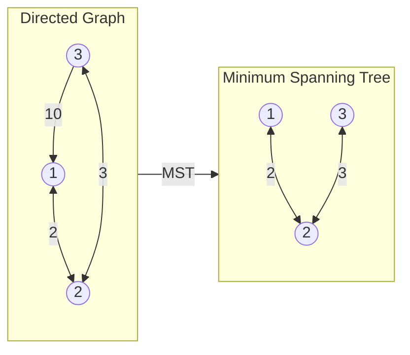


## Prim’s Algorithm

- Used to find MST
- TC = O((E+V) \* log(V))

Steps

- The algorithm starts with an empty spanning tree.
- The idea is to maintain two sets of vertices. The first set contains the vertices already included in the MST, and the other set contains the vertices not yet included.
- At every step, it considers all the edges that connect the two sets and picks the minimum weight edge from these edges. After picking the edge, it moves the other endpoint of the edge to the set containing MST.

```java
// Returns {totalWeight, mstEdges} where each edge is {u, v, weight}
int primMST(List<List<int[]>> adj, int V) {
    // Min-heap: {weight, node, parent}
    PriorityQueue<int[]> pq = new PriorityQueue<>(Comparator.comparingInt(a -> a[0]));

    boolean[] visited = new boolean[V];
    List<int[]> mstEdges = new ArrayList<>(); // {u, v, weight}
    int totalWeight = 0;

    // Start from node 0, no parent (-1)
    pq.add(new int[]{0, 0, -1});

    while (!pq.isEmpty()) {
        int[] top = pq.poll();
        int wt = top[0], u = top[1], parent = top[2];

        // Skip if already in MST
        if (visited[u]) continue;
        visited[u] = true;
        totalWeight += wt;

        // Record edge (skip the starting node which has no parent)
        if (parent != -1)
            mstEdges.add(new int[]{parent, u, wt});

        // Explore neighbors
        for (int[] v : adj.get(u)) {
            // adj[u] = {neighbor, weight}
            if (!visited[v[0]])
                pq.add(new int[]{v[1], v[0], u});
        }
    }

    return totalWeight;
}
```


## Topological Sorting

- for Directed Acyclic Graph (DAG)
- linear ordering of vertices such that for every directed edge u-v, vertex u comes before v in the ordering
- use Kahn's algorithm
- TC = O(V+E)

```java
List<Integer> topologicalSort(int V, int[][] edges)
{
    List<List<Integer>> adj = constructadj(V, edges);

    // Array to store indegree of each vertex
    int[] indegree = new int[V];
    for (int i = 0; i < V; i++) {
        for (int it : adj.get(i)) {
            indegree[it]++;
        }
    }

    // Queue to store vertices with indegree 0
    Queue<Integer> q = new ArrayDeque<>();
    for (int i = 0; i < V; i++) {
        if (indegree[i] == 0) {
            q.add(i);
        }
    }

    List<Integer> result = new ArrayList<>();
    while (!q.isEmpty()) {
        int node = q.poll();
        result.add(node);

        // Decrease indegree of adjacent vertices as the
        // current node is in topological order
        for (int it : adj.get(node)) {
            indegree[it]--;

            // If indegree becomes 0, push it to the queue
            if (indegree[it] == 0)
                q.add(it);
        }
    }

    return result;
}
```


## Connected Components in an Undirected Graph

TC = O(V + E)

```java
// Function to perform DFS and collect all
// nodes in the current connected component
void dfs(int node, List<List<Integer>> adj,
         boolean[] vis, List<Integer> component) {

    // Mark the current node as visited
    vis[node] = true;

    // Add the node to the current component
    component.add(node);

    // Traverse all unvisited neighbors
    for (int neighbor : adj.get(node)) {
        if (!vis[neighbor]) {
            dfs(neighbor, adj, vis, component);
        }
    }
}

// Function to find all connected components
// in an undirected graph
List<List<Integer>> getComponents(int V, int[][] edges) {

    // Create the graph using the adjacency list
    List<List<Integer>> adj = buildGraph(V, edges);

    // Initialize a visited array to keep track of visited nodes
    boolean[] vis = new boolean[V];

    // This will store all the connected components
    List<List<Integer>> res = new ArrayList<>();

    // Iterate through all nodes
    for (int i = 0; i < V; ++i) {
        // If the node has not been visited, it's a new component
        if (!vis[i]) {

            List<Integer> component = new ArrayList<>();

            // Perform DFS to collect all nodes in this component
            dfs(i, adj, vis, component);

            // Add the component to the result list
            res.add(component);
        }
    }

    // Return the list of all connected components
    return res;
}
```


## Eulerian path and circuit for undirected graph

- Eulerian Path- A path that visits every edge exactly once, but not necessarily all vertices. It can start and end at different vertices.
- Eulerian Circuit- An Eulerian Path that starts and ends at the same vertex.
- TC = O(V + E)

A graph has an Eulerian Cycle if and only if the below two conditions are true

- All vertices with non-zero degree are part of a single connected component. (We ignore isolated vertices— those with zero degree — as they do not affect the cycle.)
- Every vertex in the graph has an even degree.

A graph has an Eulerian Path if and only if the below two conditions are true

- All vertices with non-zero degree must belong to the same connected component. (Same as Eulerian Cycle)
- Exactly Zero or Two Vertices with Odd Degree:
  - If zero vertices have an odd degree → Eulerian Cycle exists (which is also a path).
  - If two vertices have odd degree → Eulerian Path exists (but not a cycle).
  - If one vertex has an odd degree → Not possible in an undirected graph. (Because the sum of all degrees in an undirected graph is always even.)

```java
// DFS to check connectivity, excluding zero-degree vertices
void dfs(int node, List<List<Integer>> adj, boolean[] visited) {
    visited[node] = true;

    for (int neighbor : adj.get(node)) {
        if (!visited[neighbor]) {
            dfs(neighbor, adj, visited);
        }
    }
}

// Function to check Eulerian Path or Circuit
int isEulerCircuit(int v, List<List<Integer>> adj) {
    boolean[] visited = new boolean[v];

    // Find first vertex with non-zero degree
    int start = -1;
    for (int i = 0; i < v; i++) {
        if (adj.get(i).size() > 0) {
            start = i;
            break;
        }
    }

    // No edges: graph is trivially Eulerian
    if (start == -1) {
        return 2;
    }

    // DFS from the first non-zero degree vertex
    dfs(start, adj, visited);

    // Check if all non-zero degree vertices are connected
    for (int i = 0; i < v; i++) {
        if (adj.get(i).size() > 0 && !visited[i]) {
            return 0; // Not connected
        }
    }

    // Count vertices with odd degree
    int odd = 0;
    for (int i = 0; i < v; i++) {
        if (adj.get(i).size() % 2 != 0) {
            odd++;
        }
    }

    // Apply Eulerian rules
    if (odd == 0) {
        return 2;
    } else if (odd == 2) {
        return 1;
    } else {
        return 0;
    }
}
```


# Dynamic Programming


## Properties

- Optimal Substructure- optimal results of subproblems to achieve the optimal result of the bigger problem
- Overlapping Subproblems- The same subproblems are solved repeatedly in different parts of the problem


## Approaches

Top-Down Approach (Memoization)

- Keep the solution recursive and add a memoization table to avoid repeated calls of the same subproblems.
- Before making any recursive call, we first check if the memoization table already has a solution for it.
- After the recursive call is over, we store the solution in the memoization table.

Bottom-Up Approach (Tabulation)

- Start with the smallest subproblems and gradually build up to the final solution.
- write an iterative solution (avoid recursion overhead) and build the solution in a bottom-up manner.
- We use a dp table where we first fill the solution for base cases and then fill the remaining entries of the table using a recursive formula.
- We only use recursive formula on table entries and do not make recursive calls

Space optimisation for 2D dp using tabulation

```java
int longestCommonSubsequence(String s1, String s2) {
    int m = s1.length(), n = s2.length();
    int[][] dp = new int[2][n + 1];

    for (int i = 1; i <= m; i++) {
        for (int j = 1; j <= n; j++) {
            if (s1.charAt(i - 1) == s2.charAt(j - 1)) {
                dp[i % 2][j] = dp[(i - 1) % 2][j - 1] + 1;
            }

            else {
                dp[i % 2][j] = Math.max(dp[(i - 1) % 2][j], dp[i % 2][j - 1]);
            }
        }
    }

    return dp[m % 2][n];
}

// 1. declare size of dp as 2*n, where the prev repeating row/col should be '2'
// 2. use i%2 for prev row values
// 3. use dp[i%2][j] everywhere
// 4. use dp[m%2][n] in return statement
```


# Bit Manipulation

- Decimal system has base 10
- Binary system has base 2
- Bits index are from right to left
- Decimal to Binary Conversion- divide the given number by 2 continuously till we get the quotient as 1
- Binary to Decimal Conversion- multiply each digit of the binary number by the power of 2

B = a<sub>n-1</sub>...a<sub>3</sub>a<sub>2</sub>a<sub>1</sub>a<sub>0</sub>

D = (a<sub>n-1</sub> × 2<sup>n-1</sup>) +...+(a<sub>3</sub> × 2<sup>3</sup>) + (a<sub>2</sub> × 2<sup>2</sup>) + (a<sub>1</sub> × 2<sup>1</sup>) + (a<sub>0</sub> × 2<sup>0</sup>)

- Binary Addition- same as regular addition, carry will be max 2
- Binary Subtraction- same a regular subtraction, borrow 2 instead of 10

Using 2’s complement:

```text
ans = A - B
ans = A + (2's complement of B)

2's complement = 1's complement + 1
1's complement = invert all bits
```


## Operators

| Name | Symbol | Definition |
| --- | --- | --- |
| AND | & | Bit is 1 only if both bits are 1 |
| OR | \| | Bit is 1 if either bit is 1 |
| XOR | ^ | Bit is 1 if bits are different (exclusive OR) |
| NOT | \~<br>! | Inverts all bits |
| Left shift | \<\< | Shifts bits to the left, adds 0s on right |
| Right shift | >> | Shifts bits to the right, drops right bits |


## XOR properties

Commutative property

```text
A ^ B = B ^ A
```

Associative property

```text
(A ^ B) ^ C = A ^ (B ^ C)
```

Identity property

```text
A ^ 0 = A
```

Negation property

```text
A ^ A = 0
```


## Important functions

Get bit at nth position

```java
static boolean getBit(int num, int i)
{
    // Return true if the bit is
    // set. Otherwise return false
    return ((num & (1 << i)) != 0);
}
```

Set bit at nth position

```java
static int set(int num, int pos)
{
    // First step is shift '1', second
    // step is bitwise OR
    num |= (1 << pos);
    return num;
}
```

Clear/unset bit at nth position

```java
static int unset(int num, int pos)
{
    // Second step is to bitwise and this  number with given
    // number
    num &= (~(1 << pos));
    return num;
}
```

Toggling a bit at nth position

```java
static int toggle(int num, int pos) {
    // First step is to shift 1,Second step is to XOR with given
    // number
    num ^= (1 << pos);
    return num;
}
```

Checking if the bit at nth position is Set or Unset

```java
static boolean atPosition(int num, int pos)
{
    boolean bit = (num & (1 << pos)) != 0;
    return bit;
}
```

Multiply a number by 2 using the left shift operator

```java
int ans = num << 1;
```

Divide a number 2 using the right shift operator

```java
int ans = num >> 1;
```

Check if a number is a power of 2

```java
static boolean isPowerOfTwo(int x)
{
    // First x in the below expression is
    // for the case when x is 0
    return x != 0 && ((x & (x - 1)) == 0);
}
```

Count Set bits in an integer

```java
static int countBits(int n)
{
    // Initialising a variable count to 0.
    int count = 0;
    while (n != 0) {
        // If the last bit is 1, count will be incremented
        // by 1 in this step.
        count += n & 1;

        // Using the right shift operator.
        // The bits will be shifted one position to the
        // right.
        n >>>= 1;
    }
    return count;
}
```

Position of rightmost set bit

```java
static int positionOfRightmostSetBit(int n)
{
    // if the number is odd, return 1
    if ((n & 1) != 0) {
        return 1;
    }

    // unset rightmost bit and xor with the number itself
    n = n ^ (n & (n - 1));

    // find the position of the only set bit in the result;
    // we can directly return `log2(n) + 1` from the
    // function
    int pos = 0;
    while (n != 0) {
        n = n >>> 1;
        pos++;
    }
    return pos;
}
```


## Bitset

```java
BitSet name = new BitSet(n);
```

where, n is the number of bits to allocate, and name is the name assigned.

In bitset, numbering is reversed. The right side (LSB) is 0 and the left side (MSB) is n-1.

```java
BitSet bs1 = BitSet.valueOf(new long[] { 18 });
BitSet bs2 = BitSet.valueOf(new long[] { Long.parseLong("10010", 2) });
```

Java

| Operation | Syntax |
| --- | --- |
| Set all bits (no set-all - give an explicit range) | `b.set(0, n);` |
| Set bit at index i | `b.set(i);` |
| Set bit i to val | `b.set(i, false);` |
| Reset all bits | `b.clear();` |
| Reset bit at index i | `b.clear(i);` |
| Flip all bits (no flip-all - give an explicit range) | `b.flip(0, n);` |
| Flip bit at index i | `b.flip(i);` |
| Test bit at index i | `b.get(i)` |
| Check if any bit is 1 | `!b.isEmpty()` |
| Check if all n bits are 1 (no built-in) | `b.cardinality() == n` |
| Count number of 1s | `b.cardinality()` |
| Convert to string (set-index form such as `{1, 4}`, not a bit string) | `b.toString()` |
| Convert to a long (Java has no unsigned types) | `b.toLongArray()[0]` |
| Convert to longs when wider than 64 bits (Java has no long long) | `b.toLongArray()` |

Count the no of set bits in a number

```java
int count = Integer.bitCount(num);
```


# Trie


## Declaration

```java
class TrieNode {
    TrieNode[] childNode;
    boolean isEndOfWord;

    TrieNode() {
        isEndOfWord = false;
        childNode = new TrieNode[26];
        for (int i = 0; i < 26; i++) {
            childNode[i] = null;
        }
    }
}
```


## Insertion

TC = O(n)

```java
static void insertKey(TrieNode root, String key) {
    TrieNode currentNode = root;

    for (char c : key.toCharArray()) {
        if (currentNode.childNode[c - 'a'] == null) {
            currentNode.childNode[c - 'a'] = new TrieNode();
        }
        currentNode = currentNode.childNode[c - 'a'];
    }

    currentNode.isEndOfWord = true;
}
```


## Search

TC = O(n)

```java
static boolean searchKey(TrieNode root, String key) {
    TrieNode currentNode = root;

    for (char c : key.toCharArray()) {
        if (currentNode.childNode[c - 'a'] == null) {
            return false;
        }
        currentNode = currentNode.childNode[c - 'a'];
    }

    return currentNode.isEndOfWord;
}
```


## Deletion

TC = O(n)

```java
static boolean deleteKey(TrieNode root, String word) {
    TrieNode currentNode = root;
    TrieNode lastBranchNode = null;
    char lastBranchChar = 'a';

    for (char c : word.toCharArray()) {
        if (currentNode.childNode[c - 'a'] == null) {
            return false;  // word not found
        }

        int childCount = 0;
        for (int i = 0; i < 26; i++) {
            if (currentNode.childNode[i] != null) {
                childCount++;
            }
        }

        if (childCount > 1 || currentNode.isEndOfWord) {
            lastBranchNode = currentNode;
            lastBranchChar = c;
        }

        currentNode = currentNode.childNode[c - 'a'];
    }

    // If the node has children, just unset isEndOfWord
    int childCount = 0;
    for (int i = 0; i < 26; i++) {
        if (currentNode.childNode[i] != null) {
            childCount++;
        }
    }

    if (childCount > 0) {
        currentNode.isEndOfWord = false;
        return true;
    }

    // If it's a leaf node and shares a prefix
    if (lastBranchNode != null) {
        lastBranchNode.childNode[lastBranchChar - 'a'] = null;
        return true;
    }

    // The word is completely unique -- delete from root
    root.childNode[word.charAt(0) - 'a'] = null;
    return true;
}
```
