# Intro


## C++ STL

| Operation | Syntax |
| --- | --- |
| Find the first element which satisfies a specific criterion. | `find()` |
| Counts the number of occurrences of a specific value within a range. | `count()` |
| Find max/min | `max_element()`<br>`min_element()` |
| Find the sum of all elements present inside the container. | `accumulate()` |
| This function is used to reverse the container. | `reverse()` |
| This function is used to sort the container by default in ascending order. | `sort()` |


## Pair

```cpp
pair<int, string> p = {1, "Geeks"};
```

```cpp
cout << p.first << " " << p.second;
```


## Tuple

```cpp
tuple<int, string, float> t = {42, "banana", 6.28};
```

```cpp
cout << get<0>(t) << "\n";
cout << get<1>(t) << "\n";
cout << get<2>(t) << "\n";
```


## set and unordered_set

STL

| Operation | Syntax |
| --- | --- |
| Insert an element | `insert(val)` |
| Remove element (by value) | `erase(val)` |
| Returns iterator to element or end() | `find(val)` |
| Returns 1 if present, 0 otherwise | `count(val)` |
| Removes all elements | `clear()` |
| Returns number of elements | `size()` |
| Iterators for traversal | `begin()`<br>`end()` |

TC

| Operation | Set | Unordered set |
| --- | --- | --- |
| Insert | O(log n) | Average: O(1)<br>Worst: O(n) |
| Delete | O(log n) | Average: O(1)<br>Worst: O(n) |
| Find/ count | O(log n) | Average: O(1)<br>Worst: O(n) |


## map and unordered_map

STL

| Operation | Syntax |
| --- | --- |
| Inserts a key-value pair | `insert({key, val})`<br>`m[key] = val` |
| Removes element by key | `erase(key)` |
| Returns iterator to key, or end() if not found | `find(key)` |
| Returns 1 if key exists, otherwise 0 | `count(key)` |
| Removes all elements | `clear()` |
| Returns number of elements | `size()` |
| Iterators for traversal | `begin()`<br>`end()` |

TC

| Operation | Map | Unordered Map |
| --- | --- | --- |
| Insert | O(log n) | Average: O(1)<br>Worst: O(n) |
| Delete | O(log n) | Average: O(1)<br>Worst: O(n) |
| Find/ count | O(log n) | Average: O(1)<br>Worst: O(n) |


## Time complexity

Operations in 1 sec = 10<sup>8</sup>

| Order of n | Time complexity |
| --- | --- |
| n \<= 12 | n! |
| n ≤ 25 | 2<sup>n</sup> |
| n ≤ 100 | n<sup>4</sup> |
| n ≤ 500 | n<sup>3</sup> |
| n ≤ 10<sup>4</sup> | n<sup>2</sup> |
| n ≤ 10<sup>6</sup> | n log n |
| n ≤ 10<sup>8</sup> | n |
| n > 10<sup>8</sup> | log n or 1 |


## Modular Arithmetic

Quotient Remainder Theorem

```text
a = b x q + r 
where 0 <= r < b
```

Modular Addition

```text
(a + b) mod m = ((a mod m) + (b mod m)) mod m
```

Modular Multiplication

```text
(a x b) mod m = ((a mod m) x (b mod m)) mod m
```

Modular Division

```text
(a / b) mod m = (a x (inverse of b if exists)) mod m
```

Modular Exponentiation

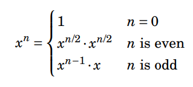


## GCD (Greatest Common Divisor)

```cpp
__gcd(m, n)
```

returns 0, if both m and n are zero, else gcd of m and n


## Decimal Precision

```cpp
setprecision(int n)
```

```cpp
cout << setprecision(5);

cout << num << endl;
```


## Prime Numbers

Natural numbers (>= 1) which are divisible by 1 and the number itself

A number n > 1 is prime if it is not divisible by any integer from 2 to √n

To check prime number:

- Brute force O(n)- Check for each number from 1 to n and check if some number divides it
- Optimised O(√n)- Check from 1 to √n

```cpp
bool isPrime(int n) {
    if (n <= 1) return false;
    for (int i = 2; i * i <= n; i++) {
        if (n % i == 0)
            return false;
    }
    return true;
}
```


## Sieve of Eratosthenes

Marking the multiples of each prime starting from 2, marking them as non-prime, and continuing this process up to sqrt(n), leaving only the prime numbers unmarked

```cpp
void sieveOfEratosthenes(int n) {
    vector<bool> isPrime(n + 1, true);
    isPrime[0] = isPrime[1] = false;

    for (int i = 2; i * i <= n; i++) {
        if (isPrime[i]) {
            for (int j = i * i; j <= n; j += i)
                isPrime[j] = false;
        }
    }

    cout << "Primes up to " << n << ":\n";
    for (int i = 2; i <= n; i++) {
        if (isPrime[i])
            cout << i << " ";
    }
    cout << endl;
}
```

T.C

```text
O(N * log (log(N)))
```


## Internal Data Structures and Time Complexity Table of All the C++ STL Containers

| STL Container Name | Internal Data-Structure | Time Complexity |
| --- | --- | --- |
| Unordered Set | Hash Table<br>(A hash table uses a hash function to compute an index) | For Insert, Search, Delete:<br>Best: O(1)<br>Avg: O(1)<br>Worst: O(N) |
| Set | Red Black Tree<br>(self-balancing binary search tree - maintains the height of tree log N) | For Insert, Search, Delete:<br>Best: O(log N)<br>Avg: O(log N)<br>Worst: O(log N) |
| MultiSet | Threaded Red Black Tree<br>(self-balancing binary search tree - maintains the height of tree log N) | For Insert, Search, Delete:<br>Best: O(log N)<br>Avg: O(log N)<br>Worst: O(log N) |
| Unordered Map | Hash Table<br>(A hash table uses a hash function to compute an index) | For Insert, Search, Delete:<br>Best: O(1)<br>Avg: O(1)<br>Worst: O(N) |
| Map | Red Black Tree<br>(self-balancing binary search tree - maintains the height of tree log N) | For Insert, Search, Delete:<br>Best: O(log N)<br>Avg: O(log N)<br>Worst: O(log N) |
| MultiMap | Threaded Red Black Tree<br>(self-balancing binary search tree - maintains the height of tree log N) | For Insert, Search, Delete:<br>Best: O(log N)<br>Avg: O(log N)<br>Worst: O(log N) |
| Priority_queue | Max Heap | Insert/Push: O(log N)<br>Delete/Pop: O(log N)<br>Peek/Top: O(1) |
| Stack | Linked List | Push: O(1)<br>Pop: O(1)<br>Top: O(1) |
| Queue | Linked List | Push: O(1)<br>Pop: O(1)<br>Front: O(1)<br>Back: O(1) |

Implementing Sets Without C++ STL Containers- [https://www.geeksforgeeks.org/implementing-sets-without-c-stl-containers/](https://www.geeksforgeeks.org/implementing-sets-without-c-stl-containers/)

C++ Unordered Map Under the Hood- [https://jbseg.medium.com/c-unordered-map-under-the-hood-9540cec4553a](https://jbseg.medium.com/c-unordered-map-under-the-hood-9540cec4553a)

What is PseudoCode: A Complete Tutorial- [https://www.geeksforgeeks.org/what-is-pseudocode-a-complete-tutorial/](https://www.geeksforgeeks.org/what-is-pseudocode-a-complete-tutorial/)


# Array

Declaration

```cpp
int arr[5];
```

Initialization

```cpp
int arr[] = { 1, 2, 3, 4, 5 };
```

Size

```cpp
int size = sizeof(arr) / sizeof(arr[0]);
```


## Vector

Declaration

```cpp
vector<int> v1;
```

Initialization

```cpp
vector<int> v1 = {1, 4, 2, 3, 5};
```

```cpp
// size 5 with default value of -1
vector<int> v1(5, -1);
```

STL

| Operation | Syntax |
| --- | --- |
| Size | `v.size()` |
| Insert at end | `v.push_back(x)` |
| Remove last element | `v.pop_back()` |
| Resize to n | `v.resize()` |
| First element | `v.front()` |
| Last element | `v.back()` |
| Iterator to first element | `v.begin()` |
| Iterator to last element | `v.end()` |
| reverse iterator pointing to the last element of the vector | `v.rbegin()` |
| reverse iterator pointing to the element preceding the first element | `v.rend()` |
| Remove all elements | `v.clear()` |
| Insert at index i | `v.insert(v.begin() + i, x)` |
| Remove element at index i | `v.erase(v.begin() + i)` |
| Remove range \[i, j) | `v.erase(v.begin() + i, v.begin() + j)` |
| Remove all elements | `v.clear()` |
| Sort ascending | `sort(v.begin(), v.end())` |
| Sort descending | `sort(v.begin(), v.end(), greater<>())` |
| Reverse vector | `reverse(v.begin(), v.end())` |
| First occurrence of x | `find(v.begin(), v.end(), x)` |
| Count occurrences of x | `count(v.begin(), v.end(), x)` |
| Sum of elements | `accumulate(v.begin(), v.end(), 0)` |
| Distance between 2 iterations | `distance(v.begin(), it)` |
| removes consecutive duplicate elements, by rearranging the elements and returning an iterator to the new logical end of the range | `unique(v.begin(), v.end())` |

If a vector is passed by reference (&), then it can be modified and this is faster.

Passing by value is slow and does not modify the original vector.


## Subarray

Total = n × (n + 1) / 2

T.C = O(n<sup>2</sup>)

```cpp
vector<vector<int>> generateSubarrays(const vector<int>& arr) {
    int n = arr.size();
    vector<vector<int>> result;

    for (int start = 0; start < n; ++start) {
        vector<int> temp; 
        for (int end = start; end < n; ++end) {
            temp.push_back(arr[end]);
            result.push_back(temp);
        }
    }

    return result;
}
```


## Subsequence

Total = 2<sup>n</sup>

```cpp
vector<vector<int>> generateSubsequences(const vector<int>& arr) {
    int n = arr.size();
    int total = 1 << n;  // 2^n subsequences
    vector<vector<int>> result;

    for (int mask = 0; mask < total; ++mask) {
        vector<int> subseq;

        for (int i = 0; i < n; ++i) {
            if (mask & (1 << i)) {
                subseq.push_back(arr[i]);
            }
        }

        result.push_back(subseq);
    }

    return result;
}
```

TC = O(n \* 2<sup>n</sup>)

```cpp
void buildSubsequences(int index, const vector<int>& arr, vector<int>& current, vector<vector<int>>& result) {
    if (index == arr.size()) {
        result.push_back(current);
        return;
    }

    // Include arr[index] in the current subsequence
    current.push_back(arr[index]);
    buildSubsequences(index + 1, arr, current, result);

    // Exclude arr[index] from the current subsequence
    current.pop_back();
    buildSubsequences(index + 1, arr, current, result);
}

vector<vector<int>> generateSubsequences(const vector<int>& arr) {
    vector<vector<int>> result;
    vector<int> current;
    buildSubsequences(0, arr, current, result);
    return result;
}
```

TC = O(2<sup>n</sup>)


## Two Pointer Technique

- The Two Pointer technique involves using two indices (or pointers) to iterate through a data structure, typically an array or string.
- It's commonly used in sorted arrays to solve problems involving pairs or subarrays efficiently.
- Start with two pointers at either end (or both at the start) and move them based on a condition.


## Sliding Window Technique

- The Sliding Window technique is used to optimize problems involving contiguous subarrays or substrings.
- Instead of recomputing sums or counts repeatedly, it adjusts the window by adding the next element and removing the first element from the previous window.
- Use two pointers to represent the current window’s start and end. Expand or shrink the window based on conditions.


## Kadane’s Algorithm

Maximum sum of a contiguous subarray

```cpp
int maxSubarraySum(vector<int> &arr) {
    int res = arr[0];
    int maxEnding = arr[0];

    for (int i = 1; i < arr.size(); i++) {      
        // Find the maximum sum ending at index i by either extending 
        // the maximum sum subarray ending at index i - 1 or by
        // starting a new subarray from index i
        maxEnding = max(maxEnding + arr[i], arr[i]);
      
        // Update res if maximum subarray sum ending at index i > res
        res = max(res, maxEnding);
    }
    return res;
}
```


## Difference Array

The difference array `diff` stores changes between adjacent elements, not the values themselves.

For a range update "add `v` to `[l, r]`":

- Something increases by `v` at position `l`
- Something decreases by `v` right after position `r`, i.e. at `r+1`

```cpp
diff[l]   += v
diff[r+1] -= v
```

After all queries, a single prefix sum over `diff` gives you the actual value at each position.

```cpp
#include <bits/stdc++.h>
using namespace std;

int main() {
    int n = 8;
    // Original array (can also start as all zeros)
    vector<int> arr = {1, 2, 3, 4, 5, 6, 7, 8};

    // Difference array, size n+1 to safely handle diff[r+1] at r=n-1
    vector<int> diff(n + 1, 0);

    // Range update queries: {l, r, v} → add v to arr[l..r]
    vector<tuple<int,int,int>> queries = {
        {1, 4, 3},   // add 3 to indices [1,4]
        {2, 6, -2},  // add -2 to indices [2,6]
        {0, 7, 1},   // add 1 to all
    };

    // Step 1: Mark boundaries -- O(q)
    for (auto [l, r, v] : queries) {
        diff[l]     += v;
        diff[r + 1] -= v;
    }

    // Step 2: Prefix sum over diff to get total change at each index -- O(n)
    for (int i = 1; i <= n; i++) {
        diff[i] += diff[i - 1];
    }

    // Step 3: Apply changes to original array -- O(n)
    for (int i = 0; i < n; i++) {
        arr[i] += diff[i];
    }

    for (int x : arr) cout << x << " ";
    // Output: 2 6 7 8 9 7 6 9
}
```


# String

| String | Char Array |
| --- | --- |
| A string is a class that defines objects that are represented as a stream of characters. | A character array is simply an array of characters that can be terminated by a null character. |
| memory is allocated dynamically | memory is allocated statically |

STL

| Operation | Syntax |
| --- | --- |
| Size | `s.length() or s.size()` |
| Append a string | `s += "world"` |
| Insert substring | `s.insert(pos, "text")` |
| Erase part of string | `s.erase(pos, len)` |
| Replace part of string | `s.replace(pos, len, "new")` |
| Substring | `s.substr(pos, len)` |
| Find substring (first occurrence) | `s.find(substr)`<br>`s.find(substr, pos)` |
| Compare strings | `s1.compare(s2)` |
| Clear the string | `s.clear()` |
| Swap two strings | `s1.swap(s2)` |
| Push back a character | `s.push_back('a')` |
| Pop last character | `s.pop_back()` |
| Convert int to string | `to_string(num)` |
| Convert string to int | `stoi(s)` |
| Convert string to long | `stol(s)` |
| Convert string to long long | `stoll(s)` |
| Copy contents of str1 into str2 | `strcpy(str2, str1);` |

string::npos- until the end of the string


## Palindrome string

```cpp
bool isPalindrome(const string& s) {
    int left = 0, right = s.length() - 1;

    while (left < right) {
        if (s[left] != s[right])
            return false;
        left++;
        right--;
    }
    return true;
}
```


## KMP Algorithm

For Pattern Searching

Whenever we detect a mismatch (after some matches), we already know some of the characters in the text of the next window

```text
lps[i] = the longest proper prefix of pat[0..i] which is also a suffix of pat[0..i]
```

```cpp
void constructLps(string &pat, vector<int> &lps) {
    // len stores the length of longest prefix which
    // is also a suffix for the previous index
    int len = 0;

    // lps[0] is always 0
    lps[0] = 0;

    int i = 1;
    while (i < pat.length()) {

        // If characters match, increment the size of lps
        if (pat[i] == pat[len]) {
            len++;
            lps[i] = len;
            i++;
        }

        // If there is a mismatch
        else {
            if (len != 0) {

                // Update len to the previous lps value
                // to avoid redundant comparisons
                len = lps[len - 1];
            }
            else {

                // If no matching prefix found, set lps[i] to 0
                lps[i] = 0;
                i++;
            }
        }
    }
}

vector<int> search(string &pat, string &txt) {
    int n = txt.length();
    int m = pat.length();

    vector<int> lps(m);
    vector<int> res;

    constructLps(pat, lps);

    // Pointers i and j, for traversing
    // the text and pattern
    int i = 0;
    int j = 0;

    while (i < n) {

        // If characters match, move both pointers forward
        if (txt[i] == pat[j]) {
            i++;
            j++;

            // If the entire pattern is matched
            // store the start index in result
            if (j == m) {
                res.push_back(i - j);

                // Use LPS of previous index to
                // skip unnecessary comparisons
                j = lps[j - 1];
            }
        }

        // If there is a mismatch
        else {

            // Use lps value of previous index
            // to avoid redundant comparisons
            if (j != 0)
                j = lps[j - 1];
            else
                i++;
        }
    }
    return res;
}
```

Ref- [https://www.geeksforgeeks.org/kmp-algorithm-for-pattern-searching/](https://www.geeksforgeeks.org/kmp-algorithm-for-pattern-searching/)


# Matrix

Declaration

```cpp
vector<vector<int>> arr(rows, vector<int>(cols));
```

Initialization

```cpp
vector<vector<int>> arr = {{1, 2, 3}, {4, 5, 6}, {7, 8, 9}};
```

Row size

```cpp
vec.size();
```

Column size

```cpp
vec[0].size();
```

Sort row wise

```cpp
sort(mat.begin(), mat.end());
```

Transpose of matrix

```cpp
void transpose(vector<vector<int>>& mat) {
    int n = mat.size(); 
    for (int i = 0; i < n; i++) {
        for (int j = i + 1; j < n; j++) {
            swap(mat[i][j], mat[j][i]); 
        }
    }
}
```


# Searching & Sorting


## Binary Search

Sorted array

TC = O(log n)

```cpp
int binarySearch(int arr[], int low, int high, int x)
{
    while (low <= high) {
        int mid = low + (high - low) / 2;

        // Check if x is present at mid
        if (arr[mid] == x)
            return mid;

        // If x greater, ignore left half
        if (arr[mid] < x)
            low = mid + 1;

        // If x is smaller, ignore right half
        else
            high = mid - 1;
    }

    // If we reach here, then element was not present
    return -1;
}
```

STL

| Operation | Syntax |
| --- | --- |
| Return true, if value exists | `binary_search(start, end, value);` |
| First iterator where the element is ≥ value | `lower_bound(start, end, value);` |
| First iterator where the element is > value | `upper_bound(start, end, value);` |


## Sorting

Stable sorting- If two objects with equal keys appear in the same order in sorted output as they appear in the input data set


## Selection Sort

Sorts an array by repeatedly selecting the smallest (or largest) element from the unsorted portion and swapping it with the first unsorted element

```cpp
void selectionSort(vector<int> &arr) {
    int n = arr.size();

    for (int i = 0; i < n - 1; ++i) {
        // Assume the current position holds
        // the minimum element
        int min_idx = i;

        // Iterate through the unsorted portion
        // to find the actual minimum
        for (int j = i + 1; j < n; ++j) {
            if (arr[j] < arr[min_idx]) {

                // Update min_idx if a smaller
                // element is found
                min_idx = j; 
            }
        }

        // Move minimum element to its
        // correct position
        swap(arr[i], arr[min_idx]);
    }
}
```


## Bubble Sort

Repeatedly swapping the adjacent elements if they are in the wrong order

```cpp
void bubbleSort(vector<int>& arr) {
    int n = arr.size();
    bool swapped;
  
    for (int i = 0; i < n - 1; i++) {
        swapped = false;
        for (int j = 0; j < n - i - 1; j++) {
            if (arr[j] > arr[j + 1]) {
                swap(arr[j], arr[j + 1]);
                swapped = true;
            }
        }
      
        // If no two elements were swapped, then break
        if (!swapped)
            break;
    }
}
```


## Insertion Sort

inserting each element of an unsorted list into its correct position in a sorted portion of the list

```cpp
void insertionSort(int arr[], int n)
{
    for (int i = 1; i < n; ++i) {
        int key = arr[i];
        int j = i - 1;

        /* Move elements of arr[0..i-1], that are
           greater than key, to one position ahead
           of their current position */
        while (j >= 0 && arr[j] > key) {
            arr[j + 1] = arr[j];
            j = j - 1;
        }
        arr[j + 1] = key;
    }
}
```


## Merge Sort

dividing the input array into two halves, recursively sorting the two halves and finally merging them back together to obtain the sorted array

TC = O(n log n)

```cpp
// Merges two subarrays of arr[].
// First subarray is arr[left..mid]
// Second subarray is arr[mid+1..right]
void merge(vector<int>& arr, int left, 
                     int mid, int right)
{
    int n1 = mid - left + 1;
    int n2 = right - mid;

    // Create temp vectors
    vector<int> L(n1), R(n2);

    // Copy data to temp vectors L[] and R[]
    for (int i = 0; i < n1; i++)
        L[i] = arr[left + i];
    for (int j = 0; j < n2; j++)
        R[j] = arr[mid + 1 + j];

    int i = 0, j = 0;
    int k = left;

    // Merge the temp vectors back 
    // into arr[left..right]
    while (i < n1 && j < n2) {
        if (L[i] <= R[j]) {
            arr[k] = L[i];
            i++;
        }
        else {
            arr[k] = R[j];
            j++;
        }
        k++;
    }

    // Copy the remaining elements of L[], 
    // if there are any
    while (i < n1) {
        arr[k] = L[i];
        i++;
        k++;
    }

    // Copy the remaining elements of R[], 
    // if there are any
    while (j < n2) {
        arr[k] = R[j];
        j++;
        k++;
    }
}

// begin is for left index and end is right index
// of the sub-array of arr to be sorted
void mergeSort(vector<int>& arr, int left, int right)
{
    if (left >= right)
        return;

    int mid = left + (right - left) / 2;
    mergeSort(arr, left, mid);
    mergeSort(arr, mid + 1, right);
    merge(arr, left, mid, right);
}
```


## Quick Sort

picks an element as a pivot and partitions the given array around the picked pivot by placing the pivot in its correct position in the sorted array

TC = O(n^2)

```cpp
int partition(vector<int>& arr, int low, int high) {
  
    // Choose the pivot
    int pivot = arr[high];
  
    // Index of smaller element and indicates 
    // the right position of pivot found so far
    int i = low - 1;

    // Traverse arr[low..high] and move all smaller
    // elements on the left side. Elements from low to 
    // i are smaller after every iteration
    for (int j = low; j <= high - 1; j++) {
        if (arr[j] < pivot) {
            i++;
            swap(arr[i], arr[j]);
        }
    }
    
    // Move pivot after smaller elements and
    // return its position
    swap(arr[i + 1], arr[high]);  
    return i + 1;
}

// The QuickSort function implementation
void quickSort(vector<int>& arr, int low, int high) {
  
    if (low < high) {
      
        // pi is the partition return index of pivot
        int pi = partition(arr, low, high);

        // Recursion calls for smaller elements
        // and greater or equals elements
        quickSort(arr, low, pi - 1);
        quickSort(arr, pi + 1, high);
    }
}
```


## Time and Space Complexity Comparison Table

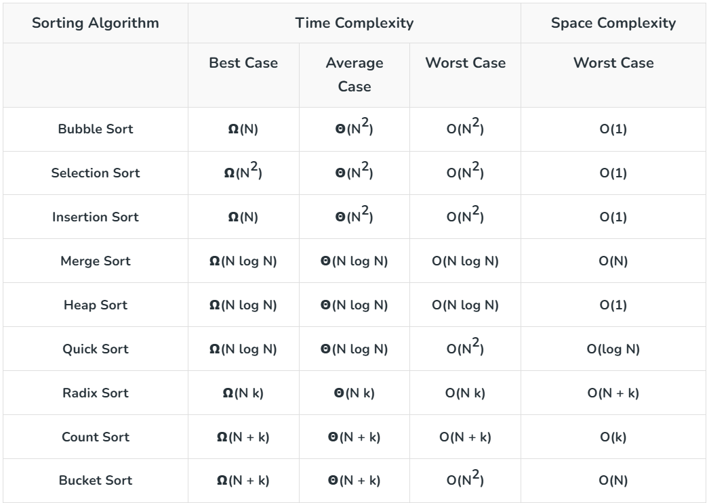


# Recursion

Base Case – stops the recursion.

Recursive Case – function calls itself with a smaller input.

Steps:

1. Define- What does my function return?
2. Base- What is the smallest input with an obvious answer?
3. Trust- Assume it works for smaller inputs (leap of faith)
4. Combine- How do I use smaller results to build my answer?
5. Verify- Does every return statement match my definition?

Backtracking- trying out all possible options and reverting (backtracking) when a choice leads to a dead end


# Linked List

| Array | Linked List |
| --- | --- |
| Arrays are stored in contiguous location | Linked Lists are not stored in contiguous locations. |
| Fixed size (Dynamic Sized Arrays also internally use fixed sized arrays) | Dynamic Size |
| Only store elements, no extra reference / pointer. | It stores both data and the address of the next node. |

Types

1. Singly Linked List: Each node points to the next node only
2. Doubly Linked List: Each node points to both next and previous nodes.
3. Circular Linked List: The last node points back to the first node.


## Structure

```cpp
class Node {
public:
    int data;
    Node* next;

    // Constructor
    Node(int value) {
        data = value;
        next = nullptr;
    }
};

Node* newNode = new Node(value);
```

```cpp
struct Node {
    int data;
    Node* next;
};

Node* newNode = new Node{value, nullptr};
```


## Operations

Insertion

```cpp
Node* insertAfterNode(Node* head, Node* prevNode, int val) {
    if (!prevNode) {
        cout << "Previous node cannot be NULL\n";
        return head;
    }

    Node* newNode = new Node(val);
    newNode->next = prevNode->next;
    prevNode->next = newNode;

    return head;
}
```

Deletion

```cpp
Node* deleteAfterNode(Node* head, Node* prevNode) {
    if (!prevNode || !prevNode->next) {
        cout << "No node to delete after the given node\n";
        return head;
    }

    Node* temp = prevNode->next;
    prevNode->next = temp->next;
    delete temp;

    return head;
}
```


## Length of Linked List

```cpp
// Counts number of nodes in linked list
int countNodes(Node* head) {
          
    // Initialize count with 0
    int count = 0;

    // Initialize curr with head of Linked List
    Node* curr = head;

    // Traverse till we reach nullptr
    while (curr != nullptr) {
        
              // Increment count by 1
        count++;
        
              // Move pointer to next node
        curr = curr->next;
    }
          
          // Return the count of nodes
    return count;
}
```


## Reverse a Linked List

```cpp
Node *reverseList(Node *head) {
    // Initialize three pointers: curr, prev and next
    Node *curr = head, *prev = nullptr, *next;

    // Traverse all the nodes of Linked List
    while (curr != nullptr) {
        // Store next
        next = curr->next;

        // Reverse current node's next pointer
        curr->next = prev;

        // Move pointers one position ahead
        prev = curr;
        curr = next;
    }

    // Return the head of reversed linked list
    return prev;
}
```


## Floyd's slow and fast pointers/ Tortoise and Hare algorithm

- Use two pointers:
  - slow moves one step at a time.
  - fast moves two steps at a time.
- Used for cycle detection (loop) and finding middle of the LL

```cpp
bool hasCycle(Node* head) {
    Node* slow = head;
    Node* fast = head;

    while (fast && fast->next) {
        slow = slow->next;
        fast = fast->next->next;

        if (slow == fast)
            return true;  // Cycle exists
    }
    return false;
}
```

```cpp
Node* findMiddle(Node* head) {
    Node* slow = head;
    Node* fast = head;

    while (fast && fast->next) {
        slow = slow->next;
        fast = fast->next->next;
    }

    return slow; // Middle node
}
```


## Merge sort in LL

TC = O(n \* log(n))

```cpp
// Function to split the singly linked list into two halves
Node *split(Node *head) {
    Node *fast = head;
    Node *slow = head;

    // Move fast pointer two steps and slow pointer
    // one step until fast reaches the end
    while (fast != nullptr && fast->next != nullptr) {
        fast = fast->next->next;
        if (fast != nullptr) {
            slow = slow->next;
        }
    }

    // Split the list into two halves
    Node *temp = slow->next;
    slow->next = nullptr;
    return temp;
}

// Function to merge two sorted singly linked lists
Node *merge(Node *first, Node *second) {
  
    // If either list is empty, return the other list
    if (first == nullptr) return second;
    if (second == nullptr) return first;

    // Pick the smaller value between first and second nodes
    if (first->data < second->data) {

        // Recursively merge the rest of the lists and
        // link the result to the current node
        first->next = merge(first->next, second);
        return first;
    }
    else {
        // Recursively merge the rest of the lists
        // and link the result to the current node
        second->next = merge(first, second->next);
        return second;
    }
}

// Function to perform merge sort on a singly linked list
Node *MergeSort(Node *head) {
  
    // Base case: if the list is empty or has only one node, 
    // it's already sorted
    if (head == nullptr || head->next == nullptr)
        return head;

    // Split the list into two halves
    Node *second = split(head);

    // Recursively sort each half
    head = MergeSort(head);
    second = MergeSort(second);

    // Merge the two sorted halves
    return merge(head, second);
}
```


# Stack & Queue


## Stack

- LIFO (Last In First Out) Principle
- All operations are O(1) in TC and SC
- Infix, Postfix, and Prefix Conversion- [https://www.naukri.com/code360/library/infix-postfix-and-prefix-conversion](https://www.naukri.com/code360/library/infix-postfix-and-prefix-conversion)

STL

| Operation | Syntax |
| --- | --- |
| Create | `stack<int> s;` |
| Push element | `s.push(x);` |
| Pop element | `s.pop();` |
| Access top element | `s.top();` |
| Check size | `s.size();` |
| Check if empty | `s.empty();` |
| Swap contents | `s1.swap(s2);` |


## Monotonic Stack

- maintaining elements in either increasing or decreasing order
- useful for Next Greater Element (NGE) and Next Smaller Element (NSE)

```cpp
vector<int> monotonicIncreasing(vector<int>& nums)
{
    int n = nums.size();
    stack<int> st;
    vector<int> result;

    // Traverse the array
    for (int i = 0; i < n; ++i) {
        // While stack is not empty AND top of stack is more
        // than the current element
        // For Monotonic Decreasing Stack, change sign to “<”
        while (!st.empty() && st.top() > nums[i]) {

            // Pop the top element from the
            // stack
            st.pop();
        }

        // Push the current element into the stack
        st.push(nums[i]);
    }

    // Construct the result array from the stack
    while (!st.empty()) {
        result.insert(result.begin(), st.top());
        st.pop();
    }

    return result;
}
```

Implementations

- Stack implementation in C++- [https://www.geeksforgeeks.org/stack-implementation-in-cpp/](https://www.geeksforgeeks.org/stack-implementation-in-cpp/)
- Implement two Stacks in an Array- [https://www.geeksforgeeks.org/implement-two-stacks-in-an-array/](https://www.geeksforgeeks.org/implement-two-stacks-in-an-array/)
- Implement Stack using Queues- [https://www.geeksforgeeks.org/implement-stack-using-queue/](https://www.geeksforgeeks.org/implement-stack-using-queue/)
- Implement k stacks in an array- [https://www.geeksforgeeks.org/efficiently-implement-k-stacks-single-array/](https://www.geeksforgeeks.org/efficiently-implement-k-stacks-single-array/)
- How to implement stack using priority queue or heap?- [https://www.geeksforgeeks.org/implement-stack-using-priority-queue-or-heap/](https://www.geeksforgeeks.org/implement-stack-using-priority-queue-or-heap/)
- Design a stack that supports getMin() in O(1) time- [https://www.geeksforgeeks.org/design-a-stack-that-supports-getmin-in-o1-time-and-o1-extra-space/](https://www.geeksforgeeks.org/design-a-stack-that-supports-getmin-in-o1-time-and-o1-extra-space/)


## Queue

- FIFO (First In First Out) Principle
- All operations are O(1) in TC and SC
- Dequeue- Double ended queue. Can insert and delete from both sides

Queue STL

| Operation | Syntax |
| --- | --- |
| Create | `queue<int> q;` |
| Add element (enqueue) | `q.push(x);` |
| Remove element | `q.pop();` |
| Access front element | `q.front();` |
| Access back element | `q.back();` |
| Check size | `q.size();` |
| Check if empty | `q.empty();` |
| Swap contents | `q1.swap(q2);` |

Dequeue STL

| Operation | Syntax |
| --- | --- |
| Create | `deque<int> dq;` |
| Insert at back | `dq.push_back(x);` |
| Insert at front | `dq.push_front(x);` |
| Remove from back | `dq.pop_back();` |
| Remove from front | `dq.pop_front();` |
| Access front element | `dq.front();` |
| Access back element | `dq.back();` |


## Monotonic Queues

maintaining elements in either increasing or decreasing order

```cpp
deque<int> increasing_monotonic_queue(int arr[], int n)
{
    deque<int> q;
    for (int i = 0; i < n; i++) {
        // If recently added element is
        // greater current element
        while (!q.empty() && q.back() > arr[i]) {

            q.pop_back();
        }

        q.push_back(arr[i]);
    }

    return q;
}
```

Implementations

- Array implementation of queue - Simple- [https://www.geeksforgeeks.org/array-implementation-of-queue-simple/](https://www.geeksforgeeks.org/array-implementation-of-queue-simple/)
- Circular Array Implementation of Queue- [https://www.geeksforgeeks.org/introduction-to-circular-queue/](https://www.geeksforgeeks.org/introduction-to-circular-queue/)
- Queue - Linked List Implementation- [https://www.geeksforgeeks.org/queue-linked-list-implementation/](https://www.geeksforgeeks.org/queue-linked-list-implementation/)
- Implement Stack and Queue using Deque-  [https://www.geeksforgeeks.org/implement-stack-queue-using-deque/](https://www.geeksforgeeks.org/implement-stack-queue-using-deque/)
- Queue using Stacks- [https://www.geeksforgeeks.org/queue-using-stacks/](https://www.geeksforgeeks.org/queue-using-stacks/)
- Implement k Queues in a single array- [https://www.geeksforgeeks.org/efficiently-implement-k-queues-single-array/](https://www.geeksforgeeks.org/efficiently-implement-k-queues-single-array/)


## LRU Cache

- Removes the least recently used item when the cache reaches its capacity
- Implemented using doubly linked list (DLL) and unordered_map

```cpp
struct Node {
    int key;
    int value;
    Node *next;
    Node *prev;

    Node(int k, int v) {
        key = k;
        value = v;
        next = nullptr;
        prev = nullptr;
    }
};

// LRU Cache class
class LRUCache
{
  public:  
    // Constructor to initialize the cache with a given capacity
    int capacity;
    unordered_map<int, Node *> cacheMap;
    Node *head;
    Node *tail;
    LRUCache(int capacity) {
        this->capacity = capacity;
        head = new Node(-1, -1);
        tail = new Node(-1, -1);
        head->next = tail;
        tail->prev = head;
    }

    // Function to get the value for a given key
    int get(int key) {      
        if (cacheMap.find(key) == cacheMap.end())
            return -1;
  

        Node *node = cacheMap[key];
        remove(node);
        add(node);
        return node->value;
    }

    // Function to put a key-value pair into the cache
    void put(int key, int value) {
        if (cacheMap.find(key) != cacheMap.end()) {
            Node *oldNode = cacheMap[key];
            remove(oldNode);
                  delete oldNode;
          
        }

        Node *node = new Node(key, value);
        cacheMap[key] = node;
        add(node);
       
       
        if (cacheMap.size() > capacity) {
            Node *nodeToDelete = tail->prev;
            remove(nodeToDelete);
            cacheMap.erase(nodeToDelete->key);
                  delete nodeToDelete;
        }
    }

    // Add a node right after the head 
    // (most recently used position)
    void add(Node *node) {
        Node *nextNode = head->next;
        head->next = node;
        node->prev = head;
        node->next = nextNode;
        nextNode->prev = node;
    }

    // Remove a node from the list
    void remove(Node *node) {
        Node *prevNode = node->prev;
        Node *nextNode = node->next;
        prevNode->next = nextNode;
        nextNode->prev = prevNode;
    }
};

int main(){
    LRUCache cache(2);
  
    cache.put(1, 1); 
    cache.put(2, 2);
    cout << cache.get(1) << endl;
    cache.put(3, 3);
    cout  << cache.get(2) << endl;
    cache.put(4, 4);
    cout << cache.get(1) << endl;
    cout << cache.get(3) << endl;
    cout << cache.get(4) << endl;

    return 0;
}
```


# Greedy

- Greedy Choice Property: The optimal solution can be constructed by making the best local choice at each step.
- Optimal Substructure: The optimal solution to the problem contains the optimal solutions to its subproblems.


# Binary Tree

```cpp
class Node {
public:
    int data;
    Node* left, * right;

    Node(int key) {
        data = key;
        left = nullptr;
        right = nullptr;
    }
};
```

Properties

- The maximum number of nodes at level L of a binary tree is 2<sup>L</sup>
- The maximum number of nodes in a binary tree of height H is 2<sup>H</sup> – 1
- Total number of leaf nodes in a binary tree = total number of nodes with 2 children + 1
- In a Binary Tree with N nodes, the minimum possible height or the minimum number of levels is Log<sub>2</sub>(N+1)
- A Binary Tree with L leaves has at least \| Log<sub>2</sub>L \| + 1 levels


## Types

Complete Binary Tree- all the levels are completely filled except possibly the last level and the last level has all keys as left as possible

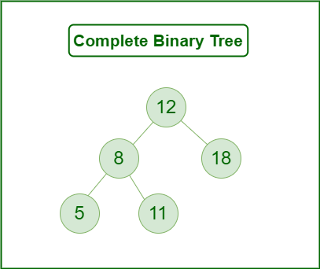

Perfect Binary Tree- all the internal nodes have two children and all leaf nodes are at the same level.

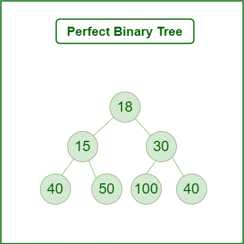

Balanced Binary Tree- difference between the height of the left and the right subtree for each node is either 0 or 1. Height will be O(log n)

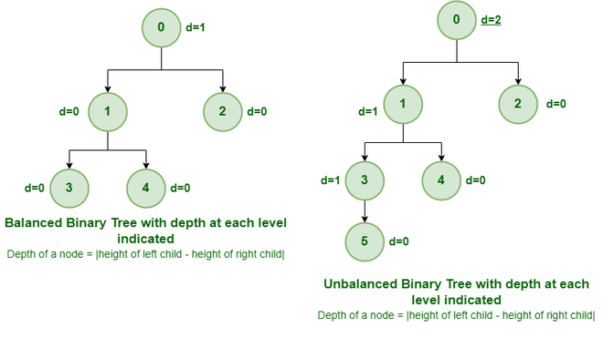

Full Binary Tree- binary tree with either zero or two child nodes for each node

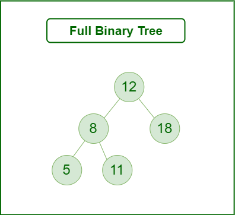

Degenerate Binary Tree/ Skewed Binary Tree- Every non-leaf node has just one child. They are either left or right skewed

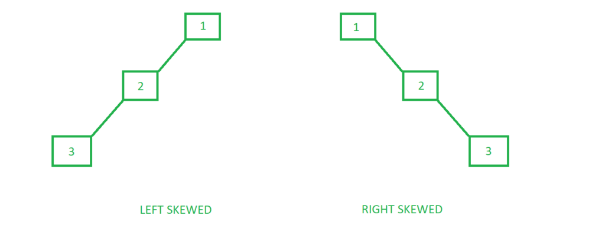

N-ary Tree- each node can have at most N children

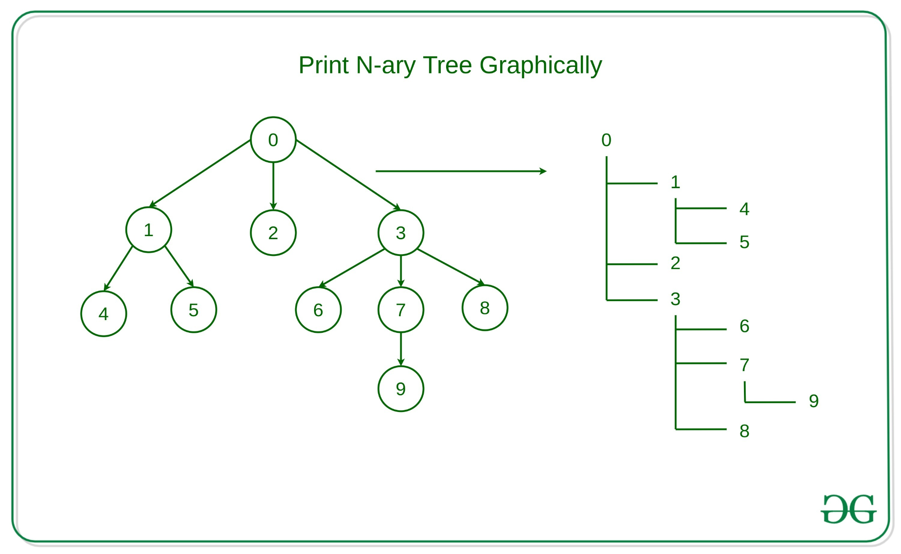


## Traversals

Inorder Traversal- Left -> Root -> Right

```cpp
void inorderTraversal(Node* root, vector<int>& result) {
    if (!root) return;
    inorderTraversal(root->left, result);
    result.push_back(root->val);
    inorderTraversal(root->right, result);
}
```

Preorder Traversal- Root -> Left -> Right

```cpp
void preorderTraversal(Node* root, vector<int>& result) {
    if (!root) return;
    result.push_back(root->val);
    preorderTraversal(root->left, result);
    preorderTraversal(root->right, result);
}
```

Postorder Traversal- Left -> Right -> Root

```cpp
void postorderTraversal(Node* root, vector<int>& result) {
    if (!root) return;
    postorderTraversal(root->left, result);
    postorderTraversal(root->right, result);
    result.push_back(root->val);
}
```

Level Order Traversal (BFS)

```cpp
vector<int> levelOrderTraversal(Node* root) {
    vector<int> result;
    if (!root) return result;

    queue<Node*> q;
    q.push(root);

    while (!q.empty()) {
        Node* curr = q.front(); 
        q.pop();
        result.push_back(curr->val);
        if (curr->left) q.push(curr->left);
        if (curr->right) q.push(curr->right);
    }

    return result;
}
```

Reverse Level Order Traversal

```cpp
vector<int> reverseLevelOrderTraversal(Node* root) {
    vector<int> result;
    if (!root) return result;

    queue<Node*> q;
    stack<int> s;
    q.push(root);

    while (!q.empty()) {
        Node* curr = q.front(); 
        q.pop();
        s.push(curr->val);

        // Push right first so left is processed first when reversed
        if (curr->right) q.push(curr->right);
        if (curr->left) q.push(curr->left);
    }

    while (!s.empty()) {
        result.push_back(s.top());
        s.pop();
    }

    return result;
}
```

Diagonal Traversal- [https://www.geeksforgeeks.org/diagonal-traversal-of-binary-tree/](https://www.geeksforgeeks.org/diagonal-traversal-of-binary-tree/)

Boundary Traversal- [https://www.geeksforgeeks.org/boundary-traversal-of-binary-tree/](https://www.geeksforgeeks.org/boundary-traversal-of-binary-tree/)


## Maximum Depth/ height of Binary Tree

Can use level order traversal also

```cpp
int height(Node *root) {
    if (root == nullptr)
        return -1;

    // compute the height of left and right subtrees
    int lHeight = height(root->left);
    int rHeight = height(root->right);

    return max(lHeight, rHeight) + 1;
}
```


## Size of a tree

Total number of nodes

```cpp
int getSize(Node* root) {
    if (root == nullptr)
        return 0;
    
    // Find the size of left and right 
    // subtree.
    int left = getSize(root->left);
    int right = getSize(root->right);
    
    // return the size of curr subtree.
    return left + right + 1;
}
```


## Level of a Node in Binary Tree

Can use level order traversal also

```cpp
int getLevel(Node* root, int target, int level) {
    if (root == nullptr) {
        return -1;
    }

    // If the target key matches the current node's 
          // data, return the level
    if (root->data == target) {
        return level;
    }

    // Recursively call for left and right subtrees
    int leftLevel = getLevel(root->left, target, level + 1);
    if (leftLevel != -1) {
        return leftLevel;
    }
    
    return getLevel(root->right, target, level + 1);
}
```


## Print path from root to a given node in a binary tree

```cpp
// Returns true if there is a path from root
// to the given node. It also populates 
// 'arr' with the given path
bool hasPath(Node *root, vector<int>& arr, int x)
{
    // if root is NULL
    // there is no path
    if (!root)
        return false;
    
    // push the node's value in 'arr'
    arr.push_back(root->data);    
    
    // if it is the required node
    // return true
    if (root->data == x)    
        return true;
    
    // else check whether the required node lies
    // in the left subtree or right subtree of 
    // the current node
    if (hasPath(root->left, arr, x) ||
        hasPath(root->right, arr, x))
        return true;
    
    // required node does not lie either in the 
    // left or right subtree of the current node
    // Thus, remove current node's value from 
    // 'arr'and then return false    
    arr.pop_back();
    return false;            
}
```


## AVL Tree

- self-balancing Binary Search Tree (BST), where the difference between heights of left and right subtrees for any node cannot be more than one
- All TC is O(log n)
- 4 types of rotations for balancing
  - Left Rotation
  - Right Rotation
  - Left-Right Rotation
  - Right-Left Rotation

Insertion- [https://www.geeksforgeeks.org/insertion-in-an-avl-tree/](https://www.geeksforgeeks.org/insertion-in-an-avl-tree/)

Deletion- [https://www.geeksforgeeks.org/deletion-in-an-avl-tree/](https://www.geeksforgeeks.org/deletion-in-an-avl-tree/)


# Binary Search Tree

- The left subtree of a node contains only nodes with keys less than the node's key.
- The right subtree of a node contains only nodes with keys greater than the node's key.
- The left and right subtree each must also be a binary search tree.


## Insertion

```cpp
Node* insert(Node* root, int x)
{

    Node* temp = new Node(x);

    // If tree is empty
    if (root == NULL)
        return temp;

    // Find the node who is going
    // to have the new node temp as
    // it child. The parent node is
    // mainly going to be a leaf node
    Node *parent = NULL, *curr = root;
    while (curr != NULL) {
        parent = curr;
        if (curr->key > x)
            curr = curr->left;
        else if (curr->key < x)
            curr = curr->right;
        else
            return root;
    }

    // If x is smaller, make it
    // left child, else right child
    if (parent->key > x)
        parent->left = temp;
    else
        parent->right = temp;
    return root;
}
```


## Searching

```cpp
// Function to search in a bst.
bool search(struct Node* root, int x) {
    
    Node* curr = root;
    
    while (curr != nullptr) {
        
        // If curr node is x
        if (curr->data == x)
            return true;
            
        // Search in right subtree
        else if (curr->data < x) 
            curr = curr->right;
            
        // Search in right subtree
        else
            curr = curr->left;
    }
    
    // If x is not found.
    return false;
}
```


## Deletion

3 cases

1. Delete a Leaf Node in BST
2. Delete a Node with Single Child in BST
3. Delete a Node with Both Children in BST

```cpp
// Note that it is not a generic inorder
// successor function. It mainly works
// when right child is not empty which is 
// the case we need in BST delete
Node* getSuccessor(Node* curr){
    curr = curr->right;
    while (curr != nullptr && curr->left != nullptr)
        curr = curr->left;
    return curr;
}

// This function deletes a given key x from
// the give BST and returns modified root of
// the BST (if it is modified)
Node* delNode(Node* root, int x){

    // Base case
    if (root == nullptr)
        return root;

    // If key to be searched is in a subtree
    if (root->key > x)
        root->left = delNode(root->left, x);
    else if (root->key < x)
        root->right = delNode(root->right, x);

    // If root matches with the given key
    else {

        // Cases when root has 0 children
        // or only right child
        if (root->left == nullptr) {
            Node* temp = root->right;
            delete root;
            return temp;
        }

        // When root has only left child
        if (root->right == nullptr) {
            Node* temp = root->left;
            delete root;
            return temp;
        }

        // When both children are present
        Node* succ = getSuccessor(root);
        root->key = succ->key;
        root->right = delNode(root->right, succ->key);
    }
    return root;
}
```


## Inorder predecessor and successor in BST

```cpp
Node* rightMost(Node* node) {
    while (node->right != nullptr) {
        node = node->right;
    }
    return node;
}

Node* leftMost(Node* node) {
    while (node->left != nullptr) {
        node = node->left;
    }
    return node;
}

// Return predecessor and successor as a vector<Node*>
vector<Node*> findPreSuc(Node* root, int key) {
    Node* pre = nullptr;
    Node* suc = nullptr;
    Node* curr = root;

    while (curr != nullptr) {
        if (curr->data < key) {
            pre = curr;
            curr = curr->right;
        } else if (curr->data > key) {
            suc = curr;
            curr = curr->left;
        } else {
            if (curr->left != nullptr)
                pre = rightMost(curr->left);
            if (curr->right != nullptr)
                suc = leftMost(curr->right);
            break;
        }
    }

    return {pre, suc};  
}
```


## Sorted Array to Balanced BST

```cpp
// Recursive function to construct BST
Node* sortedArrayToBSTRecur(vector<int>& arr, int start, int end) {
    if(start > end) return nullptr;
    
    // Find the middle element
    int mid = start + (end - start) / 2;
    
    // Create root node
    Node* root = new Node(arr[mid]);
    
    // Create left subtree
    root->left = sortedArrayToBSTRecur(arr, start, 
                                      mid - 1);
                                      
    // Create right subtree
    root->right = sortedArrayToBSTRecur(arr, mid + 1,
                                       end);
    return root;
}

Node* sortedArrayToBST(vector<int> &arr) {
    int n = arr.size();
    return sortedArrayToBSTRecur(arr, 0, n-1);
}
```


# Heap & Hashing


## Heap

- complete binary tree
- Max Heap- every parent node is greater than or equal to its children
- Min Heap- every parent node is less than or equal to its children
- Heapify- process to rearrange the elements to maintain the property of heap data structure
- Positions:
  - Parent = arr\[(i-1)/2\]
  - Left child = arr\[(2\*i)+1\]
  - Right child = arr\[(2\*i)+2\]

```cpp
class MaxHeap {
    // A pointer pointing to the elements
    // in the array in the heap.
    int* arr;

    // Maximum possible size of
    // the Max Heap.
    int maxSize;

    // Number of elements in the
    // Max heap currently.
    int heapSize;

public:
    // Constructor function.
    MaxHeap(int maxSize);

    // Heapifies a subtree taking the
    // given index as the root.
    void MaxHeapify(int);

    // Returns the index of the parent
    // of the element at ith index.
    int parent(int i)
    {
        return (i - 1) / 2;
    }

    // Returns the index of the left child.
    int lChild(int i)
    {
        return (2 * i + 1);
    }

    // Returns the index of the
    // right child.
    int rChild(int i)
    {
        return (2 * i + 2);
    }

    // Removes the root which in this
    // case contains the maximum element.
    int removeMax();

    // Increases the value of the key
    // given by index i to some new value.
    void increaseKey(int i, int newVal);

    // Returns the maximum key
    // (key at root) from max heap.
    int getMax()
    {
        return arr[0];
    }

    int curSize()
    {
        return heapSize;
    }

    // Deletes a key at given index i.
    void deleteKey(int i);

    // Inserts a new key 'x' in the Max Heap.
    void insertKey(int x);
};

// Constructor function builds a heap
// from a given array a[]
// of the specified size.
MaxHeap::MaxHeap(int totSize)
{
    heapSize = 0;
    maxSize = totSize;
    arr = new int[totSize];
}

// Inserting a new key 'x'.
void MaxHeap::insertKey(int x)
{
    // To check whether the key
    // can be inserted or not.
    if (heapSize == maxSize) {
        cout << "\nOverflow: Could not insertKey\n";
        return;
    }

    // The new key is initially
    // inserted at the end.
    heapSize++;
    int i = heapSize - 1;
    arr[i] = x;

    // The max heap property is checked
    // and if violation occurs,
    // it is restored.
    while (i != 0 && arr[parent(i)] < arr[i]) {
        swap(arr[i], arr[parent(i)]);
        i = parent(i);
    }
}

// Increases value of key at
// index 'i' to new_val.
void MaxHeap::increaseKey(int i, int newVal)
{
    arr[i] = newVal;
    while (i != 0 && arr[parent(i)] < arr[i]) {
        swap(arr[i], arr[parent(i)]);
        i = parent(i);
    }
}

// To remove the root node which contains
// the maximum element of the Max Heap.
int MaxHeap::removeMax()
{
    // Checking whether the heap array
    // is empty or not.
    if (heapSize <= 0)
        return INT_MIN;
    if (heapSize == 1) {
        heapSize--;
        return arr[0];
    }

    // Storing the maximum element
    // to remove it.
    int root = arr[0];
    arr[0] = arr[heapSize - 1];
    heapSize--;

    // To restore the property
    // of the Max heap.
    MaxHeapify(0);

    return root;
}

// In order to delete a key
// at a given index i.
void MaxHeap::deleteKey(int i)
{
    // It increases the value of the key
    // to infinity and then removes
    // the maximum value.
    increaseKey(i, INT_MAX);
    removeMax();
}

// To heapify the subtree this method
// is called recursively
void MaxHeap::MaxHeapify(int i)
{
    int l = lChild(i);
    int r = rChild(i);
    int largest = i;
    if (l < heapSize && arr[l] > arr[i])
        largest = l;
    if (r < heapSize && arr[r] > arr[largest])
        largest = r;
    if (largest != i) {
        swap(arr[i], arr[largest]);
        MaxHeapify(largest);
    }
}
```


## Heap Sort

- Rearrange array elements so that they form a Max Heap.
- Repeat the following steps until the heap contains only one element:
  - Swap the root element of the heap (which is the largest element in the current heap) with the last element of the heap.
  - Remove the last element of the heap (which is now in the correct position). We mainly reduce heap size and do not remove elements from the actual array.
  - Heapify the remaining elements of the heap.
- Finally we get a sorted array.

TC of heap sort = O (n log n)

TC of building a heap = O (n)

```cpp
// To heapify a subtree rooted with node i
// which is an index in arr[].
void heapify(vector<int>& arr, int n, int i){

    // Initialize largest as root
    int largest = i;

    // left index = 2*i + 1
    int l = 2 * i + 1;

    // right index = 2*i + 2
    int r = 2 * i + 2;

    // If left child is larger than root
    if (l < n && arr[l] > arr[largest])
        largest = l;

    // If right child is larger than largest so far
    if (r < n && arr[r] > arr[largest])
        largest = r;

    // If largest is not root
    if (largest != i) {
        swap(arr[i], arr[largest]);

        // Recursively heapify the affected sub-tree
        heapify(arr, n, largest);
    }
}

// Main function to do heap sort
void heapSort(vector<int>& arr){
    int n = arr.size();

    // Build heap (rearrange vector)
    for (int i = n / 2 - 1; i >= 0; i--)
        heapify(arr, n, i);

    // One by one extract an element from heap
    for (int i = n - 1; i > 0; i--) {

        // Move current root to end
        swap(arr[0], arr[i]);

        // Call max heapify on the reduced heap
        heapify(arr, i, 0);
    }
}
```


## Priority Queue

STL

| Operation | Syntax |
| --- | --- |
| Create (max heap) | `priority_queue<int> pq;` |
| Create (min heap) | `priority_queue<int, vector<int>, greater<int>> pq;` |
| Insertion | `pq.push(value)` |
| Top Element | `pq.top()` |
| Removal | `pq.pop()` |
| Size | `pq.size()` |
| Check Empty | `pq.empty()` |


## Custom Comparator

```cpp
class Compare {
public:
        bool operator()(data_type a, data_type b) {
                if(cond) {
                        return true;
                }
                return false;
        }
};
```

```cpp
priority_queue<PII, vector<PII>, Compare> pq;
```

- Operator overloading of () operator
- Behaviour is reverse of sorting
- If true, order is NOT correct and swapping of elements takes place
- If false, order is correct and no swapping of elements takes place


## Hashing

- process of generating a small sized output (that can be used as index in a table) from an input of typically large and variable size
- Hash function- function that converts input data into a fixed-size number (called a hash value)
- Collision- When two or more keys have the same hash value, a collision happens
- Load Factor = Total elements in hash table/ Size of hash table
- Rehashing- increasing the size of a hashmap and redistributing the elements to new buckets based on their new hash values

### Types of Hash Functions

1\. Division Method

```text
h(k) = k % m
```

Where k is the key and m is a prime number.

2\. Multiplication Method

```text
h(k) = ⌊m * (k * A % 1)⌋
```

Where ⌊ ⌋ denotes the floor function.

3\. Mid-Square Method

- the key is squared, and the middle digits of the result are taken as the hash value.

4\. Folding Method

- dividing the key into equal parts, summing the parts, and then taking the modulo with respect to m

5\. Cryptographic Hash Functions

- MD5, SHA-1, and SHA-256

6\. Universal Hashing

```text
h(k) = ((a⋅k+b)%p)%m
```

Where a and b are randomly chosen constants, p is a prime number greater than m, and k is the key.

7\. Perfect Hashing

- create a collision-free hash function for a static set of keys. It guarantees that no two keys will hash to the same value


# Graph

- Vertices (nodes)- The points where edges meet in a graph
- Edges- The connections between vertices are known as edges. They can be undirected (bidirectional) or directed (unidirectional).
- Weight- A weight can be assigned to an edge, representing the cost or distance between two vertices
- Degree- The degree of a vertex is the number of edges that connect to it. In a directed graph, the in-degree of a vertex is the number of edges that point to it, and the out-degree is the number of edges that start from it.


## Types

Null Graph- no edges in the graph

Trivial Graph- only a single vertex, it is also the smallest graph possible

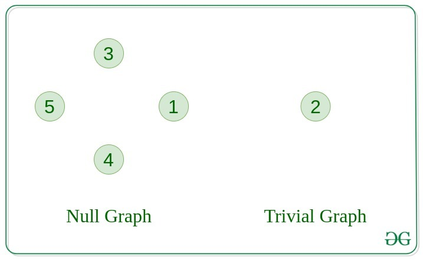

Undirected Graph- edges do not have any direction

Directed Graph- edge has direction

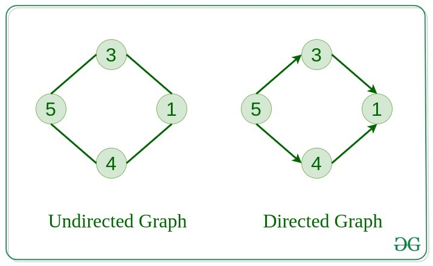

Connected Graph- in which from one node we can visit any other node in the graph

Disconnected Graph- at least one node is not reachable from a node

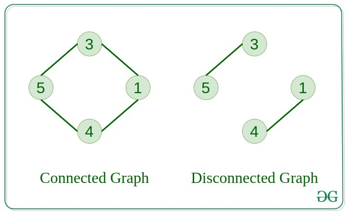

Regular Graph- degree of every vertex is equal to K is called K regular graph

Complete Graph- The graph in which from each node there is an edge to each other node

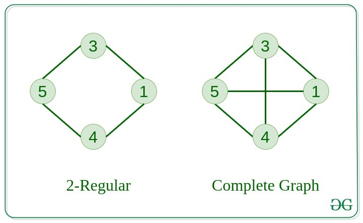

Cycle Graph- The graph in which the graph is a cycle in itself, the minimum value of degree of each vertex is 2

Cyclic Graph- graph containing at least one cycle

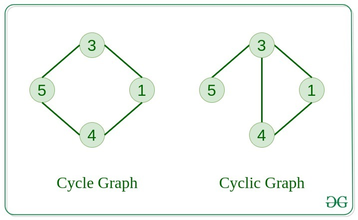

Directed Acyclic Graph- A Directed Graph that does not contain any cycle

Bipartite Graph- A graph in which vertex can be divided into two sets such that vertex in each set does not contain any edge between them

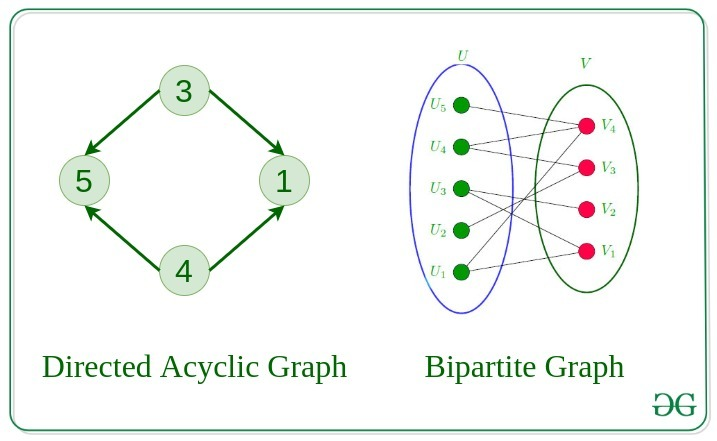


## Representation

Adjacency Matrix

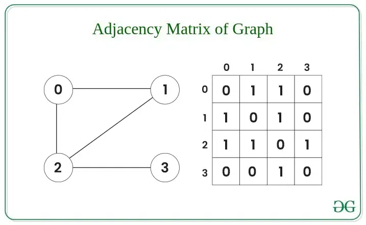

```cpp
void addEdge(vector<vector<int>> &mat, int i, int j)
{
    mat[i][j] = 1;
    mat[j][i] = 1; // Since the graph is undirected
}

void displayMatrix(vector<vector<int>> &mat)
{
    int V = mat.size();
    for (int i = 0; i < V; i++)
    {
        for (int j = 0; j < V; j++)
            cout << mat[i][j] << " ";
        cout << endl;
    }
}
```

Adjacency List

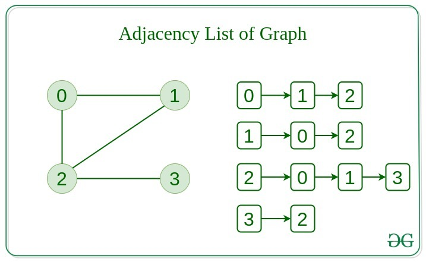

```cpp
// Function to add an edge between two vertices
void addEdge(vector<vector<int>>& adj, int i, int j) {
    adj[i].push_back(j);
    adj[j].push_back(i); // Undirected
}

// Function to display the adjacency list
void displayAdjList(const vector<vector<int>>& adj) {
    for (int i = 0; i < adj.size(); i++) {
        cout << i << ": "; // Print the vertex
        for (int j : adj[i]) {
            cout << j << " "; // Print its adjacent
        }
        cout << endl; 
    }
}
```

Convert Adjacency Matrix to Adjacency List

```cpp
vector<vector<int>> convert( vector<vector<int>> a)
{
    vector<vector<int>> adjList(a.size());
    for (int i = 0; i < a.size(); i++)
    {
        
        for (int j = 0; j < a[i].size(); j++)
        {
            if (a[i][j] != 0)
            {
                adjList[i].push_back(j);
            }
        }
    }
    return adjList;
}
```

Convert Adjacency List to Adjacency Matrix

```cpp
vector<vector<int> > convert(vector<int> adj[], int V)
{
    // Initialize a matrix
    vector<vector<int> > matrix(V,
                                vector<int>(V, 0));

    for (int i = 0; i < V; i++) {
        for (auto j : adj[i])
            matrix[i][j] = 1;
    }
    return matrix;
}
```

In and out degree

```cpp
void findInOutDegrees(const vector<vector<int>>& adj, int V) {
    vector<int> inDegree(V, 0);
    vector<int> outDegree(V, 0);

    for (int u = 0; u < V; ++u) {
        outDegree[u] = adj[u].size(); // out-degree = number of edges from u
        for (int v : adj[u]) {
            inDegree[v]++;            // in-degree of v increases for each edge (u -> v)
        }
    }

    cout << "Vertex\tIn-Degree\tOut-Degree\n";
    for (int i = 0; i < V; ++i) {
        cout << i << "\t" << inDegree[i] << "\t\t" << outDegree[i] << "\n";
    }
}
```


## Properties

- Distance between two Vertices- number of edges that are available in the shortest path between vertex A and vertex B
- Eccentricity of a Vertex- Maximum distance from a vertex to all other vertices
- Radius of a Connected Graph- The minimum value of eccentricity from all vertices
- Diameter of A Connected Graph- The maximum value of eccentricity from all vertices
- Central Point and Centre- The vertex having minimum eccentricity is considered as the central point of the graph. And the sets of all central points are considered as the centre of Graph.


## Breadth First Search or BFS

TC = O(V + E)

SC = O(V)

```cpp
// BFS from given source s
void bfs(vector<vector<int>>& adj, int s, vector<bool>& visited, vector<int> &res) {
    // Create a queue for BFS
    queue<int> q; 

    // Mark source node as visited and enqueue it
    visited[s] = true;
    q.push(s);

    // Iterate over the queue
    while (!q.empty()) {
        // Dequeue a vertex and store it
        int curr = q.front(); 
        q.pop();
        res.push_back(curr);

        // Get all adjacent vertices of the dequeued 
        // vertex curr If an adjacent has not been 
        // visited, mark it visited and enqueue it
        for (int x : adj[curr]) {
            if (!visited[x]) {
                visited[x] = true;
                q.push(x);
            }
        }
    }
}
                      
// Perform BFS for the entire graph which maybe
// disconnected
vector<int> bfsDisconnected(vector<vector<int>>& adj) {
    int V = adj.size();

    // create an array to store the traversal
    vector<int> res;

    // Initially mark all the vertices as not visited
    vector<bool> visited(V, false); 

    // perform BFS for each node
    for (int i = 0; i < adj.size(); ++i) {
        if (!visited[i]) {
            bfs(adj, i, visited, res);
        }
    }

    return res;
}
```


## Depth First Search or DFS

TC = O(V + E)

SC = O(V)

```cpp
// Recursive function for DFS traversal
void dfsRec(vector<vector<int>> &adj, vector<bool> &visited, int s, vector<int> &res)
{
    // Mark the current vertex as visited
    visited[s] = true;

    res.push_back(s);

    // Recursively visit all adjacent vertices that are not visited yet
    for (int i : adj[s])
        if (visited[i] == false)
            dfsRec(adj, visited, i, res);
}

// Main DFS function to perform DFS for the entire graph
vector<int> DFS(vector<vector<int>> &adj)
{
    vector<bool> visited(adj.size(), false);
    vector<int> res;
    // Loop through all vertices to handle disconnected graph
    for (int i = 0; i < adj.size(); i++)
    {
        if (visited[i] == false)
        {
            // If vertex i has not been visited,
            // perform DFS from it
            dfsRec(adj, visited, i, res);
        }
    }

    return res;
}
```


## Detect Cycle in a Directed Graph

Use DFS and find a back edge (a node points to one of its ancestors in a DFS tree)

```cpp
// Utility function for DFS to detect a cycle in a directed graph
bool isCyclicUtil(vector<vector<int>> &adj, int u, vector<bool> &visited, vector<bool> &recStack)
{
    // If the node is already in the recursion stack, a cycle is detected
    if (recStack[u])
        return true;

    // If the node is already visited and not in recursion stack, no need to check again
    if (visited[u])
        return false;

    // Mark the current node as visited and add it to the recursion stack
    visited[u] = true;
    recStack[u] = true;

    // Recur for all neighbors
    for (int x : adj[u])
    {
        if (isCyclicUtil(adj, x, visited, recStack))
            return true;
    }

    // Remove the node from the recursion stack
    recStack[u] = false;
    return false;
}

// Function to detect cycle in a directed graph
bool isCyclic(int V, vector<vector<int>> &edges)
{
    // Construct the adjacency list
    vector<vector<int>> adj = constructadj(V, edges);

    // visited[] keeps track of visited nodes
    // recStack[] keeps track of nodes in the current recursion stack
    vector<bool> visited(V, false);
    vector<bool> recStack(V, false);

    // Check for cycles starting from every unvisited node
    for (int i = 0; i < V; i++)
    {
        if (!visited[i] && isCyclicUtil(adj, i, visited, recStack))
            return true; // Cycle found
    }

    return false; // No cycles detected
}
```


## Detect cycle in an undirected graph

- do BFS and check if a node has been visited earlier, ensuring that we do not consider the parent node of the current node while making this check.
- If we encounter a visited node that is not the parent, a cycle exists in the graph

```cpp
// Function to perform BFS from node start
bool bfs(int start, vector<vector<int>>& adj, vector<bool>& visited) {
    queue<pair<int, int>> q;
    q.push({start, -1});
    visited[start] = true;

    while (!q.empty()) {
        int node = q.front().first;
        int parent = q.front().second;
        q.pop();

        for (int neighbor : adj[node]) {

            if (!visited[neighbor]) {
                visited[neighbor] = true;
                q.push({neighbor, node});
            } 
            else if (neighbor != parent) {
                return true;
            }
        }
    }
    return false;
}

bool isCycle(int V, vector<vector<int>>& edges) {    
    vector<vector<int>> adj = constructadj(V, edges);
    vector<bool> visited(V, false);

    for (int i = 0; i < V; i++) {
        
        if (!visited[i]) {
            if (bfs(i, adj, visited)) {
                return true;
            }
        }
    }
    
    // If no cycle is found
    return false;
}
```


## Dijkstra's Algorithm

- To find Shortest Paths from a Source to all other vertices
- Non-negative weights

Steps

- Initialize distances from source to all nodes as infinity (∞), except source = 0.
- Use a priority queue (min-heap) to pick the node with the smallest distance.
- For the current node:
  - Check all its neighbors.
  - Relax the edge: If current_dist + edge_weight \< neighbor_dist, then update the neighbor’s distance.
- Repeat until all nodes are visited

TC = O(E \* logV)

SC = O(V)

```cpp
// Returns shortest distances from src to all other vertices
vector<int> dijkstra(int V, vector<vector<int>> &edges, int src){    
    // Create adjacency list
    vector<vector<vector<int>>> adj = constructAdj(edges, V);

    // Create a priority queue to store vertices that
    // are being preprocessed.
    priority_queue<vector<int>, vector<vector<int>>, 
                   greater<vector<int>>> pq;

    // Create a vector for distances and initialize all
    // distances as infinite
    vector<int> dist(V, INT_MAX);

    // Insert source itself in priority queue and initialize
    // its distance as 0.
    pq.push({0, src});
    dist[src] = 0;

    // Looping till priority queue becomes empty (or all
    // distances are not finalized) 
    while (!pq.empty()){        
        // The first vertex in pair is the minimum distance
        // vertex, extract it from priority queue.
        int u = pq.top()[1];
        pq.pop();

        // Get all adjacent of u.
        for (auto x : adj[u]){            
            // Get vertex label and weight of current
            // adjacent of u.
            int v = x[0];
            int weight = x[1];

            // If there is a shorter path to v through u.
            // Relaxing the edge
            if (dist[v] > dist[u] + weight)
            {
                // Updating distance of v
                dist[v] = dist[u] + weight;
                pq.push({dist[v], v});
            }
        }
    }

    return dist;
}
```


## Bellman–Ford Algorithm

- To find Shortest Paths from a Source to all other vertices
- Can work in negative weights or negative weight cycle also

TC = O(V \* E)

SC = O(V)

```cpp
vector<int> bellmanFord(int V, vector<vector<int>>& edges, int src) {    
    // Initially distance from source to all 
    // other vertices are not known(Infinite).
        vector<int> dist(V, 1e8);
        dist[src] = 0;
  
        // Relaxation of all the edges V times, not (V - 1) as we
      // need one additional relaxation to detect negative cycle
        for (int i = 0; i < V; i++) {
            
                for (vector<int> edge : edges) {
                        int u = edge[0];
                        int v = edge[1];
                        int wt = edge[2];
                        if (dist[u] != 1e8 && dist[u] + wt < dist[v]) {                    
                     // If this is the Vth relaxation, then there is
                     // a negative cycle
                     if(i == V - 1)
                        return {-1};
               
                     // Update shortest distance to node v
                     dist[v] = dist[u] + wt;
                  }
                }
        }

    return dist;
}
```


## Detect a negative cycle in a Graph

use Bellman Ford algorithm

```cpp
// The main function that finds shortest distances
// from src to all other vertices using Bellman-
// Ford algorithm. The function also detects
// negative weight cycle
bool isNegCycleBellmanFord(struct Graph* graph, int src, int dist[])
{
    int V = graph->V;
    int E = graph->E;

    // Step 1: Initialize distances from src
    // to all other vertices as INFINITE
    for (int i = 0; i < V; i++)
        dist[i] = INT_MAX;
    dist[src] = 0;

    // Step 2: Relax all edges |V| - 1 times.
    // A simple shortest path from src to any
    // other vertex can have at-most |V| - 1
    // edges
    for (int i = 1; i <= V - 1; i++) {
        for (int j = 0; j < E; j++) {
            int u = graph->edge[j].src;
            int v = graph->edge[j].dest;
            int weight = graph->edge[j].weight;
            if (dist[u] != INT_MAX
                && dist[u] + weight < dist[v])
                dist[v] = dist[u] + weight;
        }
    }

    // Step 3: check for negative-weight cycles.
    // The above step guarantees shortest distances
    // if the graph doesn't contain a negative weight cycle.
    // If we get a shorter path, then there is a cycle.
    for (int i = 0; i < E; i++) {
        int u = graph->edge[i].src;
        int v = graph->edge[i].dest;
        int weight = graph->edge[i].weight;
        if (dist[u] != INT_MAX
            && dist[u] + weight < dist[v])
            return true;
    }

    return false;
}

// Returns true if the given graph has a negative weight cycle.
bool isNegCycleDisconnected(struct Graph* graph)
{
    int V = graph->V;

    // To keep track of visited vertices to avoid
    // recomputations.
    bool visited[V];
    memset(visited, 0, sizeof(visited));

    // This array is filled by Bellman-Ford
    int dist[V];

    // Call Bellman-Ford for all those vertices
    // that are not visited
    for (int i = 0; i < V; i++) {
        if (visited[i] == false) {
            // If cycle found
            if (isNegCycleBellmanFord(graph, i, dist))
                return true;

            // Mark all vertices that are visited
            // in the above call.
            for (int i = 0; i < V; i++)
                if (dist[i] != INT_MAX)
                    visited[i] = true;
        }
    }

    return false;
}
```


## Floyd Warshall Algorithm

- Works for negative weights, but should not have negative weight cycle
- TC = O(V<sup>3</sup>)

```cpp
void floydWarshall(vector<vector<int>> &dist) {
    int V = dist.size();

    // Add all vertices one by one to
    // the set of intermediate vertices.
    for (int k = 0; k < V; k++) {

        // Pick all vertices as source one by one
        for (int i = 0; i < V; i++) {

            // Pick all vertices as destination
            // for the above picked source
            for (int j = 0; j < V; j++) {

                // shortest path from
                // i to j 
                if(dist[i][k] != 1e8 && dist[k][j]!= 1e8)
                dist[i][j] = min(dist[i][j],dist[i][k] + dist[k][j]);
            }
        }
    }
}
```


## Minimum Spanning Tree (MST)

- Spanning Tree- subgraph that includes all vertices of the original graph and is a tree (i.e., it has no cycles and is connected)
- MST- spanning tree with the smallest possible total edge weight
- No of edges (E) = V-1

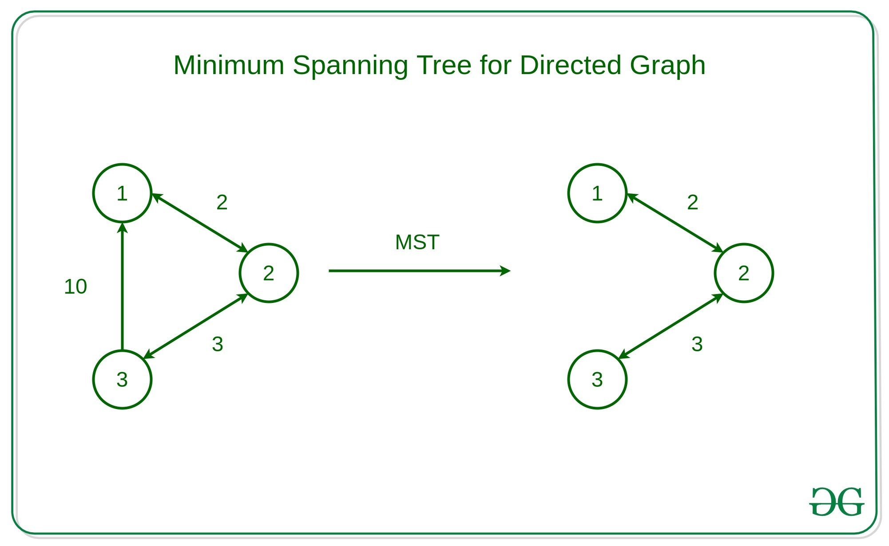


## Prim’s Algorithm

- Used to find MST
- TC = O((E+V) \* log(V))

Steps

- The algorithm starts with an empty spanning tree.
- The idea is to maintain two sets of vertices. The first set contains the vertices already included in the MST, and the other set contains the vertices not yet included.
- At every step, it considers all the edges that connect the two sets and picks the minimum weight edge from these edges. After picking the edge, it moves the other endpoint of the edge to the set containing MST.

```cpp
// Returns {totalWeight, mstEdges} where each edge is {u, v, weight}
int primMST(vector<vector<int>> adj[], int V) {    
    // Min-heap: {weight, node, parent}
    priority_queue<vector<int,3>, vector<vector<int,3>>, greater<vector<int,3>>> pq;
    
    vector<bool> visited(V, false);
    vector<vector<int,3>> mstEdges; // {u, v, weight}
    int totalWeight = 0;

    // Start from node 0, no parent (-1)
    pq.push({0, 0, -1});

    while (!pq.empty()) {
        auto [wt, u, parent] = pq.top();
        pq.pop();

        // Skip if already in MST
        if (visited[u]) continue;
        visited[u] = true;
        totalWeight += wt;

        // Record edge (skip the starting node which has no parent)
        if (parent != -1)
            mstEdges.push_back({parent, u, wt});

        // Explore neighbors
        for (auto& v : adj[u]) {
            // adj[u] = {neighbor, weight}
            if (!visited[v[0]])
                pq.push({v[1], v[0], u});
        }
    }

    return totalWeight;
}
```


## Topological Sorting

- for Directed Acyclic Graph (DAG)
- linear ordering of vertices such that for every directed edge u-v, vertex u comes before v in the ordering
- use Kahn's algorithm
- TC = O(V+E)

```cpp
vector<int> topologicalSort(int V, vector<vector<int> >& edges)
{
    vector<vector<int>> adj = constructadj(V,edges);
    
    // Vector to store indegree of each vertex
    vector<int> indegree(V);
    for (int i = 0; i < V; i++) {
        for (auto it : adj[i]) {
            indegree[it]++;
        }
    }

    // Queue to store vertices with indegree 0
    queue<int> q;
    for (int i = 0; i < V; i++) {
        if (indegree[i] == 0) {
            q.push(i);
        }
    }

    vector<int> result;
    while (!q.empty()) {
        int node = q.front();
        q.pop();
        result.push_back(node);
        
        // Decrease indegree of adjacent vertices as the
        // current node is in topological order
        for (auto it : adj[node]) {
            indegree[it]--;

            // If indegree becomes 0, push it to the queue
            if (indegree[it] == 0)
                q.push(it);
        }
    }

    return result;
}
```


## Connected Components in an Undirected Graph

TC = O(V + E)

```cpp
// Function to perform DFS and collect all
// nodes in the current connected component
void dfs(int node, vector<vector<int>>& adj,
         vector<bool>& vis, vector<int>& component) {
    
    // Mark the current node as visited
    vis[node] = true;

    // Add the node to the current component
    component.push_back(node);

    // Traverse all unvisited neighbors
    for (int neighbor : adj[node]) {
        if (!vis[neighbor]) {
            dfs(neighbor, adj, vis, component);
        }
    }
}

// Function to find all connected components 
// in an undirected graph
vector<vector<int>> getComponents(int V, vector<vector<int>>& edges) {
    
    // Create the graph using the adjacency list
    vector<vector<int>> adj = buildGraph(V, edges);

    // Initialize a visited array to keep track of visited nodes
    vector<bool> vis(V, false);

    // This will store all the connected components
    vector<vector<int>> res;

    // Iterate through all nodes
    for (int i = 0; i < V; ++i) {
        // If the node has not been visited, it's a new component
        if (!vis[i]) {
            
            vector<int> component;

            // Perform DFS to collect all nodes in this component
            dfs(i, adj, vis, component);

            // Add the component to the result list
            res.push_back(component);
        }
    }

    // Return the list of all connected components
    return res;
}
```


## Eulerian path and circuit for undirected graph

- Eulerian Path- A path that visits every edge exactly once, but not necessarily all vertices. It can start and end at different vertices.
- Eulerian Circuit- An Eulerian Path that starts and ends at the same vertex.
- TC = O(V + E)

A graph has an Eulerian Cycle if and only if the below two conditions are true

- All vertices with non-zero degree are part of a single connected component. (We ignore isolated vertices— those with zero degree — as they do not affect the cycle.)
- Every vertex in the graph has an even degree.

A graph has an Eulerian Path if and only if the below two conditions are true

- All vertices with non-zero degree must belong to the same connected component. (Same as Eulerian Cycle)
- Exactly Zero or Two Vertices with Odd Degree:
  - If zero vertices have an odd degree → Eulerian Cycle exists (which is also a path).
  - If two vertices have odd degree → Eulerian Path exists (but not a cycle).
  - If one vertex has an odd degree → Not possible in an undirected graph. (Because the sum of all degrees in an undirected graph is always even.)

```cpp
// DFS to check connectivity, excluding zero-degree vertices
void dfs(int node, vector<int> adj[], vector<bool> &visited) {
    visited[node] = true;

    for (int neighbor : adj[node]) {
        if (!visited[neighbor]) {
            dfs(neighbor, adj, visited);
        }
    }
}

// Function to check Eulerian Path or Circuit
int isEulerCircuit(int v, vector<int> adj[]) {
    vector<bool> visited(v, false);

    // Find first vertex with non-zero degree
    int start = -1;
    for (int i = 0; i < v; i++) {
        if (adj[i].size() > 0) {
            start = i;
            break;
        }
    }

    // No edges: graph is trivially Eulerian
    if (start == -1) {
        return 2;
    }

    // DFS from the first non-zero degree vertex
    dfs(start, adj, visited);

    // Check if all non-zero degree vertices are connected
    for (int i = 0; i < v; i++) {
        if (adj[i].size() > 0 && !visited[i]) {
            return 0; // Not connected
        }
    }

    // Count vertices with odd degree
    int odd = 0;
    for (int i = 0; i < v; i++) {
        if (adj[i].size() % 2 != 0) {
            odd++;
        }
    }

    // Apply Eulerian rules
    if (odd == 0) {
        return 2; 
    } else if (odd == 2) {
        return 1; 
    } else {
        return 0; 
    }
}
```


# Dynamic Programming


## Properties

- Optimal Substructure- optimal results of subproblems to achieve the optimal result of the bigger problem
- Overlapping Subproblems- The same subproblems are solved repeatedly in different parts of the problem


## Approaches

Top-Down Approach (Memoization)

- Keep the solution recursive and add a memoization table to avoid repeated calls of the same subproblems.
- Before making any recursive call, we first check if the memoization table already has a solution for it.
- After the recursive call is over, we store the solution in the memoization table.

Bottom-Up Approach (Tabulation)

- Start with the smallest subproblems and gradually build up to the final solution.
- write an iterative solution (avoid recursion overhead) and build the solution in a bottom-up manner.
- We use a dp table where we first fill the solution for base cases and then fill the remaining entries of the table using a recursive formula.
- We only use recursive formula on table entries and do not make recursive calls

Space optimisation for 2D dp using tabulation

```cpp
int longestCommonSubsequence(string s1, string s2) {
    vector<vector<int>> dp(2, vector<int>(n + 1, 0));
    
    for (int i = 1; i <= m; i++) {
        for (int j = 1; j <= n; j++) {
            if (s1[i - 1] == s2[j - 1]) {
                dp[i % 2][j] = dp[(i - 1) % 2][j - 1] + 1;
            } 
            
            else {
                dp[i % 2][j] = max(dp[(i - 1) % 2][j], dp[i % 2][j - 1]);
            }
        }
    }

    return dp[m % 2][n];
}

// 1. declare size of dp as 2*n, where the prev repeating row/col should be '2'
// 2. use i%2 for prev row values
// 3. use dp[i%2][j] everywhere
// 4. use dp[m%2][n] in return statement
```


# Bit Manipulation

- Decimal system has base 10
- Binary system has base 2
- Bits index are from right to left
- Decimal to Binary Conversion- divide the given number by 2 continuously till we get the quotient as 1
- Binary to Decimal Conversion- multiply each digit of the binary number by the power of 2

B = a<sub>n-1</sub>...a<sub>3</sub>a<sub>2</sub>a<sub>1</sub>a<sub>0</sub>

D = (a<sub>n-1</sub> × 2<sup>n-1</sup>) +...+(a<sub>3</sub> × 2<sup>3</sup>) + (a<sub>2</sub> × 2<sup>2</sup>) + (a<sub>1</sub> × 2<sup>1</sup>) + (a<sub>0</sub> × 2<sup>0</sup>)

- Binary Addition- same as regular addition, carry will be max 2
- Binary Subtraction- same a regular subtraction, borrow 2 instead of 10

Using 2’s complement:

```text
ans = A - B
ans = A + (2's complement of B)

2's complement = 1's complement + 1
1's complement = invert all bits
```


## Operators

| Name | Symbol | Definition |
| --- | --- | --- |
| AND | & | Bit is 1 only if both bits are 1 |
| OR | \| | Bit is 1 if either bit is 1 |
| XOR | ^ | Bit is 1 if bits are different (exclusive OR) |
| NOT | \~<br>! | Inverts all bits |
| Left shift | \<\< | Shifts bits to the left, adds 0s on right |
| Right shift | >> | Shifts bits to the right, drops right bits |


## XOR properties

Commutative property

```text
A ^ B = B ^ A
```

Associative property

```text
(A ^ B) ^ C = A ^ (B ^ C)
```

Identity property

```text
A ^ 0 = A
```

Negation property

```text
A ^ A = 0
```


## Important functions

Get bit at nth position

```cpp
bool getBit(int num, int i)
{
    // Return true if the bit is
    // set. Otherwise return false
    return ((num & (1 << i)) != 0);
}
```

Set bit at nth position

```cpp
void set(int& num, int pos)
{
    // First step is shift '1', second
    // step is bitwise OR
    num |= (1 << pos);
}
```

Clear/unset bit at nth position

```cpp
void unset(int& num, int pos)
{
    // Second step is to bitwise and this  number with given
    // number
    num &= (~(1 << pos));
}
```

Toggling a bit at nth position

```cpp
void toggle(int& num, int pos) { 
    // First step is to shift 1,Second step is to XOR with given
    // number
    num ^= (1 << pos); 
}
```

Checking if the bit at nth position is Set or Unset

```cpp
bool at_position(int num, int pos)
{
    bool bit = num & (1 << pos);
    return bit;
}
```

Multiply a number by 2 using the left shift operator

```cpp
int ans = num << 1;
```

Divide a number 2 using the right shift operator

```cpp
int ans = num >> 1;
```

Check if a number is a power of 2

```cpp
bool isPowerOfTwo(int x)
{
    // First x in the below expression is
    // for the case when x is 0
    return x && (!(x & (x - 1)));
}
```

Count Set bits in an integer

```cpp
int countBits(int n)
{
    // Initialising a variable count to 0.
    int count = 0;
    while (n) {
        // If the last bit is 1, count will be incremented
        // by 1 in this step.
        count += n & 1;

        // Using the right shift operator.
        // The bits will be shifted one position to the
        // right.
        n >>= 1;
    }
    return count;
}
```

Position of rightmost set bit

```cpp
int positionOfRightmostSetBit(int n)
{
    // if the number is odd, return 1
    if (n & 1) {
        return 1;
    }

    // unset rightmost bit and xor with the number itself
    n = n ^ (n & (n - 1));

    // find the position of the only set bit in the result;
    // we can directly return `log2(n) + 1` from the
    // function
    int pos = 0;
    while (n) {
        n = n >> 1;
        pos++;
    }
    return pos;
}
```


## Bitset

```cpp
bitset<n> name;
```

where, n is the number of bits to allocate, and name is the name assigned.

In bitset, numbering is reversed. The right side (LSB) is 0 and the left side (MSB) is n-1.

```cpp
bitset<32> bs1(18);
bitset<32> bs2("10010");
```

STL

| Operation | Syntax |
| --- | --- |
| Set all bits | `b.set();` |
| Set bit at index i | `b.set(i);` |
| Set bit i to val | `b.set(i, 0);` |
| Reset all bits | `b.reset();` |
| Reset bit at index i | `b.reset(i);` |
| Flip all bits | `b.flip();` |
| Flip bit at index i | `b.flip(i);` |
| Test bit at index i | `b.test(i)` |
| Check if any bit is 1 | `b.any()` |
| Check if all bits are 1 | `b.all()` |
| Count number of 1s | `b.count()` |
| Convert to string | `b.to_string()` |
| Convert to unsigned long | `b.to_ulong()` |
| Convert to unsigned long long | `b.to_ullong()` |

Count the no of set bits in a number

```cpp
int count = __builtin_popcount(num);
```


# Trie


## Declaration

```cpp
class TrieNode {
public:
    TrieNode* childNode[26];
    bool isEndOfWord;

    TrieNode() {
        isEndOfWord = false;
        for (int i = 0; i < 26; i++) {
            childNode[i] = nullptr;
        }
    }
};
```


## Insertion

TC = O(n)

```cpp
void insert_key(TrieNode* root, const string& key) {
    TrieNode* currentNode = root;

    for (char c : key) {
        if (currentNode->childNode[c - 'a'] == nullptr) {
            currentNode->childNode[c - 'a'] = new TrieNode();
        }
        currentNode = currentNode->childNode[c - 'a'];
    }

    currentNode->isEndOfWord = true;
}
```


## Search

TC = O(n)

```cpp
bool search_key(TrieNode* root, const string& key) {
    TrieNode* currentNode = root;

    for (char c : key) {
        if (currentNode->childNode[c - 'a'] == nullptr) {
            return false;
        }
        currentNode = currentNode->childNode[c - 'a'];
    }

    return currentNode->isEndOfWord;
}
```


## Deletion

TC = O(n)

```cpp
bool delete_key(TrieNode* root, const string& word) {
    TrieNode* currentNode = root;
    TrieNode* lastBranchNode = nullptr;
    char lastBranchChar = 'a';

    for (char c : word) {
        if (currentNode->childNode[c - 'a'] == nullptr) {
            return false;  // word not found
        }

        int childCount = 0;
        for (int i = 0; i < 26; i++) {
            if (currentNode->childNode[i] != nullptr) {
                childCount++;
            }
        }

        if (childCount > 1 || currentNode->isEndOfWord) {
            lastBranchNode = currentNode;
            lastBranchChar = c;
        }

        currentNode = currentNode->childNode[c - 'a'];
    }

    // If the node has children, just unset isEndOfWord
    int childCount = 0;
    for (int i = 0; i < 26; i++) {
        if (currentNode->childNode[i] != nullptr) {
            childCount++;
        }
    }

    if (childCount > 0) {
        currentNode->isEndOfWord = false;
        return true;
    }

    // If it's a leaf node and shares a prefix
    if (lastBranchNode != nullptr) {
        delete lastBranchNode->childNode[lastBranchChar];
        lastBranchNode->childNode[lastBranchChar] = nullptr;
        return true;
    }

    // The word is completely unique -- delete from root
    delete root->childNode[word[0] - 'a'];
    root->childNode[word[0] - 'a'] = nullptr;
    return true;
}
```
