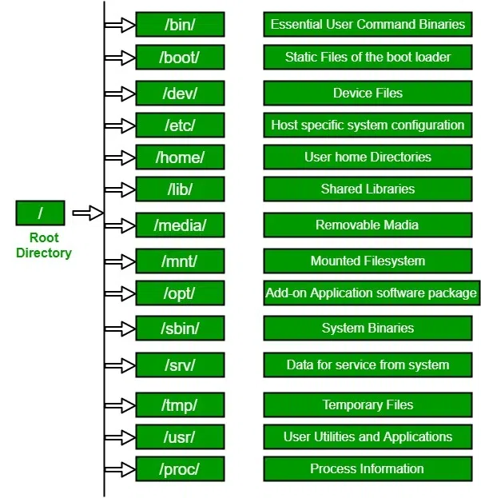

# Intro

Linux- OS built upon the Linux Kernel. based on the UNIX operating system




## File permissions

- User types
  - Owner (u)
  - Group (g)
  - Others (o)
- Permission types
  - read (r)
  - write (w)
  - execute (x)


## Commands

| Method | Description |
| --- | --- |
| `ls` | List files in a directory (-l long format, -a includes hidden files) |
| `cd /path/to/dir` | Change the current directory |
| `pwd` | Change the current directory |
| `mkdir new_dir` | Create a new directory |
| `touch file.txt` | Create an empty file |
| `cp source.txt dest.txt` | Copy a file or directory (-r for recursive copy) |
| `mv oldname.txt newname.txt` | Move or rename a file |
| `rm file.txt`<br>`rm -r folder/` | Remove a file or directory (-r recursive, -f force) |
| `cat file.txt` | Display contents of a file |
| `less file.txt` | View a file page-by-page (scrollable) |
| `head file.txt` | Show the first 10 lines of a file |
| `tail -n 20 file.txt` | Show the last 20 lines of a file |
| `echo "Hello"` | Print a message to terminal or file |
| `chmod 777 script.sh` | Change file permissions |
| `chown user:group file.txt` | Change file owner and group |
| `df -h` | Show disk space usage (-h human-readable) |
| `grep "search" file.txt` | Search text using patterns |
| `find . -name "*.txt"` | Find files by name or pattern |
| `sudo apt update && sudo apt upgrade` | Update package lists and upgrade installed packages |
| `sudo apt install nginx` | Install a package |
| `sudo apt remove nginx` | Remove a package |
| `wget http://example.com/file.zip` | Download files from the internet |
| `curl https://api.example.com` | Transfer data from or to a server |
| `ssh user@host` | Connect to another machine via SSH |
| `nano file.txt, vim file.txt` | Open file in terminal-based text editor |
| `export VARIABLE_NAME=value` | Sets the value of an environment variable. |
| `echo $VARIABLE_NAME` | Displays the value of a specific environment variable. |
| `env` | Lists all environment variables currently set in the system. |
| `printenv` | Displays the values of all environment variables. |
| `command > file.txt` | Redirect stdout to a file (overwrite existing file) |
| `command >> file.txt` | Redirect stdout to a file (append to file) |
| `command < input.txt` | Redirect stdin from a file |
| `command 2> error.log` | Redirect stderr to a file |
| `command > out.txt 2>&1` | Redirect stdout and stderr to the same file |
| `cmd1 <(cmd2)` | Output of cmd2 is used as the input file for cmd1. |
| `cmd2 \| cmd1` | sends the stdout of cmd2 directly as the stdin to cmd1 |


# Shell Scripting

```bash
# Shebang
#!/bin/bash

# -----------------------------------------------
# ✅ Special Variables
# -----------------------------------------------

echo "==> Special Variables"
echo "Script name: $0"
echo "First argument: $1"
echo "Total arguments: $#"
echo "All arguments (quoted): $@"
echo "Process ID of script: $$"
echo "Last command exit status: $?"

# -----------------------------------------------
# ✅ Shell Arrays
# -----------------------------------------------

echo ""
echo "==> Shell Arrays"

my_array=("apple" "banana" "cherry")
echo "First element: ${my_array[0]}"
echo "All elements: ${my_array[@]}"
echo "Number of elements: ${#my_array[@]}"

# Loop through array
for fruit in "${my_array[@]}"; do
  echo "Fruit: $fruit"
done

# -----------------------------------------------
# ✅ Shell Basic Operators
# -----------------------------------------------

echo ""
echo "==> Basic Arithmetic Operators"

a=10
b=3

echo "$a + $b = $((a + b))"
echo "$a - $b = $((a - b))"
echo "$a * $b = $((a * b))"
echo "$a / $b = $((a / b))"
echo "$a % $b = $((a % b))"

echo ""
echo "==> Comparison Operators"

if [ "$a" -eq "$b" ]; then
  echo "$a is equal to $b"
else
  echo "$a is not equal to $b"
fi

if [ "$a" -gt "$b" ]; then
  echo "$a is greater than $b"
fi

# -----------------------------------------------
# ✅ Shell Decision Making
# -----------------------------------------------

echo ""
echo "==> Decision Making"

read -p "Enter your age: " age

if [ "$age" -ge 18 ]; then
  echo "You are eligible to vote."
elif [ "$age" -lt 18 ] && [ "$age" -gt 0 ]; then
  echo "You are not eligible to vote."
else
  echo "Invalid age input."
fi

# -----------------------------------------------
# ✅ Shell Loop Types
# -----------------------------------------------

echo ""
echo "==> While Loop"

count=1
while [ "$count" -le 3 ]; do
  echo "Count: $count"
  ((count++))
done

echo ""
echo "==> Until Loop"

n=3
until [ "$n" -le 0 ]; do
  echo "n: $n"
  ((n--))
done

echo ""
echo "==> For Loop"

for i in 1 2 3; do
  echo "Looping: $i"
done

# -----------------------------------------------
# ✅ Shell Loop Control
# -----------------------------------------------

echo ""
echo "==> Loop Control"

for num in {1..5}; do
  if [ "$num" -eq 3 ]; then
    echo "Skipping 3"
    continue
  fi

  if [ "$num" -eq 4 ]; then
    echo "Breaking at 4"
    break
  fi

  echo "Number: $num"
done

# -----------------------------------------------
# ✅ Shell Functions
# -----------------------------------------------

echo ""
echo "==> Functions"

# Define a function
say_hello() {
  local name=$1
  echo "Hello, $name!"
}

# Call the function
say_hello "World"

# Function with return value
add_numbers() {
  return $(( $1 + $2 ))
}

add_numbers 5 7
sum=$?
echo "Sum returned from function: $sum"
```
