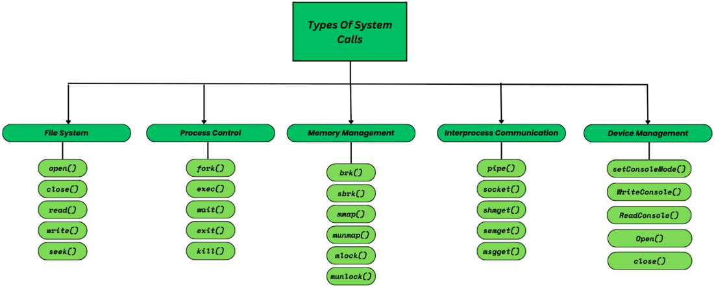
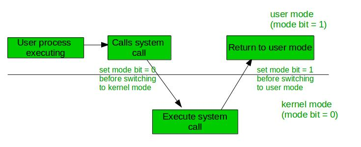
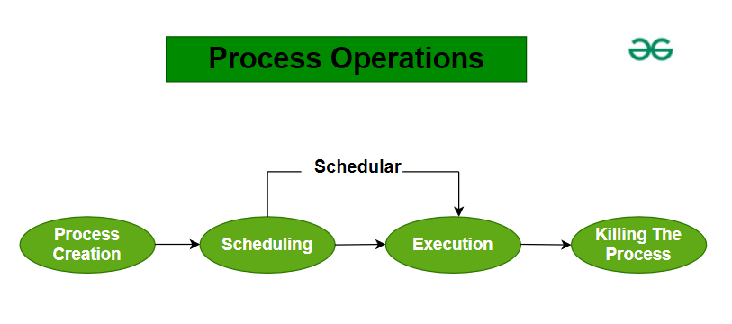
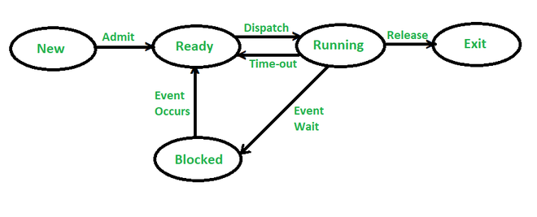
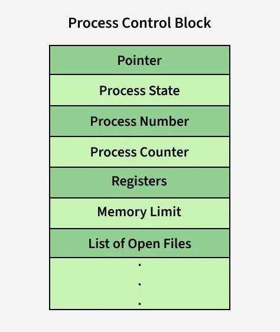
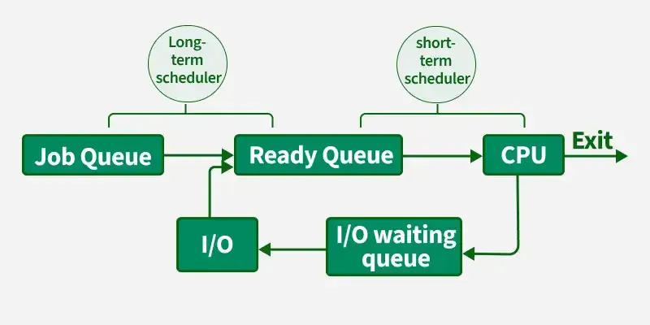
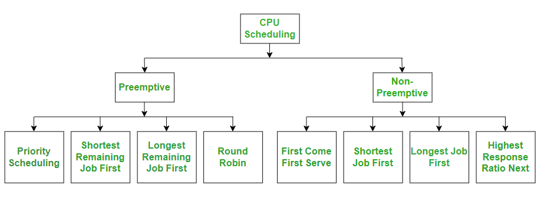
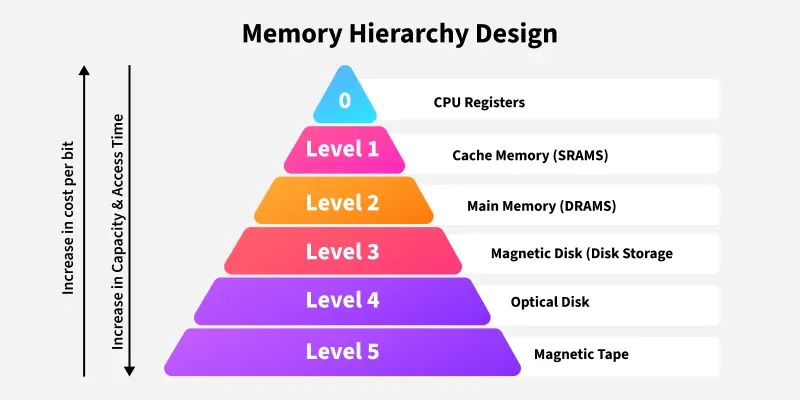
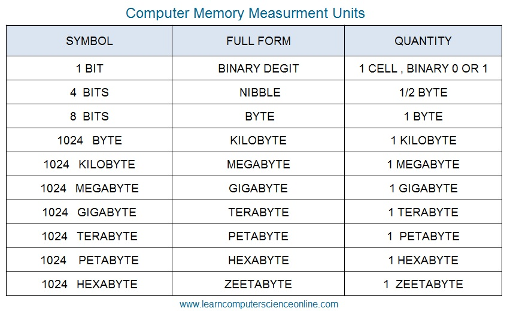

# Intro

OS- software that manages computer hardware and software

Shell- command-line interface (CLI) that allows the user to enter commands to interact with the operating system

Thread

- smallest unit of execution within a process
- lightweight process
- Shares the same memory space of the process
- Has its own stack, registers, and program counter
- Executes independently

Kernel

- core component of OS
- bridge between software and hardware
- manages system resources, such as the process management, memory management, device management, file management, security

32 and 64 bit processor

- The amount of memory a processor can access from a CPU register
- A 32-bit system can access 232 different memory addresses (4 GB of RAM)
- A 64-bit system can access 264 different memory addresses (> 4 GB of RAM)

Spooling

- simultaneous peripheral operation online
- buffering technique used in operating systems to manage input/output (I/O) operations efficiently, especially when multiple processes need to use a slow device like a printer
- Temporarily stores data in a buffer (usually on disk).
- Allows multiple processes to send data to the I/O device without waiting for each to finish.
- The device fetches data from the buffer at its own pace.

CPU (Central Processing Unit)- brain of the computer, plays a central role in executing processes, managing tasks, and running programs

Multiprogramming- Running multiple programs on a single CPU

Multitasking- Running multiple tasks (applications) on a single CPU

Multithreading- Running multiple threads within a single task (application)

Multiprocessing- Running multiple processes on multiple CPUs (or cores)

Random Access Memory (RAM)

- used to temporarily store data that the computer is currently using or processing
- The programs and data that the CPU requires during the execution of a program are stored in this memory
- volatile memory, which means that the data stored in it is lost when the power is turned off
- read-write memory

Read-Only Memory (ROM)

- used to permanently store data that does not need to be modified
- non-volatile memory, which means that the data stored in it is retained even when the power is turned off
- used to store the computer's BIOS (basic input/output system), which contains the instructions for booting the computer, as well as firmware for other hardware devices

What happens when we turn on the computer?

- The power supply sends electricity to the components of the computer, such as the motherboard, hard drive, and fans
- The BIOS (basic input/output system) or UEFI initializes and performs a power-on self-test (POST), which checks the basic hardware components to ensure they are working properly. If any issues are detected, error messages may be displayed.
- The operating system (OS), such as Windows or macOS, is loaded from the hard drive or another storage device into the computer's RAM (random access memory).
- The OS then initializes its own components and drivers and presents the login screen or desktop environment to the user.

Boot Block- special portion of a storage device (like a hard disk or SSD) that contains code used to start (boot) the computer and load the operating system into memory

UEFI (Unified Extensible Firmware Interface)

- firmware interface that initializes hardware components and loads the operating system using the GUID Partition Table (GPT).
- Has better performance, security (like Secure Boot), and support for large disks and graphical interfaces

BIOS (Basic Input/Output System)- firmware interface that initializes and tests the computer's hardware during startup and loads the operating system from the boot using the Master Boot Record (MBR)

System Call

- programmatic way in which a computer program requests a service from the kernel of the operating system on which it is executed
- A system call is a way for programs to interact with the operating system
- System calls are the only entry points into the kernel system and are executed in kernel mode

Dual Mode operations

- When the computer system is run by user applications like creating a text document or using any application program, then the system is in user mode
- When the system boots, the hardware starts in kernel mode and when the operating system is loaded, it starts the user application in user mode.
- To provide protection to the hardware, we have privileged instructions which execute only in kernel mode

Privileged Instructions

- only be executed by the operating system kernel or a privileged process, such as a device driver
- run only in Kernel Mode
- Eg: I/O operations, Managing memory, directly accessing hardware devices

Non-Privileged Instructions

- executed in both user and kernel mode
- Eg: Reading CPU registers, Reading the System Time

Interrupt

- signal emitted by hardware or software when a process or an event needs immediate attention
- It alerts the processor to a high-priority process requiring interruption of the current working process

# Process Management

## Process Operations

Process Creation- Process creation in an operating system (OS) is the act of generating a new process. This new process is an instance of a program that can execute independently.

Scheduling- Once a process is ready to run, it enters the "ready queue." The scheduler's job is to pick a process from this queue and start its execution.

Execution- CPU starts working on the process. During this time, the process might move to a waiting queue if it needs to perform an I/O operation or get blocked if a higher-priority process needs the CPU.

Killing the Process- After the process finishes its tasks, the operating system ends it and removes its Process Control Block (PCB)

Context Switching- The process of saving the context of one process and loading the context of another process

Process Control Block (PCB)- data structure in the operating system that contains information about a specific process, including its current state, resources, and CPU context

Process Table- array of PCBs, which logically contains a PCB for all of the current processes in the system

## Process Schedulers

responsible for deciding which process should run next on the CPU (process scheduling)

### Categories

1\. Non-Preemptive

- a process's resource cannot be taken before the process has finished running
- When a running process finishes and transitions to a waiting state, resources are switched

2\. Preemptive

- OS can switch a process from running state to ready state
- This switching happens because the CPU may give other processes priority and substitute the currently active process for the higher priority process

### Types

1\. Long Term or Job Scheduler

- loads a process from disk to main memory for execution
- The new process to the 'Ready State'.
- It mainly moves processes from Job Queue to Ready Queue.

2\. Short-Term or CPU Scheduler

- selecting one process from the ready state for running (or assigning CPU to it)
- It picks a process from the ready queue.
- Calls the dispatcher

3\. Medium-Term Scheduler

- temporarily removes processes from main memory (RAM) and moves them to secondary storage (swap space). This is called swapping out.
- It later restores them (swaps in) when enough memory becomes available

Dispatcher

- gives control of the CPU to the process selected by the short-term scheduler
- responsible for performing the context switch, moving the selected process into the Running state

## CPU Scheduling

Terminologies

- Arrival Time: The time at which the process arrives in the ready queue.
- Completion Time: The time at which the process completes its execution.
- Burst Time: Time required by a process for CPU execution.
- Turn Around Time = Completion Time  –  Arrival Time
- Waiting Time = Turn Around Time  –  Burst Time

### Algorithms

1\. FCFS – First Come, First Serve

- The process that arrives first is executed first

2\. SJF – Shortest Job First

- The CPU is assigned to the process with the shortest execution time (burst time) first

3\. SRTF – Shortest Remaining Time First

- always runs the process with the shortest remaining time

4\. Round Robin (RR)

- Each process gets the CPU for a fixed time quantum. If it doesn’t finish, it's moved to the back of the queue.

5\. Priority Scheduling

- The CPU is assigned to the process with the highest priority.

6\. HRRN – Highest Response Ratio Next

- selects the process with the highest response ratio
- Response Ratio = (W + S)/S

W : Waiting time of the process so far

S : Burst time of the process.

7\. MLQ – MultipleLevel Queue Scheduling

- The ready queue is divided into multiple queues based on priority or process type
- Each queue may have its own scheduling algorithm
- Processes do not move between queues

8\. MFLQ –  Multilevel Feedback Queue Scheduling

- Like multiple queues, but processes can move between queues

Starvation- Also called indefinite blocking, is a situation where a process waits forever to get the required resources (like CPU, memory, or I/O) because other higher priority processes keep getting the resources.

Aging- technique to prevent starvation by gradually increasing the priority of a process the longer it waits in the system

## Process Synchronization

Conditions That Require Process Synchronization

- Critical Section
  - It is that part of the program where shared resources are accessed.
  - Only one process can execute the critical section at a given point of time.
  - If there are no shared resources, then no need for synchronization mechanisms.
- Race Condition
  - It is a situation wherein processes are trying to access the critical section and the final result depends on the order in which they finish their update.
  - Process Synchronization mechanisms need to ensure that instructions are being executed in a required order only.
- Pre Emption
  - Preemption is when the operating system stops a running process to give the CPU to another process.
  - This is important as mainly issues arise when a process has not finished its job on shared resource and got preempted.
  - The other process might end up reading an inconsistent value if process synchronization is not done.

Inter Process Communication (IPC)- mechanism that allows processes to communicate

## Semaphores

- synchronization tool (or variable) used to control access to a shared resource by multiple processes
- help in avoiding race conditions and ensuring that critical sections are accessed by one process at a time

### Operations

wait()

- It checks the semaphore value:
- If it's > 0, it decrements and allows the process to enter the critical section.
- If it's ≤ 0, the process is blocked (i.e., it waits).

signal()

- It increments the semaphore value:
- If there are waiting processes, it unblocks one.
- Otherwise, it just increases the count.

## Mutex

synchronization primitive used to allow only one thread or process to access a critical section (shared resource) at a time

Only for mutual exclusion

Lock the mutex before entering a critical section.

Unlock it after the critical section is done.

Mutual Exclusion- no two processes can exist in the critical section at any given point of time

## Deadlock

occurs when two or more transactions are unable to proceed because each transaction is waiting for the other to release locks on resources.

Characteristics

- Mutual Exclusion: Only one transaction can hold a particular resource at a time.
- Hold and Wait: The Transactions holding resources may request additional resources held by others.
- No Preemption: The Resources cannot be forcibly taken from the transaction holding them.
- Circular Wait: A cycle of transactions exists where each transaction is waiting for the resource held by the next transaction in the cycle.

Deadlock Prevention

- Mutual Exclusion- Make resources shareable
- Hold and Wait- Require processes to request all resources at once
- No Preemption- If a process can’t get all resources, forcefully take back held ones
- Circular Wait- Impose an ordering on resource requests

Deadlock Detection

- Resource Allocation Graph
- Banker’s algorithm

Deadlock Recovery

- Process Termination- Kill one or more processes to break the cycle
- Resource Preemption- Forcefully take resources from some processes
- Rollback- Roll back processes to safe states

Livelock

- Livelock occurs when two or more processes continually repeat the same interaction in response to changes in the other processes without doing any useful work.
- These processes are not in the waiting state, and they are running concurrently

# Memory Management

- Memories are made up of registers
- Each register in the memory is one storage location, called memory location
- Memory locations are identified using Address
- The total number of bits a memory can store is its capacity
- A storage element is called a Cell
- Each register is made up of a storage element in which one bit of data is stored.

## Cache Memory

- high-speed memory located close to the CPU
- stores frequently used data and instructions
- small capacity

### Types

1\. L1 or Level 1 Cache

- first level of cache memory that is present inside the processor

2\. L2 or Level 2 Cache

- second level of cache memory that may present inside or outside the CPU

3\. L3 or Level 3 Cache

- third level of cache memory that is present outside the CPU and is shared by all the cores of the CPU

## Partitioning

1\. Contiguous Memory Allocation

- each process is assigned a single continuous block of memory in the main memory

A. Fixed (or static) Partitioning

- Memory is divided into fixed-size partitions at system startup
- Each partition holds exactly one process.
- Size of partition does not change during execution
- It can lead to internal fragmentation, where memory in a partition remains unused

B. Variable (or Dynamic) Partitioning

- Memory is divided into variable-sized partitions at runtime.
- A process is allocated exactly the size it needs

2\. Non-Contiguous Memory Allocation

- a process is divided into multiple blocks or segments that can be loaded into different parts of the memory, rather than requiring a single continuous block

A. Paging

- Logical memory (process) is divided into pages of the same size.
- Pages are mapped to frames using a page table

B. Segmentation

- Divides memory into variable-sized segments based on logical sections of a program, like code, data, and stack

## Partition Allocation Methods

1\. First Fit

- the partition is allocated which is the first sufficient block from the top of Main Memory
- It scans memory from the beginning and chooses the first available block that is large enough.

2\. Best Fit

- Allocate the process to the partition which is the first smallest sufficient partition among the free available partition
- It searches the entire list of holes to find the smallest hole whose size is greater than or equal to the size of the process

3\. Worst Fit

- Allocate the process to the partition which is the largest sufficient among the freely available partitions available in the main memory
- opposite to the best-fit
- It searches the entire list of holes to find the largest hole and allocate it to process

4\. Next Fit

- Next fit is similar to the first fit but it will search for the first sufficient partition from the last allocation point

Logical Address- also known as a virtual address, is an address generated by the CPU during program execution

Physical Address- actual address in the main memory where data is stored

## Virtual Memory

- memory management technique that gives an application the illusion of having more memory than what is physically available (RAM), by temporarily transferring data from RAM to disk storage
- uses paging and segmentation

Page fault- when a program tries to access a page (block of memory) that is not currently in RAM

Demand Paging- The process of loading the page into memory on demand (whenever a page fault occurs)

Swapping- process of moving an entire process in or out of main memory (RAM) to/from disk (secondary storage)

Thrashing

- system is overwhelmed by constant page faults, and it spends more time swapping pages in and out than executing actual processes
- Happens when there are too many active processes and each process needs more pages than can fit in RAM. As a result, pages are constantly being swapped (paged in/out)

## Page Replacement Algorithms

1\. First-In First-Out (FIFO)

- The page that was loaded first (oldest) is the first to be replaced.

2\. Optimal Page Replacement

- Replace the page that will not be used for the longest time in the future

3\. Least Recently Used (LRU)

- Replace the page that was least recently used.

4\. Most Recently Used (MRU)

- Replace the page that was most recently used.

# Disk Management

## Disk Scheduling Algorithms

1\. FCFS (First Come First Serve)

- Serve requests in the order they arrive

2\. SSTF (Shortest Seek Time First)

- Choose the request closest to the current head position

3\. SCAN (Elevator Algorithm)

- Head moves in one direction, services all requests, then reverses

4\. C-SCAN (Circular SCAN)

- Head moves in one direction only. When it reaches the end, it jumps to the beginning and continues.

5\. LOOK

- Like SCAN, but only goes as far as the last request in the current direction.

6\. C-LOOK

- Like C-SCAN, but only goes as far as the last request before jumping back.

7\. RSS (Random Scheduling Strategy)

- Randomly selects the next request.

8\. LIFO (Last-In First-Out)

- Service the most recent request first.

9\. N-STEP SCAN

- Divide the request queue into batches (of size N), and service each batch using SCAN.

10\. F-SCAN

- Improved N-STEP SCAN using two queues.
- One queue is being processed, while the other collects new requests.

Spooling

- Simultaneous Peripheral Operations On-Line
- data from multiple jobs is temporarily stored in a buffer (usually on disk), and then sent to the output device one at a time in a scheduled manner
- The OS stores this output in a spool (temporary storage)
- A separate spooler program reads the queue and sends data to the printer (or other device) sequentially.

Buffering

- technique where a temporary memory area (called a buffer) is used to hold data while it is being transferred between two places — such as between a CPU and an I/O device, or between two programs.

RAID (Redundant Arrays of Independent Disks)

- data storage technology that combines multiple physical hard drives into one logical unit
