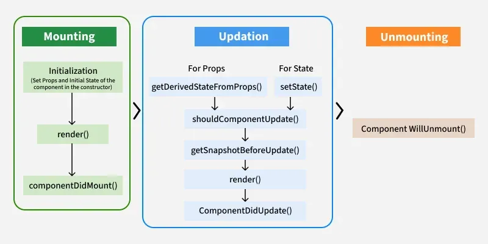

# Intro

- front-end JavaScript library
- Instead of manipulating the browser's DOM directly, React creates a virtual DOM in memory, where it does all the necessary manipulating, before making the changes in the browser DOM
- SPA (single page applications)

ES6 (ECMAScript 6)- official standard for the JavaScript language

JSX

- JavaScript XML
- write HTML elements in JavaScript

Components

- functions that return HTML elements
- independent and reusable bits of code
- 2 types- class and functional component

Props- arguments passed into React components. They are read-only

Conditional Rendering

- showing different UI elements based on some condition
- uses Ternary Operator (?) or Logical AND (&&)


# Hooks

special functions that let you use React features (like state, lifecycle, etc.) in functional components — without needing to write class components


## useState

- allows us to track state in a function component
- state value is read-only, state value can only be modified by the setter function


## useEffect

- perform side effects in your components
- useEffect(\<function>, \<dependency>)

```
useEffect(() => {
  // Runs on every render
});

useEffect(() => {
  // Runs only on the first render
}, []);

useEffect(() => {
  //Runs on the first render
  //And any time any dependency value changes
}, [prop, state]);

 useEffect(() => {
    let timer = setTimeout(() => {
    setCount((count) => count + 1);
  }, 1000);

  // cleanup function
  return () => clearTimeout(timer)
  }, []);
```


## useContext

- manage state globally
- prevent props drilling

```
const UserContext = createContext()

function Component1() {
  const [user, setUser] = useState("Jesse Hall");

  return (
    <UserContext.Provider value={user}>
      <h1>{`Hello ${user}!`}</h1>
      <Component2 user={user} />
    </UserContext.Provider>
  );
}

function Component5() {
  const user = useContext(UserContext);

  return (
    <>
      <h1>Component 5</h1>
      <h2>{`Hello ${user} again!`}</h2>
    </>
  );
}
```


## useRef

- persist values between renders
- store a mutable value that does not cause a re-render when updated
- can be used to access a DOM element directly

```
function App() {
  const inputElement = useRef();

  const focusInput = () => {
    inputElement.current.focus();
  };

  return (
    <>
      <input type="text" ref={inputElement} />
      <button onClick={focusInput}>Focus Input</button>
    </>
  );
}
```


## useReducer

- managing complex or structured state logic, especially when the state depends on previous values or involves multiple sub-values
- useReducer(\<reducer>, \<initialState>)

```
function reducer(state, action) {
  switch (action.type) {
    case 'increment':
      return { count: state.count + 1 };
    case 'decrement':
      return { count: state.count - 1 };
    default:
      return state;
  }
}

function Counter() {
  const [state, dispatch] = useReducer(reducer, { count: 0 });

  return (
    <div>
      <p>Count: {state.count}</p>
      <button onClick={() => dispatch({ type: 'decrement' })}>-</button>
      <button onClick={() => dispatch({ type: 'increment' })}>+</button>
    </div>
  );
}
```


## useCallback

- returns a memoized callback function
- prevent unnecessary re-renders of child components that depend on functions as props
- optimize performance

```
import React, { useState, useCallback } from 'react';

function Button({ handleClick, children }) {
  console.log('Button rendered:', children);
  return <button onClick={handleClick}>{children}</button>;
}

const App = () => {
  const [count, setCount] = useState(0);
  const [theme, setTheme] = useState('light');

  // increment is memoized using useCallback, 
  // so it does not get recreated on every re-render.
  // If useCallback were not used, 
  // both Button components would re-render every time 
  // the parent re-renders, even if the function didn't change.
  const increment = useCallback(() => {
    setCount((prevCount) => prevCount + 1);
  }, []);

  const toggleTheme = () => {
    setTheme((prevTheme) => (prevTheme === 'light' ? 'dark' : 'light'));
  };

  return (
    <div>
      <p>Count: {count}</p>
      <Button handleClick={increment}>Increment</Button>
      <Button handleClick={toggleTheme}>Toggle Theme</Button>
      <p>Current theme: {theme}</p>
    </div>
  );
};

export default App;
```


## useMemo

- returns a memoized value
- optimize performance
- avoiding unnecessary recalculations on every render

```
import React, { useState, useMemo } from 'react';

function App() {
  const [number, setNumber] = useState(1);
  const [dark, setDark] = useState(false);

  const double = useMemo(() => {
    console.log('Calculating...');
    return number * 2;
  }, [number]); // only reruns if number changes

  const themeStyles = {
    backgroundColor: dark ? '#333' : '#fff',
    color: dark ? '#fff' : '#000',
    padding: '10px',
  };

  return (
    <div style={themeStyles}>
      <input
        type="number"
        value={number}
        onChange={(e) => setNumber(parseInt(e.target.value))}
      />
      <button onClick={() => setDark((prevDark) => !prevDark)}>
        Toggle Theme
      </button>
      <p>Double: {double}</p>
    </div>
  );
}
```


## useNavigate

navigate between different pages in your app

```
const navigate = useNavigate();
navigate('/targetpath')
```


## useParams

access route parameters from the current URL

```
const { param1, param2, ... } = useParams();
```


## Custom Hooks

your own reusable functions built using React’s built-in hooks like useState, useEffect, useRef

```
import { useState, useEffect } from 'react';

function useLocalStorage(key, initialValue) {
  // Get from localStorage and parse or use initialValue
  const [storedValue, setStoredValue] = useState(() => {
    try {
      const item = localStorage.getItem(key);
      return item ? JSON.parse(item) : initialValue;
    } catch (error) {
      console.warn('Error reading localStorage key', key, error);
      return initialValue;
    }
  });

  // Update localStorage when state changes
  useEffect(() => {
    try {
      localStorage.setItem(key, JSON.stringify(storedValue));
    } catch (error) {
      console.warn('Error setting localStorage key', key, error);
    }
  }, [key, storedValue]);

  return [storedValue, setStoredValue];
}

export default useLocalStorage;
```


## Virtual DOM

- in-memory representation of the actual DOM
- React uses this lightweight JavaScript object to track changes in the application state and efficiently update the actual DOM only where necessary
- Efficient Updates: By minimizing direct interactions with the real DOM, React significantly reduces rendering time
- Batching Updates: Multiple state updates are batched into a single re-render cycle, avoiding unnecessary computations

Working

- Rendering the Virtual DOM: React creates a virtual representation of the UI as a tree of JavaScript objects.
- Updating State: It generates a new Virtual DOM tree to reflect the updated state when the application state changes.
- Diffing Algorithm: React compares the new Virtual DOM tree with the previous one using its efficient diffing algorithm to identify the minimal set of changes required.
- Updating the Real DOM: React applies only the necessary changes to the real DOM, optimizing rendering performance.

Diffing Algorithm

- Element Type Comparison- If two elements have different types, React destroys the old one and creates a new one.
- Same Type, Compare Props- If they have the same type, React compares their props and children and updates only what changed.
- Keyed Lists Optimization- For lists of elements (like arrays), React uses a key prop to track items.
- Component Comparison- React compares the component type. If the component is the same type, it keeps its state and just updates the props.

Reconciliation- process React uses to figure out how to efficiently update the DOM (Document Object Model) when changes occur in the UI

Reconciliation working

- Component Renders: Something (like a state or prop change) triggers a component to re-render.
- New Virtual DOM: React builds a new virtual DOM for that component.
- Diffing: React compares the new virtual DOM with the old one.
- Minimal Changes: React figures out what really changed (using keys, types, etc.).
- DOM Update: Only those changes are applied to the actual DOM.

Prop Drilling- practice of passing data through several layers of nested components in React, even though intermediate components don't directly utilize this data


## React Lifecycle

different phases a component goes through during its time



- Mounting: Initializes, renders, and mounts the component (componentDidMount()).
- Updating: Handles state/prop changes, re-renders, and updates (componentDidUpdate()).
- Unmounting: Cleans up before removal (componentWillUnmount()).


## Misc

\<Fragment>

- group elements without a wrapper node. In JSX, you can only return one parent element

lazy

- Lazy loading
- defer loading component’s code until it is rendered for the first time

memo

- prevent unnecessary re-renders of functional components, until props have changed

```
import React, { useState, memo } from 'react';

const Child = memo(({ name }) => {
  console.log('Child rendered');
  return <h2>Hello, {name}!</h2>;
});

function App() {
  const [count, setCount] = useState(0);

  return (
    <div>
      <Child name="Yash" />
      <button onClick={() => setCount(count + 1)}>Increment Count</button>
      <p>Count: {count}</p>
    </div>
  );
}

export default App;
```

Babel- JavaScript compiler that lets you write modern JavaScript (like ES6/ES7/ESNext) and ensures it works in older browsers by converting it to compatible JavaScript (ES5)

Controlled Components- form data is handled by React state. The input’s value is bound to state, and updated using onChange

Uncontrolled Components- DOM itself manages the input state. You access the value using a ref instead of React state

Higher-Order Components (HOCs)- function that takes a component and returns a new component with added functionality

```
function withLogger(WrappedComponent) {
  return function Enhanced(props) {
    console.log('Rendering:', WrappedComponent.name);
    return <WrappedComponent {...props} />;
  };
}
```


## Rendering strategies

1\. Server-Side Rendering (SSR)

- HTML is generated on the server for every request
- More load on server

2\. Client-Side Rendering (CSR)

- HTML is mostly empty at first
- JavaScript runs in the browser to build the page
- SEO is harder

3\. Static Site Generation (SSG)

- HTML is built at build time and served as static files
- Super fast (just static files)
- SEO-friendly
- Not suitable for dynamic data

4\. Incremental Static Regeneration (ISR)

- SSG with the ability to rebuild specific pages after a delay
- Page is pre-rendered like SSG
- After a time (e.g., 10s), it's re-rendered in the background
- Fast like SSG, up-to-date like SSR
