# Index

- [Intro](#intro)
  - [Requirements](#requirements)
  - [Scalability](#scalability)
    - [Types](#types)
  - [System Architecture](#system-architecture)
- [Databases](#databases)
  - [Database Replication](#database-replication)
    - [Types](#types-1)
  - [Database Sharding](#database-sharding)
    - [Types](#types-2)
  - [Data Partitioning](#data-partitioning)
    - [Types](#types-3)
  - [Apache Cassandra](#apache-cassandra)
- [High Level Design](#high-level-design)
  - [Availability](#availability)
  - [Consistency](#consistency)
    - [Types](#types-4)
  - [Reliability](#reliability)
  - [CAP Theorem](#cap-theorem)
    - [Common Trade-offs](#common-trade-offs)
  - [Load Balancer](#load-balancer)
    - [Types](#types-5)
    - [Load Balancing Algorithms](#load-balancing-algorithms)
  - [Consistent Hashing](#consistent-hashing)
  - [Latency and Throughput](#latency-and-throughput)
  - [API Gateway](#api-gateway)
  - [Communication Protocols](#communication-protocols)
  - [Proxy](#proxy)
    - [Types](#types-6)
  - [Caching](#caching)
    - [Types](#types-7)
    - [Caching Strategies](#caching-strategies)
    - [Cache Eviction Policies](#cache-eviction-policies)
  - [Content Delivery Network (CDN)](#content-delivery-network-cdn)
  - [Message Queues](#message-queues)
  - [Elasticsearch Search Engine](#elasticsearch-search-engine)
  - [Rate Limiting](#rate-limiting)
    - [Algorithms](#algorithms)
  - [Distributed System](#distributed-system)
  - [Polling](#polling)
    - [Types](#types-8)
  - [Streaming](#streaming)
    - [Types](#types-9)
  - [GraphQL](#graphql)
  - [gRPC (Google Remote Procedure Call)](#grpc-google-remote-procedure-call)
  - [WebRTC (Web Real-Time Communication)](#webrtc-web-real-time-communication)
- [Low Level Design (LLD)](#low-level-design-lld)
  - [Intro](#intro-1)
  - [Unified Modeling Language (UML)](#unified-modeling-language-uml)
  - [Class Diagram](#class-diagram)
    - [Relationships between classes](#relationships-between-classes)
  - [State Machine Diagram](#state-machine-diagram)
  - [Activity Diagrams](#activity-diagrams)
  - [Use Case Diagrams](#use-case-diagrams)
  - [Sequence Diagram](#sequence-diagram)
  - [SOLID Principles](#solid-principles)
- [Design Patterns](#design-patterns)
  - [Factory Design Pattern](#factory-design-pattern)
  - [Abstract Factory Design Pattern](#abstract-factory-design-pattern)
  - [Singleton Design Pattern](#singleton-design-pattern)
  - [Builder Design Pattern](#builder-design-pattern)
  - [Adapter Design Pattern](#adapter-design-pattern)
  - [Decorator Design Pattern](#decorator-design-pattern)
  - [Facade Design Pattern](#facade-design-pattern)
  - [Observer Design Pattern](#observer-design-pattern)
  - [Strategy Design Pattern](#strategy-design-pattern)
  - [State Design Pattern](#state-design-pattern)
- [LLD questions](#lld-questions)
  - [Parking Lot](#parking-lot)
  - [Vending Machine](#vending-machine)
  - [Elevator](#elevator)
  - [ATM](#atm)
  - [Splitwise](#splitwise)
  - [Cab Booking System (Uber/ Ola)](#cab-booking-system-uber-ola)
  - [Food Delivery System (Swiggy/ Zomato)](#food-delivery-system-swiggy-zomato)
  - [Movie Ticket Booking System (BookMyShow)](#movie-ticket-booking-system-bookmyshow)
  - [Notification System](#notification-system)
  - [Chess Game](#chess-game)
  - [Ecommerce (Amazon)](#ecommerce-amazon)
- [HLD questions](#hld-questions)
  - [Approach](#approach)
  - [Data sizes](#data-sizes)
  - [URL Shortener (bit.ly, TinyURL)](#url-shortener-bitly-tinyurl)
  - [File sharing (Dropbox)](#file-sharing-dropbox)
  - [Ecommerce (Amazon, Flipkart)](#ecommerce-amazon-flipkart)
  - [Food ordering (swiggy, zomato)](#food-ordering-swiggy-zomato)
  - [Video streaming (Netflix)](#video-streaming-netflix)
  - [Video streaming (Youtube)](#video-streaming-youtube)
  - [Ride sharing (Uber, Ola)](#ride-sharing-uber-ola)
  - [Booking (BookMyShow)](#booking-bookmyshow)
  - [Social media (twitter, instagram)](#social-media-twitter-instagram)
  - [Messaging (whatsapp, facebook messenger)](#messaging-whatsapp-facebook-messenger)
  - [Notification system](#notification-system-1)
  - [Typeahead (Autocomplete) System](#typeahead-autocomplete-system)
  - [Collaborative Editing Tool (Google docs)](#collaborative-editing-tool-google-docs)
  - [Rate Limiter](#rate-limiter)
  - [Web Crawler](#web-crawler)
  - [Distributed cache system (Redis)](#distributed-cache-system-redis)
  - [Google Maps](#google-maps)
- [Misc](#misc)
  - [Payment Gateway](#payment-gateway)


# Intro


## Requirements

Functional Requirements (FRs)

- what a system should do
- specific behavior or functions of the system
- Eg
  - Users should be able to sign up, log in, and log out.
  - The system should allow users to upload a video.
  - The API should return user data when called with /api/users/{id}.
  - A customer can add items to a cart and place an order.

Non-Functional Requirements (NFRs)

- how a system should behave
- specify system attributes, quality factors, and performance constraints
- Includes Portability, Security, Maintainability, Reliability, Scalability, Performance, Reusability
- Eg
  - The system should handle 100,000 concurrent users. (Scalability)
  - API responses must be \<200ms. (Performance)
  - The system must be available 99.99% of the time. (Availability)
  - All passwords must be stored using bcrypt hashing. (Security)
  - The system should support multi-language localization. (Usability)


## Scalability

system’s ability to handle increased load—be it more users, more data, or more traffic—without sacrificing performance or reliability

### Types

1\. Vertical Scaling

- scaling up
- Add more power (CPU, RAM, SSD) to an existing machine
- Advantages
  - Simpler to implement
  - No need to change application logic
  - Useful for databases or monoliths
- Disadvantages
  - Hardware has limits
  - Downtime during upgrades
  - Not cost-efficient long-term
  - Single point of failure
- Use cases
  - You're building an MVP or early-stage product.
  - You need a quick fix for performance (add CPU/RAM).
  - Your app is monolithic or tightly coupled.
  - You're on a single server setup or limited infra.
  - You want a simple setup without distributed complexity.
  - You have limited engineering resources to manage scaling.
  - The current bottleneck is clearly due to limited hardware.
  - You're not expecting massive scale in the short term

2\. Horizontal Scaling

- scaling out
- Add more machines (servers or instances) to handle increased load
- Advantages
  - Can scale almost infinitely
  - Better fault tolerance (no single point of failure)
  - Easy to upgrade
  - Ideal for cloud-native or microservices
- Disadvantages
  - More complex architecture
  - Requires load balancers, distributed cache, synchronization
  - Data consistency becomes harder (especially in DBs)
- Use cases
  - You expect high traffic or rapid user growth.
  - Your application is stateless (e.g., REST APIs).
  - You're using microservices or Docker/Kubernetes.
  - You want fault tolerance (no single point of failure).
  - You're on cloud infrastructure (AWS, GCP, Azure).
  - You need auto-scaling capabilities.
  - You want to scale reads/writes across distributed systems
  - You're dealing with global users and want geo-distribution

Components that help to increase Scalability

- Load Balancer
- Caching
- Database Replication
- Database Sharding
- Data Partitioning
- Microservices Architecture
- Content Delivery Networks (CDNs)
- Queueing Systems

Fan-out

- One event or request triggers many downstream operations.
- Fan-out on write (push): when the post is created, write it into every follower's feed immediately. Reads are fast, but writes are heavy, especially for celebrity accounts.
- Fan-out on read (pull): compute the feed when a follower opens the app. Writes are cheap, but reads are slow.
- Hybrid: push for normal users, pull for celebrities.

Thundering herd

- Many clients or processes hit the same resource at the same moment, usually right after something resets.
- Example: a hot cache key expires and 10,000 requests miss at once, so all of them hit the DB and it falls over.
- Other triggers: a server restarts and all clients reconnect together, or a failed service comes back and all retries land at once.
- Fixes
  - Request coalescing / single-flight: only one request rebuilds the cache, and the others wait for it.
  - Lock on cache rebuild: the first miss takes a lock and the others serve stale data or wait.
  - TTL jitter: add random time to expiries so keys don't all expire together.
  - Exponential backoff with jitter on retries.
  - Refresh ahead: refresh hot keys before they expire.
  - Rate limiting / load shedding to protect the backend.

Hot key / hot partition

- One key or shard gets disproportionate traffic (a celebrity's profile, a viral product), so that single node is overloaded while others sit idle.
- Fixes: replicate the hot key across nodes, add a local in-memory cache, split the key (key#1..N) and spread reads, or add a random suffix to spread writes.

Cache Stampede

- one hot key expires and many requests rebuild it at once. Fix: single-flight/lock, refresh ahead.

Cache Penetration

- requests for keys that don't exist always miss cache and hit the DB. Fix: cache nulls with a short TTL, or use a Bloom filter in front.

Cache Avalanche

- many keys expire at the same time (or the cache goes down), and the DB takes the full load. Fix: TTL jitter, cache replication, rate limiting.

Bloom filter

- A compact bit-array structure that answers "is X in the set?" with either "definitely no" or "probably yes".
- No false negatives, a small chance of false positives, and no deletions in the basic version.
- Use: skip DB lookups for keys that can't exist, check whether a username or URL was already seen, avoid disk read.

Load shedding

- When overloaded, deliberately reject some requests (return 503/429) instead of trying to serve everything and collapsing.
- Prioritize: drop low-value traffic (analytics, background jobs) first, keep critical paths (checkout, payments).

Circuit breaker

- Wraps calls to a dependency and tracks failures. States: closed (normal), open (fail fast, no calls for a cooldown), half-open (let a few trial calls through to test recovery).
- Stops you from wasting resources and piling retries onto a dying service.

Bulkhead

- Isolate resources (thread pools, connection pools, queues) per dependency or per tenant, so one slow dependency can't exhaust everything.
- Example: a separate pool for the payment-gateway calls, so a gateway slowdown doesn't block your other endpoints.


## System Architecture

1\. Monolithic Architecture

- The entire application is built as a single unit.
- All features, modules, and components are tightly coupled and deployed together
- Advantages
  - Simple to develop and deploy for small teams
  - Fewer network issues (all modules run together)
- Disadvantages
  - Hard to scale specific features (e.g., only checkout is slow but you have to scale everything)
  - Tight coupling means one bug can crash the whole app
  - Long build & deployment times
  - Difficult to adopt new tech (e.g., want to use Go for one part, but stuck with Node.js)
  - Not suitable for large teams working in parallel

2\. Microservices Architecture

- an application is split into many small, independent services, each responsible for a specific feature or domain
- Each service runs independently (e.g., Auth, Payments, Products, Orders).
- Services communicate via APIs (usually HTTP/REST or message queues).
- Each service has its own codebase and often its own database
- Advantages
  - Independent deployment – update one service without redeploying the whole app
  - Scalability – scale only the services that need more resources
  - Tech flexibility – use different languages or databases per service
  - Fault isolation – if one service fails, the others keep working
- Disadvantages
  - Complex to manage – lots of services = more deployment/config complexity
  - Network latency between services
  - Data consistency is harder (often eventual consistency)
  - Debugging and testing across services can be complex

3\. Event-Driven Architecture (EDA)

- systems communicate by producing and responding to events
- Instead of making direct calls between services, one part of the system emits an event, and other parts listen and react to it
- Event- message that says something happened in the system (eg UserCreated, OrderPlaced)
- Working
  - The producer emits an event. Eg: Order Service sends OrderPlaced.
  - Event Bus / Broker transports the event. Eg: Kafka, RabbitMQ, AWS SNS/SQS
  - Consumers (other services) react to the event. Eg: Notification Service listens and sends an email
- Advantages
  - Loosely coupled services
  - Better scalability – more services can listen without changing producers
  - Async processing – improves performance (e.g., background tasks)
  - Real-Time Applications: If your application needs to react instantly to user actions or changes in data, EDA can provide the responsiveness required
- Disadvantages
  - Complex to debug – harder to trace event flow
  - Eventual consistency – not all consumers process events immediately
  - Delivery issues – need retries, dead-letter queues
  - Order of processing may not be guaranteed

| Queue-Based Architecture | Event-Driven Architecture (EDA) |
| --- | --- |
| Point-to-point (Only one consumer processes each message) | Publish-subscribe (Multiple consumers can listen and react) |
| Focuses on Reliable task execution | Focuses on state change notification |
| Order Guarantee (FIFO) | Order is not guaranteed |
| Best for background jobs—send email, process files, resize images, retry payment | Best for real-time workflows—notify multiple services when something changes (e.g., log user activity, notify admins, trigger side effects) |
| If a consumer fails, the message can be retried automatically or manually | If a consumer fails, you need to handle retries or dead-letter queues (DLQ) on your own. There's no built-in retry |

4\. Serverless Architecture

- where you don’t manage servers.
- You write code in the form of functions, and the cloud provider runs them only when needed
- Eg: AWS Lambda
- Advantages
  - No server management – you just deploy code.
  - Auto-scaling – handles 1 or 1 million users automatically.
  - Pay-per-use – you only pay when your function runs.
  - Fast deployment – ideal for small tasks or APIs.
  - Great for event-driven systems (e.g., image processing, cron jobs)
- Disadvantages
  - Cold starts – first request after inactivity can be slow.
  - Limited execution time – usually 15 mins max (AWS Lambda).
  - Harder to debug – logs only, no live debugging.
  - State is not preserved – must use external DBs or caches.
  - Vendor lock-in – tightly coupled to cloud provider's ecosystem

CQRS

- Command Query Responsibility Segregation: separate the write model from the read model, often with different DBs.
- Writes go to a normalized store, reads are served from a denormalized view optimized for queries, synced via events.
- Costs: eventual consistency and more complexity.

Event sourcing

- Store every state change as an immutable event instead of only the current state. Current state = replay of events.
- Gains: full audit trail, time travel, easy rebuild of read models.
- Costs: replay time (use snapshots), event schema evolution, harder queries.
- Often paired with CQRS.


# Databases

| SQL | NoSQL |
| --- | --- |
| Tables (rows and columns) | Documents, key-value, wide-column, or graphs |
| Fixed, predefined schema (structured) | Flexible or schema-less |
| Eg: MySQL, PostgreSQL, Oracle, SQL Server | Eg: MongoDB, Cassandra, Redis, DynamoDB |
| Supports joins across multiple tables | Limited or no join support |
| ACID Compliance (Atomicity, Consistency, Isolation, and Durability) | BASE (Basically Available, Soft State, Eventually Consistent) |
| Vertically scalable | Horizontally scalable |
| Useful for Structured data, complex queries, transactions | Useful for Big data, fast reads/writes, flexible schemas |
| Use if data size \< 1 TB | Use if data size > 1 TB |
| QPS (Queries per second) \< 1000 | QPS > 1000 |
| Moderate write volume (few hundred writes/sec) | High write volume (>10K/sec or bursts) |
| Moderate read latency (hundreds of ms) | Low read latency (sub-10ms desired) |

| Block Storage | File Storage | Object Storage |
| --- | --- | --- |
| keeping data in chunks or blocks of an exact size.<br>Every block has its own address, functions independently, and can store any kind of data | storing data in a hierarchical system of files and folders | With object storage, data is kept as discrete units known as "objects."<br>A unique identity, metadata (information about the data), and the actual data are all contained in each item |
| Raw fixed-size blocks | Files in folders (hierarchical) | Objects (data + metadata + unique ID) |
| OS-level access | File path access | API-based access (HTTP, REST) |
| No metadata | Basic metadata | Rich/custom metadata |
| High performance, low latency | Medium performance | High throughput, slower |
| Vertical scaling | Moderate scaling | Massive horizontal scaling |
| Used for DBs, VMs, boot volumes | Used for file sharing, CMS | Used for backups, media, logs |
| Examples: AWS EBS | Examples: AWS EFS, NFS | Examples: AWS S3, GCP Storage |


## Database Replication

- copying data from one database (primary) to one or more other databases (replicas) to improve availability, fault tolerance, and read performance
- Benefits- High availability, Read scaling, Disaster recovery, Backup
- Used when read requests > 5k reads/ sec

### Types

1\. Master-Slave Replication

- One master handles all write operations (insert, update, delete)
- One or more slaves replicate data read-only from the master.
- Slaves can't write, only read from the replicated data.
- Used for read scaling and failover.
- Eg: E-commerce system where master handles orders and slaves handle product listing reads.

2\. Master-Master (Multi-Master) Replication

- Two or more masters can all perform read and write operations.
- Changes made in one master are replicated to others.
- Suitable for high availability and active-active clusters.
- Requires conflict resolution in case the same row is updated in two masters.
- Eg: Multi-region system where users can update data from multiple locations

3\. Snapshot Replication

- A point-in-time copy (snapshot) of the entire database is taken and copied to replicas
- Replication is not continuous—it's done at intervals.
- Suitable for static or low-change data.
- Eg: Monthly report generation or dashboard data that doesn't change frequently.

4\. Transactional Replication

- Real-time replication of individual transactions from a publisher to subscribers.
- Changes like insert, update, delete are immediately pushed to subscribers.
- Ensures high consistency and low latency.
- Suitable for systems needing real-time updates with low write conflict risks.
- Eg: Banking or inventory systems where accurate and instant data replication is required.

5\. Merge Replication

- Both publisher and subscribers can write to the database.
- Changes from all sides are merged and conflicts resolved.
- Useful in occasionally connected systems like mobile apps.
- Eg: Field agents updating customer info offline, changes sync and merge when back online.


## Database Sharding

- process of splitting a large database into smaller, faster, more manageable pieces, called shards.
- Each shard holds a subset of the data, and all shards together make up the full dataset
- Used when write requests > 10k writes/ sec
- Advantages
  - To handle massive amounts of data
  - To improve performance (faster reads/writes)
  - To scale horizontally by distributing load
  - To reduce single point of failure in large databases
- Disadvantages
  - Complex to implement and maintain
  - Requires careful shard key design
  - Cross-shard queries are slow and complex
  - Re-sharding (changing the sharding strategy) is painful
- Working
  - Data is divided based on a shard key (e.g., user ID, region)
  - Each shard is a separate DB (can be on different servers)
  - An application or router decides which shard to query

### Types

1\. Key-Based Sharding

- Hash-Based Sharding
- A shard key (like user ID or email) is passed through a hash function, and the result decides which shard stores the data.
- Eg: user_id % 3 sends data to shard 0, 1, or 2.
- Advantages
  - Even distribution if hash is uniform
  - Easy to implement
  - Predictable and consistent placement
- Disadvantages
  - Hard to scale: adding/removing shards changes the hash output
  - Rebalancing is complex (needs re-hashing)
  - Bad shard key = hotspots or imbalance

2\. Range-Based (Horizontal) Sharding

- Data is split based on a value range of the shard key.
- Eg: User A–M → Shard 1, User N–Z → Shard 2
- Advantages
  - Simple to understand and query
  - Efficient for range queries
- Disadvantages
  - Risk of uneven load (e.g., all names starting with “A”)
  - Difficult to scale without reassigning ranges
  - Some queries may span multiple shards

3\. Vertical Sharding

- Split the table by columns, assigning related columns to different shards.
- Eg: User profile → Shard A, Follower data → Shard B, Tweets → Shard C
- Advantages
  - Optimized for column-specific queries
  - Can isolate hot data from cold data
- Disadvantages
  - Tight coupling across shards
  - Complex joins across shards
  - Schema changes are harder and affect multiple shards

4\. Directory-Based Sharding

- Use a lookup table or central directory to map each record/entity to a specific shard
- Advantages
  - Very flexible and dynamic
  - Easy to add/remove shards
  - No fixed logic — directory decides placement
- Disadvantages
  - Directory is a single point of failure
  - Adds latency (due to extra lookup step)
  - Needs synchronization and consistency in the directory


## Data Partitioning

- process of splitting large datasets into smaller, manageable pieces (partitions) across different storage nodes or tables.
- enables horizontal scaling and optimized performance
- Used when a single table data > 100 GB (100-200 million rows)

### Types

1\. Horizontal Partitioning (Sharding)

- Splits data by rows
- Each partition holds a subset of rows.
- Eg: User data with user_id 1–1000 in partition 1, 1001–2000 in partition 2, etc.
- Advantages
  - High scalability
  - Parallel processing across nodes
  - Fault isolation (one shard crash doesn't affect others)
- Disadvantages
  - Cross-partition joins are complex
  - Risk of data skew if partition key is unevenly distributed

2\. Vertical Partitioning

- Splits data by columns
- different columns go to different partitions.
- Example: User_Profile table with name/email in one partition, login history in another.
- Advantages
  - Faster queries for specific columns
  - Reduces I/O for partial column reads
  - Easier schema evolution per module
- Disadvantages
  - Join complexity increases
  - Not ideal for datasets growing in column count

3\. Key-Based Partitioning

- Use a key (e.g., user ID) and a hash function to decide partition
- Example: hash(user_id) % 4 assigned to 4 partitions.
- Advantages
  - Good load balancing
  - Efficient for key-based lookups
  - Scales well
- Disadvantages
  - Poor for range queries
  - Risk of hotspots if key distribution is skewed

4\. Range Partitioning

- Splits data based on value ranges.
- Orders by date: Jan → Shard 1, Feb → Shard 2.
- Advantages
  - Great for range queries
  - Maintains natural ordering
  - Simple to route queries
- Disadvantages
  - Risk of uneven data if some ranges are more popular
  - Repartitioning is tricky as data grows

5\. Hash-Based Partitioning

- Apply a hash function to a column value, result decides partition
- Example: hash(email) → even spread across servers
- Advantages
  - Even distribution if hash is uniform
  - Simple and effective
  - Ideal for write-heavy systems
- Disadvantages
  - Random layout → poor for sequential or range queries
  - Hard to rebalance as partitions grow

6\. Round-Robin Partitioning

- How it works: Distribute rows evenly in turn, without checking values.
- Example: Row 1 → Part 1, Row 2 → Part 2, Row 3 → Part 3...
- Advantages
  - Very simple to implement
  - Good for even load distribution
- Disadvantages
  - No awareness of query patterns
  - Inefficient for selective queries or filtering

| Sharding | Partitioning |
| --- | --- |
| Applied across multiple machines | within a single database instance |
| Used for horizontal scaling | Used for performance optimization |
| Each shard runs on independent DB/server | Partitions share the same DB/server |
| Needs routing logic or middleware | Handled internally by the database |
| More complex to manage and maintain | Easier to implement and configure |
| Requires replication and sync logic | Doesn’t need cross-node replication |


## Apache Cassandra

- scalable, distributed NoSQL database designed for handling large volumes of data
- Wide Column Store

Geohash

- encodes a lat/long into a string, where longer = smaller cell and shared prefix = nearby.
- Good for "find nearby" using prefix queries in a normal DB or Redis.
- Weakness: neighbors across cell boundaries need a check of adjacent cells.

Quadtree

- recursively splits the map into 4 quadrants, subdividing only dense areas.
- Good for uneven density (a city center vs countryside), but it's an in-memory tree that needs more care to distribute.


# High Level Design


## Availability

- degree to which a system is operational and accessible when it is needed for use

```text
Availability (%) = ((Uptime) / (Uptime + Downtime)) * 100;
```

- Uptime- The time the system is operational and serving users.
- Downtime- period during which a system, service, or application is unavailable or not working as it should, so users can't use it.

To achieve high availability:

- Redundancy- Duplicate servers, components, or data centers to ensure failover support.
- Load Balancing- Distribute traffic across multiple servers to prevent overload and enhance fault tolerance.
- Failover Mechanisms- Automatically switch to backup systems upon failure.
- Disaster Recovery (DR)- Prepare recovery plans and backups for catastrophic failures.
- Monitoring & Alerting- Continuously track system health and alert teams in real time.
- Performance Optimization- Design systems to avoid bottlenecks and handle expected workloads efficiently.
- Scalability- Ensure the system can grow seamlessly to handle increased demand.

Fault tolerance

- ability of a system to continue functioning correctly even when some components fail.
- It ensures that failures do not lead to a total system breakdown, thereby maintaining availability, reliability, and data integrity
- Enables graceful degradation rather than total failure


## Consistency

- ensuring that all nodes in a distributed system reflect the same data state at any given time, even when multiple operations occur simultaneously or network delays happen

### Types

1\. Strong Consistency

- Every read reflects the latest write
- Example: SQL databases with synchronous replication

2\. Eventual Consistency

- All replicas converge to the same value eventually.
- Example: DynamoDB, S3.

3\. Causal Consistency

- preserves the causality between related events in a distributed system
- If A → B, all nodes see A before B
- Example: Collaborative editing apps (e.g., Google Docs).

4\. Weak Consistency

- No guarantees on when updates will be visible.
- Example: Distributed caches like Redis, Memcached.

5\. Read-Your-Writes Consistency

- A client always sees its own updates.
- Example: Social media posts appearing instantly to posters.

6\. Monotonic Consistency

- Once a client sees an update, it won’t see an older value.
- Example: Version-controlled key-value stores.

7\. Monotonic Reads & Writes

- Monotonic Reads: Reads always return the same or newer data.
- Monotonic Writes: Writes from a client are applied in order.
- Example: Google Spanner (globally consistent, linearizable DB).


## Reliability

- probability of performing the intended function over a given period under specified operating conditions
- how consistently a system performs its intended functions without failure over time

How to achieve high reliability

- Scalability & Maintainability
- Fault Tolerance
- Load Balancing
- Monitoring & Analytics
- Redundancy

Measurements

1\. Uptime Percentage

```text
Uptime Percentage = ((TotalTime-Downtime) / TotalTime ) * 100
```

2\. Mean Time Between Failures (MTBF)

```text
MTBF = (Total Operational Time / Number of Failures)
```

3\. Mean Time to Repair (MTTR)

```text
MTTR = Total Repair Time / Number of Failures
```

4\. Error Rate

```text
Error Rate = (Number of Errors / Total Transactions or Operations) * 100
```

Single Point of Failure (SPOF)

- any component in a system that, if it fails, causes the entire system to stop working

How to avoid Single point of Failures

- Redundancy
- Load Balancing
- Failover Mechanisms
- Monitoring and Alerting
- Regular Testing (eg stress testing)
- Replication


## CAP Theorem

- a system can only guarantee two of three properties: Consistency, Availability, and Partition Tolerance
- Consistency- Every read receives the most recent write or an error.
- Availability- Every request receives a (non-error) response — even if it's stale.
- Partition Tolerance- The system continues to function despite network failures between nodes.

### Common Trade-offs

1\. CA System (Consistency + Availability)

- Does not tolerate network partitions
- In the event of a network partition, CA systems cannot function correctly, because they can’t maintain both consistency and availability when nodes are disconnected.
- Eg: Single-node SQL Database
- Use case: A backend service hosted on a single virtual machine in a secure, internal network

2\. CP System (Consistency + Partition Tolerance)

- Some requests may be denied or delayed during network partitions to preserve consistency.
- Eg: MongoDB, HBase, Redis
- Use case: Banking Transactions. Transactions must reflect the correct balance, even if it means some users wait during network issues.

3\. AP System (Availability + Partition Tolerance)

- Different nodes may have different views of the data temporarily.
- Eg: Cassandra, Amazon DynamoDB
- Use case: Social Media Feed / Messaging. Users expect quick responses. It's okay if posts appear slightly out of order or take time to sync.

Concurrency

- when multiple tasks make progress independently and appear to run simultaneously, but not necessarily at the same time
- Achieved via task switching
- Good for handling I/O-bound tasks (e.g., API calls, file reads)
- Eg
  - A server handling 1000 client requests using asynchronous I/O.
  - A JavaScript event loop managing multiple browser events.

Parallelism

- when multiple tasks are executed at the same time, using multiple processors or cores
- Tasks actually run in parallel
- Ideal for CPU-bound tasks (e.g., computations, image processing)
- Eg
  - Matrix multiplication split across multiple CPU cores
  - A system with 4 threads doing image rendering in parallel


## Load Balancer

- component that distributes incoming traffic across multiple servers

Working

- Receives Requests: All user requests first go to the load balancer.
- Monitors Server Health: It checks which servers are healthy and ready.
- Distributes Traffic: Routes requests to the best server based on load or response time.
- Handles Failures: Automatically skips downed servers and redirects traffic to healthy ones.
- Boosts Performance: Ensures fast, reliable responses by balancing load efficiently.

### Types

1\. Hardware Load Balancers

- Physical devices placed in data centers

2\. Software Load Balancers

- Programs running on servers or virtual machines
- Eg: NGINX, HAProxy

3\. Cloud Load Balancers

- Offered as managed services by cloud providers.
- Eg: AWS Elastic Load Balancer (ELB)

4\. Layer 4 (Transport Layer) Load Balancers

- Operates at OSI Layer 4 (TCP/UDP level).
- Routes traffic based on IP address and port, without looking into packet contents.
- Eg: Load balancing raw TCP traffic for a multiplayer game.

5\. Layer 7 (Application Layer) Load Balancers

- Works at OSI Layer 7, the application layer (HTTP, HTTPS).
- Routes based on application-level info: URLs, cookies, headers, etc.
- Supports smart routing (e.g., send /api to one server, /images to another).
- Ideal for web applications needing content-aware routing.

6\. Global Server Load Balancers (GSLB)

- Distributes traffic across geographic regions.
- Improves latency by routing users to the nearest or healthiest data center.
- Offers disaster recovery and geo-redundancy.
- Ensures availability even if an entire region or country goes down.
- Eg: A user in India is routed to a data center in Mumbai instead of one in the US to reduce latency.

### Load Balancing Algorithms

1\. Static Load Balancing Algorithms

- Predefined rules to distribute requests
- do not adapt at runtime
- best for Predictable traffic, Uniform servers, Simpler systems

a. Round Robin

- Requests are sent to servers in a circular order.
- Each server gets an equal number of requests.

b. Weighted Round Robin

- Like Round Robin, but each server is assigned a weight (based on capacity).
- Higher-weight servers receive more requests.

c. Source IP Hash

- Uses the client’s IP address to determine the server.
- Ensures that the same client always connects to the same server.

2\. Dynamic Load Balancing Algorithms

- Makes real-time decisions based on current system state
- Best for High-traffic, unpredictable environments and varying server loads

a. Least Connection Method

- Sends the request to the server with the fewest active connections.
- Eg: Long-lived connections (e.g., WebSockets, video streaming).

b. Least Response Time Method

- Chooses the server with the fastest response time (often calculated as: active connections + average response time).
- Eg: Latency-sensitive applications (e.g., real-time trading apps).


## Consistent Hashing

- hashing technique used in distributed systems to evenly distribute data across servers (or nodes) with minimal reorganization when servers are added or removed

Working

- Hash Function Selection
  - A deterministic hash function (e.g., SHA-1, MD5) is selected.
  - It is used to map both keys and nodes to positions on a hash ring (e.g., values from 0 to 2<sup>32</sup>)
- Node Assignment (Hash Ring Placement)
  - All servers (nodes) are hashed and placed on the circular ring based on their hash
  - Similarly, each data key is hashed and placed on the ring
  - Each key is assigned to the first node found in the clockwise direction from its hashed position
- Key Replication
  - To handle failures, data is often replicated to multiple nodes (e.g., next 2 clockwise nodes).
  - This ensures that if one node fails, other replicas can still serve the data.
- Node Addition/Removal
  - If a new node is added, only the keys in the region between this node and its predecessor need to move.
  - If a node fails, its keys are remapped to the next node clockwise.
- Load Balancing
  - To keep the system balanced and effective when a node is overloaded, portions of its keys can be remapped to other nodes
- Failure Recovery
  - When a node fails the system detects the failure.
  - Its assigned keys (and replicated copies) are rerouted to the next available node(s).


## Latency and Throughput

Latency

- time delay between when a request is made and when the first response is received
- Measured in milliseconds (ms) or microseconds (µs)
- Indicates how fast a system responds

Throughput

- number of requests a system can process in a given amount of time
- Measured in requests per second (RPS), transactions per second (TPS), or bits/sec
- Indicates capacity of the system

Bandwidth

- maximum rate of data transfer over a network connection in a given amount of time
- measured in bits per second (bps)


## API Gateway

- server that acts as a central entry point for all client requests in a system—especially in microservices architecture
- It receives requests from clients, performs security checks, applies rate limiting, routes the request to the appropriate backend service, and returns the response.
- API gateway decides which service gets it and whether it's allowed in. A load balancer decides which instance gets the request
- Responsibilities
  - Request Routing
  - Authentication
  - Rate Limiting
  - Monitoring/Logging
  - Caching
  - Request Transformation
  - Load Balancing
  - Centralized Error Handling
- Eg: Amazon API Gateway, NGINX


## Communication Protocols

| Synchronous Communication | Asynchronous Communication |
| --- | --- |
| Sender and receiver must be active at the same time | Sender and receiver operate independently |
| Blocking – the sender waits for a response | Non-blocking – sender continues execution |
| Use case: Real-time interactions, data consistency required | Use case: High throughput systems, loose coupling |
| Eg: HTTP (REST API), Remote Procedure Call (RPC), WebSocket | Eg: Message Queues (Kafka, RabbitMQ), Event-Driven Architecture |


## Proxy

A proxy server acts as an intermediary between client devices and servers, facilitating communication through forwarding requests and responses

Use cases

- Content Filtering
- Privacy
- Load Balancing
- caching
- logging

### Types

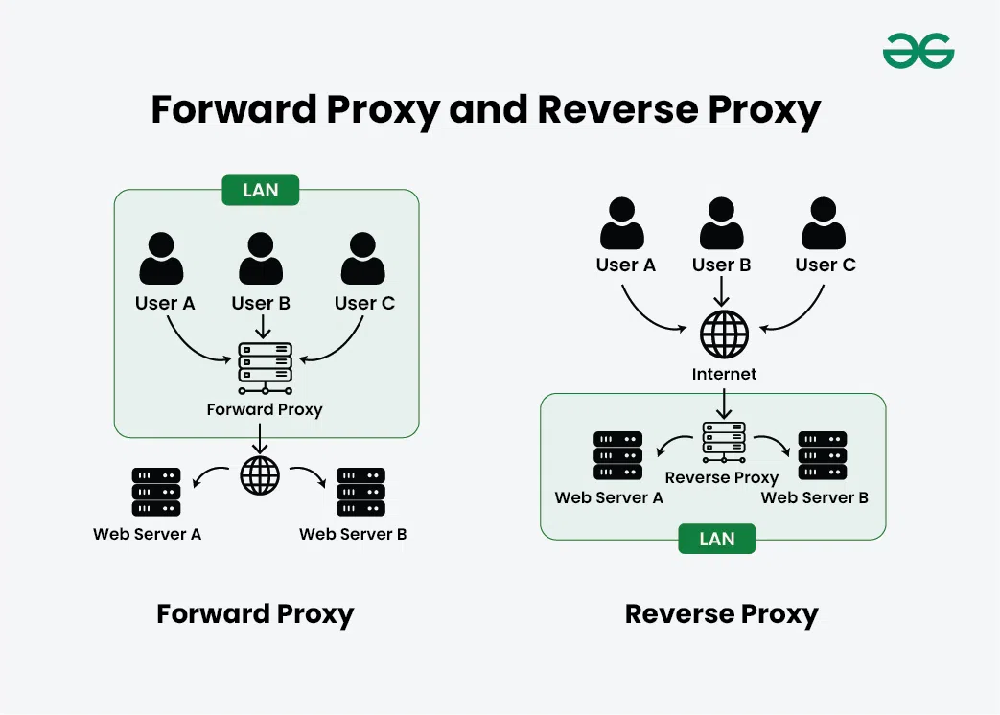

1\. Forward Proxy

- a server that sends requests to the internet on behalf of clients, hiding the client from the origin
- When you make a request to a website, the request first goes to the forward proxy.
- The proxy then sends the request to the target website, receives the response, and returns it to you
- Use cases
  - Hiding Client Identity/IP: The website only sees the proxy’s IP, not the original client
  - Access Control & Filtering: Used in organizations to block access to certain websites or restrict content.
  - Monitoring: Employers or administrators can track and monitor internet usage.
  - Bypass Geo-Restrictions: You can appear to be in another region by routing traffic through a proxy in that location.

2\. Reverse Proxy

- a server that receives requests on behalf of backend servers and routes them upstream, hiding the backends from the client
- Clients don’t directly communicate with the backend servers
- they send requests to the reverse proxy, which forwards it to the appropriate server and sends the response back to the client.
- Use cases
  - Load Balancing
  - Security & DDoS Protection
  - Caching
  - Routing

Nginx

- web server, reverse proxy, and load balancer

Caddy

- web server with automatic HTTPS support and simple configuration


## Caching

Caching stores frequently accessed data in a fast-access storage layer (memory/disk) so that future requests for that data can be served more quickly

### Types

1\. Client-Side Cache

- Used to reduce repeated HTTP requests.
- Example: Browser cache (HTML, CSS, JS, images)

2\. CDN Cache

- Content Delivery Networks cache static assets at edge servers.
- Example: Cloudflare

3\. Reverse Proxy Cache

- Example: Nginx or Varnish caching full HTTP responses.

4\. Application-Level Cache

- Stores frequently accessed business data like product lists, user sessions, etc.
- Cached at the app layer (e.g., in-memory cache using Redis or in-process memory).

5\. Database Cache

- Result sets or partial query data stored in cache (e.g., Redis or Memcached) to reduce DB hits

### Caching Strategies

1\. Cache-Aside

- Lazy Caching
- the application controls the cache
- On read: App first checks the cache.
  - If found → return.
  - If miss → fetch from DB, store in cache, then return.
- On write: App writes to the DB, then invalidates or updates the cache manually.
- Eg: ecommerce (reads are more frequent than writes)

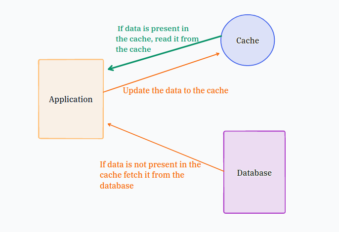

2\. Read-Through

- Cache library/service sits between the app and DB and handles all reads
- On read: App queries cache.
  - If miss, cache fetches from DB and stores the result.
- On write: Cache also updates the DB.
- Eg: social media applications

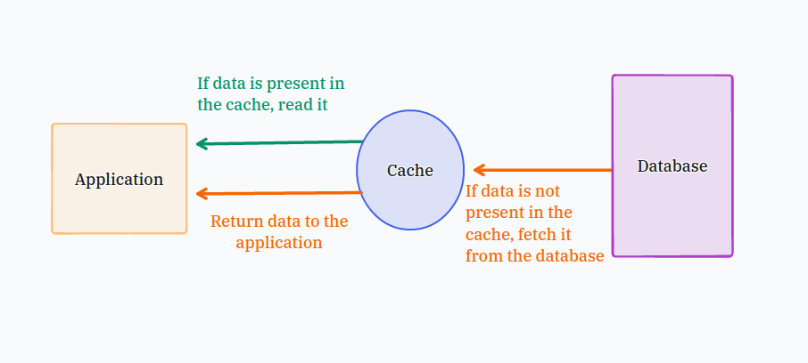

3\. Write-Through

- Every write goes through the cache, which also updates the database immediately (synchronously)
- On write: App writes to the cache → cache writes to the DB.
- On read: Same as read-through or direct cache read.
- Eg: banking applications

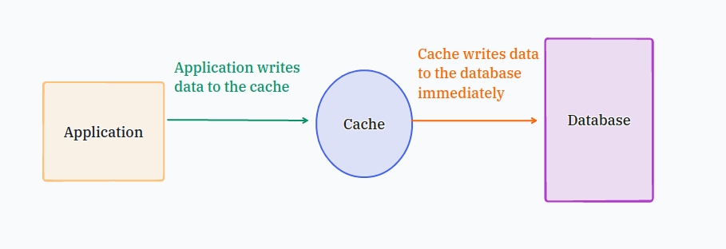

4\. Write-Back (Write-Behind)

- Writes are made only to the cache, DB is updated asynchronously later.
- On write: App writes only to the cache.
- Cache batches writes to DB in background (periodic flush or async sync).
- On read: Reads from cache.
- Eg: Content Management System (CMS)

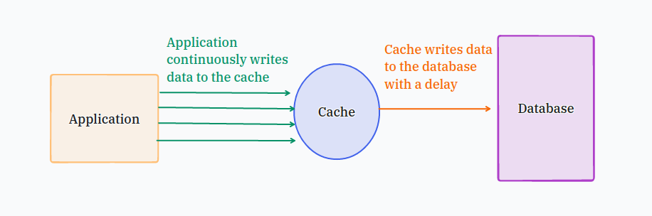

5\. Write-Around

- Writes bypass the cache and go directly to the DB.
- On write: App writes to DB only.
- Cache is updated only when a read occurs (lazy loading).
- Eg: Cloud Storage Service.

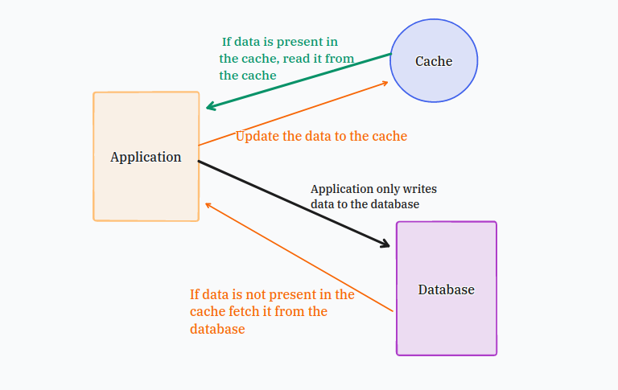

### Cache Eviction Policies

algorithm used to determine which data should be removed (evicted) when the cache reaches its maximum capacity

1\. LRU (Least Recently Used)

- The item that hasn’t been used for the longest time.

2\. LFU (Least Frequently Used)

- The item with the lowest access count.

3\. FIFO (First In First Out)

- The oldest inserted item, regardless of usage.

4\. Random Replacement

- A random item from the cache

5\. MRU (Most Recently Used)

- The most recently accessed item.

6\. TTL (Time to Live) + Expiry-Based Eviction

- Items after a fixed time duration.


## Content Delivery Network (CDN)

- globally distributed network of edge servers designed to deliver static and dynamic content (like images, videos, stylesheets, and HTML) to users faster by serving them from a server that's geographically closer to them
- A CDN caches content in edge locations around the world so that users get low-latency, high-speed access without always hitting the origin server
- Types of content which can be delivered: Static files (HTML, CSS, JS, images, pdf) and streaming (audio, video)
- Eg: AWS CloudFront, Cloudflare, Akamai


## Message Queues

- software component that stores and manages messages between producers and consumers.
- Benefits
  - Asynchronous Communication
  - Decoupling
  - Scalability
  - Reliability
- Eg: Apache Kafka, RabbitMQ, Amazon SQS

Dead Letter Queues (DLQs)

- special type of message queue that stores messages that could not be processed successfully by a consumer after multiple attempts
- prevent message loss and enable debugging, monitoring, and retry strategies for failed jobs

Backpressure

- mechanism where a slow consumer signals a fast producer to slow down, so the consumer isn't overwhelmed
- Implementations
  - Bounded queue: the buffer has a max size. When it's full, the producer either blocks (waits) or gets rejected
  - Demand signaling (pull-based): the consumer says "I can take N items," and the producer sends only that many. Reactive streams work this way.
  - Flow control window (protocol level): the receiver advertises how much buffer space it has left. The sender stops when the window hits zero. TCP and HTTP/2 do this.
  - Reject or shed load: when overloaded, the server returns 429/503 or drops requests, and the client backs off and retries.

Delivery semantics

1. At-most-once (send once, never retry)
   - The producer sends and moves on. Or the consumer acks before processing.
   - Outcome: 0 or 1 times. Loss is possible, duplicates are not.
   - Example: a metrics or log pipeline sending CPU readings every second. If one reading is lost, nobody cares.
   - Another example: a consumer acks the message, then crashes before processing it. The message is gone.
   - Use when: data is cheap and loss is acceptable. Lowest latency and simplest.
- 2\. At-least-once (retry until acked)
  - The producer retries until it gets an ack. Or the consumer acks after processing.
  - Outcome: 1 or more times. No loss, duplicates are possible.
  - Example: a payment service processes "charge ₹500" but crashes before acking. The queue redelivers, and the customer is charged twice unless you handle it.
  - Use when: loss is unacceptable. This is the default in Kafka, SQS, and RabbitMQ.
  - Requirement: consumers must be idempotent.
- 3\. Exactly-once (one effect per message)
  - Outcome: the message is processed with exactly one effect. No loss, no duplicates.
  - Reality: exactly-once delivery over an unreliable network is not achievable. What you get is exactly-once processing (effect), built from:
  - At-least-once + idempotent consumer: dedupe using a unique message ID or idempotency key.
  - Transactions: Kafka transactions write the output and the consumer offset atomically.
  - Outbox / inbox pattern: write the DB change and the message in one DB transaction.
  - Example: the payment request carries idempotency_key = order_123. The consumer first checks whether order_123 is already processed. If yes, it skips, so retries and redeliveries cause no second charge.

Publish-Subscribe (Pub/Sub) Architecture

- messaging pattern where senders (publishers) of messages do not directly send messages to receivers (subscribers).
- Instead, messages are published to a channel or topic, and any subscriber to that topic will receive the message.
- Publisher- Sends messages to a topic
- Topic- Named channel or stream where messages are published
- Subscriber- Receives messages from a topic it is subscribed to
- Broker- Mediates between publishers and subscribers (e.g., Kafka, Redis, RabbitMQ)


## Elasticsearch Search Engine

- distributed search and analytics engine designed for fast and scalable full-text search, structured data search, and log analytics
- based on Apache Lucene
- Fuzzy searches
- stores data in a document-like format
- part of the Elastic Stack (ELK Stack):
  - Elasticsearch – search & analytics
  - Logstash – data ingestion
  - Kibana – data visualization


## Rate Limiting

- technique used to control the number of requests a user, IP, or client can make to a system in a given time period

### Algorithms

1\. Token Bucket Algorithm

- allocates tokens at a fixed rate into a "bucket"
- Tokens are added at a constant rate (e.g., 1 token per second).
- Each request consumes a token. If there’s no token, the request is rejected or delayed.
- Pros: allows short bursts, memory-light (a counter plus a timestamp), simple. Used by AWS and Stripe.
- Cons: two params to tune (capacity, refill rate); bursts can still hit the backend hard.

2\. Leaky Bucket Algorithm

- A bucket leaks at a constant rate (requests processed steadily).
- Incoming requests are added to the bucket (queue).
- If the bucket overflows (too many incoming requests), they are dropped or delayed.
- Pros: smooth, steady output rate, which protects downstream systems.
- Cons: no burst tolerance, old requests can starve behind a queue, and the queue adds latency.

3\. Fixed Window Counter Algorithm

- Track the number of requests per fixed time window (e.g., 100 requests per minute).
- If the limit is exceeded, requests are rejected until the next window.
- Pros: simplest, very cheap (one counter per key), easy in Redis (INCR + EXPIRE).
- Cons: the boundary problem: a user can send the limit at the end of one window and again at the start of the next, getting 2x the limit in a short span

4\. Sliding Window Log Algorithm

- Keep a timestamp log of each request per user/IP.
- On each new request:
  - Remove timestamps older than the window (e.g., past 60 seconds).
  - Count remaining — if under limit, allow request; else, reject.
- Pros: the most accurate, with no boundary problem.
- Cons: memory-heavy (stores every timestamp) and costlier per request. It's bad at high limits or scale


## Distributed System

- system where multiple independent computers (nodes) work together to appear as a single system to the end-user.

Client-Server Architecture

- A client is a device or program that initiates a request.
- A server is a machine or program that processes the request and sends back a response.
- They communicate over a network, typically using HTTP, WebSockets, gRPC, or TCP/IP.


## Polling

- client repeatedly sends requests to the server at regular intervals to check for updates

### Types

1\. Short Polling

- Client sends an HTTP request to the server at fixed intervals (e.g., every 5 seconds)
- The server responds immediately, whether new data is available or not.
- If there's no new data, the client just waits until the next interval.
- Pros: simplest to build, works everywhere over plain HTTP, stateless, easy to scale and cache.
- Cons: wasteful (many empty responses), delay up to the polling interval, extra load on the server and battery/network on the client

2\. Long Polling

- Client sends a request and server holds it open until data becomes available (or times out).
- Once the server responds with data, the client immediately sends another request, repeating the cycle.
- Pros: near real-time delivery, far fewer empty responses, still plain HTTP so it works through most proxies and firewalls.
- Cons: each waiting client holds an open connection (server resources), timeouts and reconnect logic to manage, harder to scale and load balance, and there is a small gap between response and re-request where events can be missed unless you track a cursor or last event ID.


## Streaming

- server pushes data to the client as it becomes available, over a persistent connection

### Types

1\. Server-Sent Events (SSE)

- Uses HTTP (unidirectional)
- Server → Client only (no client-to-server streaming)
- Pros: simple, runs over plain HTTP, one-way push, built-in reconnect and resume, proxy/firewall friendly.
- Cons: server to client only, text only, limited connections per client on older HTTP versions.
- Use case: One-way updates

2\. WebSockets

- Uses TCP (full-duplex communication)
- Two-way (Client ↔ Server)
- Client performs a WebSocket handshake via HTTP.
- Once upgraded, the connection stays open and both sides can send and receive data anytime.
- Pros: true two-way, low latency, low per-message overhead, text and binary.
- Cons: stateful connections are harder to scale and load balance, reconnect and resume must be built by you, some proxies interfere, and it needs its own auth and backpressure handling.
- Use case: Interactive two-way, browser-facing

3\. gRPC Streaming

- Uses HTTP/2
- Built on top of Protocol Buffers (binary format)
- Pros: strongly typed contracts, efficient binary format, built-in flow control, deadlines and cancellation, supports server, client, and bidirectional streaming.
- Cons: weak browser support without a translation layer, harder to debug (binary), needs schema tooling, and load balancers must understand HTTP/2.
- Use case: Service-to-service, high throughput


## GraphQL

- query language for APIs and a runtime for executing those queries
- Only the requested fields are returned — no more, no less.
- Pros: no over-fetching or under-fetching, one request can pull data from many sources, strongly typed schema, great for varied clients (web, mobile) with different data needs, easy to evolve without versioning.
- Cons: HTTP caching is harder (mostly POST to one endpoint), expensive or deeply nested queries can hammer the backend (need depth/cost limits), the N+1 problem needs batching, rate limiting is harder because request cost varies, and there's more server complexity.
- Use cases: mobile and web apps with diverse data needs, API aggregation over many services, dashboards.


## gRPC (Google Remote Procedure Call)

- Remote Procedure Call (RPC) framework
- allows services to communicate with each other easily and efficiently by calling methods across machines, as if they were local function calls
- Uses HTTP/2 for transport (binary, multiplexed)
- Uses Protocol Buffers (Protobuf) instead of JSON
- Supports Unary RPC, Client Streaming, Server Streaming, and Bidirectional Streaming
- Pros: fast and compact, strongly typed contracts, supports streaming (server, client, bidirectional), built-in deadlines and cancellation, multiplexing, good for polyglot services.
- Cons: weak native browser support (needs a translation layer), binary is harder to debug, needs schema tooling, and load balancers must be HTTP/2-aware.
- Use cases: service-to-service communication in microservices, low-latency internal APIs, streaming between backends.


## WebRTC (Web Real-Time Communication)

- enables peer-to-peer communication between browsers and mobile apps for real-time audio, video, and data transfer
- Real-time communication directly between users, browser-to-browser
- Pros: very low latency, direct peer-to-peer path reduces server bandwidth cost, built-in encryption, native browser support, supports media and arbitrary data.
- Cons: needs signaling servers to set up connections, STUN/TURN servers for NAT traversal (TURN relays are costly), hard to scale beyond small groups (needs an SFU or MCU media server), and complex to implement and debug.
- Use cases: video calls, voice chat, screen sharing, live collaboration, peer-to-peer file transfer, low-latency gaming.

Components

- MediaStream- capturing the local audio or video using your webcam or microphone
- RTCPeerConnection
  - Creates a connection between two browsers/devices
  - Transfers the media streams (captured earlier)
  - Uses STUN/TURN servers to handle NAT/firewall traversal
- RTCDataChannel
  - This lets peers send arbitrary data (like text messages, files, game state) directly over the P2P connection — just like a socket

STUN (Session Traversal Utilities for NAT)

- Helps a client discover its public IP and port by contacting a STUN server.
- Used to try establishing a direct connection between peers.
- Working
  - Browser contacts the STUN server.
  - The server responds with the client's public IP + port (what the internet sees).
  - This information is shared with the other peer during WebRTC's ICE (Interactive Connectivity Establishment) negotiation.

TURN (Traversal Using Relays around NAT)

- Relays media traffic between peers through a TURN server when a direct connection fails.
- Working
  - Peer A cannot reach Peer B directly.
  - Both connect to a TURN server.
  - TURN server forwards data between them (like a middleman).


# Low Level Design (LLD)


## Intro

Interface- set of methods (without implementation) that a class must implement


## Unified Modeling Language (UML)

standardized modeling language used in software engineering to visualize, design, and document the architecture and behavior of software systems


## Class Diagram

Shows classes, attributes, methods, and relationships (inheritance, composition, aggregation, association)

Focus on Inheritance, Association and Interface implementation

```text
+-----------------------------+
|         BankAccount         |
+-----------------------------+
| - accountNumber: string     |
| - accountHolder: string     |
| - balance: double           |
+-----------------------------+
| + BankAccount(string, string, double) |
| + deposit(amount: double): void       |
| + withdraw(amount: double): bool      |
| + getBalance(): double                |
| + printDetails(): void                |
+-----------------------------+
```

Visibility Notation

- \+ for public (visible to all classes)
- \- for private (visible only within the class)
- \# for protected (visible to subclasses)
- \~ for package or default visibility (visible to classes in the same package)

### Relationships between classes

- Put arrow on the main/source/parent class, except directed association

1\. Association

- bi-directional relationship between two classes.
- It indicates that instances of one class are connected to instances of another class.

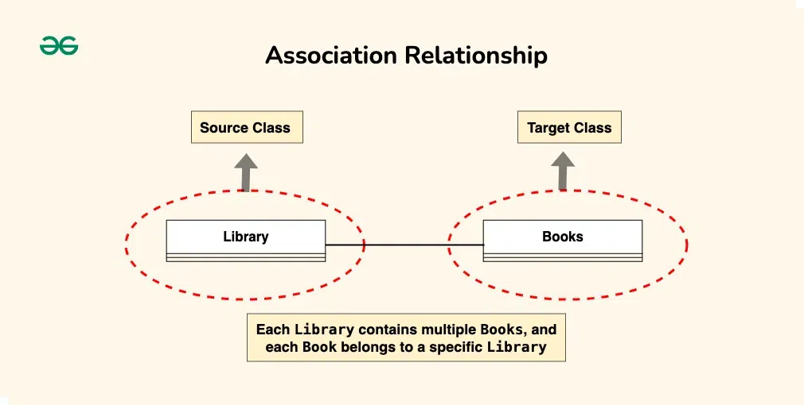

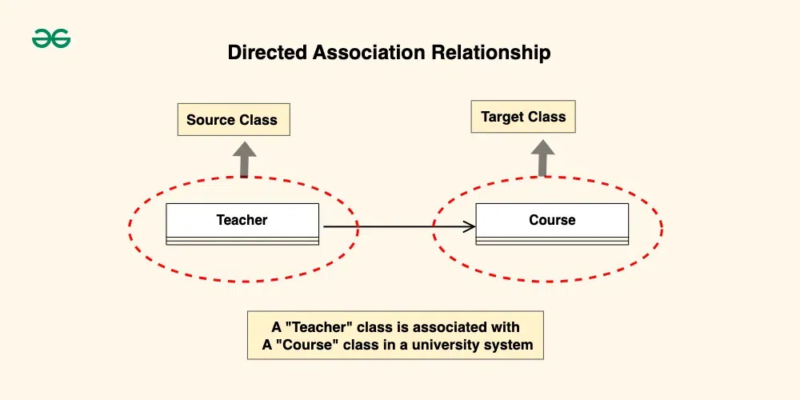

2\. Aggregation

- Has-a relationship
- A whole-part relationship
- The part can exist independently of the whole

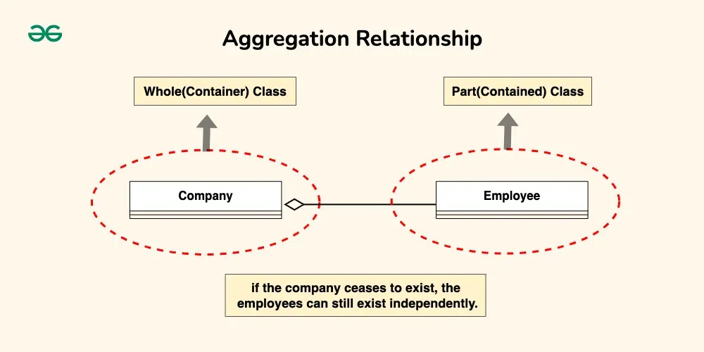

3\. Composition

- Strong Has-a relationship
- A stronger form of aggregation
- The part cannot exist without the whole.

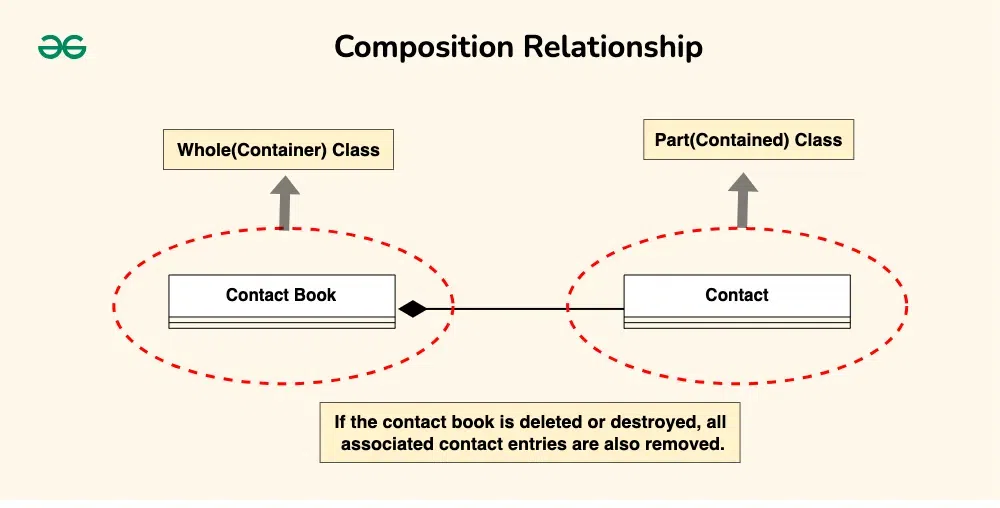

4\. Inheritance (Generalization)

- Is-a relationship
- One class is a subtype of another

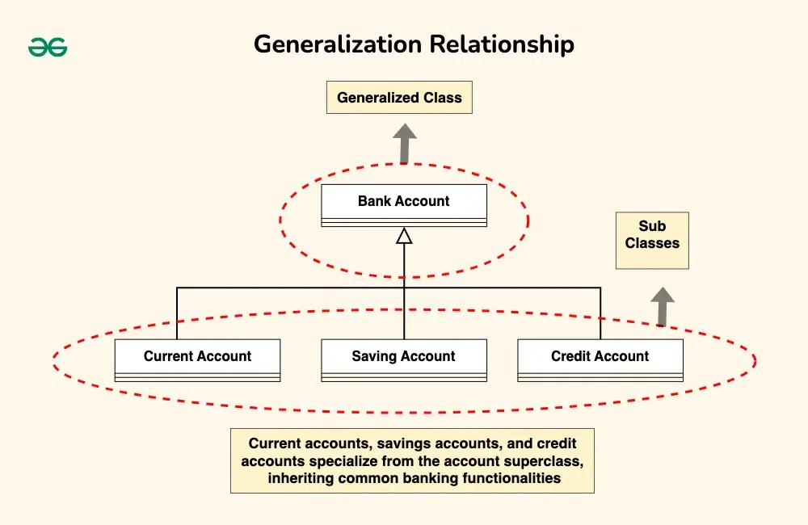

5\. Dependency

- one class relies on another, but the relationship is not as strong as association or inheritance

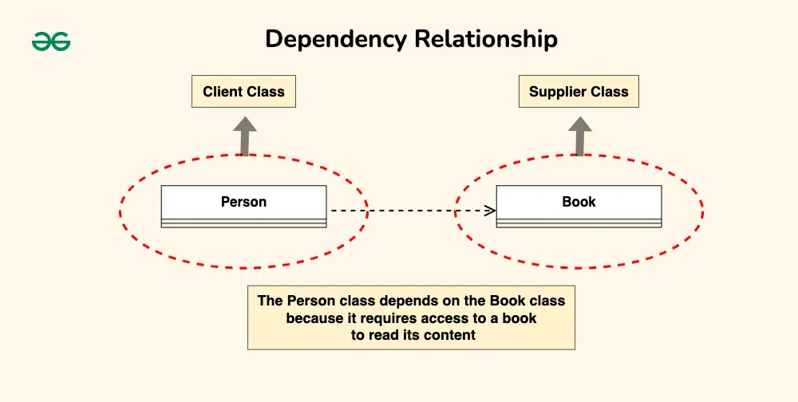


## State Machine Diagram

Shows an object's states and transitions between them

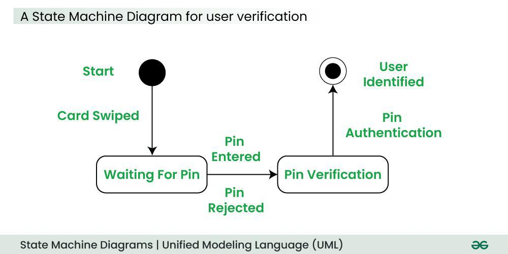


## Activity Diagrams

Like a flowchart — shows workflow/process logic, branching, parallel flows

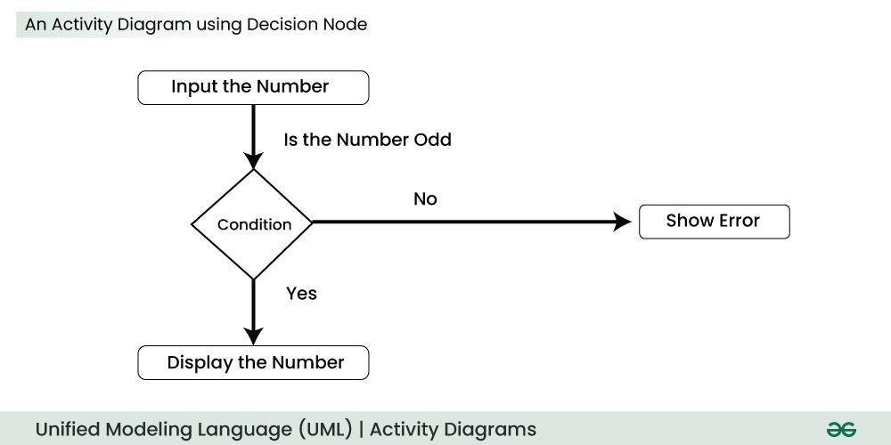


## Use Case Diagrams

High-level view of actors (users/systems) and what actions they can perform

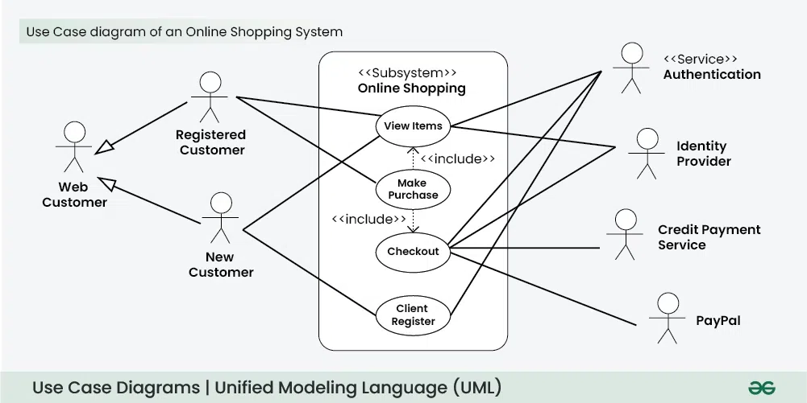


## Sequence Diagram

Shows how objects interact over time — method calls, order of execution

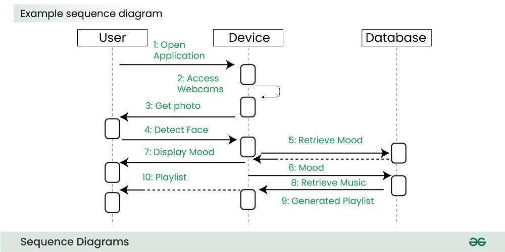


## SOLID Principles

1\. Single Responsibility Principle

- A class should have only one reason to change
- A class should do one thing and do it well

```java
// This class only handles report data generation
class Report {
    void generate() {
        System.out.println("Generating report data...");
    }
}

// This class only handles printing functionality
class ReportPrinter {
    void print(Report report) {
        System.out.println("Printing the report...");
    }
}
```

2\. Open/Closed Principle

- Software entities (classes, modules, functions, etc.) should be open for extension, but closed for modification
- should be able to extend a class behavior, without modifying it

```java
// Base class (interface) for discount strategy
interface Discount {
    double getDiscount();
}

// New discount types can extend this without modifying existing code
class GoldDiscount implements Discount {
    public double getDiscount() {
        return 0.2; // 20% discount
    }
}

class SilverDiscount implements Discount {
    public double getDiscount() {
        return 0.1; // 10% discount
    }
}
```

3\. Liskov's Substitution Principle

- Derived or child classes must be substitutable for their base or parent classes
- Any class that is the child of a parent class should be usable in place of its parent without any unexpected behaviour

```java
class Rectangle {
    protected double width;
    protected double height;

    Rectangle(double width, double height) {
        this.width = width;
        this.height = height;
    }

    void setWidth(double width) {
        this.width = width;
    }

    void setHeight(double height) {
        this.height = height;
    }

    double getArea() {
        return this.width * this.height;
    }
}

class Square extends Rectangle {
    Square(double width, double height) {
        super(width, height);
    }

    // Violates LSP: overriding setWidth also changes height
    @Override
    void setWidth(double width) {
        this.width = width;
        this.height = width; // unexpected side effect
    }

    @Override
    void setHeight(double height) {
        this.width = height;
        this.height = height;
    }
}

class Main {
    static void testRectangle(Rectangle rect) {
        rect.setWidth(5);
        rect.setHeight(10);
        System.out.println(rect.getArea()); // expects 50
    }

    public static void main(String[] args) {
        testRectangle(new Rectangle(2, 3)); // 50 ✅
        testRectangle(new Square(2, 2));    // 100 ❌ -- breaks caller's expectation
    }
}


interface Shape {
    double getArea();
}

class Rectangle2 implements Shape {
    private double width;
    private double height;

    Rectangle2(double width, double height) {
        this.width = width;
        this.height = height;
    }

    public double getArea() {
        return this.width * this.height;
    }
}

class Square2 implements Shape {
    private double side;

    Square2(double side) {
        this.side = side;
    }

    public double getArea() {
        return this.side * this.side;
    }
}

class Main2 {
    static void printArea(Shape shape) {
        System.out.println(shape.getArea());
    }

    public static void main(String[] args) {
        printArea(new Rectangle2(2, 3)); // 6
        printArea(new Square2(4));       // 16 -- no surprises
    }
}
```

4\. Interface Segregation Principle

- do not force any client to implement an interface which is irrelevant to them
- avoiding fat interface and give preference to many small client-specific interfaces

```java
// Smaller, specific interface for printing
interface IPrinter {
    void print();
}

// Another specific interface for scanning
interface IScanner {
    void scan();
}

// Class only implements what it needs
class OldPrinter implements IPrinter {
    public void print() {
        System.out.println("Printing from an old printer...");
    }
}
```

5\. Dependency Inversion Principle

- High-level modules should not depend on low-level modules. Both should depend on abstractions
- classes should rely on abstractions (e.g., interfaces or abstract classes) rather than concrete implementations

```java
// High-level code depends on this abstraction
interface IDatabase {
    void save();
}

// Low-level class implements the interface
class MySQLDatabase implements IDatabase {
    public void save() {
        System.out.println("Saving order to MySQL database.");
    }
}

// High-level class uses the abstraction, not the concrete class
class OrderService {
    private IDatabase db; // depends on abstraction

    OrderService(IDatabase dbRef) {
        this.db = dbRef;
    }

    void saveOrder() {
        this.db.save(); // calls through interface
    }
}

class Main {
    public static void main(String[] args) {
        // Usage
        IDatabase db = new MySQLDatabase();
        OrderService orderService = new OrderService(db);
        orderService.saveOrder(); // Saving order to MySQL database.
    }
}
```


# Design Patterns


## Factory Design Pattern

- provides an interface for creating objects in a superclass, but allows subclasses to alter the type of objects that will be created.

Components

- Product- Interface/abstract class that all created objects share. Eg: Vehicle
- Concrete Product- Actual classes returned by the factory method. Implements Product. Eg: Car, Bike
- Creator- Interface/abstract class that declares the factory method createVehicle() and may contain business logic. Eg: VehicleFactory
- Concrete Creator- Subclass of Creator that overrides the factory method to return a specific Concrete Product. Eg: CarFactory, BikeFactory

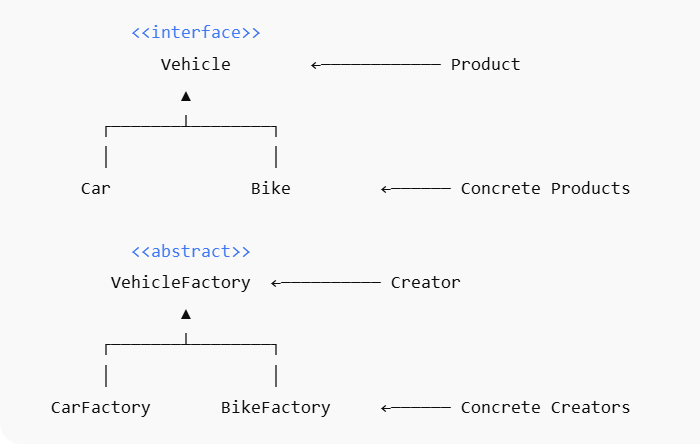

```java
import java.util.Scanner;

// ============================================
// 1. Product (Interface)
// --------------------------------------------
// Declares the interface that all concrete products must implement.
// ============================================
interface Vehicle {
    void drive();
}

// ============================================
// 2. Concrete Products
// --------------------------------------------
// Implement the Product interface. These are the actual classes that
// will be instantiated by the factory method.
// ============================================
class Car implements Vehicle {
    public void drive() {
        System.out.println("Driving a Car");
    }
}

class Bike implements Vehicle {
    public void drive() {
        System.out.println("Riding a Bike");
    }
}

// ============================================
// 3. Creator (Factory Abstract Class)
// --------------------------------------------
// Declares the factory method `createVehicle()` that returns a Product.
// Concrete creators will implement this method.
// ============================================
abstract class VehicleFactory {
    abstract Vehicle createVehicle(); // Factory method
}

// ============================================
// 4. Concrete Creators (Factories)
// --------------------------------------------
// Implement the factory method to create specific Concrete Products.
// These classes encapsulate the logic of which product to instantiate.
// ============================================
class CarFactory extends VehicleFactory {
    Vehicle createVehicle() {
        return new Car();
    }
}

class BikeFactory extends VehicleFactory {
    Vehicle createVehicle() {
        return new Bike();
    }
}

// ============================================
// 5. Client Code
// --------------------------------------------
// Uses the factory to create products without depending on the concrete classes.
// This allows us to change object creation logic without changing the client.
// ============================================
class Main {
    static VehicleFactory getFactory(String type) {
        switch (type) {
            case "car":
                return new CarFactory();
            case "bike":
                return new BikeFactory();
            default:
                return null;
        }
    }

    public static void main(String[] args) {
        Scanner rl = new Scanner(System.in);

        System.out.print("Enter vehicle type (car/bike): ");
        String type = rl.nextLine();

        VehicleFactory factory = getFactory(type.trim().toLowerCase());

        if (factory == null) {
            System.out.println("Unknown vehicle type!");
            rl.close();
            System.exit(1);
        }

        Vehicle myVehicle = factory.createVehicle();
        myVehicle.drive();

        rl.close();
    }
}
```


## Abstract Factory Design Pattern

- provides an interface for creating families of related or dependent objects without specifying their concrete classes
- 1 factory, multiple products

Components

- Abstract Factory- Defines creation methods for related products (engine, tyre). Eg: VehicleFactory
- Concrete Factories- Implement creation methods for specific product families. Eg: CarFactory, BikeFactory
- Abstract Products- Base interfaces for all concrete products. Eg: Engine, Tyre
- Concrete Products- Actual products created by concrete factories. Eg: CarEngine, CarTyre, BikeEngine, BikeTyre
- Client- Uses factories to create and use products without knowing their concrete types. Eg: VehicleAssembler

```java
// ==============================
// Abstract Products
// ==============================

// Abstract Product A - Engine
interface Engine {
    void start();
}

// Abstract Product B - Tyre
interface Tyre {
    void rotate();
}

// ==============================
// Concrete Products - Car Family
// ==============================

class CarEngine implements Engine {
    public void start() {
        System.out.println("🚗 Car Engine started!");
    }
}

class CarTyre implements Tyre {
    public void rotate() {
        System.out.println("🚗 Car Tyre rotating!");
    }
}

// ==============================
// Concrete Products - Bike Family
// ==============================

class BikeEngine implements Engine {
    public void start() {
        System.out.println("🏍️ Bike Engine started!");
    }
}

class BikeTyre implements Tyre {
    public void rotate() {
        System.out.println("🏍️ Bike Tyre rotating!");
    }
}

// ==============================
// Abstract Factory
// ==============================

interface VehicleFactory {
    Engine createEngine();
    Tyre createTyre();
}

// ==============================
// Concrete Factory - Car
// ==============================

class CarFactory implements VehicleFactory {
    public Engine createEngine() {
        return new CarEngine();
    }

    public Tyre createTyre() {
        return new CarTyre();
    }
}

// ==============================
// Concrete Factory - Bike
// ==============================

class BikeFactory implements VehicleFactory {
    public Engine createEngine() {
        return new BikeEngine();
    }

    public Tyre createTyre() {
        return new BikeTyre();
    }
}

// ==============================
// Client - Assembler
// ==============================

class VehicleAssembler {
    private Engine engine;
    private Tyre tyre;

    // Constructor uses abstract factory to get product instances
    VehicleAssembler(VehicleFactory factory) {
        this.engine = factory.createEngine(); // Polymorphic creation
        this.tyre = factory.createTyre();     // Polymorphic creation
    }

    void assemble() {
        this.engine.start();
        this.tyre.rotate();
    }
}

// ==============================
// Main Function
// ==============================

class Main {
    public static void main(String[] args) {
        System.out.println("Creating a Car:");
        CarFactory carFactory = new CarFactory();
        VehicleAssembler car = new VehicleAssembler(carFactory);
        car.assemble();

        System.out.println("\nCreating a Bike:");
        BikeFactory bikeFactory = new BikeFactory();
        VehicleAssembler bike = new VehicleAssembler(bikeFactory);
        bike.assemble();
    }
}
```


## Singleton Design Pattern

- Single Instance- Only one object is created.
- Global Access- Accessible via a static method.
- Private Constructor- Prevents external instantiation.
- Lazy Initialization- Instance created only when first needed (optional).
- Thread Safety- Ensures safe access in multi-threaded environments.

```java
class Singleton {
    private static Singleton instance;

    private Singleton() {}

    static Singleton getInstance() {
        if (instance == null) {
            instance = new Singleton();
        }
        return instance;
    }

    void sayHello() {
        System.out.println("Hello from the one and only instance!");
    }
}

class Main {
    public static void main(String[] args) {
        // Usage
        Singleton a = Singleton.getInstance();
        Singleton b = Singleton.getInstance();

        a.sayHello();
        System.out.println(a == b); // true -- same instance
    }
}
```


## Builder Design Pattern

- construct a complex object step by step, separating the construction process from the object’s representation

Components

- Product- The complex object being built (e.g., Computer).
- Builder (Interface)- Declares methods to build different parts of the product.
- ConcreteBuilder- Implements Builder, knows how to build specific parts and assemble the product.
- Director- Directs the building process using the Builder interface, doesn't know the details of construction.
- Client- Creates the Builder and Director, and asks the Director to build the product.

```java
// ==============================
// 1. Product
// ==============================
class Computer {
    String cpu = null;
    String gpu = null;
    String ram = null;
    String storage = null;

    void showSpecs() {
        System.out.println("CPU: " + this.cpu);
        System.out.println("GPU: " + this.gpu);
        System.out.println("RAM: " + this.ram);
        System.out.println("Storage: " + this.storage);
    }
}

// ==============================
// 2. Builder Interface
// ==============================
interface ComputerBuilder {
    ComputerBuilder buildCPU();
    ComputerBuilder buildGPU();
    ComputerBuilder buildRAM();
    ComputerBuilder buildStorage();
    Computer getComputer();
}

// ==============================
// 3. Concrete Builder - Gaming Computer
// ==============================
class GamingComputerBuilder implements ComputerBuilder {
    private Computer computer;

    GamingComputerBuilder() {
        this.computer = new Computer();
    }

    public GamingComputerBuilder buildCPU() {
        this.computer.cpu = "Intel Core i9";
        return this;
    }

    public GamingComputerBuilder buildGPU() {
        this.computer.gpu = "NVIDIA RTX 4090";
        return this;
    }

    public GamingComputerBuilder buildRAM() {
        this.computer.ram = "32GB DDR5";
        return this;
    }

    public GamingComputerBuilder buildStorage() {
        this.computer.storage = "2TB NVMe SSD";
        return this;
    }

    public Computer getComputer() {
        return this.computer;
    }
}

// ==============================
// 3. Concrete Builder - Office Computer
// ==============================
class OfficeComputerBuilder implements ComputerBuilder {
    private Computer computer;

    OfficeComputerBuilder() {
        this.computer = new Computer();
    }

    public OfficeComputerBuilder buildCPU() {
        this.computer.cpu = "Intel Core i5";
        return this;
    }

    public OfficeComputerBuilder buildGPU() {
        this.computer.gpu = "Integrated Graphics";
        return this;
    }

    public OfficeComputerBuilder buildRAM() {
        this.computer.ram = "16GB DDR4";
        return this;
    }

    public OfficeComputerBuilder buildStorage() {
        this.computer.storage = "512GB SSD";
        return this;
    }

    public Computer getComputer() {
        return this.computer;
    }
}

// ==============================
// 4. Director
// ==============================
class ComputerDirector {
    private ComputerBuilder builder;

    ComputerDirector(ComputerBuilder builder) {
        this.builder = builder;
    }

    // Directs the construction in a specific sequence, chaining internally
    void constructComputer() {
        this.builder
            .buildCPU()
            .buildGPU()
            .buildRAM()
            .buildStorage();
    }
}

// ==============================
// 5. Client Code
// ==============================
class Main {
    public static void main(String[] args) {
        // Building a Gaming Computer
        GamingComputerBuilder gamingBuilder = new GamingComputerBuilder();
        ComputerDirector director1 = new ComputerDirector(gamingBuilder);
        director1.constructComputer();
        Computer gamingPC = gamingBuilder.getComputer();
        System.out.println("Gaming PC Specs:");
        gamingPC.showSpecs();
        System.out.println();

        // Building an Office Computer
        OfficeComputerBuilder officeBuilder = new OfficeComputerBuilder();
        ComputerDirector director2 = new ComputerDirector(officeBuilder);
        director2.constructComputer();
        Computer officePC = officeBuilder.getComputer();
        System.out.println("Office PC Specs:");
        officePC.showSpecs();
    }
}
```


## Adapter Design Pattern

- two incompatible interfaces to work together.
- It acts as a bridge between a class with an unexpected or incompatible interface and the code that expects a different interface

Components

- Target Interface- Interface the client expects to use (IPrinter)
- Adaptee- Existing class with an incompatible interface (LegacyPrinter)
- Adapter- Translates the Adaptee’s interface to the Target interface (PrinterAdapter)
- Client- Uses only the Target interface, is unaware of the Adapter’s inner workings (ModernComputer)

```java
// ==============================
// Adaptee: LegacyPrinter
// ==============================
class LegacyPrinter {
    void printInUppercase(String text) {
        System.out.println("[LegacyPrinter]: " + text);
    }
}

// ==============================
// Target Interface: IPrinter
// ==============================
interface IPrinter {
    void print(String text);
}

// ==============================
// Adapter: PrinterAdapter
// ==============================
class PrinterAdapter implements IPrinter {
    private LegacyPrinter legacyPrinter;

    PrinterAdapter(LegacyPrinter legacyPrinter) {
        this.legacyPrinter = legacyPrinter;
    }

    public void print(String text) {
        String adaptedText = this.toUpperCase(text); // adapt lowercase to uppercase
        this.legacyPrinter.printInUppercase(adaptedText); // call legacy method
    }

    // Utility to convert lowercase to uppercase
    private String toUpperCase(String str) {
        return str.toUpperCase();
    }
}

// ==============================
// Client: ModernComputer
// ==============================
class ModernComputer {
    private IPrinter printer;

    ModernComputer(IPrinter printer) {
        this.printer = printer;
    }

    void sendCommand(String command) {
        System.out.println("[ModernComputer]: Sending command -> " + command);
        this.printer.print(command); // uses the adapter
    }
}

// ==============================
// Main: Client Usage
// ==============================
class Main {
    public static void main(String[] args) {
        // Legacy component (incompatible interface)
        LegacyPrinter oldPrinter = new LegacyPrinter();

        // Adapter wraps the legacy printer to make it compatible
        IPrinter adapter = new PrinterAdapter(oldPrinter);

        // Client uses the modern interface
        ModernComputer modernPC = new ModernComputer(adapter);
        modernPC.sendCommand("hello world");
    }
}
```


## Decorator Design Pattern

- allows you to dynamically attach new behaviors to objects at runtime without modifying their original clas

Components

- Component Interface- Abstract base class that declares the operations (e.g., getDescription(), getCost() for coffee).
- Concrete Component- The base object to be extended (e.g., SimpleCoffee).
- Decorator- Abstract class that holds a reference to a Component and implements the interface.
- Concrete Decorator- Extends the Decorator to add specific behavior (e.g., MilkDecorator, SugarDecorator).

```java
// ================================
// 1. Component Interface
// ================================
interface Coffee {
    String getDescription();
    double getCost();
}

// ================================
// 2. Concrete Component
// ================================
class SimpleCoffee implements Coffee {
    public String getDescription() {
        return "Simple Coffee";
    }

    public double getCost() {
        return 5.0;
    }
}

// ================================
// 3. Decorator Base Class
// ================================
abstract class CoffeeDecorator implements Coffee {
    protected Coffee coffee; // holds reference to component

    CoffeeDecorator(Coffee coffee) {
        this.coffee = coffee;
    }

    public String getDescription() {
        return this.coffee.getDescription();
    }

    public double getCost() {
        return this.coffee.getCost();
    }
}

// ================================
// 4. Concrete Decorators
// ================================

class MilkDecorator extends CoffeeDecorator {
    MilkDecorator(Coffee coffee) {
        super(coffee);
    }

    public String getDescription() {
        return this.coffee.getDescription() + ", Milk";
    }

    public double getCost() {
        return this.coffee.getCost() + 1.5;
    }
}

class SugarDecorator extends CoffeeDecorator {
    SugarDecorator(Coffee coffee) {
        super(coffee);
    }

    public String getDescription() {
        return this.coffee.getDescription() + ", Sugar";
    }

    public double getCost() {
        return this.coffee.getCost() + 0.5;
    }
}

// ================================
// 5. Client Code
// ================================
class Main {
    public static void main(String[] args) {
        // Start with a simple coffee
        Coffee myCoffee = new SimpleCoffee();

        // Add milk
        myCoffee = new MilkDecorator(myCoffee);

        // Add sugar
        myCoffee = new SugarDecorator(myCoffee);

        // Final coffee description and cost
        System.out.println("Order: " + myCoffee.getDescription());
        System.out.println("Total Cost: $" + myCoffee.getCost());
    }
}
```


## Facade Design Pattern

- provides a simple interface to a complex subsystem.
- It hides the subsystem’s complexity from the client and exposes only what is necessary

Components

- Facade- Provides a simple interface to the subsystem (e.g., CarFacade)
- Subsystem classes- Perform actual work (e.g., Engine, Battery, FuelPump)
- Client- Calls the Facade instead of directly accessing subsystem classes
- Interface- The exposed methods that the client can use (e.g., startCar())

```java
// ===========================
// Subsystem Components
// ===========================

class Engine {
    void ignite() {
        System.out.println("Engine: Ignition started...");
    }
}

class FuelPump {
    void pumpFuel() {
        System.out.println("FuelPump: Pumping fuel to engine...");
    }
}

class Battery {
    void supplyPower() {
        System.out.println("Battery: Supplying power to start the car...");
    }
}

class AirConditioner {
    void turnOn() {
        System.out.println("AC: Turning on air conditioning...");
    }
}

// ===========================
// Facade Class
// ===========================

class CarFacade {
    private Engine engine = new Engine();
    private FuelPump fuelPump = new FuelPump();
    private Battery battery = new Battery();
    private AirConditioner ac = new AirConditioner();

    void startCar() {
        System.out.println("=== Starting Car ===");
        this.battery.supplyPower();
        this.fuelPump.pumpFuel();
        this.engine.ignite();
        this.ac.turnOn();
        System.out.println("=== Car Started ===");
    }

    void stopCar() {
        System.out.println("=== Stopping Car ===");
        System.out.println("Turning off engine, fuel supply, and AC...");
        // In real system, you'd call shutdown methods if they existed
        System.out.println("=== Car Stopped ===");
    }
}

// ===========================
// Client Code
// ===========================

class Main {
    public static void main(String[] args) {
        CarFacade myCar = new CarFacade();

        // Client only interacts with the facade
        myCar.startCar();

        System.out.println("\nNow stopping the car...");
        myCar.stopCar();
    }
}
```


## Observer Design Pattern

- establishes a one-to-many relationship between objects
- When the subject (publisher) changes its state, all registered observers (subscribers) are notified automatically and react accordingly

Components

- Subject- Maintains a list of observers and notifies them of state changes.
- Observer- Interface that defines update() method.
- ConcreteSubject- Holds the state and notifies observers when it changes.
- ConcreteObserver- Subscribes to the subject and implements reaction logic inside update().

```java
import java.util.ArrayList;
import java.util.List;

// ==========================
// Observer Interface
// ==========================
interface IObserver {
    void update(String message);
}

// ==========================
// Subject Interface
// ==========================
interface ISubject {
    void subscribe(IObserver observer);
    void unsubscribe(IObserver observer);
    void notifyObservers(String message);
}

// ==========================
// Concrete Subject: NotificationService
// ==========================
class NotificationService implements ISubject {
    private List<IObserver> observers = new ArrayList<>();

    public void subscribe(IObserver observer) {
        this.observers.add(observer);
    }

    public void unsubscribe(IObserver observer) {
        this.observers.removeIf(obs -> obs == observer);
    }

    public void notifyObservers(String message) {
        for (IObserver observer : this.observers) {
            observer.update(message);
        }
    }

    // Trigger new notification
    void newNotification(String message) {
        System.out.println("[NotificationService] New message: " + message);
        this.notifyObservers(message);
    }
}

// ==========================
// Concrete Observers
// ==========================
class SMSAlert implements IObserver {
    public void update(String message) {
        System.out.println("[SMS Alert] Received: " + message);
    }
}

class EmailAlert implements IObserver {
    public void update(String message) {
        System.out.println("[Email Alert] Received: " + message);
    }
}

// ==========================
// Client Code
// ==========================
class Main {
    public static void main(String[] args) {
        NotificationService service = new NotificationService();

        SMSAlert sms = new SMSAlert();
        EmailAlert email = new EmailAlert();

        // Subscribing observers
        service.subscribe(sms);
        service.subscribe(email);

        service.newNotification("System maintenance at 2 AM.");
        System.out.println();

        // Unsubscribe Email
        service.unsubscribe(email);
        service.newNotification("Maintenance completed.");
    }
}
```


## Strategy Design Pattern

- Encapsulates multiple algorithms (or behaviors) inside separate classes and allows them to be interchanged dynamically at runtime

Components

- Strategy Interface- Declares a common interface for all supported strategies.
- Concrete Strategy- Implements the actual algorithm or behavior.
- Context- Maintains a reference to a Strategy object and delegates the work to it.
- Client- Decides which strategy to use and injects it into the context.

```java
// =====================================
// 1. Strategy Interface
// =====================================
interface PaymentStrategy {
    void pay(double amount);
}

// =====================================
// 2. Concrete Strategies
// =====================================

class CreditCardPayment implements PaymentStrategy {
    private String cardNumber;

    CreditCardPayment(String cardNumber) {
        this.cardNumber = cardNumber;
    }

    public void pay(double amount) {
        System.out.println("Paid ₹" + amount + " using Credit Card");
    }
}

class UpiPayment implements PaymentStrategy {
    private String upiId;

    UpiPayment(String upiId) {
        this.upiId = upiId;
    }

    public void pay(double amount) {
        System.out.println("Paid ₹" + amount + " using UPI");
    }
}

// =====================================
// 3. Context
// =====================================
class PaymentContext {
    private PaymentStrategy strategy;

    PaymentContext(PaymentStrategy strategy) {
        this.strategy = strategy;
    }

    // Allow strategy change at runtime
    void setStrategy(PaymentStrategy strategy) {
        this.strategy = strategy;
    }

    void checkout(double amount) {
        this.strategy.pay(amount);
    }
}

// =====================================
// 4. Client
// =====================================
class Main {
    public static void main(String[] args) {
        // Select a payment method (can come from user input, config, etc.)
        CreditCardPayment creditCard = new CreditCardPayment("4111111111111234");
        UpiPayment upi = new UpiPayment("john@okhdfcbank");

        PaymentContext payment = new PaymentContext(creditCard);
        payment.checkout(1500); // -> Using Credit Card

        payment.setStrategy(upi);
        payment.checkout(750); // -> Using UPI
    }
}
```


## State Design Pattern

Allows an object’s behavior to change dynamically by encapsulating state-specific behavior into separate classes

Components

- Context: Maintains a reference to the current state, delegates behavior to it, and provides an interface for clients.
- State Interface/Base Class: Defines common methods for all states, allowing Context to work with them without knowing concrete types.
- Concrete States: Implement the State interface, encapsulating behavior for specific states and defining Context’s actions in those states.

```java
// =====================================
// 1. State Interface (Abstract Base)
// =====================================
abstract class VendingMachineState {
    abstract void handleRequest();
}

// =====================================
// 2. Concrete States
// =====================================
class ReadyState extends VendingMachineState {
    void handleRequest() {
        System.out.println("Ready state: Please select a product.");
    }
}

class ProductSelectedState extends VendingMachineState {
    void handleRequest() {
        System.out.println("Product selected state: Processing payment.");
    }
}

class PaymentPendingState extends VendingMachineState {
    void handleRequest() {
        System.out.println("Payment pending state: Dispensing product.");
    }
}

class OutOfStockState extends VendingMachineState {
    void handleRequest() {
        System.out.println("Out of stock state: Product unavailable. Please select another product.");
    }
}

// =====================================
// 3. Context
// =====================================
class VendingMachineContext {
    private VendingMachineState state = null;

    void setState(VendingMachineState state) {
        this.state = state;
    }

    void request() {
        if (this.state == null) {
            throw new RuntimeException("State not set.");
        }
        this.state.handleRequest();
    }
}

// =====================================
// 4. Client
// =====================================
class Main {
    public static void main(String[] args) {
        // Create context
        VendingMachineContext vendingMachine = new VendingMachineContext();

        // Set initial state
        vendingMachine.setState(new ReadyState());
        vendingMachine.request();

        // Change state
        vendingMachine.setState(new ProductSelectedState());
        vendingMachine.request();

        // Change state
        vendingMachine.setState(new PaymentPendingState());
        vendingMachine.request();

        // Change state
        vendingMachine.setState(new OutOfStockState());
        vendingMachine.request();
    }
}
```


# LLD questions

- Requirements (functional & non-functional requirements)
- Identify Core Entities and Responsibilities, break the system into real-world objects
- UML class diagram and define Relationships
- Apply OOP Principles, use SOLID and design patterns


## Parking Lot

```text
+---------------------------+
|         Vehicle          |<--<<abstract>>
+---------------------------+
| - plate: string           |
+---------------------------+
| +constructor(plate: string)         |
| +getType(): VehicleType (abstract)  |
| +getPlate(): string                 |
+---------------------------+
        ▲
   +----+----+
   |         |
+--------+ +-------+
|  Bike  | |  Car  |
+--------+ +-------+
| +getType(): VehicleType |
+-------------------------+

+------------------------+
|        Slot            |
+------------------------+
| - id: number           |
| - status: SlotStatus   |
| - vehicle: Vehicle | null |
+------------------------+
| +constructor(id: number) |
| +isFree(): boolean       |
| +park(v: Vehicle): void  |
| +unpark(): void          |
| +getId(): number         |
| +getVehicle(): Vehicle | null |
+------------------------+

+-----------------------------+
|       FeeStrategy           |<--<<abstract>>
+-----------------------------+
| +calculateFee(entry: Date, exit: Date): number (abstract) |
+-----------------------------+
        ▲
   +----+----+
   |         |
+----------+ +----------+
|  BikeFee | |  CarFee  |
+----------+ +----------+
| +calculateFee(entry: Date, exit: Date): number |
+-------------------------------------------------+

+-----------------------------+
|          Ticket             |
+-----------------------------+
| - id: number                |
| - plate: string             |
| - slotId: number            |
| - entryTime: Date           |
+-----------------------------+
| +constructor(plate: string, slotId: number) |
| +getId(): number            |
| +getPlate(): string         |
| +getSlotId(): number        |
| +getEntryTime(): Date       |
+-----------------------------+

+---------------------------------------------------------+
|                     ParkingLot                          |
+---------------------------------------------------------+
| - slots: Slot[]                                          |
| - tickets: Map<number, { ticket: Ticket; strategy: FeeStrategy }> |
+---------------------------------------------------------+
| +constructor(numSlots: number)                           |
| +park(v: Vehicle): Ticket                                |
| +unpark(ticketId: number): void                          |
| +showAvailableSlots(): void                               |
| -getStrategy(type: VehicleType): FeeStrategy             |
+---------------------------------------------------------+
```

```java
import java.math.BigDecimal;
import java.math.RoundingMode;
import java.time.Duration;
import java.time.Instant;
import java.util.ArrayList;
import java.util.HashMap;
import java.util.List;
import java.util.Map;

// =========================
// Enums
// =========================

enum VehicleType {
    BIKE,
    CAR
}

enum SlotStatus {
    FREE,
    OCCUPIED
}

// =========================
// Vehicle Interface
// =========================

abstract class Vehicle {
    protected String plate;

    Vehicle(String plate) {
        this.plate = plate;
    }

    abstract VehicleType getType();

    String getPlate() {
        return this.plate;
    }
}

// =========================
// Bike and Car Classes
// =========================

class Bike extends Vehicle {
    Bike(String plate) {
        super(plate);
    }

    VehicleType getType() {
        return VehicleType.BIKE;
    }
}

class Car extends Vehicle {
    Car(String plate) {
        super(plate);
    }

    VehicleType getType() {
        return VehicleType.CAR;
    }
}

// =========================
// Parking Slot
// =========================

class Slot {
    private int id;
    private SlotStatus status;
    private Vehicle vehicle;

    Slot(int id) {
        this.id = id;
        this.status = SlotStatus.FREE;
        this.vehicle = null;
    }

    boolean isFree() {
        return this.status == SlotStatus.FREE;
    }

    void park(Vehicle v) {
        this.status = SlotStatus.OCCUPIED;
        this.vehicle = v;
    }

    void unpark() {
        this.status = SlotStatus.FREE;
        this.vehicle = null;
    }

    int getId() {
        return this.id;
    }

    Vehicle getVehicle() {
        return this.vehicle;
    }
}

// =========================
// Fee Strategy (abstract class)
// =========================

abstract class FeeStrategy {
    private static final BigDecimal SECONDS_PER_HOUR = BigDecimal.valueOf(3600);

    abstract BigDecimal getBaseFee();

    abstract BigDecimal getHourlyRate();

    BigDecimal calculateFee(Instant entry, Instant exit) {
        Duration duration = Duration.between(entry, exit);
        BigDecimal seconds = BigDecimal.valueOf(duration.getSeconds());
        BigDecimal hours = seconds.divide(SECONDS_PER_HOUR, 6, RoundingMode.HALF_UP);
        return getBaseFee()
            .add(hours.multiply(getHourlyRate()))
            .setScale(2, RoundingMode.HALF_UP);
    }
}

class BikeFee extends FeeStrategy {
    BigDecimal getBaseFee() {
        return BigDecimal.valueOf(10);
    }

    BigDecimal getHourlyRate() {
        return BigDecimal.valueOf(5);
    }
}

class CarFee extends FeeStrategy {
    BigDecimal getBaseFee() {
        return BigDecimal.valueOf(20);
    }

    BigDecimal getHourlyRate() {
        return BigDecimal.valueOf(10);
    }
}

// =========================
// Ticket
// =========================

class Ticket {
    private int id;
    private String plate;
    private int slotId;
    private Instant entryTime;

    Ticket(int id, String plate, int slotId) {
        this.id = id;
        this.plate = plate;
        this.slotId = slotId;
        this.entryTime = Instant.now();
    }

    int getId() {
        return this.id;
    }

    String getPlate() {
        return this.plate;
    }

    int getSlotId() {
        return this.slotId;
    }

    Instant getEntryTime() {
        return this.entryTime;
    }
}

class TicketEntry {
    Ticket ticket;
    FeeStrategy strategy;

    TicketEntry(Ticket ticket, FeeStrategy strategy) {
        this.ticket = ticket;
        this.strategy = strategy;
    }
}

// =========================
// Parking Lot
// =========================

class ParkingLot {
    private List<Slot> slots = new ArrayList<>();
    private Map<Integer, TicketEntry> tickets = new HashMap<>();
    private int ticketCounter = 0;

    ParkingLot(int numSlots) {
        for (int i = 0; i < numSlots; i++) {
            this.slots.add(new Slot(i));
        }
    }

    Ticket park(Vehicle v) {
        for (Slot slot : this.slots) {
            if (slot.isFree()) {
                slot.park(v);
                Ticket ticket = new Ticket(++this.ticketCounter, v.getPlate(), slot.getId());
                FeeStrategy strategy = this.getStrategy(v.getType());
                this.tickets.put(ticket.getId(), new TicketEntry(ticket, strategy));
                System.out.println("Parked " + v.getPlate() + " in slot " + slot.getId() + ". Ticket ID: " + ticket.getId());
                return ticket;
            }
        }
        System.out.println("No available slots.");
        return null;
    }

    void unpark(int ticketId) {
        TicketEntry entry = this.tickets.get(ticketId);
        if (entry == null) {
            System.out.println("Invalid ticket ID");
            return;
        }

        Ticket ticket = entry.ticket;
        FeeStrategy strategy = entry.strategy;
        Instant now = Instant.now();
        BigDecimal fee = strategy.calculateFee(ticket.getEntryTime(), now);

        this.slots.get(ticket.getSlotId()).unpark();

        System.out.println(
            "Unparked vehicle " + ticket.getPlate() + " from slot " + ticket.getSlotId() + ". Fee: \u20B9" + fee
        );

        this.tickets.remove(ticketId);
    }

    void showAvailableSlots() {
        for (Slot slot : this.slots) {
            System.out.println("Slot " + slot.getId() + ": " + (slot.isFree() ? "Free" : "Occupied"));
        }
    }

    private FeeStrategy getStrategy(VehicleType type) {
        if (type == VehicleType.BIKE) return new BikeFee();
        return new CarFee();
    }
}

// =========================
// Main (Client)
// =========================

class Main {
    public static void main(String[] args) {
        ParkingLot lot = new ParkingLot(3); // 3 slots

        Bike b1 = new Bike("BIKE123");
        Car c1 = new Car("CAR456");

        Ticket t1 = lot.park(b1);
        Ticket t2 = lot.park(c1);

        lot.showAvailableSlots();

        if (t1 != null) lot.unpark(t1.getId());
        if (t2 != null) lot.unpark(t2.getId());
    }
}
```


## Vending Machine

```text
+---------------------+
|       Item          |
+---------------------+
| - name: string      |
| - price: int        |
| - quantity: int     |
+---------------------+
| +Item(name, price, quantity) |
+---------------------+

        ▲
        | used in
        |
+---------------------+
|     Inventory       |
+---------------------+
| - items: unordered_map<string, Item> |
+---------------------+
| +addItem(code, Item): void           |
| +isAvailable(code): bool             |
| +getPrice(code): int                 |
| +getName(code): string               |
| +dispenseItem(code): void            |
| +showInventory(): void               |
+---------------------+

+----------------------------+
|    PaymentProcessor        |
+----------------------------+
| - currentBalance: int      |
+----------------------------+
| +insertCash(amount): void  |
| +verifyPayment(price): bool|
| +deductAmount(amount): void|
| +refund(): void            |
| +getBalance(): int         |
+----------------------------+

+----------------------------+
|      VendingMachine        |
+----------------------------+
| - inventory: Inventory     |
| - payment: PaymentProcessor|
+----------------------------+
| +displayItems(): void      |
| +insertCash(amount): void  |
| +selectItem(code): void    |
+----------------------------+
```

```java
import java.math.BigDecimal;
import java.time.Duration;
import java.time.Instant;
import java.util.HashMap;
import java.util.Map;

// ===========================
// 1. Product Class
// ===========================
final class Item {
    final String name;
    final BigDecimal price;   // BigDecimal avoids floating point rounding errors in currency math
    int quantity;

    Item(final String name, final BigDecimal price, final int quantity) {
        this.name = name;
        this.price = price;
        this.quantity = quantity;
    }
}

// ===========================
// 2. Inventory Management
// ===========================
final class Inventory {
    private final Map<String, Item> items = new HashMap<>();

    void addItem(final String code, final Item item) {
        items.put(code, item);
    }

    // synchronized: keeps the availability check and later dispense from
    // racing across two threads when only one unit of an item is left
    synchronized boolean isAvailable(final String code) {
        return items.containsKey(code) && items.get(code).quantity > 0;
    }

    BigDecimal getPrice(final String code) {
        return items.get(code).price;
    }

    String getName(final String code) {
        return items.get(code).name;
    }

    synchronized void dispenseItem(final String code) {
        if (isAvailable(code)) {
            items.get(code).quantity--;
        }
    }

    void showInventory() {
        System.out.println("Available Items:");
        for (final Map.Entry<String, Item> pair : items.entrySet()) {
            System.out.println("Code: " + pair.getKey() + ", Item: " + pair.getValue().name
                    + ", Price: " + pair.getValue().price + ", Quantity: " + pair.getValue().quantity);
        }
    }
}

// ===========================
// 3. Payment Handler
// ===========================
final class PaymentProcessor {
    // Duration a customer has to complete payment before it's considered stale
    private static final Duration PAYMENT_TIMEOUT = Duration.ofMinutes(2);

    private BigDecimal currentBalance = BigDecimal.ZERO;
    private Instant lastInsertTime;

    synchronized void insertCash(final BigDecimal amount) {
        currentBalance = currentBalance.add(amount);
        lastInsertTime = Instant.now();
        System.out.println("Inserted: " + amount + ". Total: " + currentBalance + ".");
    }

    synchronized boolean verifyPayment(final BigDecimal price) {
        if (isTimedOut()) {
            System.out.println("Payment window expired.");
            refund();
            return false;
        }
        return currentBalance.compareTo(price) >= 0;
    }

    private boolean isTimedOut() {
        return lastInsertTime != null
                && Duration.between(lastInsertTime, Instant.now()).compareTo(PAYMENT_TIMEOUT) > 0;
    }

    synchronized void deductAmount(final BigDecimal amount) {
        currentBalance = currentBalance.subtract(amount);
    }

    synchronized void refund() {
        System.out.println("Refunded: " + currentBalance + ".");
        currentBalance = BigDecimal.ZERO;
        lastInsertTime = null;
    }

    synchronized BigDecimal getBalance() {
        return currentBalance;
    }
}

// ===========================
// 4. Vending Machine Interface
// ===========================
final class VendingMachine {
    private final Inventory inventory = new Inventory();
    private final PaymentProcessor payment = new PaymentProcessor();

    VendingMachine() {
        // Load initial inventory
        inventory.addItem("A1", new Item("Coke", new BigDecimal("1.25"), 10));
        inventory.addItem("B1", new Item("Pepsi", new BigDecimal("1.15"), 5));
        inventory.addItem("C1", new Item("Water", new BigDecimal("1.00"), 8));
    }

    void displayItems() {
        inventory.showInventory();
    }

    void insertCash(final BigDecimal amount) {
        payment.insertCash(amount);
    }

    void selectItem(final String code) {
        if (!inventory.isAvailable(code)) {
            System.out.println("Error: Item unavailable or sold out.");
            payment.refund();
            return;
        }

        final BigDecimal price = inventory.getPrice(code);
        if (!payment.verifyPayment(price)) {
            System.out.println("Error: Insufficient funds. Item price is " + price + ".");
            payment.refund();
            return;
        }

        // Dispense item
        inventory.dispenseItem(code);
        payment.deductAmount(price);
        System.out.println("Success: Dispensing " + inventory.getName(code) + ". Thank you!");

        if (payment.getBalance().signum() > 0) {
            payment.refund();
        }
    }
}

// ===========================
// 5. Main Function - UI Simulation
// ===========================
final class Main {
    public static void main(final String[] args) {
        final VendingMachine vm = new VendingMachine();
        System.out.println("Welcome to Smart Vending Machine!\n");

        vm.displayItems();

        // Simulate a user buying an item
        vm.insertCash(new BigDecimal("1.00"));
        vm.insertCash(new BigDecimal("0.50"));
        vm.selectItem("A1"); // Buying Coke

        System.out.println("\nAnother User:");
        vm.insertCash(new BigDecimal("1.00"));
        vm.selectItem("B1"); // Insufficient funds for Pepsi

        System.out.println("\nThird User:");
        vm.insertCash(new BigDecimal("2.00"));
        vm.selectItem("Z1"); // Invalid code
    }
}
```


## Elevator

```text
+---------------------+
|      Person         |
+---------------------+
| - destinationFloor  |
| - weight            |
+---------------------+

+----------------------+
|   ExternalPanel      |
+----------------------+
| - upPressed: bool    |
| - downPressed: bool  |
+----------------------+
| +pressUp()           |
| +pressDown()         |
| +reset()             |
+----------------------+

+------------------------+
|    InternalPanel       |
+------------------------+
| - floorButtons: set<int> |
+------------------------+
| +pressFloor(int)       |
| +resetFloor(int)       |
| +hasRequests(): bool   |
+------------------------+

+----------------------+
|      Display         |
+----------------------+
| +showStatus(floor, dir) |
+----------------------+

+-------------------------------+
|         Elevator              |
+-------------------------------+
| - id: int                     |
| - currentFloor: int           |
| - direction: Direction        |
| - door: DoorStatus            |
| - currentWeight: int          |
| - passengers: vector<Person>  |
| - internalPanel: InternalPanel|
| - display: Display            |
+-------------------------------+
| +step()                       |
| +addRequest(floor)            |
| +boardPassenger(Person)       |
| +isFull(weight): bool         |
| +openDoor() / closeDoor()     |
| +unloadPassengers()           |
| +getCurrentFloor(), getId()   |
| +canServiceRequest(floor, dir)|
+-------------------------------+

+--------------------------------+
|       ElevatorSystem           |
+--------------------------------+
| - elevators: vector<Elevator>  |
| - floorPanels: vector<ExternalPanel> |
+--------------------------------+
| +callElevator(floor, dir)      |
| +step()                        |
| +findBestElevator(floor, dir)  |
+--------------------------------+
```

```java
import java.util.ArrayList;
import java.util.Iterator;
import java.util.List;
import java.util.TreeSet;

// ======================== ENUMS ==========================
enum Direction { UP, DOWN, IDLE }
enum DoorStatus { OPEN, CLOSED }

// ======================= PERSON ===========================
final class Person {
    final int destinationFloor;
    final int weight;

    Person(final int floor, final int wt) {
        this.destinationFloor = floor;
        this.weight = wt;
    }
}

// ======================= CONTROL PANEL ======================
final class ExternalPanel {
    private boolean upPressed = false;
    private boolean downPressed = false;

    void pressUp() { upPressed = true; }
    void pressDown() { downPressed = true; }
    void reset() { upPressed = false; downPressed = false; }
}

final class InternalPanel {
    // TreeSet keeps floors sorted, so first() behaves like C++ set's begin()
    private final TreeSet<Integer> floorButtons = new TreeSet<>();

    // synchronized: floor button presses can arrive from a passenger thread
    // while step() (on the elevator's own thread) is reading/removing floors
    synchronized void pressFloor(final int floor) { floorButtons.add(floor); }
    synchronized void resetFloor(final int floor) { floorButtons.remove(floor); }
    synchronized boolean hasRequests() { return !floorButtons.isEmpty(); }
    synchronized int firstRequest() { return floorButtons.first(); }
}

// ======================= DISPLAY ======================
final class Display {
    void showStatus(final int floor, final Direction direction) {
        final String dir = (direction == Direction.UP ? "UP" :
                      direction == Direction.DOWN ? "DOWN" : "IDLE");
        System.out.println("[Display] Floor: " + floor + " | Direction: " + dir);
    }
}

// ======================= ELEVATOR ======================
final class Elevator {
    // ==================== CONSTANTS ========================
    static final int MAX_CAPACITY_PEOPLE = 8;
    static final int MAX_CAPACITY_WEIGHT = 680; // kg
    static final int NUM_FLOORS = 15;

    private final int id;
    private int currentFloor;
    private Direction direction;
    private DoorStatus door;
    private int currentWeight;
    private final List<Person> passengers = new ArrayList<>();
    private final InternalPanel internalPanel = new InternalPanel();
    private final Display display = new Display();

    Elevator(final int eid) {
        this.id = eid;
        this.currentFloor = 0;
        this.direction = Direction.IDLE;
        this.door = DoorStatus.CLOSED;
        this.currentWeight = 0;
    }

    boolean isFull(final int weight) {
        return passengers.size() >= MAX_CAPACITY_PEOPLE || (currentWeight + weight) > MAX_CAPACITY_WEIGHT;
    }

    boolean isIdle() { return direction == Direction.IDLE; }
    int getCurrentFloor() { return currentFloor; }
    Direction getDirection() { return direction; }

    void openDoor() {
        if (direction == Direction.IDLE) {
            door = DoorStatus.OPEN;
            System.out.println("Elevator " + id + " door opened at floor " + currentFloor);
        }
    }

    void closeDoor() {
        door = DoorStatus.CLOSED;
        System.out.println("Elevator " + id + " door closed.");
    }

    void addRequest(final int floor) {
        internalPanel.pressFloor(floor);
    }

    // synchronized: boarding mutates shared passenger/weight state that
    // step() also reads on the elevator's own control loop
    synchronized void boardPassenger(final Person p) {
        if (!isFull(p.weight)) {
            passengers.add(p);
            currentWeight += p.weight;
            addRequest(p.destinationFloor);
        }
    }

    void step() {
        // Process destination if any
        if (internalPanel.hasRequests()) {
            final int targetFloor = internalPanel.firstRequest();
            if (currentFloor < targetFloor) direction = Direction.UP;
            else if (currentFloor > targetFloor) direction = Direction.DOWN;
            else direction = Direction.IDLE;

            if (direction == Direction.UP) ++currentFloor;
            else if (direction == Direction.DOWN) --currentFloor;
            else {
                openDoor();
                unloadPassengers();
                internalPanel.resetFloor(currentFloor);
                closeDoor();
            }
        } else {
            direction = Direction.IDLE;
        }

        display.showStatus(currentFloor, direction);
    }

    synchronized void unloadPassengers() {
        final Iterator<Person> it = passengers.iterator();
        while (it.hasNext()) {
            final Person p = it.next();
            if (p.destinationFloor == currentFloor) {
                currentWeight -= p.weight;
                it.remove();
            }
        }
    }

    boolean canServiceRequest(final int floor, final Direction dir) {
        return !isFull(60) && (direction == dir || direction == Direction.IDLE);
    }

    int getId() { return id; }
}

// ======================= ELEVATOR SYSTEM ======================
final class ElevatorSystem {
    // ====================== CONSTANTS ========================
    static final int NUM_ELEVATORS = 3;
    static final int NUM_FLOORS = 15;

    private final List<Elevator> elevators = new ArrayList<>();
    private final List<ExternalPanel> floorPanels = new ArrayList<>();

    ElevatorSystem() {
        for (int i = 0; i < NUM_ELEVATORS; ++i)
            elevators.add(new Elevator(i));
        for (int i = 0; i < NUM_FLOORS; ++i)
            floorPanels.add(new ExternalPanel());
    }

    // synchronized: multiple floor-call threads could race to assign the
    // same "best" elevator to different requests
    synchronized void callElevator(final int floor, final Direction dir) {
        floorPanels.get(floor).pressUp(); // simplified for UP only
        final int bestElevator = findBestElevator(floor, dir);
        if (bestElevator != -1) {
            elevators.get(bestElevator).addRequest(floor);
            System.out.println("Elevator " + bestElevator + " assigned to floor " + floor);
        }
    }

    void step() {
        for (final Elevator elevator : elevators) {
            elevator.step();
        }
    }

    int findBestElevator(final int floor, final Direction dir) {
        int bestId = -1;
        int minDist = NUM_FLOORS + 1;
        for (final Elevator elevator : elevators) {
            final int dist = Math.abs(elevator.getCurrentFloor() - floor);
            if (elevator.canServiceRequest(floor, dir) && dist < minDist) {
                minDist = dist;
                bestId = elevator.getId();
            }
        }
        return bestId;
    }
}

// ======================= MAIN ======================
final class Main {
    public static void main(final String[] args) {
        final ElevatorSystem system = new ElevatorSystem();
        system.callElevator(3, Direction.UP);
        system.callElevator(5, Direction.UP);

        for (int i = 0; i < 10; ++i) {
            system.step();
        }
    }
}
```


## ATM

```text
+------------------------+
|       IAccount         |  <<interface>>
+------------------------+
| +authenticate(pin)     |
| +getBalance()          |
| +withdraw(amount)      |
| +deposit(amount)       |
| +getCardNumber()       |
+------------------------+
           ▲
           |
+------------------------+
|       Account          |
+------------------------+
| -cardNumber: string    |
| -pin: string           |
| -balance: double       |
+------------------------+
| +authenticate(pin)     |
| +getBalance()          |
| +withdraw(amount)      |
| +deposit(amount)       |
| +getCardNumber()       |
+------------------------+

+------------------------+
|      CardReader        |
+------------------------+
| +readCard(): string    |
+------------------------+

+------------------------+
|        Keypad          |
+------------------------+
| +getPIN(): string      |
| +getMenuChoice(): int  |
| +getAmount(): double   |
+------------------------+

+------------------------+
|        Display         |
+------------------------+
| +showMessage(msg)      |
+------------------------+

+------------------------+
|     CashDispenser      |
+------------------------+
| +dispense(amount)      |
+------------------------+

+------------------------+
|      DepositSlot       |
+------------------------+
| +acceptEnvelope(amount)|
+------------------------+

+---------------------------+
|       Transaction         |  <<abstract>>
+---------------------------+
| +execute(account)         |
+---------------------------+
           ▲
    +------+------+
    |      |      |
+--------+ +--------+ +------------------+
|Withdraw| |Deposit | | BalanceInquiry   |
+--------+ +--------+ +------------------+
| -amount| | -amount| | -display         |
| -disp. | | -slot  | +------------------+
+--------+ +--------+ | +execute(acc)    |
| +exec  | | +exec  | +------------------+

+----------------------------+
|           ATM              |
+----------------------------+
| -accounts: map<string, IAccount*>  |
| -cardReader, keypad, display       |
| -dispenser, depositSlot            |
+----------------------------+
| +run()                             |
+----------------------------+
```

```java
import java.math.BigDecimal;
import java.util.HashMap;
import java.util.Map;
import java.util.Scanner;

// ======================== ENUMS ==========================
enum TransactionType { WITHDRAW, DEPOSIT, BALANCE_INQUIRY }

// ==================== ACCOUNT INTERFACE =====================
interface IAccount {
    boolean authenticate(String pin);
    BigDecimal getBalance();
    boolean withdraw(BigDecimal amount);
    void deposit(BigDecimal amount);
    String getCardNumber();
}

// ======================== ACCOUNT ===========================
final class Account implements IAccount {
    private final String cardNumber;
    private final String pin;
    private BigDecimal balance;

    Account(final String cn, final String p, final BigDecimal b) {
        this.cardNumber = cn;
        this.pin = p;
        this.balance = b;
    }

    @Override
    public boolean authenticate(final String p) {
        return p.equals(pin);
    }

    @Override
    public synchronized BigDecimal getBalance() {
        return balance;
    }

    @Override
    public synchronized boolean withdraw(final BigDecimal amount) {
        if (amount.compareTo(balance) <= 0) {
            balance = balance.subtract(amount);
            return true;
        }
        return false;
    }

    @Override
    public synchronized void deposit(final BigDecimal amount) {
        balance = balance.add(amount);
    }

    @Override
    public String getCardNumber() {
        return cardNumber;
    }
}

// ==================== CARD READER ==========================
final class CardReader {
    private final Scanner scanner;

    CardReader(final Scanner scanner) {
        this.scanner = scanner;
    }

    String readCard() {
        System.out.print("Insert your card (enter card number): ");
        return scanner.next();
    }
}

// ==================== KEYPAD ===============================
final class Keypad {
    private final Scanner scanner;

    Keypad(final Scanner scanner) {
        this.scanner = scanner;
    }

    String getPIN() {
        System.out.print("Enter PIN: ");
        return scanner.next();
    }

    int getMenuChoice() {
        System.out.print("\n1. Withdraw\n2. Deposit\n3. Balance Inquiry\n4. Exit\nChoose: ");
        return scanner.nextInt();
    }

    BigDecimal getAmount() {
        System.out.print("Enter amount: ");
        return scanner.nextBigDecimal();
    }
}

// ==================== DISPLAY ===============================
final class Display {
    void showMessage(final String msg) {
        System.out.println(msg);
    }
}

// ==================== CASH DISPENSER ========================
final class CashDispenser {
    void dispense(final BigDecimal amount) {
        System.out.println("Dispensing ₹" + amount + "...");
    }
}

// ==================== DEPOSIT SLOT ==========================
final class DepositSlot {
    void acceptEnvelope(final BigDecimal amount) {
        System.out.println("Envelope received with ₹" + amount + ".");
    }
}

// ================== TRANSACTION STRATEGY =====================
interface Transaction {
    void execute(IAccount account);
}

final class WithdrawTransaction implements Transaction {
    private final BigDecimal amount;
    private final CashDispenser dispenser;
    private final Display display;

    WithdrawTransaction(final BigDecimal amt, final CashDispenser d, final Display disp) {
        this.amount = amt;
        this.dispenser = d;
        this.display = disp;
    }

    @Override
    public void execute(final IAccount account) {
        if (account.withdraw(amount)) {
            dispenser.dispense(amount);
            display.showMessage("Withdraw successful.");
        } else {
            display.showMessage("Insufficient balance.");
        }
    }
}

final class DepositTransaction implements Transaction {
    private final BigDecimal amount;
    private final DepositSlot slot;
    private final Display display;

    DepositTransaction(final BigDecimal amt, final DepositSlot s, final Display disp) {
        this.amount = amt;
        this.slot = s;
        this.display = disp;
    }

    @Override
    public void execute(final IAccount account) {
        account.deposit(amount);
        slot.acceptEnvelope(amount);
        display.showMessage("Deposit successful.");
    }
}

final class BalanceInquiry implements Transaction {
    private final Display display;

    BalanceInquiry(final Display disp) {
        this.display = disp;
    }

    @Override
    public void execute(final IAccount account) {
        final BigDecimal balance = account.getBalance();
        display.showMessage("Your balance is ₹" + balance);
    }
}

// ==================== ATM CONTROLLER =========================
final class ATM {
    private final Map<String, IAccount> accounts = new HashMap<>();
    private final Scanner scanner = new Scanner(System.in);
    private final CardReader cardReader = new CardReader(scanner);
    private final Keypad keypad = new Keypad(scanner);
    private final Display display = new Display();
    private final CashDispenser dispenser = new CashDispenser();
    private final DepositSlot depositSlot = new DepositSlot();

    ATM() {
        // Adding some sample accounts
        accounts.put("1234", new Account("1234", "4321", new BigDecimal("5000")));
        accounts.put("5678", new Account("5678", "8765", new BigDecimal("10000")));
    }

    void run() {
        final String card = cardReader.readCard();

        if (!accounts.containsKey(card)) {
            display.showMessage("Card not recognized.");
            return;
        }

        final IAccount acc = accounts.get(card);
        final String pin = keypad.getPIN();

        if (!acc.authenticate(pin)) {
            display.showMessage("Invalid PIN.");
            return;
        }

        while (true) {
            final int choice = keypad.getMenuChoice();
            if (choice == 4) break;

            Transaction txn = null;
            if (choice == 1) {
                final BigDecimal amt = keypad.getAmount();
                txn = new WithdrawTransaction(amt, dispenser, display);
            } else if (choice == 2) {
                final BigDecimal amt = keypad.getAmount();
                txn = new DepositTransaction(amt, depositSlot, display);
            } else if (choice == 3) {
                txn = new BalanceInquiry(display);
            } else {
                display.showMessage("Invalid choice.");
                continue;
            }

            if (txn != null) {
                txn.execute(acc);
            }
        }
    }
}

// ========================= MAIN ============================
final class Main {
    public static void main(final String[] args) {
        final ATM atm = new ATM();
        atm.run();
    }
}
```


## Splitwise

```text
+------------------+
|      User        |
+------------------+
| - name: string   |
| - email: string  |
+------------------+
| +getName()       |
| +getEmail()      |
+------------------+

+---------------------------+
|     BalanceService        |
+---------------------------+
| - balances: map<map>      |
+---------------------------+
| +addTransaction()         |
| +showBalances()           |
| +showUserBalance()        |
+---------------------------+

+------------------------------+
|         Expense              |  <<abstract>>
+------------------------------+
| - payer: string              |
| - participants: vector       |
| - amount: double             |
+------------------------------+
| +apply(BalanceService&)      |
+------------------------------+
           ▲
           |
+------------------------------+
|        EqualExpense          |
+------------------------------+
| +apply(BalanceService&)      |
+------------------------------+

+-------------------------------+
|       ExpenseManager          |
+-------------------------------+
| - users: map<string, User*>   |
| - expenses: vector<Expense*>  |
| - balanceService              |
+-------------------------------+
| +addUser()                    |
| +addEqualExpense()            |
| +showBalances()               |
| +showUserBalance()            |
+-------------------------------+
```

```java
import java.math.BigDecimal;
import java.util.ArrayList;
import java.util.HashMap;
import java.util.List;
import java.util.Map;
import java.util.TreeMap;

// ============================ USER ============================
final class User {
    private final String name;
    private final String email;

    User(final String n, final String e) {
        this.name = n;
        this.email = e;
    }

    String getName() { return name; }
    String getEmail() { return email; }
}

// ======================== BALANCE SERVICE ======================
final class BalanceService {
    private final Map<String, Map<String, BigDecimal>> balances = new TreeMap<>(); // user -> (otherUser -> amount)

    synchronized void addTransaction(final String payer, final List<String> participants, final BigDecimal amount) {
        final BigDecimal split = amount.divide(new BigDecimal(participants.size()), 10, java.math.RoundingMode.HALF_UP);
        for (final String participant : participants) {
            if (participant.equals(payer)) continue;
            balances.computeIfAbsent(participant, k -> new TreeMap<>())
                    .merge(payer, split, BigDecimal::add);
            balances.computeIfAbsent(payer, k -> new TreeMap<>())
                    .merge(participant, split.negate(), BigDecimal::add);
        }
    }

    synchronized void showBalances() {
        for (final Map.Entry<String, Map<String, BigDecimal>> entry1 : balances.entrySet()) {
            final String user1 = entry1.getKey();
            for (final Map.Entry<String, BigDecimal> entry2 : entry1.getValue().entrySet()) {
                final String user2 = entry2.getKey();
                final BigDecimal amount = entry2.getValue();
                if (amount.compareTo(new BigDecimal("0.001")) > 0) {
                    System.out.printf("%s owes %s ₹%.2f%n", user1, user2, amount);
                }
            }
        }
    }

    synchronized void showUserBalance(final String user) {
        if (!balances.containsKey(user)) {
            System.out.println(user + " has no balances.");
            return;
        }
        for (final Map.Entry<String, BigDecimal> entry : balances.get(user).entrySet()) {
            final String otherUser = entry.getKey();
            final BigDecimal amount = entry.getValue();
            if (amount.compareTo(new BigDecimal("0.001")) > 0) {
                System.out.printf("%s owes %s ₹%.2f%n", user, otherUser, amount);
            }
        }
    }
}

// ============================ EXPENSE ============================
abstract class Expense {
    protected final String payer;
    protected final List<String> participants;
    protected final BigDecimal amount;

    Expense(final String p, final List<String> parts, final BigDecimal amt) {
        this.payer = p;
        this.participants = parts;
        this.amount = amt;
    }

    abstract void apply(BalanceService service);
}

// ====================== EQUAL EXPENSE STRATEGY ====================
final class EqualExpense extends Expense {
    EqualExpense(final String p, final List<String> parts, final BigDecimal amt) {
        super(p, parts, amt);
    }

    @Override
    void apply(final BalanceService service) {
        service.addTransaction(payer, participants, amount);
    }
}

// =========================== EXPENSE MANAGER =======================
final class ExpenseManager {
    private final Map<String, User> users = new HashMap<>();
    private final List<Expense> expenses = new ArrayList<>();
    private final BalanceService balanceService = new BalanceService();

    void addUser(final String name, final String email) {
        if (!users.containsKey(name))
            users.put(name, new User(name, email));
    }

    void addEqualExpense(final String payer, final List<String> participants, final BigDecimal amount) {
        final Expense e = new EqualExpense(payer, participants, amount);
        expenses.add(e);
        e.apply(balanceService);
    }

    void showBalances() {
        balanceService.showBalances();
    }

    void showUserBalance(final String user) {
        balanceService.showUserBalance(user);
    }
}

// ============================== MAIN ==============================
final class Main {
    public static void main(final String[] args) {
        final ExpenseManager manager = new ExpenseManager();
        manager.addUser("Alice", "alice@example.com");
        manager.addUser("Bob", "bob@example.com");
        manager.addUser("Charlie", "charlie@example.com");

        manager.addEqualExpense("Alice", List.of("Alice", "Bob", "Charlie"), new BigDecimal("300"));
        manager.addEqualExpense("Bob", List.of("Bob", "Charlie"), new BigDecimal("200"));

        System.out.println("\nAll balances:");
        manager.showBalances();

        System.out.println("\nBalance for Charlie:");
        manager.showUserBalance("Charlie");
    }
}
```


## Cab Booking System (Uber/ Ola)

```text
+-------------------------+
|        Location         |
+-------------------------+
| +x: double              |
| +y: double              |
+-------------------------+
| +distanceTo(other):double|
+-------------------------+

+-------------------------+         +------------------------+
|         Rider           |         |        Driver          |
+-------------------------+         +------------------------+
| -name: string           |         | -name: string          |
| -phone: string          |         | -vehicleNumber: string |
+-------------------------+         | -location: Location    |
| +getName(): string      |         | -status: CabStatus     |
+-------------------------+         +------------------------+
                                    | +isAvailable(): bool   |
                                    | +assignTrip()          |
                                    | +endTrip(Location)     |
                                    | +getDistance(Location) |
+-------------------------+         | +getName(): string     |
|          Trip           |         +------------------------+
+-------------------------+
| -rider: Rider*          |
| -driver: Driver*        |
| -from: Location         |
| -to: Location           |
| -fare: double           |
+-------------------------+
| +calculateFare(): double|
| +endTrip()              |
| +printTripDetails()     |
+-------------------------+

        ▲
        |
+-------------------------------+
| DriverMatchingStrategy        | <<interface>>
+-------------------------------+
| +match(source, drivers):Driver*|
+-------------------------------+

        ▲
        |
+-----------------------------+
| NearestDriverStrategy       |
+-----------------------------+
| +match(...)                 |
+-----------------------------+

+-------------------------------+
|     CabBookingService         |
+-------------------------------+
| -riders: vector<Rider*>       |
| -drivers: vector<Driver*>     |
| -strategy: DriverMatching...  |
+-------------------------------+
| +registerRider(Rider*)        |
| +registerDriver(Driver*)      |
| +bookTrip(Rider*, from, to)   |
+-------------------------------+
```

```java
import java.math.BigDecimal;
import java.util.ArrayList;
import java.util.List;

// ============================= LOCATION =============================
final class Location {
    final double x, y;

    Location(final double x, final double y) {
        this.x = x;
        this.y = y;
    }

    double distanceTo(final Location other) {
        return Math.sqrt(Math.pow(x - other.x, 2) + Math.pow(y - other.y, 2));
    }
}

// ============================== USER ================================
final class Rider {
    private final String name;
    private final String phone;

    Rider(final String n, final String p) {
        this.name = n;
        this.phone = p;
    }

    String getName() { return name; }
}

// ============================== DRIVER ==============================
enum CabStatus { IDLE, ON_TRIP }

final class Driver {
    private final String name;
    private final String vehicleNumber;
    private Location location;
    private CabStatus status;

    Driver(final String n, final String vNo, final Location loc) {
        this.name = n;
        this.vehicleNumber = vNo;
        this.location = loc;
        this.status = CabStatus.IDLE;
    }

    synchronized boolean isAvailable() { return status == CabStatus.IDLE; }
    synchronized void assignTrip() { status = CabStatus.ON_TRIP; }
    synchronized void endTrip(final Location newLoc) { status = CabStatus.IDLE; location = newLoc; }

    synchronized double getDistance(final Location loc) { return location.distanceTo(loc); }
    String getName() { return name; }
    String getVehicleNumber() { return vehicleNumber; }
    synchronized Location getLocation() { return location; }
}

// ============================== TRIP ================================
final class Trip {
    private final Rider rider;
    private final Driver driver;
    private final Location from;
    private final Location to;
    private final BigDecimal fare;

    Trip(final Rider r, final Driver d, final Location f, final Location t) {
        this.rider = r;
        this.driver = d;
        this.from = f;
        this.to = t;
        this.fare = calculateFare();
        this.driver.assignTrip();
    }

    BigDecimal calculateFare() {
        return BigDecimal.valueOf(from.distanceTo(to) * 10); // simple fare calculation
    }

    void endTrip() {
        driver.endTrip(to);
        System.out.println("Trip ended. Fare: ₹" + fare);
    }

    void printTripDetails() {
        System.out.println("Trip started with driver " + driver.getName()
                + " for rider " + rider.getName());
    }
}

// ============================ MATCHING STRATEGY ======================
interface DriverMatchingStrategy {
    Driver match(Location source, List<Driver> drivers);
}

final class NearestDriverStrategy implements DriverMatchingStrategy {
    @Override
    public Driver match(final Location source, final List<Driver> drivers) {
        Driver bestDriver = null;
        double minDist = Double.MAX_VALUE;

        for (final Driver d : drivers) {
            if (d.isAvailable()) {
                final double dist = d.getDistance(source);
                if (dist < minDist) {
                    minDist = dist;
                    bestDriver = d;
                }
            }
        }
        return bestDriver;
    }
}

// ========================== CAB SERVICE ==============================
final class CabBookingService {
    private final List<Rider> riders = new ArrayList<>();
    private final List<Driver> drivers = new ArrayList<>();
    private final DriverMatchingStrategy strategy;

    CabBookingService(final DriverMatchingStrategy s) {
        this.strategy = s;
    }

    void registerRider(final Rider rider) { riders.add(rider); }
    void registerDriver(final Driver driver) { drivers.add(driver); }

    // synchronized: match-then-assign must be atomic, otherwise two riders
    // booking at the same time could both be matched to the same driver
    synchronized Trip bookTrip(final Rider rider, final Location from, final Location to) {
        final Driver driver = strategy.match(from, drivers);
        if (driver == null) {
            System.out.println("No available drivers.");
            return null;
        }

        final Trip trip = new Trip(rider, driver, from, to);
        trip.printTripDetails();
        return trip;
    }
}

// ============================== MAIN ================================
final class Main {
    public static void main(final String[] args) {
        final CabBookingService service = new CabBookingService(new NearestDriverStrategy());

        final Rider r1 = new Rider("Alice", "1234567890");
        final Driver d1 = new Driver("Bob", "KA01AB1234", new Location(1, 2));
        final Driver d2 = new Driver("Charlie", "KA02XY5678", new Location(5, 6));

        service.registerRider(r1);
        service.registerDriver(d1);
        service.registerDriver(d2);

        final Trip trip = service.bookTrip(r1, new Location(2, 3), new Location(8, 9));

        if (trip != null) {
            trip.endTrip();
        }
    }
}
```


## Food Delivery System (Swiggy/ Zomato)

```text
+----------------+        +-----------------+        +----------------+
|    User        |<>------|   Order         |<>------|   Delivery     |
+----------------+        +-----------------+        +----------------+
| - id           |        | - id            |        | - id           |
| - name         |        | - items         |        | - status       |
| - phone        |        | - status        |        | - deliveryTime |
+----------------+        | - restaurant    |        | - agent        |
                          | - customer      |        +----------------+
                          +-----------------+
                                 /_\
                                  |
                      +-----------+-----------+
                      |                       |
              +---------------+       +----------------+
              |  Restaurant   |       |  Customer       |
              +---------------+       +----------------+
              | - menu        |       | - address       |
              +---------------+       +----------------+

+--------------------+
|  DeliveryAgent     |
+--------------------+
| - id               |
| - name             |
| - availability     |
+--------------------+

+--------------------+
|   RestaurantManager|
+--------------------+
| +addRestaurant()   |
| +removeRestaurant()|
+--------------------+

+--------------------+
|    OrderService    |
+--------------------+
| +placeOrder()      |
| +assignAgent()     |
| +trackOrder()      |
+--------------------+
```

```java
import java.util.ArrayList;
import java.util.List;

// --------------------- Base Classes ---------------------

abstract class User {
    protected final int id;
    protected final String name;
    protected final String phone;

    User(final int id, final String name, final String phone) {
        this.id = id;
        this.name = name;
        this.phone = phone;
    }

    abstract void display();
    int getId() { return id; }
}

final class Customer extends User {
    private final String address;

    Customer(final int id, final String name, final String phone, final String address) {
        super(id, name, phone);
        this.address = address;
    }

    @Override
    void display() {
        System.out.println("Customer: " + name + " | Phone: " + phone + " | Address: " + address);
    }

    String getAddress() { return address; }
}

final class DeliveryAgent extends User {
    private boolean available;

    DeliveryAgent(final int id, final String name, final String phone) {
        super(id, name, phone);
        this.available = true;
    }

    @Override
    void display() {
        System.out.println("Agent: " + name + " | Phone: " + phone + " | Available: " + (available ? "Yes" : "No"));
    }

    synchronized void setAvailability(final boolean val) { available = val; }
    synchronized boolean isAvailable() { return available; }
}

final class Restaurant {
    private final int id;
    private final String name;
    private final List<String> menu;

    Restaurant(final int id, final String name, final List<String> menu) {
        this.id = id;
        this.name = name;
        this.menu = menu;
    }

    void displayMenu() {
        System.out.print("Restaurant: " + name + " Menu: ");
        for (final String item : menu) {
            System.out.print(item + ", ");
        }
        System.out.println();
    }

    String getName() { return name; }
}

// --------------------- Order & Delivery ---------------------

enum OrderStatus { PLACED, PREPARING, DELIVERING, COMPLETED }

final class Order {
    private final int id;
    private final Customer customer;
    private final Restaurant restaurant;
    private final List<String> items;
    private OrderStatus status;

    Order(final int id, final Customer customer, final Restaurant restaurant, final List<String> items) {
        this.id = id;
        this.customer = customer;
        this.restaurant = restaurant;
        this.items = items;
        this.status = OrderStatus.PLACED;
    }

    synchronized void updateStatus(final OrderStatus newStatus) {
        status = newStatus;
    }

    void display() {
        System.out.println("Order ID: " + id + " | Status: " + status + " | Customer: " + customer.getId()
                + " | Restaurant: " + restaurant.getName());
    }

    int getId() { return id; }
    synchronized OrderStatus getStatus() { return status; }
    Customer getCustomer() { return customer; }
}

final class Delivery {
    private final int id;
    private final DeliveryAgent agent;
    private final Order order;
    private String status;

    Delivery(final int id, final DeliveryAgent agent, final Order order) {
        this.id = id;
        this.agent = agent;
        this.order = order;
        this.status = "ASSIGNED";
        agent.setAvailability(false);
    }

    void deliverOrder() {
        status = "DELIVERED";
        order.updateStatus(OrderStatus.COMPLETED);
        agent.setAvailability(true);
    }

    void display() {
        System.out.println("Delivery ID: " + id + " | Agent: " + agent.getId() + " | Order ID: " + order.getId()
                + " | Status: " + status);
    }
}

// --------------------- Service Classes ---------------------

final class RestaurantManager {
    private final List<Restaurant> restaurants = new ArrayList<>();

    void addRestaurant(final Restaurant rest) {
        restaurants.add(rest);
    }

    void listRestaurants() {
        for (final Restaurant r : restaurants) {
            r.displayMenu();
        }
    }

    Restaurant getRestaurantByName(final String name) {
        for (final Restaurant r : restaurants) {
            if (r.getName().equals(name)) return r;
        }
        return null;
    }
}

final class OrderService {
    private final List<Order> orders = new ArrayList<>();
    private final List<DeliveryAgent> agents = new ArrayList<>();
    private final List<Delivery> deliveries = new ArrayList<>();

    void addAgent(final DeliveryAgent agent) {
        agents.add(agent);
    }

    synchronized Order placeOrder(final Customer customer, final Restaurant restaurant, final List<String> items) {
        final Order order = new Order(orders.size() + 1, customer, restaurant, items);
        orders.add(order);
        System.out.println("Order placed successfully.");
        return order;
    }

    DeliveryAgent assignAgent() {
        for (final DeliveryAgent a : agents) {
            if (a.isAvailable()) return a;
        }
        return null;
    }

    // synchronized: assigning an agent and creating the delivery must be
    // atomic, otherwise two orders could both grab the same available agent
    synchronized Delivery createDelivery(final Order order) {
        final DeliveryAgent agent = assignAgent();
        if (agent == null) {
            System.out.println("No available delivery agent!");
            return null;
        }
        final Delivery delivery = new Delivery(deliveries.size() + 1, agent, order);
        deliveries.add(delivery);
        order.updateStatus(OrderStatus.DELIVERING);
        return delivery;
    }

    void trackOrder(final Order order) {
        System.out.println("Tracking Order #" + order.getId() + ": Status = " + order.getStatus());
    }
}

// --------------------- Driver ---------------------

final class Main {
    public static void main(final String[] args) {
        final RestaurantManager rManager = new RestaurantManager();
        final OrderService oService = new OrderService();

        // Setup restaurants
        rManager.addRestaurant(new Restaurant(1, "Dominos", List.of("Pizza", "Pasta", "Garlic Bread")));
        rManager.addRestaurant(new Restaurant(2, "KFC", List.of("Burger", "Fries", "Chicken Wings")));

        // Setup agents
        oService.addAgent(new DeliveryAgent(1, "Ravi", "9999999999"));
        oService.addAgent(new DeliveryAgent(2, "Ajay", "8888888888"));

        // Setup customer
        final Customer cust = new Customer(1, "John", "7777777777", "Delhi");

        // Browse
        rManager.listRestaurants();

        // Place order
        final Restaurant chosen = rManager.getRestaurantByName("Dominos");
        final Order order = oService.placeOrder(cust, chosen, List.of("Pizza", "Garlic Bread"));

        // Assign agent
        final Delivery delivery = oService.createDelivery(order);

        // Track and deliver
        oService.trackOrder(order);
        delivery.deliverOrder();
        oService.trackOrder(order);
    }
}
```


## Movie Ticket Booking System (BookMyShow)

```text
+----------------+          +---------------+
|    User        |<>--------|   Booking     |
+----------------+          +---------------+
| - id           |          | - id          |
| - name         |          | - user        |
| - email        |          | - show        |
| - phone        |          | - seatNumbers |
+----------------+          | - status      |
| +viewShows()   |          +---------------+
| +bookSeat()    |

+----------------+           +--------------+
|  Admin         |<>---------| Theater      |
+----------------+           +--------------+
| - id           |           | - id         |
| - name         |           | - city       |
| - shows        |           | - screens    |
| +addMovie()    |           +--------------+

+----------------+          +---------------+
|   Movie        |<>--------| Show          |
+----------------+          +---------------+
| - id           |          | - id          |
| - name         |          | - movie       |
| - duration     |          | - screen      |
+----------------+          | - timing      |
                            | - seats       |
                            +---------------+

+----------------+          +---------------+
| Screen         |<>--------| Seat          |
+----------------+          +---------------+
| - id           |          | - seatNumber  |
| - totalSeats   |          | - isBooked    |
| - seats        |          +---------------+
+----------------+

+----------------+
| City           |
+----------------+
| - name         |
| - theaters     |
+----------------+
```

```java
import java.util.ArrayList;
import java.util.List;

// ------------------ Basic Entities --------------------

final class Seat {
    private final int seatNumber;
    private boolean isBooked;

    Seat(final int number) {
        this.seatNumber = number;
        this.isBooked = false;
    }

    // synchronized: prevents two customers from both booking the last
    // available seat at the same time
    synchronized boolean book() {
        if (isBooked) return false;
        isBooked = true;
        return true;
    }

    synchronized boolean isAvailable() { return !isBooked; }

    int getSeatNumber() { return seatNumber; }
}

final class Screen {
    private final int id;
    private final int totalSeats;
    private final List<Seat> seats = new ArrayList<>();

    Screen(final int id, final int totalSeats) {
        this.id = id;
        this.totalSeats = totalSeats;
        for (int i = 1; i <= totalSeats; ++i) {
            seats.add(new Seat(i));
        }
    }

    Seat getSeat(final int number) {
        if (number > 0 && number <= totalSeats) return seats.get(number - 1);
        return null;
    }

    void displaySeats() {
        for (final Seat s : seats) {
            System.out.print("[" + s.getSeatNumber() + (s.isAvailable() ? " A" : " B") + "] ");
        }
        System.out.println();
    }

    List<Seat> getAllSeats() { return seats; }
}

// ------------------ Movie, Show, Theater --------------------

final class Movie {
    private final int id;
    private final String name;
    private final int duration; // in minutes

    Movie(final int id, final String name, final int duration) {
        this.id = id;
        this.name = name;
        this.duration = duration;
    }

    String getName() { return name; }
}

final class Show {
    private final int id;
    private final Movie movie;
    private final Screen screen;
    private final String timing;

    Show(final int id, final Movie movie, final Screen screen, final String timing) {
        this.id = id;
        this.movie = movie;
        this.screen = screen;
        this.timing = timing;
    }

    void displayShow() {
        System.out.println("Show ID: " + id + " | Movie: " + movie.getName()
                + " | Time: " + timing);
        screen.displaySeats();
    }

    Screen getScreen() { return screen; }
    int getId() { return id; }
}

final class Theater {
    private final int id;
    private final String name;
    private final String city;
    private final List<Screen> screens = new ArrayList<>();
    private final List<Show> shows = new ArrayList<>();

    Theater(final int id, final String name, final String city) {
        this.id = id;
        this.name = name;
        this.city = city;
    }

    void addScreen(final Screen screen) {
        screens.add(screen);
    }

    void addShow(final Show show) {
        shows.add(show);
    }

    List<Show> getShows() { return shows; }

    void displayShows() {
        System.out.println("Theater: " + name + " | City: " + city);
        for (final Show show : shows) {
            show.displayShow();
        }
    }

    String getCity() { return city; }
}

// ------------------ User and Booking --------------------

abstract class User {
    protected final int id;
    protected final String name, email, phone;

    User(final int id, final String name, final String email, final String phone) {
        this.id = id;
        this.name = name;
        this.email = email;
        this.phone = phone;
    }

    abstract void display();
}

final class Booking {
    private final int id;
    private final User user;
    private final Show show;
    private final List<Integer> seatNumbers;
    private final String status;

    Booking(final int id, final User user, final Show show, final List<Integer> seatNumbers) {
        this.id = id;
        this.user = user;
        this.show = show;
        this.seatNumbers = seatNumbers;
        this.status = "CONFIRMED";
    }

    void display() {
        System.out.print("Booking ID: " + id + " | Seats: ");
        for (final int num : seatNumbers) System.out.print(num + " ");
        System.out.println("| Status: " + status);
    }
}

final class Customer extends User {
    Customer(final int id, final String name, final String email, final String phone) {
        super(id, name, email, phone);
    }

    @Override
    void display() {
        System.out.println("Customer: " + name + " | Email: " + email);
    }

    Booking bookSeat(final Show show, final List<Integer> seatNums, final int bookingId) {
        final List<Integer> booked = new ArrayList<>();
        final Screen screen = show.getScreen();
        for (final int num : seatNums) {
            final Seat seat = screen.getSeat(num);
            if (seat != null && seat.book()) {
                booked.add(num);
            } else {
                System.out.println("Seat " + num + " already booked or invalid.");
            }
        }

        if (!booked.isEmpty()) {
            return new Booking(bookingId, this, show, booked);
        }
        return null;
    }
}

// ------------------ Admin --------------------

final class Admin extends User {
    Admin(final int id, final String name, final String email, final String phone) {
        super(id, name, email, phone);
    }

    @Override
    void display() {
        System.out.println("Admin: " + name);
    }

    void addShowToTheater(final Theater theater, final Show show) {
        theater.addShow(show);
    }
}

// ------------------ Driver --------------------

final class Main {
    public static void main(final String[] args) {
        // Movies
        final Movie m1 = new Movie(1, "Inception", 148);
        final Movie m2 = new Movie(2, "Dune", 155);

        // Theater and Screens
        final Theater t1 = new Theater(1, "PVR", "Delhi");
        final Screen s1 = new Screen(1, 10);
        t1.addScreen(s1);

        // Show
        final Show show1 = new Show(1, m1, s1, "7:30 PM");
        t1.addShow(show1);

        // Users
        final Customer user = new Customer(1, "John", "john.doe@example.com", "1234567890");
        final Admin admin = new Admin(2, "Admin", "admin@pvr.com", "0000000000");

        // View shows
        t1.displayShows();

        // Book a seat
        final Booking b1 = user.bookSeat(show1, List.of(2, 4, 7), 1);
        if (b1 != null) b1.display();

        System.out.println("\nAfter Booking:");
        t1.displayShows();
    }
}
```


## Notification System

```text
+------------------------+               +-----------------------------+
|        User            |               |   NotificationSender        |  <-- Singleton
+------------------------+               +-----------------------------+
| - id, name, email, ... |               | - channels: vector<...>     |
| +getEmail(), etc.      |               | +addChannel()               |
+------------------------+               | +notify(User*, string)      |
                                         +-----------------------------+
                                                   /_\
                                                    |
                                       +------------+--------------+
                                       |                           |
                        +--------------------------+     +--------------------------+
                        | INotificationChannel      |     | NotificationFactory      |
                        +--------------------------+     +--------------------------+
                        | +send(User*, string)     |     | +createChannel(type):... |
                        +--------------------------+     +--------------------------+
                                /    |    \
                               /     |     \
               +-------------+  +-------------+  +-------------+
               | EmailChannel|  | SMSChannel  |  | PushChannel |
               +-------------+  +-------------+  +-------------+
               | +send()     |  | +send()     |  | +send()     |
               +-------------+  +-------------+  +-------------+
```

```java
import java.util.ArrayList;
import java.util.List;

// ---------------------- User --------------------------

final class User {
    private final int id;
    private final String name;
    private final String email;
    private final String phone;

    User(final int id, final String name, final String email, final String phone) {
        this.id = id;
        this.name = name;
        this.email = email;
        this.phone = phone;
    }

    String getEmail() { return email; }
    String getPhone() { return phone; }
    String getName() { return name; }
}

// ------------------- Notification Strategy Interface -------------

interface INotificationChannel {
    void send(User user, String message);
}

// ------------------- Concrete Strategies -----------------------

final class EmailChannel implements INotificationChannel {
    @Override
    public void send(final User user, final String message) {
        System.out.println("[Email] To: " + user.getEmail() + " | " + message);
    }
}

final class SMSChannel implements INotificationChannel {
    @Override
    public void send(final User user, final String message) {
        System.out.println("[SMS] To: " + user.getPhone() + " | " + message);
    }
}

final class PushChannel implements INotificationChannel {
    @Override
    public void send(final User user, final String message) {
        System.out.println("[Push] To: " + user.getName() + " | " + message);
    }
}

// ------------------- Factory Pattern -----------------------

final class NotificationFactory {
    static INotificationChannel createChannel(final String type) {
        if (type.equals("email")) return new EmailChannel();
        if (type.equals("sms")) return new SMSChannel();
        if (type.equals("push")) return new PushChannel();
        return null;
    }
}

// ------------------- Singleton + Manager -----------------------

final class NotificationSender {
    private final List<INotificationChannel> channels = new ArrayList<>();
    private static NotificationSender instance;

    // Private constructor
    private NotificationSender() {}

    static synchronized NotificationSender getInstance() {
        if (instance == null) instance = new NotificationSender();
        return instance;
    }

    synchronized void addChannel(final INotificationChannel channel) {
        channels.add(channel);
    }

    synchronized void notify(final User user, final String message) {
        for (final INotificationChannel channel : channels) {
            channel.send(user, message);
        }
    }

    // Optional: clean up resources
    synchronized void clearChannels() {
        channels.clear();
    }
}

// ------------------------ Main ----------------------------

final class Main {
    public static void main(final String[] args) {
        // User
        final User user = new User(1, "John", "john.doe@example.com", "9999999999");

        // Factory + Strategy
        final INotificationChannel email = NotificationFactory.createChannel("email");
        final INotificationChannel sms = NotificationFactory.createChannel("sms");
        final INotificationChannel push = NotificationFactory.createChannel("push");

        // Singleton manager
        final NotificationSender sender = NotificationSender.getInstance();
        sender.addChannel(email);
        sender.addChannel(sms);
        sender.addChannel(push);

        // Notify user
        sender.notify(user, "📦 Your package has been dispatched!");

        // Clean up
        sender.clearChannels();
    }
}
```


## Chess Game

```text
+------------------+        +----------------+
|     Game         |<>------|     Board      |<-- contains --> [Cell]
+------------------+        +----------------+
| - currentPlayer  |        | - cells[8][8]  |
| - board          |        +----------------+
| +start()         |        | +getCell()     |
+------------------+        +----------------+

+------------------+
|    Player        |
+------------------+
| - name           |
| - color          |
+------------------+

+--------------------------+     <<interface>>
|       Piece              |<-------------------------+
+--------------------------+                          |
| - color: Color           |                          |
| - position: Cell*        |                          |
| +canMove(Board*, src, dst)|                         |
+--------------------------+                          |
         ^       ^       ^                            |
         |       |       |                            |
+--------+ +-----+----+ +--------+      etc.          |
|  Pawn  | | Knight   | | Bishop |                    |
+--------+ +----------+ +--------+                    |
| +canMove()          |                              |
+---------------------+                              |
                                                     |
+----------------------------+                       |
|     PieceFactory           |  <-- Factory          |
+----------------------------+                       |
| +createPiece(type, color)  |                       |
+----------------------------+                       |
                                                     |
+---------------------------+                        |
|        Cell               |<------------------------+
+---------------------------+
| - row, col               |
| - piece: Piece*          |
+---------------------------+
| +getPiece(), setPiece()  |
+---------------------------+
```

```java
// ---------- Enums ----------

enum Color { WHITE, BLACK }

// ---------- Cell Class ----------

final class Cell {
    private final int row, col;
    private Piece piece;

    Cell(final int r, final int c) {
        this.row = r;
        this.col = c;
        this.piece = null;
    }

    void setPiece(final Piece p) { piece = p; }
    Piece getPiece() { return piece; }

    int getRow() { return row; }
    int getCol() { return col; }
}

// ---------- Board Class ----------

final class Board {
    private final Cell[][] cells = new Cell[8][8];

    Board() {
        for (int i = 0; i < 8; ++i)
            for (int j = 0; j < 8; ++j)
                cells[i][j] = new Cell(i, j);
    }

    Cell getCell(final int row, final int col) {
        if (row >= 0 && row < 8 && col >= 0 && col < 8)
            return cells[row][col];
        return null;
    }

    void printBoard() {
        System.out.println("\n  a b c d e f g h");
        for (int i = 7; i >= 0; --i) {
            System.out.print((i + 1) + " ");
            for (int j = 0; j < 8; ++j) {
                final Piece piece = cells[i][j].getPiece();
                if (piece != null)
                    System.out.print(piece.getSymbol() + " ");
                else
                    System.out.print(". ");
            }
            System.out.println();
        }
    }
}

// ---------- Piece Base Class ----------

abstract class Piece {
    protected final Color color;
    protected Cell position;

    Piece(final Color c, final Cell pos) {
        this.color = c;
        this.position = pos;
    }

    Color getColor() { return color; }
    void setPosition(final Cell cell) { position = cell; }
    abstract char getSymbol();
    abstract boolean canMove(Board board, Cell src, Cell dest);
}

// ---------- Concrete Pieces ----------

final class Rook extends Piece {
    Rook(final Color c, final Cell pos) { super(c, pos); }

    @Override
    char getSymbol() { return color == Color.WHITE ? 'R' : 'r'; }

    @Override
    boolean canMove(final Board board, final Cell src, final Cell dest) {
        return src.getRow() == dest.getRow() || src.getCol() == dest.getCol();
    }
}

final class Knight extends Piece {
    Knight(final Color c, final Cell pos) { super(c, pos); }

    @Override
    char getSymbol() { return color == Color.WHITE ? 'N' : 'n'; }

    @Override
    boolean canMove(final Board board, final Cell src, final Cell dest) {
        final int dx = Math.abs(src.getRow() - dest.getRow());
        final int dy = Math.abs(src.getCol() - dest.getCol());
        return dx * dy == 2;
    }
}

final class Pawn extends Piece {
    Pawn(final Color c, final Cell pos) { super(c, pos); }

    @Override
    char getSymbol() { return color == Color.WHITE ? 'P' : 'p'; }

    @Override
    boolean canMove(final Board board, final Cell src, final Cell dest) {
        final int dir = (color == Color.WHITE) ? 1 : -1;
        final int dx = dest.getRow() - src.getRow();
        final int dy = Math.abs(dest.getCol() - src.getCol());

        return dx == dir && dy == 0 && dest.getPiece() == null;
    }
}

// ---------- Piece Factory Pattern ----------

final class PieceFactory {
    static Piece createPiece(final char type, final Color color, final Cell cell) {
        switch (type) {
            case 'P': return new Pawn(color, cell);
            case 'R': return new Rook(color, cell);
            case 'N': return new Knight(color, cell);
            default: return null;
        }
    }
}

// ---------- Player ----------

final class Player {
    private final String name;
    private final Color color;

    Player(final String name, final Color color) {
        this.name = name;
        this.color = color;
    }

    Color getColor() { return color; }
    String getName() { return name; }
}

// ---------- Game Singleton ----------

final class Game {
    private static Game instance = null;

    private final Board board;
    private final Player white;
    private final Player black;
    private Player currentTurn;

    private Game() {
        board = new Board();
        white = new Player("Player1", Color.WHITE);
        black = new Player("Player2", Color.BLACK);
        currentTurn = white;
    }

    static synchronized Game getInstance() {
        if (instance == null) instance = new Game();
        return instance;
    }

    void setupBoard() {
        for (int i = 0; i < 8; ++i) {
            final Cell wpCell = board.getCell(1, i);
            final Cell bpCell = board.getCell(6, i);
            final Piece wp = PieceFactory.createPiece('P', Color.WHITE, wpCell);
            final Piece bp = PieceFactory.createPiece('P', Color.BLACK, bpCell);
            wpCell.setPiece(wp);
            bpCell.setPiece(bp);
        }

        board.getCell(0, 0).setPiece(PieceFactory.createPiece('R', Color.WHITE, board.getCell(0, 0)));
        board.getCell(0, 7).setPiece(PieceFactory.createPiece('R', Color.WHITE, board.getCell(0, 7)));
        board.getCell(7, 0).setPiece(PieceFactory.createPiece('R', Color.BLACK, board.getCell(7, 0)));
        board.getCell(7, 7).setPiece(PieceFactory.createPiece('R', Color.BLACK, board.getCell(7, 7)));

        board.getCell(0, 1).setPiece(PieceFactory.createPiece('N', Color.WHITE, board.getCell(0, 1)));
        board.getCell(0, 6).setPiece(PieceFactory.createPiece('N', Color.WHITE, board.getCell(0, 6)));
        board.getCell(7, 1).setPiece(PieceFactory.createPiece('N', Color.BLACK, board.getCell(7, 1)));
        board.getCell(7, 6).setPiece(PieceFactory.createPiece('N', Color.BLACK, board.getCell(7, 6)));
    }

    void playTurn(final int srcRow, final int srcCol, final int dstRow, final int dstCol) {
        final Cell src = board.getCell(srcRow, srcCol);
        final Cell dst = board.getCell(dstRow, dstCol);
        final Piece piece = src.getPiece();

        if (piece != null && piece.getColor() == currentTurn.getColor()) {
            if (piece.canMove(board, src, dst)) {
                dst.setPiece(piece);
                src.setPiece(null);
                piece.setPosition(dst);
                System.out.println(currentTurn.getName() + " moved piece.");
                currentTurn = (currentTurn == white) ? black : white;
            } else {
                System.out.println("Invalid move");
            }
        } else {
            System.out.println("Invalid turn or no piece");
        }
    }

    void printBoard() {
        board.printBoard();
    }
}

// ---------- Driver Code ----------

final class Main {
    public static void main(final String[] args) {
        final Game game = Game.getInstance();
        game.setupBoard();
        game.printBoard();

        System.out.println("\n-- White moves Pawn from (1,0) to (2,0) --");
        game.playTurn(1, 0, 2, 0);
        game.printBoard();

        System.out.println("\n-- Black moves Pawn from (6,0) to (5,0) --");
        game.playTurn(6, 0, 5, 0);
        game.printBoard();
    }
}
```


## Ecommerce (Amazon)

```text
+-------------------------------+     +------------------------------+
|           User                |◄───|        ShoppingCart          |
+-------------------------------+     +------------------------------+
| - id: int                     |     | - items: vector<CartItem>    |
| - name: string                |     +------------------------------+
| +viewProducts(): void         |     | +addProduct(Product*, int)   |
| +addToCart(Product*,int)      |     | +removeProduct(pid)          |
+-------------------------------+     | +getTotal(): double          |
                                      +------------------------------+

+-------------------------------+     +-------------------------------+
|        CartItem               |     |         Product               |
+-------------------------------+     +-------------------------------+
| - product: Product*           |     | - id: int                     |
| - quantity: int               |     | - name: string                |
+-------------------------------+     | - price: double               |
| +getSubtotal(): double        |     +-------------------------------+

+-------------------------------+
|         Order                 |◄─── CheckoutStrategy
+-------------------------------+
| - id: int                     |
| - user: User*                 |
| - items: vector<CartItem>     |
| - status: OrderStatus         |
+-------------------------------+
| +placeOrder(): void           |
| +cancelOrder(): void          |
+-------------------------------+

+------------------------------+
|   <<enum class>>             |
|   OrderStatus { PENDING,     |
|       CONFIRMED, SHIPPED,    |
|       DELIVERED, CANCELED }  |
+------------------------------+

+-------------------------------+
| <<interface>>                 |
| CheckoutStrategy              |
+-------------------------------+
| +checkout(Order*): bool       |
+-------------------------------+
       ▲           ▲
       |           |
+------------------+     +-------------------+
| PaymentGateway   |     | MockGateway       |
+------------------+     +-------------------+
| +checkout(Order*)|     | +checkout(Order*) |
+------------------+     +-------------------+

+-------------------------------+
|   <<Singleton>>               |
|       ECommercePlatform       |
+-------------------------------+
| - users: vector<User*>        |
| - products: vector<Product*>  |
| - platform: ECommercePlatform*|
+-------------------------------+
| +registerUser()               |
| +addProduct()                 |
| +getInstance(): ECommercePlatform*|
+-------------------------------+
```

```java
import java.math.BigDecimal;
import java.util.ArrayList;
import java.util.List;

// ---------- enum ----------
enum OrderStatus {
    PENDING,
    CONFIRMED,
    SHIPPED,
    DELIVERED,
    CANCELED
}

// ---------- Product ----------
final class Product {
    private final int id;
    private final String name;
    private final BigDecimal price;

    Product(final int id, final String name, final BigDecimal price) {
        this.id = id;
        this.name = name;
        this.price = price;
    }

    int getId() { return id; }
    String getName() { return name; }
    BigDecimal getPrice() { return price; }
}

// ---------- CartItem ----------
final class CartItem {
    private final Product product;
    private final int quantity;

    CartItem(final Product product, final int quantity) {
        this.product = product;
        this.quantity = quantity;
    }

    BigDecimal getSubtotal() {
        return product.getPrice().multiply(BigDecimal.valueOf(quantity));
    }

    Product getProduct() { return product; }
    int getQuantity() { return quantity; }
}

// ---------- ShoppingCart ----------
final class ShoppingCart {
    private final List<CartItem> items = new ArrayList<>();

    void addProduct(final Product product, final int quantity) {
        items.add(new CartItem(product, quantity));
    }

    void removeProduct(final int productId) {
        items.removeIf(item -> item.getProduct().getId() == productId);
    }

    BigDecimal getTotal() {
        BigDecimal total = BigDecimal.ZERO;
        for (final CartItem item : items) {
            total = total.add(item.getSubtotal());
        }
        return total;
    }

    List<CartItem> getItems() {
        return items;
    }
}

// ---------- User ----------
final class User {
    private final int id;
    private final String name;
    private final ShoppingCart cart = new ShoppingCart();

    User(final int id, final String name) {
        this.id = id;
        this.name = name;
    }

    ShoppingCart getCart() { return cart; }
    String getName() { return name; }

    void viewProducts(final List<Product> products) {
        System.out.println("Available products:");
        for (final Product product : products) {
            System.out.println("ID: " + product.getId()
                    + ", Name: " + product.getName()
                    + ", Price: " + product.getPrice());
        }
    }

    void addToCart(final Product product, final int quantity) {
        cart.addProduct(product, quantity);
    }
}

// ---------- Strategy Pattern ----------
interface CheckoutStrategy {
    boolean checkout(Order order);
}

final class PaymentGateway implements CheckoutStrategy {
    @Override
    public boolean checkout(final Order order) {
        System.out.println("[PaymentGateway] Charging $" + order.getTotal() + "... Success.");
        order.setStatus(OrderStatus.CONFIRMED);
        return true;
    }
}

final class MockGateway implements CheckoutStrategy {
    @Override
    public boolean checkout(final Order order) {
        System.out.println("[MockGateway] Simulated checkout of $" + order.getTotal() + ".");
        order.setStatus(OrderStatus.CONFIRMED);
        return true;
    }
}

// ---------- Order ----------
final class Order {
    private final int id;
    private final User user;
    private final List<CartItem> items;
    private OrderStatus status;

    Order(final int id, final User user, final List<CartItem> items) {
        this.id = id;
        this.user = user;
        this.items = items;
        this.status = OrderStatus.PENDING;
    }

    void placeOrder(final CheckoutStrategy strategy) {
        System.out.println("Placing order #" + id + " for user " + user.getName());
        if (strategy.checkout(this)) {
            System.out.println("Order confirmed.");
        } else {
            System.out.println("Payment failed.");
        }
    }

    void cancelOrder() { status = OrderStatus.CANCELED; }

    void setStatus(final OrderStatus newStatus) { status = newStatus; }

    OrderStatus getStatus() { return status; }

    BigDecimal getTotal() {
        BigDecimal total = BigDecimal.ZERO;
        for (final CartItem item : items) {
            total = total.add(item.getSubtotal());
        }
        return total;
    }
}

// ---------- Singleton: ECommercePlatform ----------
final class ECommercePlatform {
    private final List<User> users = new ArrayList<>();
    private final List<Product> products = new ArrayList<>();

    private static ECommercePlatform instance = null;

    private ECommercePlatform() {}

    static synchronized ECommercePlatform getInstance() {
        if (instance == null) {
            instance = new ECommercePlatform();
        }
        return instance;
    }

    void registerUser(final User user) {
        users.add(user);
    }

    void addProduct(final Product product) {
        products.add(product);
    }

    List<Product> getProducts() {
        return products;
    }
}

// ---------- Main ----------
final class Main {
    public static void main(final String[] args) {
        final ECommercePlatform platform = ECommercePlatform.getInstance();

        // Add some products
        platform.addProduct(new Product(1, "iPhone 15", new BigDecimal("79999.0")));
        platform.addProduct(new Product(2, "MacBook Air", new BigDecimal("119999.0")));
        platform.addProduct(new Product(3, "AirPods Pro", new BigDecimal("24999.0")));

        // Register a user
        final User user = new User(1, "John");
        platform.registerUser(user);

        // User interaction
        user.viewProducts(platform.getProducts());
        user.addToCart(platform.getProducts().get(0), 1); // iPhone
        user.addToCart(platform.getProducts().get(2), 2); // AirPods

        System.out.println("Cart total: ₹" + user.getCart().getTotal());

        // Place an order
        final Order order = new Order(1, user, user.getCart().getItems());
        final PaymentGateway paymentGateway = new PaymentGateway();
        order.placeOrder(paymentGateway);
    }
}
```


# HLD questions


## Approach

- Requirements
  - FR- features
  - NFR- Performance, scalability, availability, consistency, fault tolerance
- Capacity estimation
- High level architecture model
  - client layer
  - load balancer
  - API Gateway
  - app server
  - database
  - Caching
  - Queueing
  - microservices
- Db design
  - SQL vs noSQL
- API design
- Trade offs


## Data sizes

| Data type | Size |
| --- | --- |
| TINYINT | 1 byte |
| SMALLINT | 2 byte |
| MEDIUMINT | 3 byte |
| INT / INTEGER | 4 byte |
| BIGINT | 8 byte |
| FLOAT | 4 byte |
| DOUBLE | 8 byte |
| DECIMAL(p,s) | 4-16 byte |
| CHAR(n) | n byte |
| VARCHAR(n) | n byte + length prefix (1-2 byte) |
| TEXT | n byte |
| DATE | 3 byte |
| TIME | 3 byte |
| DATETIME | 8 byte |
| TIMESTAMP | 4 byte |
| BOOLEAN | 1 byte |
| ENUM | 1 byte |

| Data type | Size |
| --- | --- |
| 1 Byte | 8 bits |
| 1 KB | 1,024 Bytes |
| 1 MB | 1,024 KB |
| 1 GB | 1,024 MB |
| 1 TB | 1,024 GB |
| 1 PB | 1,024 TB |


## URL Shortener (bit.ly, TinyURL)

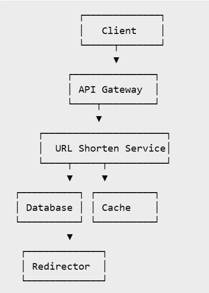

- Use base62 encoding of auto incrementing id
- A central counter (Redis INCR or a DB sequence) hands out ranges, not single IDs. E.g. app server A gets 1,000,000 to 1,999,999, server B gets 2,000,000 to 2,999,999. Each app server increments locally in memory, so no network call per request. When its range runs out, it fetches a new one.
- Max short URL length = 7 characters
- Use NoSQL database due to high data volume and high reads
- Kafka for analytics tracking


## File sharing (Dropbox)

```text
           +-------------------+
           |  Client (Web/Mobile) |
           +-------------------+
                     |
                     v
           +-------------------+
           |    API Gateway    |
           +-------------------+
                     |
      +--------------+---------------------+
      |              |                     |
      v              v                     v
+-------------+ +----------------+ +----------------+
| Auth Service| | Upload Service | | Download Service|
+-------------+ +----------------+ +----------------+
                    |                     |
                    v                     v
         +------------------+   +------------------+
         | Presigned URL Svc|   |   Metadata DB    |
         +------------------+   +------------------+
                    |                     ^
                    v                     |
              +-----------------------------+
              |       S3 Object Store       |
              +-----------------------------+
                    |
                    v
           +----------------------+
           |     Task Runner      |
           +----------------------+
```

- Upload Service- Contacts Presigned URL Service to generate a temporary S3 upload link. Stores metadata (name, path, size, checksum) in Metadata DB. Big files can be broken down into chunks (multipart upload)
- Download Service- Validates download request (auth, access rights). Fetches file metadata. Generates signed URL for downloading from S3.
- Presigned URL Service- Generates time-limited, secure URLs using S3 SDK. Ensures direct client → S3 interaction.
- Metadata Database- Stores file/folder metadata (File ID, Name, Size, Owner/User ID, Parent Folder, Timestamps, Access permissions)
- Task Runner- Triggered post-upload. Validates S3 object integrity (checksums). Triggers virus scan, indexing, preview generation, etc
- S3/Blob Storage- Stores raw file contents

Multipart upload

- Multipart upload splits one large file into smaller parts and uploads each part as a separate request.
- The client first asks the storage service to start an upload and gets back an uploadId.
- Each part is sent with its part number, and the server returns an ETag for each one.
- Parts can be uploaded in parallel, which improves throughput.
- If a part fails, only that part is retried, not the whole file.
- The upload can be paused and resumed later using the same uploadId.
- Once all parts are uploaded, the client sends the list of part numbers and ETags to complete the upload.
- The server then stitches the parts together into a single object.
- With presigned URLs, the backend issues one URL per part, and the client uploads directly to storage.
- Abandoned uploads still use storage, so set a lifecycle rule to abort incomplete uploads after a few days.


## Ecommerce (Amazon, Flipkart)

```text
                        +----------------------+
                        |      Client (Web/Mobile)     |
                        +----------------------+
                                   |
                                   v
                        +----------------------+
                        |     API Gateway / BFF        |
                        +----------------------+
                                   |
       +-----------+--------------+---------------+----------------+
       |           |              |               |                |
       v           v              v               v                v
+------------+ +-------------+ +-------------+ +--------------+ +--------------+
| Auth Svc   | | Product Svc | | Cart Svc    | | Order Svc    | | Payment Svc  |
+------------+ +-------------+ +-------------+ +--------------+ +--------------+
                    |               |               |                  |
                    v               v               v                  v
           +--------------+ +--------------+ +--------------+ +-----------------+
           | Product DB   | | Cart DB      | | Order DB     | | Payment Gateway |
           +--------------+ +--------------+ +--------------+ +-----------------+
                                                           |
                                                           v
                                               +----------------------+
                                               | Inventory / Shipping |
                                               +----------------------+
                                                           |
                                                           v
                                                  +----------------+
                                                  | Notification Svc |
                                                  +----------------+
                                                           |
                                                           v
                                                +--------------------+
                                                | Email / SMS Queue  |
                                                +--------------------+
```


## Food ordering (swiggy, zomato)

```text
                        +------------------------+
                        |  Client (Mobile/Web)   |
                        +------------------------+
                                   |
                                   v
                        +------------------------+
                        |     API Gateway        |
                        +------------------------+
                                   |
         +-----------+------------+-------------+------------+----------+
         |           |            |             |            |          |
         v           v            v             v            v          v
+--------------+ +-------------+ +-----------+ +-----------+ +----------+ +-------------+
| Auth Service | | User Service| | Restaurant| | Cart Svc  | | Order Svc| | Payment Svc |
+--------------+ +-------------+ | Service   | +-----------+ +----------+ +-------------+
                                 +-----------+                                     
                                       |
         +--------------------+--------+--------------------+
         |                    |                             |
         v                    v                             v
+--------------+    +----------------+              +---------------+
| Restaurant DB|    | Menu / Catalog |              | Delivery Svc  |
+--------------+    +----------------+              +---------------+
                                                        |
                                                        v
                                               +-------------------+
                                               | Delivery Partner   |
                                               | (Agent App)        |
                                               +-------------------+
                                                        |
                                                        v
                                                 +----------------+
                                                 | Notification Svc|
                                                 +----------------+
                                                        |
                                                        v
                                                +------------------+
                                                | Email / SMS Queue|
                                                +------------------+
```


## Video streaming (Netflix)

```text
[ Client Apps (Web, Mobile, TV) ]
               |
      [ API Gateway / BFF Layer ]
               |
     -----------------------------
     |                           |
[User Services]          [Video Services]
     |                           |
[Auth, Billing, Profile]     [Playback, Encoding, Metadata]
     |                           |
     -----------------------------
               |
         [ Orchestrator ]
               |
         [ Microservices Layer ]
     (User, Catalog, Playback, etc.)
               |
        ---------------------
        |                   |
[Metadata DB]       [Recommendation Engine]
        |                   |
   -------------------     |
   |                 |     |
[MySQL]         [Elasticsearch]   <- for search
        |
[Media Asset Pipeline] -> [S3/Blob Storage] -> [CDN]
```

- Supports adaptive bitrate streaming (ABR)
- Encodes videos in multiple resolutions and formats


## Video streaming (Youtube)

```text
    [ Clients (Web / App / Smart TVs) ]
                  |
         [ API Gateway / BFF ]
                  |
         ---------------------
         |                   |
  [ User & Channel Service ]   [ Video Service ]
         |                   |
   [ Auth, Profile,        [ Upload, Encoding,
     Subscriptions ]         Playback, Metadata ]
         |                   |
         ---------------------
                  |
        [ Microservices Layer ]
                  |
 -----------------------------------------------------
 |       |         |         |         |            |
Search  Video    Comments  Likes     Notifications  Ads
       Metadata
                  |
         [ Recommendation Engine ]
                  |
          ------------------------
          |                      |
     [ Kafka / Stream logs ]   [ Offline Jobs (Spark, ML) ]
          |
     [ Analytics + Metrics ]
                  |
      [ Storage & Delivery Pipeline ]
         |                        |
[ Video File Store (Blob)]    [ CDN (Google CDN / Akamai) ]
```


## Ride sharing (Uber, Ola)

```text
       [ Mobile App / Web ]
                 |
          [ API Gateway ]
                 |
-----------------------------------------------------
|       |         |           |          |          |
User   Ride     Driver    Matching    Payment     Notification
Service Service  Service    Service     Service       Service
        |         |           |          |            |
        ------------------------------
                  |
          [ Orchestration Layer ]
                  |
        ------------------------------
        |            |              |
  Redis / Cache   Message Queue   Location Service
                                (via GPS updates)
                  |
          [ Real-Time Services ]
       (Kafka, PubSub, WebSockets)
                  |
      -------------------------------
      |             |               |
 [MongoDB]     [PostgreSQL]     [ElasticSearch]
(User, Ride)   (Billing, Logs)  (Search for nearby drivers)
                  |
           [ Analytics + ML ]
          (ETA Prediction, Surge Pricing)
```

- Both rider and driver apps send GPS coordinates every few seconds
- geocoding and reverse geocoding
- The map is divided into a square like grid


## Booking (BookMyShow)

```text
[ Clients (Web, Mobile) ]
         |
   [ API Gateway / BFF ]
         |
-------------------------------------------------
|       |         |          |          |       |
City  Movie   ShowTime  Booking  Payment  Notification
Svc    Svc     Svc       Svc      Svc        Svc
         |         |          |         |
         -------------------------------
                   |
            [ Orchestration Layer ]
                   |
       ------------------------------------
       |                  |               |
 [ Partner Integration ]  [ Seat Locking ] [ Event Queue ]
       |                  |               |
    [ Theatre APIs ]    [ Redis / DB ]   [ Kafka / RabbitMQ ]
                   |
          [ SQL + NoSQL Databases ]
```

- For seat locking, initially a 5 min lock will be set in redis. Then, use ACID transaction to store data in SQL db


## Social media (twitter, instagram)

```text
            +------------+
             |  Client UI |
             +-----+------+
                   |
           +-------v--------+
           | API Gateway     |
           +-----------------+
                   |
         +---------+---------+
         | Authentication     |
         | Rate Limiting      |
         +---------+---------+
                   |
      +------------+-----------------------------+
      |            Application Layer             |
      |   (Tweet Service, User Service, etc.)    |
      +------------+-----------------------------+
                   |
       +-----------+-----------+-------------------------+
       |                       |                         |
+------v-----+       +---------v---------+     +---------v---------+
|  Tweet DB  |       |   User/Follow DB  |     |  Media Service     |
| (Sharded)  |       | (Relational/NoSQL)|     | (S3 / CDN)         |
+------------+       +-------------------+     +--------------------+
       |
+------v----------------------+
| Timeline Cache (Redis/ES)  |
+----------------------------+

+-----------------------------------+
| Notification Service (Kafka + WS)|
+-----------------------------------+

+------------------------------+
| Analytics + Search (ELK, ES)|
+------------------------------+
```


## Messaging (whatsapp, facebook messenger)

```text
                  +-------------+
                   |  Mobile/Web |
                   |    Client   |
                   +------+------+
                          |
                +---------v----------+
                |     API Gateway    |
                +---------+----------+
                          |
           +--------------+--------------+
           |                             |
   +-------v--------+         +----------v---------+
   | Auth Service   |         |   Messaging Service |
   +----------------+         +---------------------+
                                         |
        +--------------------------+-----+------------------------------+
        |                          |                                    |
+-------v--------+     +-----------v----------+       +----------------v-----------+
|   Redis Cache  |     |  Message Store DB    |       |  Media Service (S3 + CDN)  |
| (ephemeral msg)|     | (MongoDB/Cassandra)  |       |  For image/video/file blobs|
+----------------+     +----------------------+       +----------------------------+

            +-----------------------------+
            | WebSocket Server (RealTime) |
            +-------------+---------------+
                          |
                +---------v---------+
                | Kafka Message Bus |
                +------------------+

    +------------------------------+
    | Notification Service (FCM)   |
    +------------------------------+
```

- WebSocket Server
  - Maintains long-lived TCP connections with active users
  - Used for real-time delivery, typing indicators, presence updates
  - Messages sent to Kafka if recipient is online, else stored temporarily in Redis
- End-to-End Encryption (E2EE)
  - method of secure communication that prevents third parties — including service providers, hackers, or even governments — from accessing data while it’s transferred from sender to receiver
  - Only the sender and receiver can decrypt and read the actual content of the messages — no one in between can see it, not even the messaging server
  - Key Generation- Each user/device generates a public key (shared with others) and a private key (kept secret)
  - Key Exchange- When User A wants to send a message to User B, User A gets User B’s public key from a secure key server. Both generate a shared secret which is never transmitted
  - Message Encryption- A message key (symmetric key) is derived from the shared secret. User A uses this key to encrypt the message. Encrypted message + metadata is sent to the server
  - Message Transmission- The server cannot decrypt the message (it doesn’t have the private key). It just forwards the ciphertext to User B
  - Decryption on Receiver Side- User B uses their private key and User A’s public key to derive the same shared secret. Then decrypts the message using the derived message key
  - For Backups, the messages are stored without encryption on the cloud. If E2EE is enabled, then the messages are decrypted on the device and stored encrypted on the cloud using a backup key which is given to the user


## Notification system

```text
        +-----------------------+
         |    Notification API   |
         +----------+------------+
                    |
                    v
         +----------+------------+
         |  Notification Service |
         | (Orchestrator / Logic)|
         +----------+------------+
                    |
        +-----------+-----------+
        |           |           |
        v           v           v
 +------+--+   +----+----+  +---+----+
 | Email   |   |  SMS    |  | Push   | <-- Channel Workers
 | Worker  |   | Worker  |  | Worker |
 +----+----+   +----+----+  +---+----+
      |             |           |
      v             v           v
[Sendgrid]     [Twilio]    [FCM / APNs]
```


## Typeahead (Autocomplete) System

```text
                  +----------------------+
                   |   Web / Mobile App   |
                   +----------+-----------+
                              |
                              v
                   +----------+-----------+
                   |  Typeahead API Layer |
                   +----------+-----------+
                              |
                              v
          +------------------+------------------+
          |                                     |
          v                                     v
+------------------+              +--------------------------+
| In-Memory Trie / |              |    Search Ranking Engine |
| Prefix Index     |              | (popularity, recency etc)|
+--------+---------+              +-----------+--------------+
         |                                     |
         v                                     v
+--------+---------+               +-----------+-------------+
| Suggestion Store |               |  Usage Logs / Analytics |
| (Redis, RocksDB) |               |  (Click, search history) |
+------------------+               +--------------------------+
```


## Collaborative Editing Tool (Google docs)

```text
+------------+       +------------------+        +------------------------+
|  Web Client| <---> |  Collaboration   | <----> |   Operational Storage  |
|  (Editor)  | WebSocket/HTTP |  Server (OT/CRDT) | (Redis/Mongo/Postgres) |
+------------+       +------------------+        +------------------------+
      |                      |
      |                      v
      |              +----------------+
      |              |  Auth Service  |
      |              +----------------+
      |                      |
      |                      v
      |              +----------------+
      |              | Document Access|
      |              | Control Service|
      |              +----------------+
```

- Operational Transformation (OT)
  - transforming operations based on the history of concurrent operations, ensuring consistency no matter the order of execution
  - Eg: Initial Document: "apple"
  - Concurrent Edits: User 1: Delete at index 1 → removes 'p' → wants "aple" or "ample". User 2: Replace 'e' with 'y' at index 4 → wants "apply"
  - If the system applies User 1’s delete first, the document becomes "aple", and index 4 is no longer 'e' — so User 2’s operation is now wrong.
  - OT adjusts this by transforming User 2’s operation to match the updated index (index becomes 3 after deletion). Ensures operation still refers to the correct character and applies it correctly
- Differential Synchronization (DiffSync)
  - Each participant (client and server) keeps: A document, A shadow copy (last synced version), A backup copy (just in case sync fails)
  - Every time the user makes an edit: The client generates a diff between the current document and its shadow copy
  - This diff is sent to the server
  - Server applies the diff to its version of the shadow
  - Server sends back its own diff if there were other changes


## Rate Limiter

```text
                   +-------------+
                    |   Client    |
                    +-------------+
                          |
                          v
                 +------------------+
                 |    API Gateway   |  (Rate Limiting Logic)
                 +------------------+
                          |
           +--------------+---------------+
           |              |               |
        (Cache)      +----+----+      (Store Limits)
     Redis/Memcached | Limiter | <--> DB/Config Service
                     +---------+
```


## Web Crawler

```text
                   +-------------------+
                     |   Seed URL Queue  |
                     +-------------------+
                              |
                              v
                     +-------------------+
                     |   URL Scheduler   | <-- Pulls from queue, enforces policies
                     +-------------------+
                              |
                              v
        +---------------------+----------------------+
        |                                            |
        v                                            v
+---------------+                         +------------------+
|  Crawler Bots |                         |  robots.txt/Rate |
|   (Workers)   |                         |  Rules Validator |
+-------+-------+                         +------------------+
        |
        v
+-------------------+
| HTML Downloader   |
+-------------------+
        |
        v
+-------------------+    +----------------+     +----------------+
| Link Extractor    |    | Content Parser | --> | Data Storage   |
+-------------------+    +----------------+     +----------------+
        |
        v
+-------------------+
| URL Frontier (new URLs) |
+-------------------+
```


## Distributed cache system (Redis)

```text
                   +------------------+
                    |     Clients      |
                    +--------+---------+
                             |
                             v
               +-------------+-------------+
               |     Cache Client SDK      |  (Key hashing, routing)
               +-------------+-------------+
                             |
            +----------------+----------------+
            |                                 |
      +-----+-----+                    +------+-----+
      |  Cache Node 1|  <-------->     | Cache Node 2 |
      +-------------+                  +-------------+
              |                               |
        +-----+------+                 +------+-----+
        |  Local Cache |               | Local Cache |
        +-------------+                +-------------+
              |                               |
              v                               v
        +------------+                 +-------------+
        | Backend DB |                 | Backend DB  |
        +------------+                 +-------------+
```


## Google Maps

```text
      +------------+       +--------------------+      +------------------+
       |  Mobile/Web| <---> |     API Gateway    | <--> |  Auth/Throttle   |
       +------------+       +--------------------+      +------------------+
                                  |        
        +----------------+--------+--------+------------------------+
        |                |                 |                        |
        v                v                 v                        v
+-------------+  +----------------+  +---------------+      +---------------+
|  Map Tiles  |  | Search Service |  | Routing Engine|      | Traffic Engine|
|   Service   |  | (Places, Addr) |  | (Pathfinding) |      | Real-time Data|
+------+------+  +-------+--------+  +------+--------+      +-------+-------+
       |                 |                  |                       |
       v                 v                  v                       v
+-------------+  +---------------+  +---------------+       +--------------+
| Tiles Store |  | Places DB     |  | Road Graph DB |       | Sensor Feeds |
| (Zoom, LatLng)| (Name, Coord) |  | Weights, Geo  |       | GPS, Telcos  |
+-------------+  +---------------+  +---------------+       +--------------+
```


# Misc


## Payment Gateway

- A payment gateway is like a digital point-of-sale (POS) terminal for online transactions.
- It acts as a middleman between the customer and the merchant, making sure the transaction is secure, validated, and authorized.

Working

- Customer Places an Order- The customer goes to the checkout page and enters their card details (or chooses a payment method like UPI, Netbanking, Wallets, etc.).
- Encryption and Transmission- The payment gateway encrypts the card/payment data and sends it securely to the payment processor.
- Bank Authorization- The payment processor forwards the details to the issuing bank (customer’s bank) or card network (like Visa, MasterCard).
- Approval or Decline- The bank sends back a response
- Transaction Confirmation- If approved, the payment gateway informs the merchant and the customer sees a "Payment Successful" message. The transaction is captured and the merchant prepares to deliver the goods/services.
- Settlement- The funds are settled (usually after 1–2 days) into the merchant’s bank account by the payment processor.

PCI DSS Compliance

- Payment Card Industry Data Security Standard
- security standard that businesses must follow if they store, process, or transmit credit or debit card information
- 4 levels based on transaction count per year. Includes submitting self assessment forms, quarterly scans and audits by QSA (Qualified Security Assessor)
- Requirements
  - Install and maintain a firewall configuration to protect cardholder data
  - Do not use vendor-supplied defaults for system passwords and other security parameters
  - Protect stored cardholder data
  - Encrypt transmission of cardholder data across open, public networks
  - Protect all systems against malware and regularly update anti-virus software or programs
  - Develop and maintain secure systems and applications
  - Restrict access to cardholder data by business need-to-know
  - Identify and authenticate access to system components
  - Restrict physical access to cardholder data
  - Track and monitor all access to network resources and cardholder data
  - Regularly test security systems and processes
  - Maintain a policy that addresses information security for all personnel
