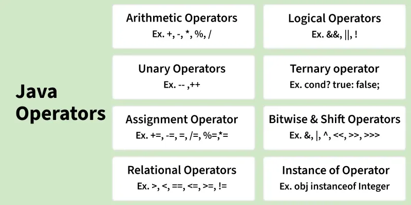
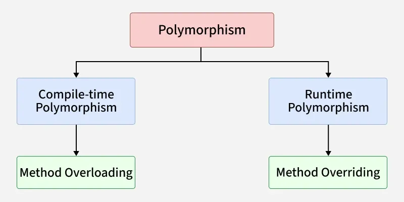

# Intro

Java is platform independent

Components

- JVM
  - Java Virtual Machine
  - interpreter responsible for converting bytecode into machine-readable code
- JRE
  - Java Runtime Environment
  - installation package that provides an environment to run the Java program or application on any machine
- JDK
  - Java Development Kit
  - environment to develop and execute Java programs


## CLI commands

Executing Java code file

```bash
// Take input from file
java Main.java < input.txt

// Take input via args
java Main.java arg1 arg2
```


## Code working

1. Code written in .java file
2. Java compiler (javac) translate .java files into bytecode (.class files)
3. JVM (Java Virtual Machines) executes the bytecode


## Data types

- Primitive
  - boolean- true or false
  - byte- 8 bit signed integer
  - short- 16 bit signed integer
  - int- 32 bit signed integer
  - long- 64 bit signed integer
  - float- 32 bit floating-point
  - double- 64 bit floating-point
  - char- Unicode character (16 bit)
- Non primitive
  - String
  - Class
  - Object
  - Interface
  - Array

Values

```java
Integer.MIN_VALUE  // -2147483648  (-2^31)
Integer.MAX_VALUE  //  2147483647  (2^31 - 1)

Long.MIN_VALUE  // -9223372036854775808  (-2^63)
Long.MAX_VALUE  //  9223372036854775807  (2^63 - 1)
```


## Operators



Arithmetic Right Shift (>>): copies the sign bit (the leftmost bit). Negative numbers stay negative, positive stay positive.

Logical Right Shift (>>>): always fills with 0. So the result is never negative

instanceof- check if an object is an instance of a class, a subclass, or an interface


## Varargs

Variable-length Arguments- allow you to pass a variable number of arguments to a method

```java
int sum(int... numbers) {
    int total = 0;
    for (int n : numbers) total += n;
    return total;
}
```


# Array

| Operation | Syntax |
| --- | --- |
| Declare | `int[] arr;`<br>`int arr[];`<br>`int[] arr = new int[5];` |
| Declare + initialize values | `int[] arr = {1, 2, 3};` |
| Length | `arr.length` |
| Sort array | `Arrays.sort(arr);` |
| Reverse array (manual) | `Collections.reverse(Arrays.asList(arr));` |
| Search (binary search) | `int idx = Arrays.binarySearch(arr, key);` |
| Declare 2D array | `int[][] matrix;`<br>`int[][] matrix = new int[3][4];` |


# String

- Strings are stored in a String Pool, allowing reuse of objects and reducing memory overhead
- String are immutable, but we can assign to a new string
- Multiple threads can safely share the same string object without synchronization


## String

| Operation | Syntax |
| --- | --- |
| Declare | `String s;` |
| Initialize string | `String s = "Hello";` |
| Get length | `s.length();` |
| Get character | `s.charAt(2);` |
| Get substring | `s.substring(i, j);` |
| Compare strings | `s.equals("Hello");` |
| Compare ignoring case | `s.equalsIgnoreCase("hello");` |
| Convert to uppercase | `s.toUpperCase();` |
| Convert to lowercase | `s.toLowerCase();` |
| Check contains | `s.contains("ell");` |
| Check startsWith | `s.startsWith("He");` |
| Check endsWith | `s.endsWith("lo");` |
| Replace characters | `s.replace('a', 'b');` |
| Replace substring | `s.replace("abc", "xyz");` |
| Split string | `s.split(",");` |
| Trim whitespace | `s.trim();` |
| Join strings | `String.join("-", s);` |


## StringBuilder

- Mutable
- Not thread safe
- Faster

| Operation | Syntax |
| --- | --- |
| Declare | `StringBuilder sb;` |
| Initialize | `StringBuilder sb = new StringBuilder();`<br>`StringBuilder sb = new StringBuilder("Hello");` |
| Append text | `sb.append("world");` |
| Insert text | `sb.insert(2, "Java ");` |
| Replace substring | `sb.replace(1, 4, "xyz");` |
| Delete range | `sb.delete(2, 5);` |
| Delete character | `sb.deleteCharAt(1);` |
| Reverse string | `sb.reverse();` |
| Get length | `sb.length();` |
| Set length | `sb.setLength(3);` |
| Get character | `sb.charAt(2);` |
| Set character | `sb.setCharAt(1, 'X');` |
| Convert to String | `sb.toString();` |
| Substring | `sb.substring(1, 3);` |


## StringBuffer

- Mutable
- Thread safe
- Slower


# OOP

```java
// A simple class representing a Car
class Car {

    // ======== Variables (Properties) =========
    public String brand;       // public -> accessible everywhere
    private int speed;         // private -> only inside this class
    protected String color;    // protected -> same package + child classes
    int year;                  // default -> same package only

    // ======== Constructor =========
    // Used to initialize the Car object
    public Car(String brand, int speed, String color, int year) {
        this.brand = brand;
        this.speed = speed;
        this.color = color;
        this.year = year;
    }

    // ======== Methods =========

    // Public method (accessible from main)
    public void displayInfo() {
        System.out.println("Brand: " + brand);
        System.out.println("Speed: " + speed + " km/h");
        System.out.println("Color: " + color);
        System.out.println("Year: " + year);
    }

    // Private method (only inside Car)
    private void testEngine() {
        System.out.println("Engine is OK!");
    }

    // Public method that uses private method
    public void startCar() {
        System.out.println("Starting the car...");
        testEngine();
        System.out.println("Car started successfully!\n");
    }
}


// ========== Main Class to Use Objects ==========
public class Main {
    public static void main(String[] args) {

        // Creating objects using constructor
        Car car1 = new Car("Toyota", 180, "Red", 2020);
        Car car2 = new Car("BMW", 240, "Black", 2023);

        // Calling methods on objects
        car1.displayInfo();
        car1.startCar();

        car2.displayInfo();
        car2.startCar();

        // Accessing public variable
        System.out.println("Car brand: " + car1.brand);

        // Accessing protected & default (allowed because same package)
        System.out.println("Color: " + car1.color);
        System.out.println("Year: " + car1.year);

        // Speed is private → NOT allowed
        // System.out.println(car1.speed);  // ❌ ERROR
    }
}
```


## Abstraction

Abstract class

- abstract methods (methods without body) as well as concrete methods (with implementation)
- Useful to share some common code

Interface

- Only abstract methods. Can have default, private and static methods
- Useful when you want only rules / contract

```java
// ---------- Interface (100% abstraction) ----------
interface Payment {
    void pay(int amount);   // no body → must be implemented
}


// ---------- Abstract Class (partial abstraction) ----------
abstract class CardPayment implements Payment {

    // concrete method (has body)
    void swipeCard() {
        System.out.println("Card swiped successfully!");
    }

    // abstract method (no body)
    abstract void validateCard();
}


// ---------- Normal Class (implements everything) ----------
class CreditCardPayment extends CardPayment {

    @Override
    void validateCard() {
        System.out.println("Validating credit card...");
    }

    @Override
    public void pay(int amount) {
        System.out.println("Paid ₹" + amount + " using Credit Card");
    }
}


// ---------- Main Class ----------
public class Main {
    public static void main(String[] args) {

        CreditCardPayment obj = new CreditCardPayment();

        obj.validateCard();      // from abstract class
        obj.swipeCard();         // concrete method from abstract class
        obj.pay(500);            // from interface
    }
}
```


## Encapsulation

Access modifiers

- Public- Everyone can access
- Private- Only the same class can access
- Protected- Same package + subclasses
- default- Only same package


## Inheritance

extends keyword

1 class can inherit only 1 class. But 1 class can implement multiple interfaces

Types

1. Single Inheritance
2. Multilevel Inheritance
3. Hierarchical Inheritance
4. Multiple Inheritance
5. Hybrid Inheritance

```java
// Parent Class (Super Class)
class Animal {

    String name;

    void eat() {
        System.out.println(name + " is eating food.");
    }
}


// Child Class (Subclass) → Inherits Animal
class Dog extends Animal {

    void bark() {
        System.out.println(name + " is barking.");
    }
}


// Main Class
public class Main {
    public static void main(String[] args) {

        // Create object of subclass
        Dog d = new Dog();

        // Use inherited variable
        d.name = "Tommy";

        // Use parent class method
        d.eat();

        // Use child class method
        d.bark();
    }
}
```


## Polymorphism

Java doesn't support the Operator Overloading



```java
// ---------- Compile-Time Polymorphism (Overloading) ----------
class MathOperations {

    // same method name, different parameters
    int add(int a, int b) {
        return a + b;
    }

    int add(int a, int b, int c) {
        return a + b + c;
    }

    double add(double a, double b) {
        return a + b;
    }
}


// ---------- Run-Time Polymorphism (Overriding) ----------
class Animal {
    void sound() {
        System.out.println("Animal makes a sound");
    }
}

class Dog extends Animal {
    @Override
    void sound() {
        System.out.println("Dog barks");
    }
}

class Cat extends Animal {
    @Override
    void sound() {
        System.out.println("Cat meows");
    }
}


// ---------- Main Class ----------
public class Main {
    public static void main(String[] args) {

        // ----- Compile-Time Polymorphism -----
        MathOperations m = new MathOperations();
        System.out.println(m.add(2, 3));         // calls add(int,int)
        System.out.println(m.add(1, 2, 3));      // calls add(int,int,int)
        System.out.println(m.add(2.5, 3.5));     // calls add(double,double)


        // ----- Run-Time Polymorphism -----
        Animal a;

        a = new Dog();   // parent reference → child object
        a.sound();        // Dog barks

        a = new Cat();
        a.sound();        // Cat meows
    }
}
```


## Package

```java
package com.myapp.utils;

public class Calculator {

    public int add(int a, int b) {
        return a + b;
    }
}
```

Path = src/com/myapp/utils/Calculator.java

```java
import com.myapp.utils.Calculator;
```


# Interface


## Functional Interfaces

has only one abstract method, making it suitable for use with lambda expressions and method references

```java
@FunctionalInterface
interface Greeting {
    void sayHello();   // one abstract method
}
```

### 1. Predicate\<T>

Checks a condition → returns boolean.

```java
Predicate<Integer> isEven = n -> n % 2 == 0;
System.out.println(isEven.test(4));   // true
```

### 2. Function\<T, R>

Takes input T, returns output R.

```java
Function<String, Integer> length = s -> s.length();
System.out.println(length.apply("John"));   // 4
```

### 3. Consumer\<T>

Takes input, returns nothing.

```java
Consumer<String> printer = s -> System.out.println(s);
printer.accept("Hello World");
```

### 4. Supplier\<T>

Returns a value, takes no input.

```java
Supplier<Double> random = () -> Math.random();
System.out.println(random.get());
```

### 5. BiFunction\<T, U, R>

Two inputs → one output.

```java
BiFunction<Integer, Integer, Integer> add = (a, b) -> a + b;
System.out.println(add.apply(5, 3));   // 8
```

### 6. BinaryOperator\<T>

Special case of BiFunction

T, T → T

```java
BinaryOperator<Integer> mul = (a, b) -> a * b;
System.out.println(mul.apply(4, 3));   // 12
```

### 7. UnaryOperator\<T>

Special case of Function

T → T

```java
UnaryOperator<Integer> square = n -> n * n;
System.out.println(square.apply(5));    // 25
```


## Marker Interface

- No methods and No fields
- tagging interface
- It is used to mark or tag a class so that the JVM or frameworks know to treat the class in a special way.
- Examples
  - Cloneable
  - Serializable
  - Remote


# Exception Handling

- throw- It is used to explicitly throw an exception.
- throws- It is used to declare that a method might throw one or more exceptions. Used in the method signature
- blows up at runtime if it happens.
- Error- the JVM or system is broken
- Exception- your program hit a problem it can (often) handle
- Checked exception- Compiler checks that you handle it. If code can throw it, you must either catch it or declare it with throws. Otherwise it won't compile.
- Checked exception- The compiler doesn't care. No try/catch or throws needed. It just

Types

1. Error- Unchecked error
   - StackOverflowError
   - OutOfMemoryError
   - NoClassDefFoundError
   - ExceptionInInitializerError
   - AssertionError
   - VirtualMachineError
2. Exception- checked exception
   - IOException
   - FileNotFoundException
   - SQLException
   - ClassNotFoundException
   - InterruptedException
   - CloneNotSupportedException
   - ParseException
   - TimeoutException
   - ExecutionException
   - NoSuchMethodException
   - IllegalAccessException
   - MalformedURLException
   - URISyntaxException
3. RuntimeException- Unchecked exception
   - NullPointerException
   - ArrayIndexOutOfBoundsException
   - StringIndexOutOfBoundsException
   - IndexOutOfBoundsException
   - ArithmeticException
   - ClassCastException
   - NumberFormatException
   - IllegalArgumentException
   - IllegalStateException
   - UnsupportedOperationException
   - ConcurrentModificationException
   - NoSuchElementException
   - InputMismatchException
   - NegativeArraySizeException
   - ArrayStoreException
   - EmptyStackException

```java
class Calculator {

    // Method that may throw an exception
    int divide(int a, int b) throws ArithmeticException {

        // throw → manually throw exception
        if (b == 0) {
            throw new ArithmeticException("Cannot divide by zero");
        }

        return a / b;
    }
}


public class Main {
    public static void main(String[] args) {

        Calculator c = new Calculator();

        try {
            // risky code → may cause exception
            int result = c.divide(10, 0);
            System.out.println("Result: " + result);
        }
        catch (ArithmeticException e) {
            // handles the error
            System.out.println("Error occurred: " + e.getMessage());
        }
        catch (Exception e) {
            System.out.println("General error: " + e.getMessage());
        }
        finally {
            // always runs
            System.out.println("Operation complete (finally block).");
        }

        System.out.println("Program continues normally...");
    }
}
```


# Memory Allocation


## Stack Memory

- Stores method calls, local variables, rReferences to objects (not objects themselves), function parameters
- Fast, small, automatically managed
- Each thread has its own stack


## Heap Memory

- Stores objects, arrays and strings created using new
- Shared by all threads
- Managed by Garbage Collector (GC)

String Pool

- place in heap memory where all the strings defined in the program are stored


## Method Area

- Stores Class bytecode, Static variables, Method definitions, Constant pool

Memory Leaks

- program keeps using memory but does not give it back when it's done
- unnecessary objects remain referenced, so the Garbage Collector cannot delete them.
- As a result, memory usage grows, eventually causing performance issues or crashes.


# Collections

All packages are imported from java.utils.\<className>


## ArrayList

ArrayList

- Not sync (not thread safe)
- Faster

Vector

- Sync
- Slower

| Operation | Syntax |
| --- | --- |
| Create | `ArrayList<String> list = new ArrayList<>();` |
| Add element | `list.add("Hello");` |
| Add at index | `list.add(1, "Hi");` |
| Add all elements from another collection | `list.addAll(otherList);` |
| Add all at index | `list.addAll(1, otherList);` |
| Get element | `list.get(0);` |
| Set (update) element | `list.set(2, "NewValue");` |
| Remove element by index | `list.remove(0);` |
| Remove element by value | `list.remove("Hi");` |
| Clear list | `list.clear();` |
| Check size | `list.size();` |
| Check if contains element | `list.contains("John");` |
| Check index of element | `list.indexOf("John");` |
| Sort list | `Collections.sort(list);` |
| Sort reverse | `Collections.sort(list, Collections.reverseOrder());` |
| Reverse list | `Collections.reverse(list);` |
| Get sublist | `list.subList(0, 3);` |


## LinkedList

| Operation | Syntax |
| --- | --- |
| Create | `LinkedList<String> list = new LinkedList<>();` |
| Add element | `list.add("Hello");` |
| Add at index | `list.add(1, "Hi");` |
| Add all elements | `list.addAll(otherList);` |
| Add all at index | `list.addAll(1, otherList);` |
| Add first | `list.addFirst("Start");` |
| Add last | `list.addLast("End");` |
| Get first | `list.getFirst();` |
| Get last | `list.getLast();` |
| Set (update) | `list.set(2, "NewValue");` |
| Remove by index | `list.remove(0);` |
| Remove by value | `list.remove("Hi");` |
| Remove first | `list.removeFirst();` |
| Remove last | `list.removeLast();` |
| Clear | `list.clear();` |
| Size | `list.size();` |
| Contains | `list.contains("John");` |
| Index of | `list.indexOf("John");` |
| Sort | `Collections.sort(list);` |
| Reverse | `Collections.reverse(list);` |


## HashSet

Unsorted set

| Operation | Syntax |
| --- | --- |
| Create | `HashSet<String> set = new HashSet<>();` |
| Add element | `set.add("A");` |
| Check if contains | `set.contains("A");` |
| Remove element | `set.remove("A");` |
| Clear set | `set.clear();` |
| Check size | `set.size();` |
| Loop (for-each) | `for (String s : set) {}` |


## TreeSet

Sorted set

| Operation | Syntax |
| --- | --- |
| Create | `TreeSet<String> set = new TreeSet<>();` |
| Create with custom comparator | `TreeSet<String> set = new TreeSet<>(Comparator.reverseOrder());` |
| Get first (smallest) | `set.first();` |
| Get last (largest) | `set.last();` |
| Lower (\< element) | `set.lower(e);` |
| Higher (> element) | `set.higher(e);` |
| Ceiling (>= element) | `set.ceiling(e);` |
| Floor (\<= element) | `set.floor(e);` |


## ArrayDeque

Can be used for stack, queue and deque

| Operation | Syntax |
| --- | --- |
| Create | `ArrayDeque<Integer> dq = new ArrayDeque<>();` |
| Enqueue (add at end) | `dq.offer(e);` |
| Dequeue (remove from front) | `dq.poll();` |
| Peek front | `dq.peek();` |
| Push (insert at top) | `dq.push(e);` |
| Pop (remove top) | `dq.pop();` |
| Check size | `dq.size();` |
| Clear deque | `dq.clear();` |
| Iterate (for-each) | `for (Integer x : dq) {}` |


## PriorityQueue

Uses Binary heap

| Operation | Syntax |
| --- | --- |
| Create min-heap | `PriorityQueue<Integer> pq = new PriorityQueue<>();` |
| Create max-heap | `PriorityQueue<Integer> pq = new PriorityQueue<>(Comparator.reverseOrder());` |
| Add element | `pq.add(e);` |
| Peek min element (root) | `pq.peek();` |
| Remove and return min | `pq.remove();` |
| Check if contains | `pq.contains(e);` |
| Check size | `pq.size();` |
| Clear queue | `pq.clear();` |
| Remove specific element | `pq.remove(e);` |


## HashMap

Not sorted by key

| Operation | Syntax |
| --- | --- |
| Create | `HashMap<K, V> map = new HashMap<>();` |
| Put (insert/update) | `map.put(key, value);` |
| Get value by key | `map.get(key);` |
| Check if key exists | `map.containsKey(key);` |
| Check if value exists | `map.containsValue(value);` |
| Remove by key | `map.remove(key);` |
| Remove key if value matches | `map.remove(key, value);` |
| Check size | `map.size();` |
| Clear map | `map.clear();` |
| Iterate entries | `for (Map.Entry<String, Integer> e : map.entrySet()) {`<br>`    e.getKey(); e.getValue();`<br>`}`<br>`for (String k : map.keySet()) { }`<br>`for (int v : map.values()) { }` |


## TreeMap

Sorted by key

| Operation | Syntax |
| --- | --- |
| Create | `TreeMap<K, V> map = new TreeMap<>();` |
| Smallest key | `tm.firstKey()` |
| Largest key | `tm.lastKey()` |
| Smallest entry | `tm.firstEntry()` |
| Largest entry | `tm.lastEntry()` |
| Greatest key ≤ k | `tm.floorKey(k)` |
| Smallest key ≥ k | `tm.ceilingKey(k)` |
| Greatest key \< k | `tm.lowerKey(k)` |
| Smallest key > k | `tm.higherKey(k)` |


## Iterator

| Operation | Syntax |
| --- | --- |
| Create | `Iterator<String> it = list.iterator();` |
| Check if next element exists | `it.hasNext();` |
| Get next element | `it.next();` |
| Remove current element | `it.remove();` |


## Comparator Interface

functional interface used to define custom sorting logic for objects

```java
import java.util.*;

// Separate Comparator Class
class DescComparator implements Comparator<Integer> {
    @Override
    public int compare(Integer a, Integer b) {
        return b - a;   // descending order
    }
}

public class Main {
    public static void main(String[] args) {

        List<Integer> nums1 = new ArrayList<>(List.of(5, 2, 9, 1));
        List<Integer> nums2 = new ArrayList<>(List.of(5, 2, 9, 1));

        // -----------------------------
        // Comparator using Lambda
        // -----------------------------
        Comparator<Integer> descLambda = (a, b) -> b - a;

        nums1.sort(descLambda);
        System.out.println("Using Lambda Comparator: " + nums1);
        // Output: [9, 5, 2, 1]


        // -----------------------------
        // Comparator using Separate Class
        // -----------------------------
        Comparator<Integer> descClass = new DescComparator();

        nums2.sort(descClass);
        System.out.println("Using Separate Comparator Class: " + nums2);
        // Output: [9, 5, 2, 1]
    }
}
```


## Comparable Interface

interface used to define the natural ordering of objects. Used when a class defines its own default sorting logic

```java
class Student implements Comparable<Student> {
    int marks;

    Student(int marks) {
        this.marks = marks;
    }

    @Override
    public int compareTo(Student other) {
        return this.marks - other.marks;  // ascending order
    }
}

List<Student> list = new ArrayList<>();
list.add(new Student(50));
list.add(new Student(10));
list.add(new Student(80));

Collections.sort(list);   // uses compareTo internally
```


## Lambda Expressions

```java
@FunctionalInterface
interface Adder {
    int add(int a, int b);
}

public class Main {
    public static void main(String[] args) {

        // Lambda to add two numbers
        Adder add = (a, b) -> a + b;

        System.out.println(add.add(5, 7));  
        // Output: 12
    }
}
```


# Multithreading

- Enables a program to run multiple threads simultaneously, allowing tasks to execute in parallel and utilize the CPU more efficiently
- A thread is a lightweight, independent unit of execution inside a program (process)
- Thread is a lightweight subprocess that runs independently but shares the same memory space as the process, allowing multiple tasks to execute concurrently.
- start()- Creates a new thread and call the thread’s run() method and starts parallel execution
- join()- Makes the current thread wait until the other thread finishes

Implementing the Runnable Interface

```java
class CookingJob implements Runnable {
    private String task;

    CookingJob(String task) {
        this.task = task;
    }

    public void run() {
        System.out.println(task + " is being prepared by " +
            Thread.currentThread().getName());
    }
}

public class RestaurantRunnable {
    public static void main(String[] args) {
        Thread t1 = new Thread(new CookingJob("Soup"));
        Thread t2 = new Thread(new CookingJob("Pizza"));
        Thread t3 = new Thread(new CookingJob("Burger"));

        t1.start();
        t2.start();
        t3.start();

        // Wait for all cooking jobs to finish
        t1.join();
        t2.join();
        t3.join();
    }
}
```

Life Cycle of a Thread

- New: Thread object is created but not started
- Runnable: Thread is ready to run and waiting for CPU allocation
- Running: Thread is executing its run() method
- Waiting/Blocked: Thread waits for a resource or another thread
- Terminated: Thread completes execution or is stopped

Daemon Thread

- low-priority background thread that does not prevent the JVM from exiting when the program finishes execution
- run in the background to support user threads
- Eg: Garbage Collector and Finalizer Thread


## Synchronization

- ensures that only one thread can access a shared resource (like a variable, object, or method) at a time.
- It prevents concurrent threads from interfering with each other while modifying shared data.

Methods

1. Synchronized Method
2. Synchronized Block
3. Static Synchronization

```java
class Counter {
    private int count = 0;

    // Method-level synchronization (object instance-level lock)
    public synchronized void increment() {
        count++;
    }

    // Block-level synchronization
    public void decrement() {
        synchronized (this) {
            count--;
        }
    }

    // Static synchronization (class-level lock)
    public static synchronized void printMessage() {
        System.out.println("Static synchronized method: Thread = " + Thread.currentThread().getName());
    }

    public int getCount() {
        return count;
    }
}

public class SyncExample {
    public static void main(String[] args) throws InterruptedException {

        Counter c = new Counter();

        Thread t1 = new Thread(() -> {
            for (int i = 0; i < 1000; i++)
                c.increment();   // method-level sync
        });

        Thread t2 = new Thread(() -> {
            for (int i = 0; i < 1000; i++)
                c.decrement();   // block-level sync
        });

        Thread t3 = new Thread(() -> {
            Counter.printMessage(); // static sync
        });

        t1.start();
        t2.start();
        t3.start();

        t1.join();
        t2.join();
        t3.join();

        System.out.println("Final Count = " + c.getCount());
    }
}
```

### Types

1\. Process Synchronization

- Each process has its own memory
- So synchronization is needed when several processes access shared resources, like: shared files, databases, printers, shared memory regions

2\. Thread Synchronization

- Threads share the same memory
- So they need synchronization when accessing shared variables/objects coordinate and ordering of the execution of the threads inside the same process

Process Synchronization

```java
import java.io.*;
import java.nio.channels.*;

public class ProcessSync {
    public static void main(String[] args) throws Exception {
        FileOutputStream fos = new FileOutputStream("shared.txt", true);
        FileChannel channel = fos.getChannel();

        // Acquire lock - synchronizing processes
        FileLock lock = channel.lock();

        try {
            fos.write(("Written by " + ProcessHandle.current().pid() + "\n").getBytes());
            System.out.println("Process " + ProcessHandle.current().pid() + " wrote to file.");
        } finally {
            lock.release();
            fos.close();
        }
    }
}
```


## Volatile

- When one thread updates a volatile variable, other threads immediately see the updated value
- The variable is never cached per thread, always read from main memory
- Not atomic (not thread safe). Volatile does not make operations like count++ safe

```java
class Example {
    volatile boolean flag = false;

    void workerThread() {
        while (!flag) {
            // waiting
        }
        System.out.println("Flag detected!");
    }

    void mainThread() {
        flag = true;  // worker thread will see this change immediately
    }
}
```


## Atomic classes

- classes that make a single variable's read-modify-write atomic without locks.
- They use hardware CAS (Compare-And-Swap): "set to new value only if it still equals the expected old value, else retry.

```java
import java.util.concurrent.atomic.*;

class User {
    final String name;
    final int age;
    User(String name, int age) { this.name = name; this.age = age; }
}

public class AtomicDemo {
    public static void main(String[] args) {

        // AtomicInteger
        AtomicInteger i = new AtomicInteger(0);
        i.get();
        i.set(5);
        i.incrementAndGet();

        // AtomicLong
        AtomicLong l = new AtomicLong(0);
        l.get();
        l.set(10);
        l.addAndGet(5);

        // AtomicBoolean
        AtomicBoolean b = new AtomicBoolean(false);
        b.get();
        b.set(true);
        b.compareAndSet(true, false);

        // AtomicReference with an object
        AtomicReference<User> r = new AtomicReference<>(new User("John", 25));
        r.get();
        r.set(new User("Amit", 30));
        User old = r.get();
        r.compareAndSet(old, new User("Ravi", 28));         // swap if same instance
        r.updateAndGet(u -> new User(u.name, u.age + 1));   // build new object

        // AtomicIntegerArray
        AtomicIntegerArray arr = new AtomicIntegerArray(3);
        arr.get(0);
        arr.set(0, 7);
        arr.incrementAndGet(0);

        // LongAdder
        LongAdder adder = new LongAdder();
        adder.add(10);
        adder.increment();
        adder.sum();
    }
}
```


## Thread-safe collections

- thread-safe collections (java.util.concurrent) are collections that can be safely used by multiple threads at once without external synchronisation.
- Each operation like put or add is atomic, so data doesn't get lost or corrupted.

```java
import java.util.*;
import java.util.concurrent.*;

public class ConcurrentDemo {
    public static void main(String[] args) {

        // HashMap
        Map<String, Integer> map = new ConcurrentHashMap<>();

        // ArrayList
        List<String> list = new CopyOnWriteArrayList<>();

        // HashSet
        Set<String> set = new CopyOnWriteArraySet<>();

        // LinkedList / ArrayDeque (as Queue)
        Queue<Integer> queue = new ConcurrentLinkedQueue<>();

        // ArrayDeque
        Deque<Integer> deque = new ConcurrentLinkedDeque<>();

        // TreeMap
        NavigableMap<Integer, String> sortedMap = new ConcurrentSkipListMap<>();

        // TreeSet
        NavigableSet<Integer> sortedSet = new ConcurrentSkipListSet<>();

        // ArrayDeque / LinkedList (Queue) + put()/take()
        BlockingQueue<Integer> bq = new ArrayBlockingQueue<>(10);
    }
}
```


## Locks

- mechanism that lets only one thread at a time access a shared resource, while other threads wait until the lock is released
- More flexible than synchronized
- Manual lock() and unlock()

### Types

1\. ReentrantLock

- Exclusive Lock
- Only one thread can acquire the lock at a time

```java
import java.util.concurrent.locks.ReentrantLock;

class SafeCounter {
    private int count = 0;
    private final ReentrantLock lock = new ReentrantLock();

    public void increment() {
        lock.lock();  // acquire lock
        try {
            count++;   // critical section
        } finally {
            lock.unlock(); // release lock
        }
    }

    public int getCount() {
        return count;
    }
}

public class Main {
    public static void main(String[] args) throws InterruptedException {
        SafeCounter counter = new SafeCounter();

        Thread t1 = new Thread(() -> {
            for (int i = 0; i < 1000; i++)
                counter.increment();
        });

        Thread t2 = new Thread(() -> {
            for (int i = 0; i < 1000; i++)
                counter.increment();
        });

        t1.start();
        t2.start();
        t1.join();
        t2.join();

        System.out.println("Final Count: " + counter.getCount());
    }
}
```

2\. ReadWriteLock

- Shared Lock
- allows multiple threads to read a resource concurrently, but only one thread to write, ensuring no reads happen during writing

```java
import java.util.concurrent.locks.ReentrantReadWriteLock;

class Product {
    private int price = 100;
    private final ReentrantReadWriteLock rwLock = new ReentrantReadWriteLock();

    public int getPrice() {
        rwLock.readLock().lock();
        try {
            return price;  // many threads can read
        } finally {
            rwLock.readLock().unlock();
        }
    }

    public void updatePrice(int newPrice) {
        rwLock.writeLock().lock();
        try {
            price = newPrice; // only one writer allowed
        } finally {
            rwLock.writeLock().unlock();
        }
    }
}

public class Main {
    public static void main(String[] args) throws InterruptedException {
        Product product = new Product();

        // Reader threads
        Thread reader1 = new Thread(() -> System.out.println(product.getPrice()));
        Thread reader2 = new Thread(() -> System.out.println(product.getPrice()));

        // Writer thread
        Thread writer = new Thread(() -> product.updatePrice(200));

        reader1.start();
        reader2.start();
        writer.start();

        reader1.join();
        reader2.join();
        writer.join();
    }
}
```

Deadlock

- Deadlock happens when two or more threads are waiting on each other forever, and none of them can continue

Thread Pool

- collection of pre-created, reusable threads that are kept ready to perform tasks.
- Instead of creating a new thread every time you need to run something (which is costly in terms of memory and CPU), a thread pool maintains a fixed number of threads


# File Handling

Input/Output

```java
import java.util.*;

public class BasicIOExample {
    public static void main(String[] args) {
        Scanner sc = new Scanner(System.in); // System.in used for input

        // ----- String input -----
        System.out.print("Enter your name: ");
        String name = sc.nextLine();

        // ----- Integer input -----
        System.out.print("Enter your age: ");
        int age = sc.nextInt();

        // ----- Boolean input -----
        System.out.print("Are you a student? (true/false): ");
        boolean isStudent = sc.nextBoolean();

        // ----- Array input (fixed size) -----
        System.out.print("Enter size of array: ");
        int n = sc.nextInt();

        int[] arr = new int[n];
        System.out.println("Enter " + n + " integers:");
        for (int i = 0; i < n; i++) {
            arr[i] = sc.nextInt();
        }

        // ----- Array input (size unknown → read until -1) -----
        System.out.println("Enter numbers until -1 to stop:");
        List<Integer> list = new ArrayList<>();

        while (true) {
            int x = sc.nextInt();
            if (x == -1) break;
            list.add(x);
        }

        // ----- Output -----
        System.out.println("\n--- OUTPUT ---");
        System.out.println("Name: " + name);
        System.out.println("Age: " + age);
        System.out.println("Student: " + isStudent);

        System.out.print("Fixed Array: ");
        System.out.println(Arrays.toString(arr));

        System.out.print("Variable Array (List): ");
        System.out.println(list);

        sc.close();
    }
}
```

File operations

```java
import java.io.File;
import java.io.FileReader;
import java.io.FileWriter;
import java.io.IOException;

public class FileDemo {

    // 1. Create a new file
    public static void createFile() {
        try {
            File file = new File("demo.txt");

            if (file.createNewFile()) {
                System.out.println("File created: " + file.getName());
            } else {
                System.out.println("File already exists.");
            }

        } catch (IOException e) {
            System.out.println("Error while creating file: " + e.getMessage());
        }
    }


    // 2. Write data to a file using FileWriter
    public static void writeFile() {
        try {
            File file = new File("demo.txt");

            FileWriter writer = new FileWriter(file);
            writer.write("Hello from FileWriter!\nThis is sample data.");
            writer.close();

            System.out.println("Data written to file.");

        } catch (IOException e) {
            System.out.println("Error while writing: " + e.getMessage());
        }
    }


    // 3. Read file using FileReader
    public static void readFile() {
        try {
            File file = new File("demo.txt");

            FileReader reader = new FileReader(file);

            int ch;
            System.out.println("File content:");
            while ((ch = reader.read()) != -1) {
                System.out.print((char) ch);
            }

            reader.close();

        } catch (IOException e) {
            System.out.println("Error while reading: " + e.getMessage());
        }
    }


    public static void main(String[] args) {
        createFile();
        writeFile();
        readFile();
    }
}
```
