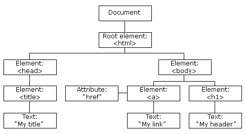

# Index

- [Intro](#intro)
  - [Variables](#variables)
  - [Operators](#operators)
  - [Objects](#objects)
  - [Array](#array)
  - [Scopes](#scopes)
  - [Hoisting](#hoisting)
  - [this keyword](#this-keyword)
  - [Class](#class)
  - [JSON](#json)
  - [Object](#object)
  - [Functions](#functions)
  - [Closures](#closures)
  - [Promises](#promises)
  - [Async and Await](#async-and-await)
  - [Event loop](#event-loop)
  - [DOM (Document Object Model)](#dom-document-object-model)
  - [Browser Object Model (BOM)](#browser-object-model-bom)
  - [Cookies](#cookies)
  - [Local and session storage](#local-and-session-storage)
  - [Fetch API](#fetch-api)
  - [AJAX](#ajax)
  - [XML](#xml)
  - [Web security](#web-security)
- [TypeScript](#typescript)


# Intro


## Variables

| var | let | const |
| --- | --- | --- |
| functional or global scope | block scope | block scope |
| updated | updated | cannot update |
| re-declared in the same scope | cannot be redeclared in the same scope | cannot be redeclared in any scope |
| can be declared without initialization | can be declared without initialization | cannot be declared without initialization |
| can be accessed without initialization as its default value is "undefined" | cannot be accessed without initialization | cannot be accessed without initialization |
| hoisted | These variables are hoisted but stay in the temporal dead zone until the initialization | These variables are hoisted but stays in the temporal dead zone until the initialization |

undefined- A variable has been declared but has not been assigned a value.

null- A variable has been explicitly set to no value.


## Operators

\== check value only

\=== check value and type


## Objects

collection of key-value pairs used to store and organize data


## Array

forEach()

```javascript
nums.forEach((num, index) => {
  console.log(`Index ${index}: ${num}`);
});
```

map()

```javascript
const doubled = nums.map(num => num * 2);
```

reduce()

```javascript
const sum = nums.reduce((acc, num) => acc + num, 0);
```

filter()

```javascript
const evens = nums.filter(num => num % 2 === 0);
```


## Scopes

- Global- Variables declared outside any function or block — accessible everywhere
- Function- Variables declared inside a function — accessible only inside that function
- Block- Variables declared with let or const inside {} — accessible only inside that block


## Hoisting

- JavaScript's default behavior of moving variable and function declarations to the top of their scope before the code is executed
- var is fully hoisted with undefined. let and const are hoisted but not initialized
- JavaScript only hoists declarations, not initializations


## this keyword

- this keyword refers to an object
- In an object method, this refers to the object.
- Alone, this refers to the global object.
- In a function, this refers to the global object.
- In a function, in strict mode, this is undefined.
- With arrow functions the this keyword always represents the object that defined the arrow function
- In an event, this refers to the element that received the event.
- Methods like call(), apply(), and bind() can refer to any object.


## Class

```javascript
class Car {
  constructor(brand) {
    this.carname = brand;
  }
  present() {
    return 'I have a ' + this.carname;
  }
}

class Model extends Car {
  constructor(brand, mod) {
    super(brand);
    this.model = mod;
  }
  show() {
    return this.present() + ', it is a ' + this.model;
  }
}

let myCar = new Model("Ford", "Mustang");
```


## JSON

- JavaScript Object Notation
- lightweight data interchange format


## Object

Prototype

- object from which other objects inherit properties and methods
- Every JavaScript object has a prototype from which it can inherit methods and properties.


## Functions

all functions are object methods.

Self-Invoking functions/ Immediately Invoked Function Expression (IIFE)

- a function that defines itself (function expression) and executes immediately after it's defined

```javascript
(function () {
  console.log("This runs immediately!");
})();
```

call()

- call a function with a specific this context and pass arguments individually

```javascript
const person = {
  fullName: function(city, country) {
    return this.firstName + " " + this.lastName + "," + city + "," + country;
  }
}

const person1 = {
  firstName:"John",
  lastName: "Doe"
}

person.fullName.call(person1, "Oslo", "Norway");
```

apply()

- same as call(), arguments are taken as array

```javascript
func.apply(thisArg, [arg1, arg2, ...]);
```

bind()

- creates a new function with a fixed this value
- it does not call the function immediately — it returns a copy you can call later

```javascript
const person = {
  fullName: function(city, country) {
    return this.firstName + " " + this.lastName + ", " + city + ", " + country;
  }
};

const person1 = {
  firstName: "John",
  lastName: "Doe"
};

// Create a new bound function
const boundFullName = person.fullName.bind(person1);

// Call the bound function later with arguments
const result = boundFullName("Oslo", "Norway");
console.log(result); // John Doe, Oslo, Norway
```


## Closures

- function that remembers variables from the outer (enclosing) scope, even after that outer function has finished executing

```javascript
function outer() {
  let count = 0;
  // Inner() is a closure. It "remembers" count from the outer() function.
  return function inner() {
    count++;
    console.log("Count:", count);
  };
}

const counter = outer();
counter(); // Count: 1
counter(); // Count: 2
```

Callbacks- function passed as an argument to another function.


## Promises

- object that holds the future value of an asynchronous operation
- represents the eventual result (or failure) of an asynchronous operation
- 3 states- pending, fulfilled, rejected

```javascript
function asyncTask(success = true) {
  return new Promise((resolve, reject) => {
    setTimeout(() => {
      if (success) resolve("✅ Task completed!");
      else reject("❌ Task failed!");
    }, 500);
  });
}

asyncTask(true)
  .then(msg => console.log(msg))
  .catch(err => console.error(err));
```


## Async and Await

- async- Declares an asynchronous function and returns a promise
- await- Used inside an async function. Pauses execution until the Promise is resolved or rejected. Returns the resolved value of the Promise.


## Event loop

- allows non-blocking, asynchronous operations to run efficiently on a single-threaded environment
- continuously monitors the call stack and task queues, and transfers functions into the stack when it's empty — enabling asynchronous behavior in JavaScript

Components

- Call Stack- A stack (LIFO) that keeps track of function calls. Executes one function at a time (synchronously).
- Web APIs / Browser APIs- Handle asynchronous operations such as setTimeout(), fetch(), DOM events, event listeners
- Callback Queue (Task Queue)- Stores callbacks from Web APIs. The event loop moves them into the call stack only when it’s empty.
- Microtask Queue- Stores microtasks like Promises. Has higher priority than the callback queue

Working

- JavaScript starts executing synchronous code → functions go to the call stack.
- If an asynchronous function is encountered (like setTimeout). It is offloaded to a Web API.
- Once the async operation finishes:
  - Its callback is added to a queue:
  - Microtask queue for promises
  - Callback queue for timers, DOM events
- When the call stack is empty, the event loop:
  - First empties the microtask queue
  - Then takes one item from the callback queue
- The cycle repeats infinitely — that’s why it’s called an event loop


## DOM (Document Object Model)

structure of a web page as a tree of objects, where each element, attribute, and piece of text is a node in that tree



| Method | Description |
| --- | --- |
| `getElementById(id)` | Returns the element that has the ID attribute with the specified value |
| `getElementsByClassName(class)` | Returns a live HTMLCollection of all elements with the specified class name. |
| `getElementsByTagName(tag)` | Returns a live HTMLCollection of elements with the given tag name |
| `querySelector(selector)` | Returns the first element that matches the specified CSS selector(s) |
| `querySelectorAll(selector)` | Returns a static NodeList of all elements matching the CSS selector(s) |
| `createElement(tag)` | Creates a new element node with the given tag name |
| `appendChild(node)` | Appends a node as the last child of a parent node |
| `removeChild(node)` | Removes a child node from the DOM and returns the removed node |
| `addEventListener(type, listener)` | Attaches an event handler to an element. |
| `removeEventListener(type, listener)` | Removes an event handler that was added with addEventListener |
| `submit()` | Submits a form programmatically |
| `preventDefault()` | Prevents the default action of an event. Often used in event handling |
| `stopPropagation()` | Prevents the event from bubbling up to parent elements |


## Browser Object Model (BOM)

provides access to browser-specific objects that allow JavaScript to interact with the web browser itself, outside the content of the web page

| Method | Description |
| --- | --- |
| `window` | The top-level object in the BOM, representing the browser window/tab |
| `screen` | Contains info about the user's screen (width, height, color depth, etc) |
| `location` | Contains the URL of the current page, allows URL navigation |
| `history` | Allows navigation through the browser's session history (back/forward) |
| `setTimeout()` | Executes a function after a specified delay |
| `setInterval()` | Executes a function repeatedly at specified intervals |


## Cookies

key-value pair stored in the browser and sent to the server with every HTTP request

```javascript
document.cookie = "username=John; expires=Fri, 31 Dec 2025 23:59:59 UTC; path=/";
```

Attributes

- expires- when the cookie should expire
- path- URL path where the cookie is accessible
- domain- Specifies the domain the cookie belongs to
- secure- Makes sure the cookie is only sent over secure HTTPS connections
- SameSite- Controls whether the cookie is sent along with cross-site requests. Prevents CSRF


## Local and session storage

Local storage- Stores data permanently in the browser

Session storage- Stores data temporarily in the browser


## Fetch API

make HTTP requests (like GET, POST, PUT, DELETE) from the browser using JavaScript

```javascript
async function getPost() {
  try {
    const response = await fetch('https://jsonplaceholder.typicode.com/posts/1');
    const data = await response.json();
    console.log(data);
  } catch (error) {
    console.error('Error:', error);
  }
}

getPost();
```


## AJAX

- Asynchronous JavaScript and XML
- technique used in web development to send and receive data from a server without reloading the entire webpage.
- Sends requests to the server in the background. Receives data (like JSON, HTML, XML). Updates only part of the web page without a full reload


## XML

- eXtensible Markup Language
- designed to store and transport data in a structured, readable, and platform-independent format
- used in SOAP APIs

```xml
<user>
  <name>John</name>
  <age>24</age>
  <email>john.doe@example.com</email>
</user>
```


## Web security

Cross-Site Scripting (XSS)

- allows an attacker to inject malicious scripts (usually JavaScript) into a website
- These scripts are then executed in the browser of users who visit the affected page
- Working
  - Attacker finds a place to inject script (e.g. comment box, form, URL).
  - The app fails to sanitize user input.
  - The script is stored or reflected back in the web page.
  - When a victim loads the page, the malicious script runs in their browser.

Cross-Site Request Forgery (CSRF)

- malicious website tricks a user's browser into performing actions on another site where the user is already authenticated — without their knowledge or consent
- Working
  - Victim logs into trusted-site.com
  - Session cookie is saved in browser
  - Attacker tricks the victim into making a request (via \, \<form>, or JavaScript)
  - The request is automatically sent with the victim’s cookies
  - Server trusts the request, thinking it’s from the real user

Man-in-the-Middle (MitM) Attacks

- attackers intercept communication between two parties such as users and servers
- use HTTPS and avoid public wifi


# TypeScript

- superset of JavaScript that adds static typing to the language
