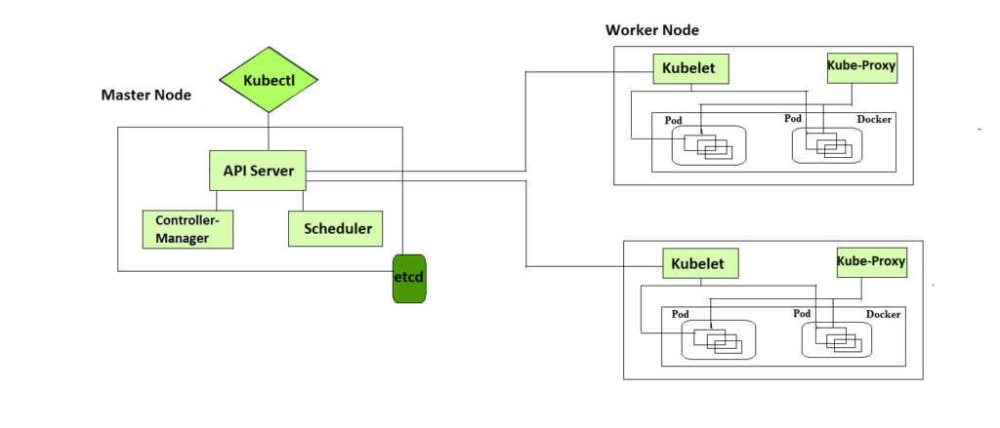
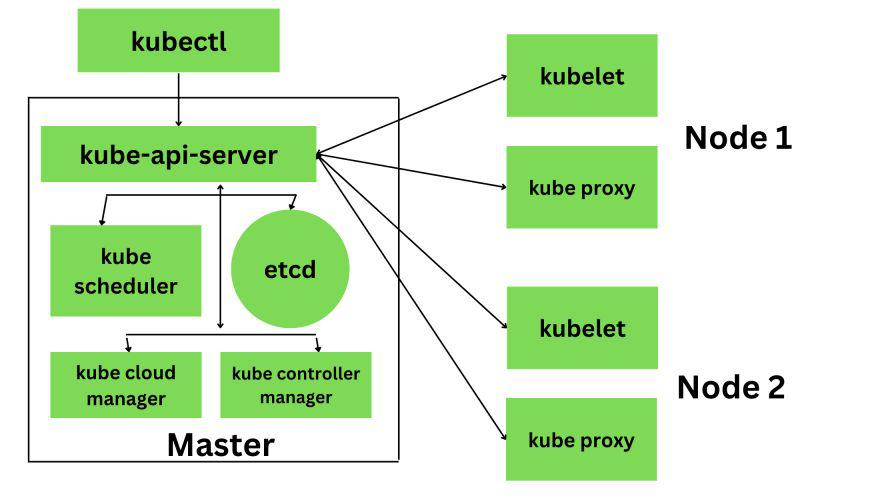

# Intro

K8- container orchestration platform designed to automate deployment, scaling, and management of containerized applications

Components

- Pod
  - A Pod is the smallest unit you can deploy in Kubernetes.
  - It wraps one or more containers that need to run together, sharing the same network and storage.
  - Containers inside a Pod can easily communicate and work as a single unit.
- Node
  - A physical or virtual machine that runs pods.
  - Each Node contains the tools needed to run Pods, including the container runtime (like Docker), the Kubelet (agent), and the Kube proxy (networking).
- Cluster
  - A group of nodes managed together
  - 2 types:
    - 1\. Master node (Control Plane)- brain of the cluster. It makes decisions, like where to run applications, handles scheduling, and keeps track of everything.
    - 2\. Worker nodes- machines that actually run your apps inside containers
- Deployment
  - object used to manage a set of Pods
  - Manages replica pods, rolling updates, rollback
- Service
  - Stable endpoint to access pods (via DNS name)
  - a way to connect applications running inside your cluster
  - Types
    - ClusterIP- exposes the node within the cluster
    - NodePort- exposes the node outside the cluster
    - LoadBalancer- exposes the node outside the cluster via cloud provider LB. Maps the external IP to the service and forwards traffic to NodePorts.
- Ingress
  - way to manage external access to your services in a Kubernetes cluster.
  - It provides HTTP and HTTPS routing to your services, acting as a reverse proxy
- ConfigMap
  - stores configuration settings
- Secret
  - store sensitive information
- Persistent Volume (PV)
  - Persistent storage for pods in the cluster
  - it doesn’t get deleted when a Pod is removed or restarted
- Namespace
  - Isolated environment within a cluster
- Kubelet
  - runs on each Worker Node and ensures Pods are running as expected
- Kube-proxy
  - manages networking inside the cluster, ensuring different Pods can communicate


## Architecture



### Control Plane Components

Control Plane (brain of the cluster)

1\. API server- Entry point (via kubectl, UI, etc.), validates and exposes K8s API

2\. Scheduler- Decides which pod runs on which node (based on resources, constraints)

3\. Controller Manager- Reconciles desired state with current state (e.g., ensures replicas)

4\. etcd- Distributed key-value store database for all cluster data

### Node Components

nodes where the actual work happens. Each Node can have multiple pods and pods have containers running inside them

1\. Container Runtime- A container runtime is needed to run the application containers running on pods inside a pod (eg Docker)

2\. kubelet- interacts with both the container runtime as well as the Node. It is the process responsible for starting a pod with a container inside

3\. kube-proxy- forwarding the request from Services to the pods




## Helm Chart

package manager for k8

Commands

| Method | Description |
| --- | --- |
| `helm repo add <name> <url>` | Add a chart repo |
| `helm repo update` | Update chart repo |
| `helm install <release-name> <chart-name>` | Install a chart |
| `helm status <release-name>` | See release details |
| `helm upgrade <name> <chart> -f values.yaml` | Upgrade release |
| `helm rollback <release-name> <revision>` | Rollback release |
| `helm uninstall <release-name>` | Uninstall release |
| `helm push <chart.tgz> oci://<repo-url>` | Push to repo (OCI) |


## Example Code

```yaml
# =============================
# 📁 Chart.yaml
# =============================
apiVersion: v2
name: nodejs-app
description: A Node.js app connected to MySQL RDS
type: application
version: 1.0.0
appVersion: "1.0"

---

# =============================
# 📁 values.yaml
# =============================

replicaCount: 2

image:
  repository: myregistry/my-node-app
  tag: latest
  pullPolicy: IfNotPresent

service:
  type: ClusterIP
  port: 3000

env:
  DB_HOST: my-rds-endpoint.rds.amazonaws.com
  DB_PORT: 3306
  DB_NAME: mydb
  DB_USER: myuser

secret:
  DB_PASSWORD: mysecretpassword

resources:
  limits:
    cpu: "500m"
    memory: "256Mi"
  requests:
    cpu: "250m"
    memory: "128Mi"

---

# =============================
# 📁 templates/deployment.yaml
# =============================

apiVersion: apps/v1
kind: Deployment
metadata:
  name: {{ include "nodejs-app.fullname" . }}
  labels:
    app: {{ include "nodejs-app.name" . }}
spec:
  replicas: {{ .Values.replicaCount }}
  selector:
    matchLabels:
      app: {{ include "nodejs-app.name" . }}
  template:
    metadata:
      labels:
        app: {{ include "nodejs-app.name" . }}
    spec:
      containers:
        - name: nodejs-app
          image: "{{ .Values.image.repository }}:{{ .Values.image.tag }}"
          imagePullPolicy: {{ .Values.image.pullPolicy }}
          ports:
            - containerPort: {{ .Values.service.port }}
          env:
            - name: DB_HOST
              value: {{ .Values.env.DB_HOST }}
            - name: DB_PORT
              value: "{{ .Values.env.DB_PORT }}"
            - name: DB_NAME
              value: {{ .Values.env.DB_NAME }}
            - name: DB_USER
              value: {{ .Values.env.DB_USER }}
            - name: DB_PASSWORD
              valueFrom:
                secretKeyRef:
                  name: {{ include "nodejs-app.fullname" . }}-secret
                  key: DB_PASSWORD
          resources:
            {{- toYaml .Values.resources | nindent 12 }}

---

# =============================
# 📁 templates/service.yaml
# =============================

apiVersion: v1
kind: Service
metadata:
  name: {{ include "nodejs-app.fullname" . }}
spec:
  type: {{ .Values.service.type }}
  selector:
    app: {{ include "nodejs-app.name" . }}
  ports:
    - port: {{ .Values.service.port }}
      targetPort: {{ .Values.service.port }}

---

# =============================
# 📁 templates/secret.yaml
# =============================

apiVersion: v1
kind: Secret
metadata:
  name: {{ include "nodejs-app.fullname" . }}-secret
type: Opaque
stringData:
  DB_PASSWORD: {{ .Values.secret.DB_PASSWORD }}

---

# =============================
# 📁 templates/configmap.yaml (optional)
# =============================

apiVersion: v1
kind: ConfigMap
metadata:
  name: {{ include "nodejs-app.fullname" . }}-config
data:
  APP_ENV: "production"
  LOG_LEVEL: "info"
```
